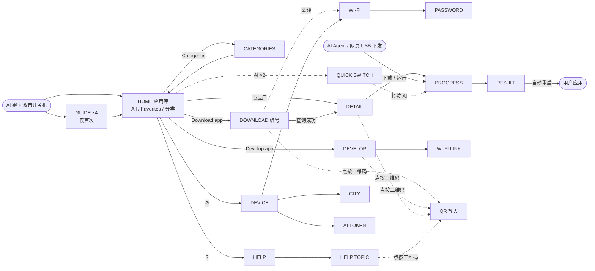

# Vibe Mode 0.3 界面设计与功能定义（阶段 A · 第 2 版）

| 项目 | 内容 |
| --- | --- |
| 状态 | 设计评审稿第 2 版（按 2026-10-11 评审意见修订），**尚未实现**；本目录不改变任何固件行为 |
| 范围 | Vibe Mode 界面重设计、交互规范与功能定义；固件实现属于阶段 B，待本稿确认后进行 |
| 语言 | 本轮只设计英文界面；英文确认后再做中文文案与语言切换（第 14 节） |
| 页面图 | `mockups/`：37 个页面状态，由布局数据渲染的**近似设计图**（含屏幕圆角遮罩），不是 GSP 模拟器或真机截图 |
| 原型 | `prototype/index.html`：可直接用浏览器打开的可交互原型，与页面图使用同一份 `layout.json` |
| 布局数据 | `layout.json`（机器可读）与 [`layout-tables.md`](layout-tables.md)（逐页坐标表） |


## 第 2 版修订

| 评审意见 | 修改 | 查看 |
| --- | --- | --- |
| 1. 按键位置与颜色不对 | 按产品照片重画：奶白机身、黑色大圆角屏幕、**橙色 AI 键在顶边右侧**、底边左右两个浅灰键（右侧为开关机键）。引导页示意图、原型外框、屏幕上的 AI 指示条位置同步修改；首页状态行沿用设备状态栏的 Wi‑Fi、机器人、电池图标顺序 | `guide-2`、原型 |
| 2. 二维码白边太多、小屏难识别 | 静区由 4 模块改为 2 模块，纠错改 L，模块放大到 5–6 px；去掉白色卡片。码面占白底面积由 36% 提升到 77%；**任意二维码点按放大到 12 px 模块（396 px）**。模拟扫描：同一距离下识别率由 40% 提升到 98%（第 6.5 节） | `download`、`qr-full` |
| 3. 应用商店已有同事在开发 | 第 9 节改为“设备端对接需求”，接口细节以商店团队为准；原契约降为示例草案 | 第 9 节 |
| 4. 不需要设备密钥；Wi‑Fi、城市、大模型 token 开放给所有应用 | 设备页新增 “SHARED WITH APPS”：Wi‑Fi、City、AI token，可编辑；所有应用只读访问；设备密钥取消；标注 token 被所有应用读取的风险 | `device`、`city`、`token`、第 11 节 |
| 5. 出厂约 20 个应用；分类查找；收藏 | 20 个官方示例应用，分类采用 Mosaico Ideas 的 6 个项目分类；首页 All / Favorites / Categories 筛选，大标题随筛选变化；分类页 2×4 图块；详情页 ☆ 收藏；快速切换遍历当前列表 | `home*`、`categories`、`detail-*` |
| 6. 添加应用拆为下载与开发；保留 AI Agent / 网页有线下载 | 首页底部 **Download app** 与 **Develop app** 两个入口。开发页：vibe coding 指南二维码（https://mosaico.espressif.com/guide/vibe-coding/）、三步说明（Vibe-code → USB 有线安装 → 分享到 Mosaico Ideas）、USB 与连接状态；Agent 与网页有线安装照常显示进度 | `develop`、`wifi-link`、`progress-agent` |
| 7. 应用简介要有二维码，扫码看详细说明 | 详情页左侧为该应用在 Mosaico Ideas 页面的二维码，右侧为商店简介，可点按放大 | `detail-*`、`qr-full` |

另外两项预算相关调整：字号收敛为 Doto 5 档、Noto 8 档（字形位图估计由约 277 KiB 降到约 150 KiB）；引导页设备
示意改用容器绘制，不再嵌入 200×200 位图（约 120 KB）。

## 1. Vibe Mode 是什么

Vibe Mode 是 ESP-Mosaico 常驻的第三级引导层：ROM → 二级 bootloader → **Vibe Mode**（`vibe_mode` test
分区）→ 用户应用。应用崩溃、被覆盖或用户想换应用时，总能回到这里。它服务四件事：

1. **AI Agent 部署的落点**。Agent（或网页）通过 USB 数据线（`mosaico.py` + ESP-Iris）构建并下发应用时，屏幕显示
   连接状态、传输与校验进度、成功或失败，而不是黑屏。没有嵌入式经验的 DIY 用户也看得懂设备在做什么。
2. **应用库与切换**。NAND 中保存多款应用（出厂约 20 个官方应用），按分类和收藏查找，选中即写入 Flash 运行。
3. **下载与分享**。每个应用有一个数字编号；在设备上输入编号即可从 Mosaico Ideas 下载，告诉别人编号就能分享。
4. **开发入门**。告诉新用户如何用 AI Agent vibe coding、用数据线烧录，并把作品分享到 Mosaico Ideas。

这对多数用户是新概念，所以设计包含首次引导、各页 ? 帮助（扫码看官网文档），并把顶部 AI 键变成实体交互
（返回、快速切换）。首页从“状态卡 + 一排按钮”改为“状态 + 应用库 + 下载 / 开发两个入口”。

## 2. 需求对应与已确认决策

| 需求 | 设计决策 |
| --- | --- |
| UI 重设计，保持 Nothing 风格，加图标提示 | 纯黑底、点阵大标题、白色胶囊主按钮、唯一强调色、24 网格线性图标（第 6 节） |
| 共享信息只读；修改只写本地私有副本；本地缺失时从 Vibe 端 NVS 同步 | “Web 端”即“Vibe 端”。共享项改为 Wi‑Fi、所在城市、大模型 token，**所有应用可读**，只有 Vibe Mode 可改；设备密钥取消（第 11 节） |
| 出厂预置约 20 个应用；云端下载存 NAND；选择后写 Flash 运行 | 应用库 = `/nand/apps/<编号>/`；运行走现有 NAND System Update 后端（第 10 节） |
| 分类查找、收藏 | 分类沿用 Mosaico Ideas 的 6 个项目分类；收藏存 `sysmeta`（F19） |
| 扫码到 Mosaico Ideas 选应用，输入编号下载 | 下载页左侧二维码、右侧数字键盘；查询后**显示一次确认**再下载（已确认） |
| 下载与开发分开；保留 AI Agent / 网页有线下载 | 首页两个入口；开发页讲清 vibe coding、USB 烧录与分享（F20） |
| 应用简介带二维码 | 详情页显示本应用 Mosaico Ideas 页面二维码 + 简介（F3、F21） |
| 编号不定长、默认 6 位、号段服务端管控、官方专属号段 | 设备只校验“纯数字”，官方标记与排序依据服务端返回字段（F11） |
| 取消配对与 Bridge 隔离，设备直连应用商店 | 商店由其他同事开发；第 9 节列出设备端对接需求；Bridge 配对页与 TCP pairing 独立页取消 |
| 同编号拉最新版并覆盖旧版；下载时上传 MAC 与设备版本 | 请求携带 `mac`、`device_version`；本地同编号原子替换（第 9、10 节） |
| 不为 NAND 损坏做兼容；风险只在商店侧提示 | 挂载失败只提示“存储不可用”，不格式化；设备不显示风险提示（F14） |
| 2 MB 限制不变；固定列表 + 基础动效；固定取模双语 | 只用 GSP 1.4.0 基础控件；列表原生滚动 + 页面短距离滑入；字体子集化 + 字号阶梯（第 12 节） |
| 出厂首次启动后台自动下载预置编号 | 联网后后台逐个检查并下载最新版、只下载不安装（F9） |
| 帮助入口、引导页、AI 键参与交互 | 按主题多个帮助二维码、仅首次显示引导、AI 键“单击返回 · 双击切换”（已确认） |

进入 Vibe Mode 的操作（已确认）：**设备开机状态下按住顶部右侧的 AI 键，双击底部右侧开关机键使设备重启，看到
Vibe Mode 画面后再松开 AI 键**。bootloader 在复位时检测 AI 键（GPIO7）是否按住，与此一致。

## 3. 功能定义

| 编号 | 功能 | 定义 |
| --- | --- | --- |
| F0 | AI Agent 部署状态 | 首页状态行机器人图标：橙色 = Iris 会话已建立，灰色 = 未连接；连接建立时横幅 “AI agent connected”；开发页显示 USB 数据线与连接状态。Agent 或网页发起 App Update / System Update 时自动进入进度页，来源字样为 “FROM YOUR AI AGENT · USB”、“FROM THE WEBSITE · USB”（主机在会话中声明身份时）、“FROM YOUR COMPUTER · USB”（无法区分时）或 “FROM YOUR AI AGENT · WI-FI”；完成后结果页显示 “Restarting into your app…” 并自动重启进入新应用；失败页给出原因与 ? 帮助。 |
| F1 | 应用库（首页） | 状态行：`● VIBE MODE`、预置下载进度 `↓ 3/20`（仅下载时）、Wi‑Fi / AI Agent / 电量三个图标（与设备自带状态栏同序）、? 帮助、⚙ 设备。大标题随筛选变化（`MY APPS`、`FAVORITES` 或分类名），右侧橙色点阵数字为当前列表数量。筛选胶囊：All / ☆ Favorites / ▦ Categories（选中分类后显示分类名）。列表每行：首字母点阵图块（收藏时右上角橙色 ★）、名称、`分类 · 编号`、`● CURRENT`（`ota_0` 中正在使用的应用）、社区应用标 `COMMUNITY`（预置应用多为官方，只标例外）、箭头。排序：官方在前，其后按编号数值升序。底部：**Download app**（白色主按钮）与 **Develop app**（描边按钮）。空状态分全部 / 收藏 / 分类三种。NAND 不可用时列表区显示 “Storage unavailable”，Download app 置灰。上次使用的筛选存 `sysmeta`，下次进入保持。 |
| F2 | 下载应用 | 左列：Mosaico Ideas 二维码（6 px 模块，198 px，点按放大）、“Scan to browse apps”、域名、放大提示、两步说明。右列：编号显示（默认 6 个点位，最多 16 位，超过 8 位改用紧凑字号）、状态行、3×4 键盘（⌫ 删除、长按清空，橙色 → 查询）。查询中显示 “Looking up…”；错误用橙色行内提示（第 8 节）。离线时进入 Wi‑Fi 页，副标题提示 “Connect to continue your download”，连上后自动回到下载页继续查询。查询成功进入详情页（一次确认）。 |
| F3 | 应用详情 | 页头：返回、`APP`、副标题（Saved on this device / On Mosaico Ideas）、收藏键（☆/★，仅本地应用）、?。上部：64 px 首字母图块、名称、橙色点阵编号、版本与大小。左下：**本应用 Mosaico Ideas 页面的二维码**（5 px 模块，165 px，点按放大）；右侧：商店简介（ASCII，≤ 120 字符，最多 4 行）、`分类 · Official/Community`、状态、“Scan for the full description”。本地应用：Open（当前应用，直接重启进入，不重写 Flash）/ Run this app（从 NAND 写入后运行）、Update（同编号查询最新版）、Delete（4 秒内再次点击 “Tap again to delete” 才删除；安装或下载中禁止）。商店查询结果：Download & run（主）、Download only、Cancel；本机已有旧版时状态显示 “Update · v1.0.0 → v1.1.0”，已是最新版时直接打开本地详情。 |
| F4 | 进度 | 同一页面承接四种来源：AI Agent / 网页（USB）、Agent（Wi‑Fi link）、Mosaico Ideas 下载、本地应用库写入。显示来源字样、标题、应用名与版本、点阵大百分比、进度条、已传输/总大小、速率、步骤（“Step 1 of 2 · Receiving”“File 2 of 3”）。下载阶段可取消；写 Flash 阶段不可取消、AI 键无效。始终提示 “Keep the device powered”。 |
| F5 | 结果 | 成功：橙色圆环 + 对勾；“App installed” 后自动重启进入应用；“Saved to My Apps” 提供 Open now 与 Done。失败：灰色圆环 + 叉、可读原因、Try again 与 Done、右上 ? 直达 Troubleshooting。 |
| F6 | Wi‑Fi | 副标题 “Apps use this network too”（Wi‑Fi 是共享信息）。当前连接卡（名称、IP、Forget）、“NETWORKS · n” 与 Scan、网络列表（名称、Secured/Open、Strong/Good/Weak signal）。开放网络直接连接，加密网络进入密码页。 |
| F7 | 密码 | 副标题为网络名；密码卡显示圆点或明文（眼睛按钮切换）；错误行（“Use at least 8 characters”“Wrong password. Try again.”）；原生键盘几何与 0.2 一致；最多 64 字符；离开页面清除输入。 |
| F8 | 设备页 | `SHARED WITH APPS`：Wi‑Fi、City、AI token 三行，可进入编辑，下方说明 “Every app can read these. Only Vibe Mode can change them.”；`THIS DEVICE`：Vibe Mode 版本、MAC 地址、应用存储（数量与已用空间）；底部 “App downloads send this device's MAC and version.”。原 Developer 区（Wi‑Fi link 端点与配对 token）移到开发页。 |
| F9 | 出厂预置 | 出厂时 NAND 预写约 20 个官方应用（与下载相同的目录布局，`source: "factory"`，覆盖 6 个分类）。预置编号列表来自构建配置：首次联网后后台逐个检查并下载最新版（只下载不安装），状态行显示 `↓ k/n`；完成集合存 `sysmeta`；用户删除的预置应用不会被再次自动下载；用户操作优先，预置任务让路后重试。 |
| F10 | 共享信息 | Wi‑Fi、所在城市、大模型 token 由 Vibe Mode 存于 `sysmeta`，**所有应用可读**，只有 Vibe Mode 可改。应用本地无配置时读取 Vibe 端；应用自己的修改只写入其 `nvs` 分区的私有副本。Iris TCP 配对 token 不开放。设备密钥在新版本中取消。详见第 11 节。 |
| F11 | 编号规则 | 纯数字、不定长（默认 6 位），界面缓冲 16 位；号段由服务端分配与扩容；官方/社区由服务端 `official` 字段决定；设备以服务端返回的规范化编号作为本地目录名。 |
| F12 | 商店对接 | 商店（Mosaico Ideas）由其他同事开发。设备直连、无配对、无会话；第 9 节列出设备端需求。 |
| F13 | 版本与统计 | 同编号总是拉取最新版；下载完成后原子替换本地同编号旧版；不提供旧版本选择；每次查询上传 MAC 与 Vibe Mode 版本。 |
| F14 | 风险与兼容 | 存储破坏风险只在商店网页提示；设备不额外提示，不为用户自行导致的 NAND 损坏做兼容；挂载失败不格式化。 |
| F15 | 资源约束 | 2 MB 限制不变；字号阶梯与图标格式见第 6、12 节。 |
| F16 | 首次引导 | 仅首次进入显示 4 页：① 什么是 Vibe Mode ② 如何回到这里（机身示意：顶边右侧 AI 键、底边右侧开关机键，三步说明）③ 两种获取方式（Download / Develop）与收藏提示 ④ AI 键与 ? 帮助。可 Skip；点阵页码；完成标记存 `sysmeta`；帮助页 Replay guide 可重看。 |
| F17 | 帮助 | 各页右上 ? 打开帮助。主题：Getting started、Develop apps（vibe coding 指南）、App IDs & sharing、Troubleshooting；每个主题页有独立二维码、网址与 3 条要点。带上下文的 ? 直达相关主题（下载页与详情页 → App IDs；Wi‑Fi、设备与失败页 → Troubleshooting；分类页 → Getting started；首页与开发页 → 主题列表）。 |
| F18 | AI 键 | 见第 5 节；快速切换遍历当前首页列表（全部、收藏或某个分类）。 |
| F19 | 分类与收藏 | 分类为 Mosaico Ideas 的 6 个项目分类（`display`、`audio`、`smart-home`、`sensors`、`communication`、`motor`，见 `mosaico-tools/mosaico-ideas.schema.json`），由商店随应用返回；一个应用最多 6 个分类，任一分类匹配即出现在该分类下，列表行显示第一个；未知分类归入 Other（有此类应用时才出现）。分类页为 2×4 图块（All apps、Favorites、6 个分类），每块有图标与数量，当前选中项橙色描边，点按后回到首页并筛选。收藏：详情页 ☆/★ 切换并横幅提示，收藏编号列表存 `sysmeta`；删除应用时同时移除收藏。 |
| F20 | 开发应用 | 开发页：vibe coding 指南二维码（5 px 模块，点按放大）与三步说明——① Vibe-code it：让 AI Agent 写代码；② Install over USB：插上数据线，由 Agent 或网页有线安装，屏幕显示进度；③ Share on Mosaico Ideas：发布后获得编号，任何人可下载。下方状态卡：USB data cable（Plugged in / Not plugged in）、AI agent or website（Connected / Waiting）、Wi‑Fi link（端点，点按进入子页查看地址与配对 token）。有线安装路径（`mosaico.py` / ESP-Iris / 网页）与 0.2 相同，不改协议。 |
| F21 | 二维码 | 所有二维码由设备运行时从 URL 生成：版本 3、ECC L、2 模块静区、黑码白底、整数倍模块尺寸。下载页与帮助主题页 6 px（198 px），详情页与开发页 5 px（165 px），放大页 12 px（396 px）。点按任意二维码进入全屏放大页（下方显示标题与网址），点按任意处或按 AI 键返回。URL 不超过 53 字节时保持版本 3；更长时自动升版本并减小模块，但不小于 4 px。 |

文案原则：面向无嵌入式经验的用户，主路径不出现 System Update、组件、SHA-256 等术语；开发细节集中在开发页
与 Wi‑Fi link 子页。

## 4. 页面地图与关键流程



1. **首次进入**：引导 4 页 → Start → 首页。
2. **AI Agent / 网页有线部署**：插上数据线，Agent 连接后机器人图标变橙并提示 “AI agent connected” → Agent 发起更新 →
   进度页 “FROM YOUR AI AGENT · USB” → 结果页 → 自动重启进入应用。
3. **按编号下载并运行**：首页 Download app → 输入 238114 → → → 详情（Retro Snake · Community · Not on this device）→
   Download & run → 下载进度（可取消）→ 写入进度 → App installed → 重启进入应用。
4. **离线续接**：下载页点 → 时未联网 → Wi‑Fi 页（副标题提示续接）→ 选网络、输入密码 → 连上后自动回到下载页继续查询。
5. **找应用**：首页点 Favorites 或 Categories → 选分类 → 列表与大标题随之变化 → 点应用；或双击 AI 在当前列表里快速切换，
   长按 AI 1 秒打开。
6. **收藏**：详情页点 ☆ → 变为橙色 ★ 并提示 “Added to Favorites” → 首页 Favorites 可见，行图块右上角显示 ★。
7. **看应用的详细说明**：详情页点二维码 → 全屏放大 → 手机扫码打开该应用的 Mosaico Ideas 页面。
8. **开发**：首页 Develop app → 扫码打开 vibe coding 指南 → 在电脑上与 AI Agent 开发 → 插数据线安装（流程 2）→
   上传到 Mosaico Ideas，发布后获得编号分享给别人。
9. **共享设置**：⚙ → City → 键盘输入 → GO → 提示 “City saved”；AI token 同理（默认遮挡，眼睛按钮显示，橙色提示所有
   应用可读）。
10. **打开当前应用 / 切换**：详情显示 Current app → Open → “Opening Pixel Pet”，重启进入，不重写 Flash；非当前应用
    Run this app → 写入进度 → 自动重启。
11. **更新与删除**：详情 Update → 有新版时转到 “Update · v1.0.0 → v1.1.0” 详情；已是最新版时提示 “Up to date: <name>”。
    Delete → 按钮变为橙色 “Tap again to delete”（4 秒）→ 再次点击删除 → 回到首页并提示。
12. **回到 Vibe Mode**：在应用中按住 AI 键并双击开关机键；进入后在松开 AI 键之前不识别 AI 手势。

## 5. AI 键交互规范

| 手势 | 判定 | 普通页面 | 快速切换浮层 | 引导页 | 进度页 |
| --- | --- | --- | --- | --- | --- |
| 单击 | 松开后 350 ms 内无第二次按下 | 返回上一页；首页无上一页时显示横幅 “Double-press AI to switch apps” | 关闭浮层 | 上一页 | 忽略 |
| 双击 | 两次按下间隔 ≤ 350 ms | 打开快速切换，默认选中当前列表中当前应用的下一个 | 选中下一个应用 | 下一页（第 4 页时完成） | 忽略 |
| 长按 | 按住 ≥ 1000 ms，到时立即触发 | 提示 “Double-press AI, then hold to open” | 打开选中的应用（浮层进度条随按住填满） | 无 | 忽略 |

- **列表范围**：快速切换遍历首页当前列表（全部、收藏或某个分类）；当前列表为空时提示 “No apps in this list”。
- **进入手势屏蔽**：Vibe Mode 启动时若 AI 键仍按着，在第一次松开之前不识别任何手势。
- **反馈**：屏幕顶边、物理 AI 键正下方（顶边右侧，x = 354–390）有 36×4 的 AI 指示条，平时灰色，按下或快速切换打开时
  变橙；单击在首页无处可退时显示 1.5 秒横幅。
- **触摸等价**：快速切换中点卡片打开，点卡片外关闭；所有 AI 键操作都有触摸替代路径。
- 浮层内容：`QUICK SWITCH · <列表名>`、`2/20`、大首字母图块、名称、`分类 · 编号`、长按进度条、三栏按键说明。

## 6. 硬件与视觉系统

### 6.1 硬件（按产品照片）

| 部件 | 位置与颜色 | 设计中的对应 |
| --- | --- | --- |
| 机身 | 奶白色（`#E9E2D6`） | 引导页示意、原型外框 |
| 屏幕 | 480×480，黑色，大圆角（按 40 px 估计，待结构图确认） | 布局检查保证所有可见内容在圆角内；页面图带圆角遮罩 |
| AI 键 | 机身**顶边右侧**（约 3/4 宽度），橙色 | AI 指示条位于屏幕顶边 x = 354–390；引导页标号 1 |
| 底部两键 | 底边左右（约 1/4 与 3/4），浅灰；**右侧为开关机键** | 进入手势；引导页标号 2；左键在 Vibe Mode 中无功能 |
| 设备状态栏 | 设备自带应用的状态栏：左侧时间，右侧 Wi‑Fi、机器人、电池 | 首页状态行右侧沿用同样的图标顺序；左侧显示 `VIBE MODE`（标明当前模式，且 Vibe Mode 不保证时钟已同步） |

### 6.2 颜色

唯一强调色使用 Mosaico 橙，与橙色 AI 键和 bootloader 的橙色点阵开机 Logo 呼应；只用于进度、CURRENT、收藏 ★、
查询键、成功环、AI 指示条、风险提示与连接状态。

| Token | 值 | 用途 |
| --- | --- | --- |
| background | `#000000` | 页面底色 |
| card | `#141414` | 卡片、列表行、分类图块 |
| raised | `#1E1E1E` | 键盘按键、大图块、横幅 |
| tile | `#262626` | 行内首字母图块、进度条底 |
| outline | `#3A3A3A` | 2 px 描边按钮与胶囊、AI 指示条 |
| divider | `#262626` | 卡片内分隔线 |
| text / secondary / tertiary | `#F2F2F2` / `#9A9A9A` / `#5C5C5C` | 主文字 / 次文字 / 弱文字 |
| accent | `#FF4C01` | 强调色 |
| primary | `#F2F2F2` 底、`#000000` 字 | 主按钮、选中的筛选胶囊 |

### 6.3 字体与字号阶梯

字体为 OFL 授权，子集化后入库（`assets/fonts/`）。GSP 为每个字号烘焙一份位图字库，所以全稿只用下列字号，
布局检查拒绝其他字号：

| 字体 | 字号 | 字符范围 | 用途 |
| --- | --- | --- | --- |
| Doto Black（圆点，ROND 100） | 22 / 32 / 40 / 56 / 112 | 22：数字 `/·`；32：A–Z 数字 `-`；40：A–Z 数字 `·`；56：A–Z；112：数字 `%` | 页码与数量 / 页标题与键盘数字 / 首页大标题与编号 / 大首字母 / 百分比 |
| Noto Sans SC Medium | 12 / 15 / 17 / 20 / 24 / 28 | ASCII + 少量符号 | 角标与小标题 / 标签与胶囊 / 按钮、横幅与名称 / 卡片标题 / 页面标题 / 进度与结果标题 |
| Noto Sans SC Regular | 13 / 15 | 同上 | 说明与网址 / 正文 |

行高：Doto 1.0 em，Noto 1.25 em（ascent 1000 / descent 250），GSP 标签高度按此计算。中文阶段只扩充同一 Noto
子集的字符，不换字体、不重排。DejaVuSans 不再用于 Vibe Mode。

### 6.4 图标

24 网格、圆头描边，按显示尺寸输出 PNG：返回、箭头、退格、播放、下载、刷新、删除、眼睛开/关、对勾、叉、Wi‑Fi/断开、
机器人（AI Agent）、电池（满/中/低/充电）、设置、帮助、星标（空心/实心）、代码 `</>`、分类网格、6 个分类图标（显示器、
扬声器、房屋、波形、对话框、齿轮）、位置针、钥匙、USB、芯片、ID 卡、存储、旗帜、井号、救生圈、电源、重播、放大框、
空状态点阵。不使用 SVG：GSP 的矢量图会链接光栅器并抬高渲染栈。引导页机身示意用容器绘制（`guide_device()`）。

### 6.5 二维码

| 规则 | 值 |
| --- | --- |
| 编码 | 运行时生成；版本 3（URL ≤ 53 字节），ECC L，字节模式 |
| 静区 | 2 模块（原 4 模块）；不再加白色卡片 |
| 模块尺寸 | 整数像素：下载页、帮助主题页 6 px（198 px）；详情页、开发页 5 px（165 px）；放大页 12 px（396 px） |
| 颜色 | 纯黑模块、纯白底，不反色、不加 Logo |
| 交互 | 点按放大；下方显示标题与网址；点按任意处或按 AI 键返回 |

验证（`zxing-cpp` 与 OpenCV 两种解码器；模拟手机拍摄：透视倾斜、屏幕泛光、模糊、噪声、JPEG 压缩，每组 150–200 次）：

| 对比 | 结果 |
| --- | --- |
| 静区 1 / 2 / 4 模块（码面在照片中约 90 px） | zxing 97% / 98% / 99%；OpenCV 19% / 41% / 35%。1 模块对较弱的解码器明显变差，2 模块与 4 模块相当 |
| 同一拍摄距离（整屏在照片中约 240 px）：旧设计 148 px vs 新设计 198 px vs 231 px | zxing 40% / 98% / 100%；OpenCV 4% / 30% / 67%。模块越大越好，放大页因此用 12 px |

真机扫码（不同手机、亮度与距离）留到阶段 B 验证。

### 6.6 版式与动效

外边距 16 px；页头为 48 px 圆形返回键 + 32 px 点阵标题 + 15 px 副标题 + 右上 ? 键；卡片圆角 20、列表行 60 px（间距
6）、圆角 16；筛选胶囊高 44；触控目标不小于 44 px（主要按钮 52–56 px）；底部操作区 y = 404；所有可见内容位于屏幕
圆角之内。动效只有列表原生滚动与进入页面时 48 px / 160 ms ease‑out 的短距离滑入（返回反向）。

## 7. 页面说明

逐页坐标、对象名称与动作见 [`layout-tables.md`](layout-tables.md)。

| 页面 | 状态图 | 要点 |
| --- | --- | --- |
| GUIDE ×4 | `guide-1…4` | 点阵页码、Skip、Back/Next；第 2 页机身示意标 1、2 号，右侧三步说明；第 3 页下载 / 开发两张卡片 |
| HOME | `home`、`home-favorites`、`home-category`、`home-preset`、`home-favorites-empty`、`home-empty`、`home-ai-hint` | 状态行 + 大标题 + 筛选胶囊 + 列表（3 行半，露出提示可滚动）+ 两个入口 |
| QUICK SWITCH | `quick-switch` | 黑色半透明遮罩 232/255，卡片居中，显示当前列表名 |
| CATEGORIES | `categories` | 2×4 图块；选中项橙色描边（一个描边对象移动到选中图块） |
| DOWNLOAD | `download`、`download-typing`、`download-error` | 198 px 二维码 + 键盘；错误改用橙色行 |
| DEVELOP | `develop`、`wifi-link` | 指南二维码 + 三步 + 状态卡；Wi‑Fi link 子页显示地址与配对 token |
| DETAIL | `detail-current`、`detail-local`、`detail-delete`、`detail-remote`、`detail-update` | 应用二维码 + 简介；收藏键；三个按钮固定位置 |
| QR | `qr-full` | 任意二维码放大到 396 px |
| PROGRESS | `progress-agent`、`progress-download`、`progress-install` | 来源字样橙色；112 px 点阵百分比；下载有取消按钮 |
| RESULT | `result-installed`、`result-saved`、`result-failed` | 成功橙环、失败灰环 |
| HELP / TOPIC | `help`、`help-topic` | 主题列表 + Replay guide；主题页二维码 + 要点 |
| WI-FI / PASSWORD | `wifi`、`password` | 键盘几何与 0.2 一致 |
| DEVICE / CITY / AI TOKEN | `device`、`city`、`token` | 共享设置与本机信息；输入页共用键盘布局 |

## 8. 文案（英文）

固定文案按页面列出，动态文案列出全部取值，供中文阶段对照翻译。每个取值都已按所在标签宽度测量
（`tools/build_design.py` 的 `COPY`），新增文案须加入该列表。

| 位置 | 文案 |
| --- | --- |
| 首页 | `VIBE MODE` · `MY APPS` / `FAVORITES` / `DISPLAY` / `AUDIO` / `SMART HOME` / `SENSORS` / `COMMUNICATION` / `MOTOR` · `All` · `Favorites` · `Categories`（或分类名）· `● CURRENT` · `COMMUNITY` · `<Category> · <ID>` · `↓ <k>/<n>` · `Download app` · `Develop app` |
| 首页空状态 | `No apps yet` · `Download an app by its ID, or develop your own with your AI agent.` · `No favorites yet` · `Open an app and tap ☆ to add it here.` · `Nothing here yet` · `Find more apps on Mosaico Ideas.` · `Storage unavailable` |
| 横幅 | `Double-press AI to switch apps` · `Double-press AI, then hold to open` · `No apps in this list` · `AI agent connected` · `Added to Favorites` · `Removed from Favorites` · `Deleted: <name>` · `Up to date: <name>` · `Download cancelled` · `Connect Wi-Fi to check for updates` · `Getting your preset apps` · `City saved` · `AI token saved` · `AI token cleared`（名称放在末尾，过长时省略的是名称而不是动作） |
| 快速切换 | `QUICK SWITCH · <LIST>` · `<k>/<n>` · `AI ×2` / `Next` · `Hold AI` / `Open` · `AI` / `Close` |
| 分类页 | `CATEGORIES` · `Find apps by type` · `All apps` · `Favorites` · `Display` · `Audio` · `Smart home` · `Sensors` · `Communication` · `Motor` · `Other` |
| 下载页 | `DOWNLOAD` · `Get an app by its ID` · `Scan to browse apps` · `mosaico-ideas.espressif.com` · `Tap the code to enlarge` · `Pick an app on your phone` · `Type its ID on the keypad` |
| 下载页状态 | `Enter the app ID` · `Tap → to look it up` · `Looking up…` · `Type an app ID first` |
| 下载页错误 | `No app with this ID`（不存在）· `This app was removed`（已下架）· `Not available for this device`（不兼容）· `Download not allowed`（无权限）· `Store is busy. Try again soon.`（限流/维护）· `Can't reach the store. Check Wi-Fi.`（网络/超时）· `Storage unavailable`（NAND 不可用）· `Not enough storage`（空间不足） |
| 开发页 | `DEVELOP` · `Make your own app with AI` · `Vibe-coding guide` · `Tap to enlarge` · `Vibe-code it` · `Tell your AI agent what to build. It writes the code for you.` · `Install over USB` · `Plug in a data cable, then install from your agent or the website.` · `Share on Mosaico Ideas` · `Publish it to get an app ID that anyone can download.` · `USB data cable` · `Plugged in` / `Not plugged in` · `AI agent or website` · `Connected` / `Waiting` · `Wi-Fi link` · `<ip>:<port>` / `Connect Wi-Fi first` |
| Wi‑Fi link | `WI-FI LINK` · `Install over your network` · `ADDRESS` · `TOKEN` · `Your AI agent can install apps over Wi-Fi with this address and token.` · `Keep the token private.` |
| 详情 | `APP` · `Saved on this device` · `On Mosaico Ideas` · `<Category> · Official` / `Community` · `● Current app` · `Saved · not running` · `Not on this device` · `Update · v<old> → v<new>`（两个版本合计超过 16 字符时改为 `Update available`）· `Scan for the full description` · `Open` · `Run this app` · `Update` · `Delete` · `Tap again to delete` · `Download & run` · `Download only` · `Cancel` |
| 二维码放大 | `Scan with your phone camera` · `<name> on Mosaico Ideas` · `Browse apps on Mosaico Ideas` · `Vibe-coding guide` · 帮助主题名 · 网址 |
| 进度 | `FROM YOUR AI AGENT · USB` · `FROM YOUR AI AGENT · WI-FI` · `FROM THE WEBSITE · USB` · `FROM YOUR COMPUTER · USB` · `FROM MOSAICO IDEAS` · `FROM YOUR LIBRARY` · `Installing your app` · `Downloading` · `Switching apps` · `Step 1 of 2 · Receiving` · `Step 2 of 2 · Checking` · `Step 1 of 2 · Writing` · `Step 2 of 2 · Verifying` · `File <k> of <n>` · `<a> MB of <b> MB` · `<rate> KB/s` · `Keep the device powered` · `The device restarts into the app when done` · `Cancel download` |
| 结果 | `App installed` · `Restarting into your app…` · `Saved to My Apps` · `Open it any time from My Apps.` · `Open now` · `Done` · `Couldn't download` · `Couldn't install the app` · `The connection dropped. Check Wi-Fi and try again.` · `Try again` |
| 打开当前应用 | `Opening <name>` · `Restarting into your app…` |
| 帮助 | `HELP` · `Scan a code to read the guide` · `Scan for the full guide` · `Tap to enlarge` · `Getting started`（`Enter Vibe Mode, AI key, favorites`）· `Develop apps`（`Vibe coding, USB install, sharing`）· `App IDs & sharing`（`Find, share and download apps`）· `Troubleshooting`（`Wi-Fi, failed installs, recovery`）· 每主题 3 条要点（见原型）· `Replay guide` · `All help topics` |
| 引导 | `VIBE MODE` · `A safe home for your apps` · `Coming back here` · `Hold the AI key` · `Top edge, on the right. Keep holding it.` · `Double-press power` · `Bottom edge, on the right. The device restarts.` · `Release AI` · `When the Vibe Mode screen appears.` · `Two ways to get apps` · `Download` · `Type an app ID from Mosaico Ideas, or scan to browse.` · `Develop` · `Vibe-code with your AI agent, install over USB, then share it.` · `Tap ☆ on any app to keep it in Favorites.` · `Your AI key` · `Go back` · `Switch apps` · `Open the selected app` · `Tap ? on any page for help and QR guides.` · `Skip` · `Back` · `Next` · `Start` |
| Wi‑Fi | `WI-FI` · `Apps use this network too` · `Connect to continue your download` · `Connected · <ip>` · `Not connected` · `Choose a network below` · `Connecting…` · `Forget` · `NETWORKS · <n>` · `SCANNING…` · `Scan` · `Secured` / `Open` · `Strong` / `Good` / `Weak signal` |
| 密码 | `PASSWORD` · `Type the Wi-Fi password` · `Up to 64 characters` · `Use at least 8 characters` · `Wrong password. Try again.` |
| 城市 | `CITY` · `Shared with all apps` · `Type your city` · `Apps use it for weather and local info.` · `Up to 40 characters` · `Type a city name first` |
| AI token | `AI TOKEN` · `Shared with all apps` · `Type your token` · `Every app on this device can read it.` · `Long token? Set it from your computer.` |
| 设备 | `DEVICE` · `Vibe Mode <version> · ESP32-S31` · `SHARED WITH APPS` · `Wi-Fi` · `City` · `AI token` · `Set · ends in <last 4>` / `Not set` / `Not connected` · `Every app can read these. Only Vibe Mode can change them.` · `THIS DEVICE` · `Vibe Mode` · `MAC address` · `App storage` · `<n> apps · <m> MB used` · `App downloads send this device's MAC and version.` |

## 9. Mosaico Ideas 商店对接需求

应用商店由 Mosaico Ideas 团队的同事开发，接口路径、字段名与鉴权方式**以商店团队的实现为准**。本节只列出
Vibe Mode 设备端需要商店提供的能力，便于对齐。上传侧已有工具：开发者用 `mosaico.py project upload`
（`mosaico-tools`，配置 schema `mosaico-ideas/project-upload/v1`）创建或更新草稿，审核发布后由商店分配数字编号；
开发页第 3 步与帮助主题即指向这一流程。

| 编号 | 需求 | 说明 |
| --- | --- | --- |
| R1 | 按编号查询最新版 | 设备直连 HTTPS，无会话、无配对码；同一编号永远返回最新发布版本 |
| R2 | 请求携带设备信息 | 至少 `mac` 与 `device_version`（Vibe Mode 版本），用于简单鉴权与统计；建议同时带兼容字段（`board_id`、`chip_id`、`product_contract`、`layout_id`、`recovery_abi`）供服务端判断兼容性，带 `reason`（`user` / `update` / `preset`）与本机已有版本 |
| R3 | 设备显示字段 | 规范化编号；名称（设备显示用 ASCII，≤ 31 字节）；版本；`official`；分类（6 个项目分类之一或多个）；**简介**（设备显示用 ASCII，≤ 120 字符） |
| R4 | 应用详情页地址 | 每个应用一个可公开访问的 https 页面，供详情页二维码使用；**建议提供按数字编号的短路径并保持 ≤ 53 字节**（例如占位 `https://mosaico-ideas.espressif.com/app/<id>`，最终路径由商店团队定），否则二维码升版本、模块变小 |
| R5 | 安装内容 | 与现有 `.irisfw` 相同的 System Update manifest（`esp-iris-system-update/0.2`，≤ 3 KiB、≤ 8 个组件）+ 每个组件一个 https 下载地址；大小与 SHA‑256 以 manifest 为准 |
| R6 | 可区分的错误 | 不存在、已下架、与本设备不兼容、无权限、限流或维护（带重试时间）；设备据此显示第 8 节对应文案，其他错误统一为网络错误 |
| R7 | 编号管理 | 纯数字、不定长（默认 6 位），号段与官方号段由服务端分配；设备不做号段判断 |
| R8 | 风险提示 | 第三方应用可能破坏 NAND 数据等风险只在商店网页提示，设备不重复提示 |
| R9 | 统计 | 按编号的下载与安装次数、设备版本分布（来自 R2） |

设备侧保证：TLS 证书校验；下载地址只接受 https，最多跟随 3 次重定向且仍须为 https；每个文件流式写入 NAND，
长度与 SHA‑256 不符即失败；安装时 System Update 后端仍做完整的 manifest、镜像与布局校验；名称或简介不是 ASCII
时，设备显示 `App <id>` 并隐藏简介，用户扫详情页二维码看完整说明。

<details>
<summary>示例草案（第 1 版由本稿拟定的接口，仅供与商店团队讨论）</summary>

请求：`POST /api/v1/device/apps/{app_id}/latest`，`Content-Type: application/json`，`User-Agent: esp-mosaico-vibe/<version>`。

```json
{
  "schema": "mosaico-store/device-request/1",
  "mac": "30:ed:a0:f4:60:56",
  "device_version": "0.3.0",
  "board_id": "esp-mosaico",
  "chip_id": 32,
  "product_contract": "esp-mosaico/v2",
  "layout_id": "mosaico-retained-test-2m-v2",
  "recovery_abi": 2,
  "reason": "user",
  "local_version": "1.0.0"
}
```

成功响应 200：

```json
{
  "schema": "mosaico-store/device-app/1",
  "app_id": "100006",
  "name": "Voice Notes",
  "version": "1.1.0",
  "official": true,
  "categories": ["audio"],
  "summary": "Record short voice memos and play them back any time.",
  "detail_url": "https://mosaico-ideas.espressif.com/app/100006",
  "manifest": {
    "schema": "esp-iris-system-update/0.2",
    "release": "1.1.0",
    "minimum_recovery_version": "0.2.0",
    "target": {"chip_id": 32, "flash_size": 16777216},
    "target_layout_sha256": "<64 hex>",
    "components": [
      {"id": 1, "kind": "partition_table", "target_offset": 32768, "size": 3072, "sha256": "<64 hex>", "file": "partition-table.bin"},
      {"id": 2, "kind": "application", "target_offset": 2162688, "size": 3355443, "sha256": "<64 hex>", "file": "ota_0.bin"}
    ]
  },
  "files": [
    {"file": "partition-table.bin", "url": "https://<cdn>/…/partition-table.bin"},
    {"file": "ota_0.bin", "url": "https://<cdn>/…/ota_0.bin"}
  ]
}
```

错误与界面对应：404 → `No app with this ID`；410 → `This app was removed`；409/422 → `Not available for this device`；
401/403 → `Download not allowed`；429/503 → `Store is busy. Try again soon.`（遵守 `Retry-After`）；其他 5xx、超时、
TLS 失败 → `Can't reach the store. Check Wi-Fi.`。

</details>

## 10. 本地存储、切换、预置与收藏

```text
/nand/apps/<app_id>/app.json        本地元数据
/nand/apps/<app_id>/manifest.json   与商店返回的 manifest 相同
/nand/apps/<app_id>/<组件文件>
/nand/apps/.<app_id>.part/          下载暂存，完成后整体替换
```

- `app.json`（`mosaico-vibe/app/1`）：`app_id`、`name`、`version`、`official`、`categories`、`summary`、`detail_url`、
  `size`、`source`（`store` 或 `factory`）。
- **原子替换**：下载到 `.part` 并全部校验通过后，旧目录改名 `.<id>.old`、`.part` 改名为正式目录、删除 `.old`；
  启动时清理残留，正式目录缺失但有 `.old` 时还原。
- **运行**：若所选应用就是当前应用且 `ota_0` 镜像描述（ELF SHA‑256）与记录一致，只切换启动分区并重启；否则在
  `sysmeta` 记录 `pending{操作 ID, 编号, 版本}`，用同一操作 ID 启动 NAND System Update；下次进入 Vibe Mode 时，
  若 `update/last_result` 的操作 ID 相同且成功，提升为 `active` 记录。Agent 或网页通过 USB 写入的应用不在应用库中，
  此时没有任何行显示 CURRENT。
- **收藏与筛选**：收藏编号列表存 `sysmeta` 的 `vibe_apps/favorites`（逗号分隔，最多 64 个）；上次使用的筛选存
  `vibe_prefs/filter`。删除应用时同时移除收藏。
- **删除**：二次确认；当前应用的本地副本也可删除（`ota_0` 中的应用仍可运行）。
- **预置**：约 20 个官方应用出厂写入 NAND；预置编号列表来自构建配置；完成集合存 `sysmeta`；用户删除后不再自动下载。
  示例数据中 20 个应用合计约 33 MB，正式数量受 NAND 容量约束。
- 原 `/nand/system-update` 目录扫描与 NAND update 页取消；按路径安装的 USB RPC 保留给开发工具。

## 11. 共享信息（所有应用可读）

| 信息 | Vibe 端存储 | 由谁修改 | 应用侧 |
| --- | --- | --- | --- |
| Wi‑Fi 名称与密码 | `sysmeta` 命名空间 `wifi`（已有） | Vibe Mode 的 Wi‑Fi 页 | 所有应用可读 |
| 所在城市 | `sysmeta` 键 `shared/city`（新增，UTF-8，≤ 40 字节；英文阶段为拉丁字母） | 设备页 City | 所有应用可读 |
| 大模型 token | `sysmeta` 键 `shared/ai_token`（新增，≤ 128 字节） | 设备页 AI token；从电脑经 USB 写入（待定，见第 15 节） | 所有应用可读 |
| 语言（中文阶段新增） | `sysmeta` 键 `shared/language` | 设备页 | 所有应用可读 |
| Iris TCP 配对 token | `sysmeta`（已有） | Vibe Mode | **不开放** |
| 设备密钥 | — | — | 新版本取消 |

公共组件 `esp_mosaico_app_recovery` 提供只读接口（阶段 B，示意）：`mosaico_shared_get(key, buf, len)`，键名常量放在
产品 ABI 头文件中（ABI 2 的增量，不改变已有标识）。读取顺序：先读应用自己 `nvs` 分区中的私有副本，缺失时以
`NVS_READONLY` 读取 `sysmeta`；应用的修改只写私有副本，不回写 Vibe 端。这是接口约定而非硬件隔离：应用仍可直接
调用 NVS 写 `sysmeta`，公共组件与文档要求不这样做。

**风险**：大模型 token 对所有应用开放后，通过编号下载的社区应用也能读到它。界面已在 token 页用橙色提示
“Every app on this device can read it.”，并提供显示/隐藏与清空。建议产品侧优先发放限额、可吊销、按设备区分的
token（例如由 Mosaico 服务代理），而不是让用户填写个人主账号密钥；是否需要商店审核相关权限，由产品与商店团队确认。

## 12. 资源预算与裁剪

`vibe_mode` 槽为 1,835,008 B；0.2.0 评审包 `factory.bin` 为 1,782,864 B，仅余约 51 KB。

| 变化 | 内容 |
| --- | --- |
| 移除 | Bridge 配对/授权/遥测/自更新下载 worker 与系统计划校验；TCP pairing 独立页；Download Ideas 页与 185 px 静态二维码；NAND update 页与目录扫描；DejaVuSans 的 32/40 px 与多处 ASCII 字符集 |
| 新增 | 商店客户端（HTTPS + NAND 写入）、应用库扫描、分类与收藏、开发页与共享设置页、运行时二维码编码器（qrcodegen 类实现，约 6–10 KB 代码，替代全部静态二维码图片）、引导与帮助页、约 50 个小图标、Doto 与 Noto 子集字形、AI 键手势识别 |
| 保持 | ESP-Iris USB/TCP、System Update 后端、Wi‑Fi、NAND 文件卷、截图与输入 |

估算（`tools/build_design.py` 同款字体，FreeType 栅格化后按 4 bpp 位图 + 每字形 16 B 描述计算；实际以 GSPC 产物为准）：

| 项目 | 估算 |
| --- | --- |
| 字形位图（第 6.3 节字号阶梯与字符范围） | 约 150 KiB；其中 Doto 112 px 约 29 KiB、Medium 28 px 约 21 KiB、Doto 56 px 约 17 KiB。第 1 版字号（Doto 10 档、Noto 18 档）约 277 KiB |
| 图标 | 53 个文件；只存透明度（A8）约 29 KiB，同图标不同颜色若能运行时着色约 28 KiB；若按 ARGB8888 存放约 117 KiB（不可接受） |
| 引导页机身示意 | 0（容器绘制；位图方案约 120 KB） |

实际大小只能由 ESP-IDF 构建得到（`check_recovery_slot.cmake` 超限即失败）。若超限，按收益依次考虑：
进度/结果标题改用 Medium 24 px（省 28 px 字库，约 21 KiB）；百分比由 Doto 112 px 改为 56 px（约省 20 KiB）；
大首字母图块与引导大标题改用 40 px（省 Doto 56 px，约 17 KiB；与上一项二选一）；引导第 3、4 页合并；评估 mDNS 与
TCP 传输。

## 13. GSP 实现说明（阶段 B 输入）

- 只使用 GSP 1.4.0 已验证控件：每页一个 `layer`（可见性 bind），`container`、`label`、`button`、`image`、
  `list`（`apps_row` 行高 66、`networks_row` 行高 68）、`progress`、`keyboard`。
- GSP 对象颜色是静态的：需要切换颜色的文字或按钮用两个对象（如 `id_status`/`id_error`、`detail_status`/
  `detail_status_accent`、`develop_usb_on`/`develop_usb_off`、筛选胶囊 `chip_*_on`/`chip_*_off`），空的一方写入空格字形
  或隐藏；状态图标在两张图之间切换可见性（或更换图像源，阶段 B 以 GSP 能力为准）。
- 列表行内容只通过行文本 setter 更新：收藏角标 `apps_star` 是文本字形 ★（不收藏时写空格），`apps_badge_current`、
  `apps_badge_source` 同理。
- 分类页选中描边是一个对象 `category_selected`，用 `esp_gsp_component_set_position()` 移到选中图块。
- 详情页简介 `detail_summary` 为多行换行标签，固定 4 行高度，超出时末尾省略号；需确认 GSP 标签支持换行 + 省略。
- 二维码：运行时编码后渲染到一块图像缓冲（1 bpp 或 8 bpp，最大 396×396，放 PSRAM），作为 `image` 对象的运行时图像源；
  需确认 GSP 1.4.0 的图像控件支持运行时缓冲，否则退化为固定尺寸画布对象。
- 编号显示沿用 0.2 配对码的大字/紧凑两个标签方案（`id_digits`/`id_digits_compact`）。
- 页面滑入：对具名图层调用 `esp_gsp_component_set_position()` 与 `esp_gsp_component_animate_position_to()`；
  失败即退化为瞬时切换。
- 标签高度不小于 `行高 × 行数`（Noto 1.25 em、Doto 1.0 em），多行固定文案用显式换行；单行动态文本使用
  `overflow: "ellipsis"`（名称最长 31 字节、SSID 32 字节、城市 40 字节）。
- 字号只用第 6.3 节阶梯；字符范围按字号配置 `font_charset_file`，避免为大字号烘焙整套 ASCII。
- 图标优先使用只含透明度的格式并在运行时着色；不支持着色时，同一图标的不同颜色各存一份（已计入估算）。
- 屏幕圆角安全区：布局检查按 40 px 圆角校验，结构图确认实际圆角后更新 `SCREEN_R`。
- 所有对象名称（阶段 B 的 bind/key 名称）见 `layout-tables.md`；动态文案集中到 `main/vibe_text.{c,h}`。
- AI 键：在渲染定时器中读取 `BSP_BUTTON_AI_GPIO`，可移植手势识别模块负责 350 ms / 1000 ms 判定与开机按住屏蔽。

## 14. 中文阶段计划

英文设计确认后：在设备页增加语言设置（中文 / English，存 `sysmeta`，同时作为共享信息）；固定文案改为文本 bind，
从 `vibe_text` 中英两张表取值；按第 8 节文案表翻译（含分类名、收藏、开发页与共享设置），生成汉字语料，用
`font_charset_file` 让 GSPC 只烘焙用到的字形；扩充同一 Noto 子集；按实际字符数复核字模大小与 2 MB 预算。中文仍
保留点阵英文大标题作为视觉元素，副标题与按钮使用中文。

两个限制：商店返回的应用名与简介若为中文，固定字模无法显示，仍按第 9 节规则显示 `App <id>` 并靠二维码查看详情
（建议商店为设备提供 ASCII 名称与简介字段）；原生键盘只有拉丁字母，城市名在中文阶段仍以拼音或英文输入，或改为
从固定城市列表中选择（待确认）。

## 15. 验证与待确认事项

已完成：

- 37 个页面状态及原型扩展状态的布局自检：屏幕边界、**屏幕圆角安全区**、触控目标 ≥ 44 px、文字宽度、标签行高、
  **字号阶梯**、**二维码整数倍模块与最小模块尺寸**；第 8 节动态文案全部取值的宽度测量；示例应用简介 ASCII 且 4 行内
  （`python tools/build_design.py --strict`，0 问题）。
- 原型走查脚本 `tools/prototype_smoke.js`（Playwright，57 项全部通过）：按编号下载并运行、离线续接、快速切换、
  收藏与分类筛选、快速切换随筛选、删除确认、开发页与二维码放大、应用二维码、城市与 AI token 设置、引导、Agent 部署、
  静态预览、手机宽度无横向溢出、无控制台错误。
- 二维码静区与模块尺寸的模拟扫描对比（第 6.5 节）。
- 资源生成可复现：同一工具版本下重复运行 `generate_assets.py`，字体子集、图标与二维码逐字节一致。

未完成（阶段 B 及之后）：GSPC 0.5.0 编译与 GSP 1.4.0 模拟器运行、ESP-IDF 构建与槽位大小、真机显示与触摸、
真机扫码、AI 键 GPIO 实测、商店接口联调、下载/安装/切换实测。

待确认：

1. 屏幕实际圆角半径，AI 键与底部两键在机身上的准确位置（影响安全区、AI 指示条位置与引导示意）。
2. 设备状态栏的电量来源（BSP 是否提供电量与充电状态）；若无，状态行去掉电池图标。
3. 商店接口：字段、错误码、鉴权，以及应用详情页的短路径（R4，≤ 53 字节）与是否提供设备用 ASCII 名称和简介。
4. 大模型 token：发放方式（个人密钥或 Mosaico 代理的限额 token）、是否需要从电脑经 USB 写入（需要新增 Iris RPC，
   属于增量，不改已有标识）、商店是否审核读取 token 的应用。
5. 城市信息的格式：自由文本，还是城市代码 / 经纬度 / 时区（影响天气类应用）；中文阶段的输入方式。
6. 官网帮助文档的最终网址；当前帮助二维码使用占位短链 `https://mosaico.espressif.com/vibe/{start,ids,fix}`，
   开发主题已使用正式地址 https://mosaico.espressif.com/guide/vibe-coding/ 。
7. 出厂预置的官方应用编号列表、分类与 NAND 容量上限；本稿的 20 个应用名称、编号与简介均为示例。
8. 主机能否在 Iris 会话中声明自己是 AI Agent 还是网页安装器（决定进度页来源字样）。

## 16. 目录与再生成

```text
README.md            本文
layout.json          全部页面的布局数据（阶段 B 编写 ui/main.json 的依据）
layout-tables.md     逐页布局表（生成）
mockups/             页面图（生成）
prototype/index.html 可交互原型（生成，单文件，无网络依赖）
assets/fonts/        字体子集与 OFL 许可证
assets/icons/        图标
assets/qr/           二维码（每模块 1 px，由布局按整数倍放大）
tools/               生成脚本、示例数据（sample_data.py）、原型模板与走查脚本
```

```sh
python -m pip install pillow fonttools qrcode
python tools/generate_assets.py --google-fonts /path/to/google-fonts   # 字体子集；省略参数时只重画图标与二维码
python tools/build_design.py --strict                                   # layout.json、layout-tables.md、页面图与布局自检
python tools/build_prototype.py                                         # prototype/index.html
node tools/prototype_smoke.js                                           # 原型走查（需要 Playwright 与 Chromium）
```
