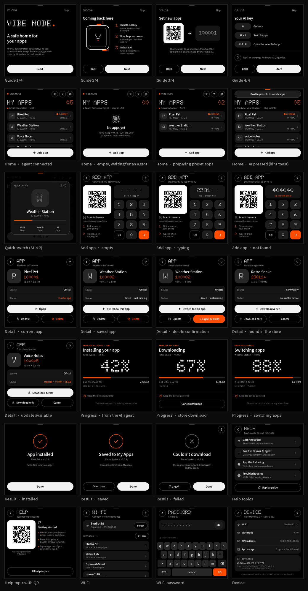
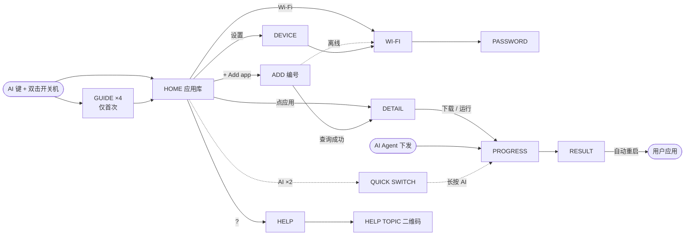

# Vibe Mode 0.3 界面设计与功能定义（阶段 A）

| 项目 | 内容 |
| --- | --- |
| 状态 | 设计评审稿，**尚未实现**；本目录不改变任何固件行为 |
| 范围 | Vibe Mode 界面重设计、交互规范与功能定义；固件实现属于阶段 B，待本稿确认后进行 |
| 语言 | 本轮只设计英文界面；英文确认后再做中文文案与语言切换（第 14 节） |
| 页面图 | `mockups/`：28 个页面状态，由布局数据渲染的**近似设计图**，不是 GSP 模拟器或真机截图 |
| 原型 | `prototype/index.html`：可直接用浏览器打开的可交互原型，与页面图使用同一份 `layout.json` |
| 布局数据 | `layout.json`（机器可读）与 [`layout-tables.md`](layout-tables.md)（逐页坐标表） |



## 1. Vibe Mode 是什么

Vibe Mode 是 ESP-Mosaico 常驻的第三级引导层：ROM → 二级 bootloader → **Vibe Mode**（`vibe_mode` test
分区）→ 用户应用。应用崩溃、被覆盖或用户想换应用时，总能回到这里。它服务三件事：

1. **AI Agent 部署的落点**。Agent 通过 USB（`mosaico.py` + ESP-Iris）构建并下发应用时，屏幕显示连接
   状态、传输与校验进度、成功或失败，而不是黑屏。没有嵌入式经验的 DIY 用户也看得懂设备在做什么。
2. **应用库与切换**。NAND 中保存多款应用，选中即写入 Flash 运行；出厂预置官方精品应用。
3. **应用分享**。每个应用有一个数字编号，告诉别人编号就能分享；在设备上输入编号即可下载。

这对多数用户是新概念，所以设计包含首次引导、各页 ? 帮助（扫码看官网文档），并把顶部 AI 键变成
实体交互（返回、快速切换）。首页从“状态卡 + 一排按钮”改为“状态 + 应用库”。

## 2. 需求对应与已确认决策

| 需求 | 设计决策 |
| --- | --- |
| UI 重设计，保持 Nothing 风格，加图标提示 | 纯黑底、点阵大标题、白色胶囊主按钮、唯一强调色、24 网格线性图标（第 6 节） |
| 共享信息只读；修改只写本地私有副本；本地缺失时从 Vibe 端 NVS 同步 | 用户确认“Web 端”即“Vibe 端”。Vibe Mode 的 `sysmeta` 为共享源，应用只读并在本地 `nvs` 写私有副本（第 11 节） |
| 出厂预置多款应用；云端下载默认存 NAND；选择后直接写 Flash 运行 | 应用库 = `/nand/apps/<编号>/`；运行走现有 NAND System Update 后端（第 10 节） |
| 扫码到 mosaico-ideas 选应用，输入 6 位编号下载 | 添加页左侧二维码、右侧数字键盘；查询后**显示一次确认**再下载（用户确认） |
| 编号不定长、默认 6 位、号段服务端管控、官方专属号段 | 设备只校验“纯数字”，官方标记与排序依据服务端返回字段（F11） |
| 取消配对认证与 Bridge 隔离，设备直连应用商店 | 新的设备接口契约 v1，由本稿定义（第 9 节）；Bridge 配对页与 TCP pairing 独立页取消 |
| 同编号拉最新版并覆盖旧版；下载时上传 MAC 与设备版本 | 契约请求体携带 `mac`、`device_version`；本地同编号原子替换（第 9、10 节） |
| 不为 NAND 损坏做兼容；风险只在商店侧提示 | 挂载失败只提示“存储不可用”，不格式化；设备不显示风险提示（F14） |
| 2 MB 限制不变；固定列表 + 基础动效；固定取模双语 | 只用 GSP 1.4.0 基础控件；列表原生滚动 + 页面短距离滑入；字体子集化（第 12、14 节） |
| 出厂首次启动后台自动下载预置编号列表 | 联网后后台逐个下载、只下载不安装、记录完成集合（F9） |
| 帮助入口、引导页、AI 键参与交互（追加需求） | 按主题多个帮助二维码、仅首次显示引导、AI 键“单击返回 · 双击切换”（用户确认） |

进入 Vibe Mode 的操作（用户确认）：**设备开机状态下按住顶部 AI 键，双击底部右侧开关机键使设备重启，看到
Vibe Mode 画面后再松开 AI 键**。bootloader 在复位时检测 AI 键（GPIO7）是否按住，与此一致。

## 3. 功能定义

| 编号 | 功能 | 定义 |
| --- | --- | --- |
| F0 | AI Agent 部署状态 | 首页状态行：Iris 会话建立时显示橙点 “Agent connected · USB/Wi‑Fi”；否则灰点 “Ready for your AI agent · plug in USB”；后台预置下载时显示 “Preparing apps · 2 of 5”。Agent 发起 App Update / System Update 时自动进入进度页，标注 “FROM YOUR AI AGENT · USB”；完成后结果页显示 “Restarting into your app…” 并自动重启进入新应用；失败页给出原因与 ? 帮助。 |
| F1 | 应用库（首页） | 列出 NAND 中的应用：官方在前，其后按编号数值升序（先比位数再比字典序）。每行：首字母点阵图块、名称、`ID · 版本`、`● CURRENT`（`ota_0` 中正在使用的应用）、`OFFICIAL`、箭头。点行进入详情。顶部：Wi‑Fi 按钮、? 帮助、设置（设备页）。右上橙色点阵数字为应用数。底部主按钮 “+ Add app”。空库显示点阵空状态与引导文案。NAND 不可用时显示 “Storage unavailable”，Add app 置灰。 |
| F2 | 添加应用 | 左列：mosaico-ideas 二维码、“Scan to browse”、域名、两步说明。右列：编号显示（默认 6 个点位，最多 16 位，超过 8 位改用紧凑字号）、状态行、3×4 键盘（⌫ 删除、长按清空，橙色 → 查询）。查询中显示 “Looking up 238114…”；错误用橙色行内提示（见第 8 节）。离线时进入 Wi‑Fi 页，副标题提示 “Connect to continue your download”，连上后自动回到添加页继续查询。 |
| F3 | 应用详情 | 大首字母图块、名称、橙色点阵编号、版本与大小、来源（Official / Community）、状态。本地应用：Open（当前应用，直接重启进入，不重写 Flash）/ Switch to this app（从 NAND 写入后运行）、Update（同编号查询最新版）、Delete（4 秒内再次点击 “Tap again to delete” 才删除；安装或下载中禁止）。商店查询结果：Download & run（主）、Download only、Cancel；本机已有旧版时状态显示 “Update · v0.9.0 → v1.0.0”，已是最新版时直接打开本地详情。 |
| F4 | 进度 | 同一页面承接四种来源：AI Agent（USB/Wi‑Fi）、应用商店下载、本地应用库写入、开发者 USB/TCP 更新。显示来源字样、标题、应用名与版本、点阵大百分比、进度条、已传输/总大小、速率、步骤（“Step 1 of 2 · Receiving”“File 2 of 3”）。下载阶段可取消；写 Flash 阶段不可取消、AI 键无效。始终提示 “Keep the device powered”。 |
| F5 | 结果 | 成功：橙色圆环 + 对勾；“App installed” 后自动重启进入应用；“Saved to My Apps” 提供 Open now 与 Done。失败：灰色圆环 + 叉、可读原因、Try again 与 Done、右上 ? 直达 Troubleshooting。 |
| F6 | Wi‑Fi | 当前连接卡（名称、IP、Forget）、“NETWORKS · n” 与 Scan、网络列表（名称、Secured/Open、Strong/Good/Weak signal）。开放网络直接连接，加密网络进入密码页。连接中显示 “Connecting…”。 |
| F7 | 密码 | 副标题为网络名；密码卡显示圆点或明文（眼睛按钮切换）；错误行（“Use at least 8 characters”“Wrong password. Try again.”）；原生键盘几何与 0.2 完全一致；最多 64 字符；离开页面清除密码。 |
| F8 | 设备页 | Wi‑Fi（可进入 Wi‑Fi 页）、Vibe Mode 版本、MAC 地址、应用存储（数量与已用空间）；Developer 区：Wi‑Fi link 端点与 TCP 配对 token（原 TCP pairing 页并入）；底部说明 “App downloads send this device's MAC and version for statistics.” |
| F9 | 出厂预置 | 出厂时 NAND 预写官方应用（与下载相同的目录布局，`source: "factory"`）。另可在构建配置中给出预置编号列表：首次联网后后台逐个下载（只下载不安装），完成集合存 `sysmeta`；用户删除的预置应用不会被再次自动下载；用户操作优先，预置任务让路后重试。 |
| F10 | 共享信息 | Wi‑Fi、设备密钥、设备基础参数由 Vibe Mode 存于 `sysmeta`。应用通过公共组件 API 只读访问；应用本地无配置时默认读取 Vibe 端内容；应用的修改只写入其 `nvs` 分区的私有副本，不改 Vibe 端。不开放的项（如 Iris TCP 配对 token）不提供读取接口。 |
| F11 | 编号规则 | 纯数字、不定长（默认 6 位），界面缓冲 16 位；号段由服务端分配与扩容；官方/社区由服务端 `official` 字段决定；设备以服务端返回的规范化编号作为本地目录名。 |
| F12 | 商店接口 | 设备直连应用商店，无配对、无会话；见第 9 节契约 v1。 |
| F13 | 版本与统计 | 同编号总是拉取最新版；下载完成后原子替换本地同编号旧版；不提供旧版本选择；每次查询上传 MAC 与 Vibe Mode 版本。 |
| F14 | 风险与兼容 | 存储破坏风险只在商店网页提示；设备不额外提示，不为用户自行导致的 NAND 损坏做兼容；挂载失败不格式化。 |
| F15 | 资源约束 | 2 MB 限制不变；见第 12 节预算与裁剪。 |
| F16 | 首次引导 | 仅首次进入显示 4 页：① 什么是 Vibe Mode ② 如何回到这里（设备线稿 + 三步）③ 获取应用（扫码 + 编号）④ AI 键与 ? 帮助。可 Skip；点阵页码；完成标记存 `sysmeta`；帮助页 Replay guide 可重看。 |
| F17 | 帮助 | 各页右上 ? 打开帮助。主题：Getting started、Build with your AI agent、App IDs & sharing、Troubleshooting；每个主题页有独立二维码、短网址与 3 条要点。带上下文的 ? 直达相关主题（添加页 → App IDs；Wi‑Fi、设备与失败页 → Troubleshooting；首页 → 主题列表）。 |
| F18 | AI 键 | 见第 5 节。 |

文案原则：面向无嵌入式经验的用户，主路径不出现 System Update、组件、SHA-256、TCP token 等术语；开发细节
集中在设备页 Developer 区与日志。

## 4. 页面地图与关键流程



1. **首次进入**：引导 4 页 → Start → 首页。
2. **AI Agent 部署**：Agent 连接后首页状态行变橙 → Agent 发起更新 → 进度页 “FROM YOUR AI AGENT · USB” → 结果页 → 自动重启进入应用。
3. **按编号下载并运行**：首页 + Add app → 输入 238114 → → → 详情（Retro Snake · Community · Not on this device）→ Download & run → 下载进度（可取消）→ 写入进度 → App installed → 重启进入应用。
4. **离线续接**：添加页点 → 时未联网 → Wi‑Fi 页（副标题提示续接）→ 选网络、输入密码 → 连上后自动回到添加页继续查询。
5. **切换本地应用**：首页点应用 → Switch to this app → 写入进度 → 自动重启；或在任意页双击 AI → 快速切换 → 再双击换下一个 → 长按 AI 1 秒打开。
6. **打开当前应用**：详情显示 Current app → Open → “Opening Pixel Pet”，重启进入，不重写 Flash。
7. **更新**：详情 Update → 有新版时转到 “Update · v0.9.0 → v1.0.0” 详情 → Download & run / Download only；已是最新版时提示 “… is up to date”。
8. **删除**：详情 Delete → 按钮变为橙色 “Tap again to delete”（4 秒）→ 再次点击删除 → 回到首页并提示。
9. **回到 Vibe Mode**：在应用中按住 AI 键并双击开关机键；进入后在松开 AI 键之前不识别 AI 手势。

## 5. AI 键交互规范

| 手势 | 判定 | 普通页面 | 快速切换浮层 | 引导页 | 进度页 |
| --- | --- | --- | --- | --- | --- |
| 单击 | 松开后 350 ms 内无第二次按下 | 返回上一页；首页无上一页时显示横幅 “Double-press AI to switch apps” | 关闭浮层 | 上一页 | 忽略 |
| 双击 | 两次按下间隔 ≤ 350 ms | 打开快速切换，默认选中当前应用的下一个 | 选中下一个应用 | 下一页（第 4 页时完成） | 忽略 |
| 长按 | 按住 ≥ 1000 ms，到时立即触发 | 提示 “Double-press AI, then hold to open” | 打开选中的应用（浮层进度条随按住填满） | 无 | 忽略 |

- **进入手势屏蔽**：Vibe Mode 启动时若 AI 键仍按着，在第一次松开之前不识别任何手势。
- **反馈**：屏幕顶部中央、物理 AI 键正下方有 36×4 的 AI 指示条，平时灰色，按下或快速切换打开时变橙；单击
  在首页无处可退时显示 1.5 秒横幅。指示条位置需与实际按键对齐（第 15 节）。
- **触摸等价**：快速切换中点卡片打开，点卡片外关闭；所有 AI 键操作都有触摸替代路径。
- 浮层内容：`QUICK SWITCH`、`2/5`、大首字母图块、名称、`ID · 版本`、长按进度条、三栏按键说明。

## 6. 视觉系统

**颜色**：唯一强调色使用 Mosaico 橙，与 bootloader 的橙色点阵开机 Logo 呼应，替代 Nothing 红；只用于
进度、CURRENT、查询键、成功环、AI 指示条与状态点。

| Token | 值 | 用途 |
| --- | --- | --- |
| background | `#000000` | 页面底色（AMOLED 熄灭像素） |
| card | `#141414` | 卡片、列表行 |
| raised | `#1E1E1E` | 键盘按键、大图块、横幅 |
| tile | `#262626` | 行内首字母图块、进度条底 |
| outline | `#3A3A3A` | 2 px 描边按钮、AI 指示条 |
| divider | `#262626` | 卡片内分隔线 |
| text / secondary / tertiary | `#F2F2F2` / `#9A9A9A` / `#5C5C5C` | 主文字 / 次文字 / 弱文字 |
| accent | `#FF4C01` | 强调色 |
| primary | `#F2F2F2` 底、`#000000` 字 | 主按钮 |

**字体**（OFL，子集化后入库，见 `assets/fonts/`）：

| 字体 | 用途 | 字号 | 行高 |
| --- | --- | --- | --- |
| Doto Black（圆点，ROND 100） | 英文点阵大标题、编号、百分比、首字母图块 | 22–112 px，正文不用 | 1.0 em |
| Noto Sans SC Medium | 标题、按钮、标签、名称 | 12–28 px | 1.25 em |
| Noto Sans SC Regular | 正文、说明、详情 | 12–17 px | 1.25 em |

子集把行高收紧为 1.25 em（ascent 1000 / descent 250），GSP 标签高度按此计算；中文阶段只扩充同一 Noto
子集的字符，不换字体、不重排。DejaVuSans 不再用于 Vibe Mode。

**图标**：24 网格、圆头描边、按显示尺寸输出 PNG（返回、箭头、加号、Wi‑Fi/断开、设置、帮助、AI 星标、刷新、
退格、播放、下载、删除、眼睛开/关、对勾、叉、芯片、ID 卡、存储、终端、扫码框、旗帜、井号、救生圈、电源、
重播、空状态点阵、引导页设备线稿）。不使用 SVG：GSP 的矢量图会链接光栅器并抬高渲染栈。

**版式**：外边距 16 px；页头为 48 px 圆形返回键 + 32 px 点阵标题 + 15 px 副标题 + 右上 ? 键；卡片圆角 20、
列表行圆角 16–18；触控目标不小于 44 px（主要按钮 56 px）；主按钮在底部 y = 404。

**动效**：只有列表原生滚动与进入页面时 48 px / 160 ms ease‑out 的短距离滑入（返回反向）；不做淡入、缩放等其他动画。

## 7. 页面说明

逐页坐标、对象名称与动作见 [`layout-tables.md`](layout-tables.md)。

| 页面 | 状态图 | 要点 |
| --- | --- | --- |
| GUIDE ×4 | `guide-1…4` | 点阵页码、Skip、Back/Next；第 2 页设备线稿上标 1、2 号，右侧三步说明 |
| HOME | `home`、`home-empty`、`home-preset`、`home-ai-hint` | 状态行三种状态；列表显示 3 行 + 第 4 行露出提示可滚动 |
| QUICK SWITCH | `quick-switch` | 黑色半透明遮罩 232/255，卡片居中 |
| ADD | `add`、`add-typing`、`add-error` | 编号用点阵 40 px，空位用 `·`；错误改用橙色行 |
| DETAIL | `detail-current`、`detail-local`、`detail-delete`、`detail-remote`、`detail-update` | 三个按钮固定位置，文字随本地/商店模式变化 |
| PROGRESS | `progress-agent`、`progress-download`、`progress-install` | 来源字样橙色；112 px 点阵百分比；下载有取消按钮 |
| RESULT | `result-installed`、`result-saved`、`result-failed` | 成功橙环、失败灰环 |
| HELP / TOPIC | `help`、`help-topic` | 主题列表 + Replay guide；主题页二维码 + 要点 |
| WI-FI / PASSWORD | `wifi`、`password` | 键盘几何与 0.2 一致（原测试坐标可复用） |
| DEVICE | `device` | 开发者区放 TCP 端点与 token |

## 8. 文案（英文）

固定文案按页面列出，动态文案列出全部取值，供中文阶段对照翻译。

| 位置 | 文案 |
| --- | --- |
| 首页 | `VIBE MODE` · `MY APPS` · `Add app` · `● CURRENT` · `OFFICIAL` · `No apps yet` · `Add an app with its ID, or ask your AI agent to build one for you.` |
| 首页状态行 | `Agent connected · USB` · `Agent connected · Wi-Fi` · `Ready for your AI agent · plug in USB` · `Preparing apps · 2 of 5` · `Storage unavailable` |
| 横幅 | `Double-press AI to switch apps` · `Double-press AI, then hold to open` · `No apps yet. Add one first.` · `Deleted: <name>` · `Up to date: <name>` · `Download cancelled` · `Connect Wi-Fi to check for updates`（名称放在末尾，过长时省略的是名称而不是动作） |
| 快速切换 | `QUICK SWITCH` · `AI ×2 / Next` · `Hold AI / Open` · `AI / Close` |
| 添加页 | `ADD APP` · `Download any app by its ID` · `Scan to browse` · `mosaico-ideas.espressif.com` · `Pick an app on your phone` · `Type its ID on the keypad` |
| 添加页状态 | `Enter the app ID` · `Tap → to look it up` · `Looking up <id>…` · `Type an app ID first` |
| 添加页错误 | `No app with this ID`（404）· `This app was removed`（410）· `Not available for this device`（409/422）· `Download not allowed`（401/403）· `Store is busy. Try again soon.`（429/5xx）· `Can't reach the store. Check Wi-Fi.`（网络/超时）· `Storage unavailable`（NAND 不可用）· `Not enough storage`（空间不足） |
| 详情 | `APP` · `Saved on this device` · `From the app store` · `Source` · `Official` · `Community` · `Status` · `Current app` · `Saved · not running` · `Not on this device` · `Update · v<old> → v<new>`（两个版本合计超过 16 字符时改为 `Update available`）· `Open` · `Switch to this app` · `Update` · `Delete` · `Tap again to delete` · `Download & run` · `Download only` · `Cancel` |
| 进度 | `FROM YOUR AI AGENT · USB` · `FROM YOUR AI AGENT · WI-FI` · `FROM THE APP STORE` · `FROM YOUR LIBRARY` · `FROM USB` · `Installing your app` · `Downloading` · `Switching apps` · `Step 1 of 2 · Receiving` · `Step 2 of 2 · Checking` · `Step 1 of 2 · Writing` · `Step 2 of 2 · Verifying` · `File <k> of <n>` · `<a> MB of <b> MB` · `<rate> KB/s` · `Keep the device powered` · `The device restarts into the app when done` · `Cancel download` |
| 结果 | `App installed` · `Restarting into your app…` · `Saved to My Apps` · `Open it any time from My Apps.` · `Open now` · `Done` · `Couldn't download` · `Couldn't install the app` · `The connection dropped. Check Wi-Fi and try again.` · `Try again` |
| 打开当前应用 | `Opening <name>` · `Restarting into your app…` |
| 帮助 | `HELP` · `Scan a code to read the guide` · `Scan for the full guide` · 四个主题名与说明（`Getting started`、`Build with your AI agent`、`App IDs & sharing`、`Troubleshooting`）· 每主题 3 条要点（见原型）· `Replay guide` · `All help topics` |
| 引导 | `VIBE MODE` · `A safe home for your apps` · `Coming back here` · `Hold the AI key` · `Double-press power` · `Release AI` · `Get new apps` · `Your AI key` · `Go back` · `Switch apps` · `Open the selected app` · `Tap ? on any page for help and QR guides.` · `Skip` · `Back` · `Next` · `Start` |
| Wi‑Fi | `WI-FI` · `Connect to download apps` · `Connect to continue your download` · `Connected · <ip>` · `Not connected` · `Choose a network below` · `Connecting…` · `Forget` · `NETWORKS · <n>` · `SCANNING…` · `Scan` · `Secured` / `Open` · `Strong` / `Good` / `Weak signal` |
| 密码 | `PASSWORD` · `Type the Wi-Fi password` · `Up to 64 characters` · `Use at least 8 characters` · `Wrong password. Try again.` |
| 设备 | `DEVICE` · `Vibe Mode <version> · ESP32-S31` · `Wi-Fi` · `Vibe Mode` · `MAC address` · `App storage` · `<n> apps · <m> MB used` · `DEVELOPER` · `Wi-Fi link <ip>:<port>` · `Token <64 hex>` · `App downloads send this device's MAC and version for statistics.` |

## 9. 应用商店设备接口契约 v1

设备不注册会话、不显示配对码，直接按编号请求最新版。服务器 Origin 默认 `https://mosaico-ideas.espressif.com`，
可在构建配置中覆盖。以下契约需服务端实现，当前仓库中不存在对应服务。

**请求**：`POST /api/v1/device/apps/{app_id}/latest`，TLS 证书校验，`Content-Type: application/json`，
`User-Agent: esp-mosaico-vibe/<version>`。

```json
{
  "schema": "mosaico-store/device-request/1",
  "mac": "30:ed:a0:f4:60:56",
  "device_version": "0.3.0",
  "board_id": "esp-mosaico",
  "chip_id": 32,
  "product_contract": "esp-mosaico/v2",
  "layout_id": "mosaico-retained-test-2m-v2",
  "recovery_abi": 2,
  "reason": "user",
  "local_version": "0.9.0"
}
```

`reason` 为 `user`（用户输入）、`update`（详情页 Update）或 `preset`（出厂预置）；`local_version` 本机无该应用时为
`null`。`mac` 与 `device_version` 用于简单鉴权与下载统计。

**成功响应 200**：

```json
{
  "schema": "mosaico-store/device-app/1",
  "app_id": "100005",
  "name": "Voice Notes",
  "version": "1.0.0",
  "official": true,
  "manifest": {
    "schema": "esp-iris-system-update/0.2",
    "release": "1.0.0",
    "minimum_recovery_version": "0.2.0",
    "target": {"chip_id": 32, "flash_size": 16777216},
    "target_layout_sha256": "<64 hex>",
    "components": [
      {"id": 1, "kind": "partition_table", "target_offset": 32768, "size": 3072, "sha256": "<64 hex>", "file": "partition-table.bin"},
      {"id": 2, "kind": "application", "target_offset": 2162688, "size": 3355443, "sha256": "<64 hex>", "file": "ota_0.bin"}
    ]
  },
  "files": [
    {"file": "partition-table.bin", "url": "https://<cdn>/…/partition-table.bin"},
    {"file": "ota_0.bin", "url": "https://<cdn>/…/ota_0.bin"}
  ]
}
```

设备校验：`app_id` 为 1–16 位数字；`name` 为 1–31 字节可打印 ASCII（否则显示 `App <id>`）；`version` 为
1–31 字节 `[A-Za-z0-9._+-]`；`manifest` 与现有 `.irisfw` 内 manifest 相同（≤ 3 KiB、≤ 8 个组件），每个组件
恰有一条 `https://` 文件地址，无多余文件；总大小不超过可用空间。组件的大小与 SHA‑256 以 manifest 为准，
下载时逐文件校验；安装时 System Update 后端仍做完整的 manifest、镜像与布局校验。

**错误与界面对应**：404 → `No app with this ID`；410 → `This app was removed`；409/422 → `Not available for
this device`；401/403 → `Download not allowed`；429/503 → `Store is busy. Try again soon.`
（遵守 `Retry-After`）；其他 5xx、超时、TLS 失败 → `Can't reach the store. Check Wi-Fi.`。

**下载**：文件地址只接受 `https://`，最多跟随 3 次重定向且必须仍为 https；每个文件流式写入 NAND，长度与
SHA‑256 不符即失败；同编号永远是最新版。

## 10. 本地存储、切换与预置

```text
/nand/apps/<app_id>/app.json        本地元数据
/nand/apps/<app_id>/manifest.json   与商店返回的 manifest 相同
/nand/apps/<app_id>/<组件文件>
/nand/apps/.<app_id>.part/          下载暂存，完成后整体替换
```

- `app.json`（`mosaico-vibe/app/1`）：`app_id`、`name`、`version`、`official`、`size`、`source`（`store` 或
  `factory`）。
- **原子替换**：下载到 `.part` 并全部校验通过后，旧目录改名 `.<id>.old`、`.part` 改名为正式目录、删除 `.old`；
  启动时清理残留，正式目录缺失但有 `.old` 时还原。
- **运行**：若所选应用就是当前应用且 `ota_0` 镜像描述（ELF SHA‑256）与记录一致，只切换启动分区并重启；否则在
  `sysmeta` 记录 `pending{操作 ID, 编号, 版本}`，用同一操作 ID 启动 NAND System Update；下次进入 Vibe Mode 时，
  若 `update/last_result` 的操作 ID 相同且成功，提升为 `active` 记录。Agent 或开发者通过 USB 写入的应用不在
  应用库中，此时没有任何行显示 CURRENT。
- **删除**：二次确认；当前应用的本地副本也可删除（`ota_0` 中的应用仍可运行）。
- **预置**：预置编号列表来自构建配置（默认空）；完成集合存 `sysmeta`；用户删除后不再自动下载。
- 原 `/nand/system-update` 目录扫描与 NAND update 页取消；按路径安装的 USB RPC 保留给开发工具。

## 11. 共享信息（应用侧只读）

| 信息 | 来源（Vibe 端） | 应用侧规则 |
| --- | --- | --- |
| Wi‑Fi 名称与密码 | `sysmeta` 命名空间 `wifi`（已有） | 先读应用私有副本，缺失时只读读取 Vibe 端 |
| 设备基础参数（如语言） | `sysmeta`（中文阶段新增语言设置） | 同上 |
| 设备密钥 | 由产品确定具体项后加入共享表 | 只读；未列入共享表的不提供接口 |
| Iris TCP 配对 token | `sysmeta`（已有） | **不开放** |

公共组件 `esp_mosaico_app_recovery` 将提供只读访问接口：`sysmeta` 一律以 `NVS_READONLY` 打开；应用的修改
写入应用自己 `nvs` 分区的私有命名空间，不回写 Vibe 端。注意这是接口约定而非硬件隔离：应用仍可直接调用 NVS
写 `sysmeta`，公共组件与文档要求不这样做。

## 12. 资源预算与裁剪

`vibe_mode` 槽为 1,835,008 B；0.2.0 评审包 `factory.bin` 为 1,782,864 B，仅余约 51 KB。

| 变化 | 内容 |
| --- | --- |
| 移除 | Bridge 配对/授权/遥测/自更新下载 worker 与系统计划校验；TCP pairing 独立页；Download Ideas 页与 185 px 二维码；NAND update 页与目录扫描；DejaVuSans 的 32/40 px 与多处 ASCII 字符集 |
| 新增 | 商店客户端（HTTPS + NAND 写入）、应用库扫描、引导与帮助页、5 个 148 px 二维码（每个压缩后约 2–3 KB）、约 35 个小图标、Doto 与 Noto 子集字形、AI 键手势识别 |
| 保持 | ESP-Iris USB/TCP、System Update 后端、Wi‑Fi、NAND 文件卷、截图与输入 |

实际大小只能由 ESP-IDF 构建得到（`check_recovery_slot.cmake` 超限即失败）。若超限，按以下顺序继续裁剪：
帮助二维码合并为 1 个 → 引导第 3、4 页合并 → 去掉 112 px 百分比改用 72 px → 评估 mDNS 与 TCP 传输。

## 13. GSP 实现说明（阶段 B 输入）

- 只使用 GSP 1.4.0 已验证控件：每页一个 `layer`（可见性 bind），`container`、`label`、`button`、`image`、
  `list`（`apps_row` 行高 74、`networks_row` 行高 68）、`progress`、`keyboard`。
- GSP 对象颜色是静态的：需要在中性色与橙色间切换的文字用两个重叠标签（如 `id_status`/`id_error`、
  `detail_status`/`detail_status_accent`），空的一方写入空格字形；状态点、Wi‑Fi 图标、结果环用两个对象切换可见性。
- 编号显示沿用 0.2 配对码的大字/紧凑两个标签方案（`id_digits`/`id_digits_compact`）。
- 页面滑入：对具名图层调用 `esp_gsp_component_set_position()` 与 `esp_gsp_component_animate_position_to()`；
  失败即退化为瞬时切换。
- 标签高度不小于 `行高 × 行数`（Noto 1.25 em、Doto 1.0 em），多行文本用显式换行。
- 显示应用名、SSID、版本的单行标签使用 `overflow: "ellipsis"`（名称最长 31 字节、SSID 32 字节）；其余固定
  文案的每个取值都已按标签宽度测量（`tools/build_design.py` 的 `COPY` 列表），新增文案须加入该列表。
- 所有对象名称（阶段 B 的 bind/key 名称）见 `layout-tables.md`；动态文案集中到 `main/vibe_text.{c,h}`。
- AI 键：在渲染定时器中读取 `BSP_BUTTON_AI_GPIO`，可移植手势识别模块负责 350 ms / 1000 ms 判定与开机按住屏蔽。

## 14. 中文阶段计划

英文设计确认后：在设备页增加语言设置（中文 / English，存 `sysmeta`，同时作为 F10 共享基础参数）；固定文案改为
文本 bind，从 `vibe_text` 中英两张表取值；按第 8 节文案表翻译，生成汉字语料，用 `font_charset_file` 让 GSPC
只烘焙用到的字形；扩充同一 Noto 子集；按实际字符数复核字模大小与 2 MB 预算。中文仍保留点阵英文大标题作为
视觉元素，副标题与按钮使用中文。

## 15. 验证边界与待确认事项

已完成：28 个页面状态的布局自检（触控目标、文字宽度、标签行高、屏幕边界）与第 8 节固定文案全部取值的宽度
测量；原型的主要流程脚本走查（添加、
下载并运行、离线续接、快速切换、删除确认、引导、Agent 部署、手机宽度无横向溢出）。

未完成（阶段 B 及之后）：GSPC 0.5.0 编译与 GSP 1.4.0 模拟器运行、ESP-IDF 构建与槽位大小、真机显示与触摸、
AI 键 GPIO 实测、商店服务端实现与联调、下载/安装/切换实测。

待确认：

1. AI 键与开关机键在机身上的准确位置（影响 AI 指示条位置与引导线稿）。
2. 官网帮助文档的最终网址；当前二维码使用占位短链 `https://mosaico.espressif.com/vibe/{start,agent,ids,fix}`，
   建议官网保留这些短链并重定向到正式文档。
3. 商店接口契约 v1 由服务端团队确认字段与错误码。
4. “设备密钥”包含哪些具体项、是否对应用开放。
5. 出厂预置的官方应用编号列表与 NAND 容量上限。

## 16. 目录与再生成

```text
README.md            本文
layout.json          全部页面的布局数据（阶段 B 编写 ui/main.json 的依据）
layout-tables.md     逐页布局表（生成）
mockups/             页面图（生成）
prototype/index.html 可交互原型（生成，单文件，无网络依赖）
assets/fonts/        字体子集与 OFL 许可证
assets/icons/        图标与引导线稿
assets/qr/           二维码
tools/               生成脚本与原型模板
```

```sh
python -m pip install pillow fonttools qrcode
python tools/generate_assets.py --google-fonts /path/to/google-fonts   # 字体子集；省略参数时只重画图标与二维码
python tools/build_design.py --strict                                   # layout.json、layout-tables.md、页面图与布局自检
python tools/build_prototype.py                                         # prototype/index.html
```
