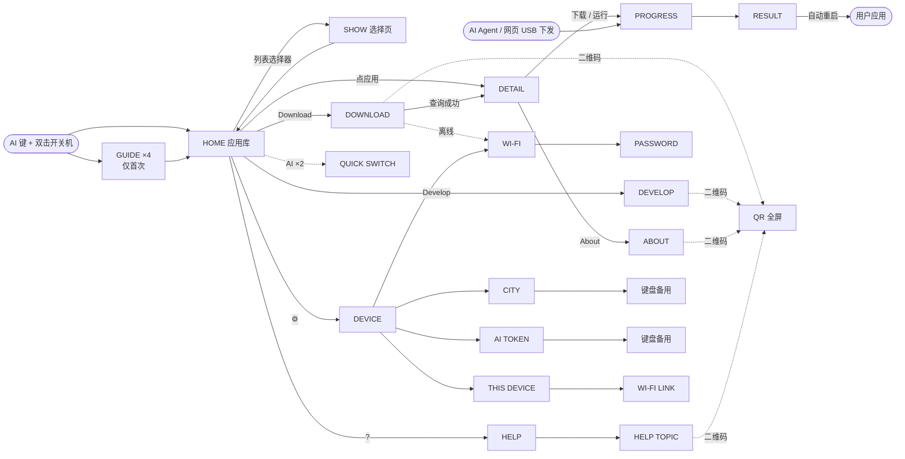

# Vibe Mode 0.3 界面设计与功能定义（阶段 A · 第 3 版）

| 项目 | 内容 |
| --- | --- |
| 状态 | 设计评审稿第 3 版（按 2.1 英寸实物尺寸重做字号与触控），**尚未实现**；本目录不改变任何固件行为 |
| 范围 | Vibe Mode 界面与交互设计、功能定义；固件实现属于阶段 B，待本稿确认后进行；**固件大小暂不约束本轮设计**，阶段 B 再优化 |
| 语言 | 本轮只设计英文界面；英文确认后再做中文文案与语言切换（第 14 节） |
| 页面图 | `mockups/`：41 个页面状态，由布局数据渲染的**近似设计图**（含屏幕圆角遮罩），不是 GSP 模拟器或真机截图 |
| 原型 | `prototype/index.html`：可直接用浏览器打开的可交互原型，与页面图使用同一份 `layout.json`；面板中的“近似实物尺寸”按 37.7 mm 屏宽显示 |
| 布局数据 | `layout.json`（机器可读）与 [`layout-tables.md`](layout-tables.md)（逐页坐标表） |


## 第 3 版修订：按 2.1 英寸屏幕重做尺寸

评审意见：屏幕只有 2.1 英寸，第 2 版很多文字太小，完全看不清。第 3 版按实物尺寸换算后重排了每一页（用户选定
“偏紧凑”档：正文 26 px、最小 22 px；文本输入以电脑/手机为主、设备键盘备用；暂不考虑固件大小）。

| 项目 | 第 2 版 | 第 3 版 |
| --- | --- | --- |
| 正文 | 13–15 px（1.0–1.2 mm） | 26 px（2.0 mm） |
| 最小文字 | 12 px（0.9 mm） | 22 px（1.7 mm） |
| 名称、按钮 | 15–18 px | 28 px（2.2 mm） |
| 最小触控 | 44 px（3.5 mm） | 72 px（5.7 mm），主按钮 80 px |
| 图标 | 16–24 px | 28–32 px（结果页 48 px） |
| 每页内容 | 一页多个任务 | 一屏一件事：首页筛选合并为一个列表选择器；详情拆为“操作”与 About 两屏；下载键盘全宽、扫码改为全屏二维码；帮助主题页只留二维码 |
| 共享设置输入 | 设备键盘 | 主路径为电脑经 USB（AI Agent）设置；设备键盘作为备用 |

第 2 版的 7 条修改（按键位置与颜色、二维码密度、商店对接、共享信息、预置/分类/收藏、下载与开发拆分、应用
二维码）全部保留，只是按新尺寸重新排版；记录见 Git 历史与 [PR #2](https://github.com/zhanzhaocheng/esp-mosaico-utils/pull/2)。

## 1. Vibe Mode 是什么

Vibe Mode 是 ESP-Mosaico 常驻的第三级引导层：ROM → 二级 bootloader → **Vibe Mode**（`vibe_mode` test
分区）→ 用户应用。应用崩溃、被覆盖或用户想换应用时，总能回到这里。它服务四件事：

1. **AI Agent 部署的落点**。Agent（或网页）通过 USB 数据线（`mosaico.py` + ESP-Iris）构建并下发应用时，屏幕显示
   连接状态、传输与校验进度、成功或失败，而不是黑屏。没有嵌入式经验的 DIY 用户也看得懂设备在做什么。
2. **应用库与切换**。NAND 中保存多款应用（出厂约 20 个官方应用），按分类和收藏查找，选中即写入 Flash 运行。
3. **下载与分享**。每个应用有一个数字编号；在设备上输入编号即可从 Mosaico Ideas 下载，告诉别人编号就能分享。
4. **开发入门**。告诉新用户如何用 AI Agent vibe coding、用数据线烧录，并把作品分享到 Mosaico Ideas。

这对多数用户是新概念，所以设计包含首次引导、? 帮助（扫码看官网文档），并把顶部 AI 键变成实体交互（返回、
快速切换）。

## 2. 尺寸与可读性（设计依据）

| 参数 | 值 |
| --- | --- |
| 屏幕 | 480×480，对角 2.1 英寸 → 边长 37.7 mm，约 323 ppi，**1 px ≈ 0.079 mm** |
| 观看距离 | 手持 25–35 cm |
| 参照 | Apple Watch 显示屏约 326 ppi，与本屏密度几乎相同、尺寸相近；watchOS 正文按 @2x 约 34 px，脚注约 26–28 px，最小说明约 24 px，按钮高约 100 px |
| 本稿取值 | 偏紧凑档（用户选定）：正文 26 px，最小 22 px，名称与按钮 28 px，标题 34 px，最小触控 72 px |

字号阶梯（布局检查拒绝其他字号）：

| 字体 | 字号 | 用途 |
| --- | --- | --- |
| Noto Sans SC Regular | 22 / 26 | 说明、副信息、网址 / 正文、简介 |
| Noto Sans SC Medium | 22 / 28 / 34 | 角标、来源字样、按键说明 / 名称、按钮、横幅、行标题 / 页内大标题、进度与结果标题 |
| Doto Black（圆点） | 32 / 40 / 44 / 64 / 120 | 编号与数量 / 页标题与键盘数字 / 编号输入 / 大首字母与引导标题 / 百分比 |

布局检查（`tools/build_design.py --strict`）除原有的屏幕边界、圆角安全区、行高、文字宽度、二维码整数模块外，新增：
文字 ≥ 22 px、触控 ≥ 72×72 px、图标 ≥ 28 px、只用上表字号。原生键盘（GSP 控件，几何沿用 0.2）键宽 42 px
（3.3 mm）仍偏小，因此城市与 AI token 以电脑设置为主，键盘只作备用；Wi‑Fi 密码仍需在设备上输入，页面提示
也可从电脑设置。

## 3. 需求对应与已确认决策

| 需求 | 设计决策 |
| --- | --- |
| UI 重设计，保持 Nothing 风格，加图标提示 | 纯黑底、点阵标题、白色胶囊主按钮、唯一强调色、线性图标（第 7 节） |
| 2.1 英寸屏幕可读 | 按实物尺寸换算的字号与触控规则，一屏一件事（第 2 节） |
| 共享信息只读；修改只写本地私有副本；本地缺失时从 Vibe 端 NVS 同步 | 共享项为 Wi‑Fi、所在城市、大模型 token，**所有应用可读**，只有 Vibe Mode 可改；设备密钥取消（第 12 节） |
| 出厂预置约 20 个应用；云端下载存 NAND；选择后写 Flash 运行 | 应用库 = `/nand/apps/<编号>/`；运行走现有 NAND System Update 后端（第 11 节） |
| 分类查找、收藏 | 分类沿用 Mosaico Ideas 的 6 个项目分类；首页一个列表选择器（All / Favorites / 分类）；收藏存 `sysmeta`（F19） |
| 扫码到 Mosaico Ideas 选应用，输入编号下载 | 下载页全宽数字键盘；右上二维码按钮打开全屏二维码；查询后**显示一次确认**再下载 |
| 下载与开发分开；保留 AI Agent / 网页有线下载 | 首页底部 Download / Develop 两个入口（F20） |
| 应用简介带二维码 | 详情页 About 屏显示简介 + 应用的 Mosaico Ideas 页面二维码（F3、F21） |
| 编号不定长、默认 6 位、号段服务端管控、官方专属号段 | 设备只校验“纯数字”，官方标记依据服务端字段（F11） |
| 取消配对与 Bridge 隔离，设备直连应用商店 | 商店由其他同事开发；第 10 节列出设备端对接需求 |
| 同编号拉最新版并覆盖旧版；下载时上传 MAC 与设备版本 | 请求携带 `mac`、`device_version`；本地同编号原子替换 |
| 不为 NAND 损坏做兼容；风险只在商店侧提示 | 挂载失败只提示“存储不可用”，不格式化（F14） |
| 固定列表 + 基础动效；固定取模双语 | 只用 GSP 1.4.0 基础控件；列表原生滚动 + 页面短距离滑入；字体子集化 |
| 出厂首次启动后台自动下载预置编号 | 联网后后台逐个检查并下载最新版、只下载不安装（F9） |
| 帮助入口、引导页、AI 键参与交互 | 按主题多个帮助二维码、仅首次显示引导、AI 键“单击返回 · 双击切换” |

进入 Vibe Mode（已确认）：**设备开机状态下按住顶部右侧的 AI 键，双击底部右侧开关机键使设备重启，看到 Vibe Mode
画面后再松开 AI 键**。bootloader 在复位时检测 AI 键（GPIO7）是否按住，与此一致。

## 4. 功能定义

| 编号 | 功能 | 定义 |
| --- | --- | --- |
| F0 | AI Agent 部署状态 | 首页状态条机器人图标：橙色 = Iris 会话已建立，灰色 = 未连接；连接建立时横幅 “AI agent connected”；开发页顶部一行显示 USB 与 Agent 状态。Agent 或网页发起 App Update / System Update 时自动进入进度页，来源字样为 “FROM YOUR AI AGENT · USB”、“FROM THE WEBSITE · USB”（主机声明身份时）、“FROM YOUR COMPUTER · USB”（无法区分时）或 “FROM YOUR AI AGENT · WI-FI”；完成后自动重启进入新应用；失败页给出原因与 ? 帮助。 |
| F1 | 应用库（首页） | 状态条：`● VIBE MODE`、预置下载进度 `↓ 3/20`（仅下载时）、Wi‑Fi / AI Agent / 电量图标（与设备状态栏同序）。第二行：**列表选择器**（显示 All apps / Favorites / 分类名，点按打开选择页）、? 帮助、⚙ 设备。列表每行 88 px：64 px 首字母图块（收藏时右上角橙色 ★）、名称（28 px）、副信息（22 px：`分类 · 编号`，社区应用为 `Community app · 编号`，当前应用为橙色 `● Current app`），约 2.5 行可见、可滚动。底部 **Download**（白色主按钮）与 **Develop**（描边按钮）。排序：官方在前，再按编号数值升序。空状态分全部 / 收藏 / 分类三种。上次使用的列表存 `sysmeta`。 |
| F2 | 下载应用 | 编号卡片（Doto 44 px，16 位以内；超过 8 位改用 32 px）+ 全宽 3×4 键盘（每键 144×72 px）。空时卡片显示 “Type the app ID”，查询时显示 “Looking up…”；错误以横幅显示（第 9 节）。右上二维码按钮打开 Mosaico Ideas 全屏二维码（11 px 模块）。离线时进入 Wi‑Fi 页（“PICK ONE TO CONTINUE”），连上后自动继续查询。查询成功进入详情页（一次确认）。 |
| F3 | 应用详情（两屏） | **操作屏**：96 px 图块、名称（34 px）、橙色点阵编号、状态（28 px）、`分类 · 来源 · 版本 · 大小`（22 px）；主按钮 Open / Run this app / Download & run；下方三个图标按钮——本地：Update、Delete（再点 “Tap again” 才删除）、About；商店：Save only、About、Cancel；右上 ☆/★ 收藏（仅本地）。**About 屏**：名称、该应用 Mosaico Ideas 页面二维码（6 px 模块，198 px，点按放大）、商店简介（26 px，最多 7 行，ASCII ≤ 120 字符）、信息行。 |
| F4 | 进度 | 来源字样（22 px 橙色）、标题（34 px）、应用名与版本、点阵 120 px 百分比、进度条、“已传输 / 总大小 · 速率”一行、步骤；下载阶段有 Cancel download，写入阶段提示 “Keep the device powered”，不可取消、AI 键无效。 |
| F5 | 结果 | 成功：橙色圆环 + 对勾；“App installed” 后自动重启进入应用；“Saved to My Apps” 提供 Open now 与 Done。失败：灰色圆环 + 叉、原因两行、Try again 与 Done、右上 ? 直达 Troubleshooting。 |
| F6 | Wi‑Fi | 当前连接卡（名称、状态、Forget）、“NETWORKS · n” 与扫描按钮、网络列表（每行 88 px）。开放网络直接连接，加密网络进入密码页。 |
| F7 | 密码 | 原生键盘（几何与 0.2 一致）；密码卡显示圆点或明文；提示行 “Or set it from your computer.”，错误时改为橙色错误文案；最多 64 字符。 |
| F8 | 设备页 | “Shared with every app” 下三行：Wi‑Fi、City、AI token（两行式，点按进入）；第四行 This device 进入本机信息页（Vibe Mode 版本、MAC、应用存储、Wi‑Fi link、统计说明）。 |
| F9 | 出厂预置 | 出厂 NAND 预写约 20 个官方应用（覆盖 6 个分类）；首次联网后按预置编号列表后台检查并下载最新版，状态条显示 `↓ k/n`；用户删除的预置不再自动下载；用户操作优先。 |
| F10 | 共享信息 | Wi‑Fi、所在城市、大模型 token 存于 `sysmeta`，所有应用可读，只有 Vibe Mode 可改；城市与 token 页以“在电脑上设置”为主，“Type on device / Type it” 进入备用键盘；token 页可 Clear。详见第 12 节。 |
| F11 | 编号规则 | 纯数字、不定长（默认 6 位），界面缓冲 16 位；号段由服务端分配；官方/社区由服务端 `official` 字段决定。 |
| F12 | 商店对接 | 商店（Mosaico Ideas）由其他同事开发。设备直连、无配对、无会话；第 10 节列出设备端需求。 |
| F13 | 版本与统计 | 同编号总是拉取最新版；下载完成后原子替换本地旧版；每次查询上传 MAC 与 Vibe Mode 版本。 |
| F14 | 风险与兼容 | 存储破坏风险只在商店网页提示；不为用户自行导致的 NAND 损坏做兼容；挂载失败不格式化。 |
| F15 | 资源约束 | 本轮不约束；2 MB 槽位与字库、图标大小在阶段 B 优化（第 13 节）。 |
| F16 | 首次引导 | 仅首次进入显示 4 页：① 什么是 Vibe Mode ② 如何回到这里（机身示意 + 三步，每步一行）③ 两种获取方式（Download / Develop）④ AI 键用法。可 Skip；完成标记存 `sysmeta`；帮助页右上 ↻ 可重看。 |
| F17 | 帮助 | 主题列表 4 行：Getting started、Develop apps、App IDs & sharing、Troubleshooting；主题页 = 主题名 + 二维码（8 px 模块，264 px，点按放大）+ 网址，详细说明交给网页。 |
| F18 | AI 键 | 见第 6 节；快速切换遍历当前列表。 |
| F19 | 分类与收藏 | 分类为 Mosaico Ideas 的 6 个项目分类（`display`、`audio`、`smart-home`、`sensors`、`communication`、`motor`），由商店随应用返回，任一分类匹配即出现在该分类下；选择页为 2×4 图块（All apps、Favorites、6 个分类），每块有图标与数量，当前项橙色描边；收藏在详情页切换，存 `sysmeta`。 |
| F20 | 开发应用 | 开发页：顶部 USB / Agent 状态一行；三行步骤——Vibe-code it（点按打开 vibe coding 指南二维码）、Install over USB（由 Agent 或网页有线安装，屏幕显示进度）、Share on Mosaico Ideas（点按打开 Mosaico Ideas 二维码）。Wi‑Fi link（地址与配对 token）移到本机信息页。 |
| F21 | 二维码 | 设备运行时生成：版本 3、ECC L、2 模块静区、黑码白底、整数倍模块。About 页 6 px（198 px），帮助主题 8 px（264 px），全屏 11 px（363 px，下载页扫码、开发步骤与任意二维码放大都用它）。点按任意处或按 AI 键返回。URL ≤ 53 字节时保持版本 3。 |

## 5. 页面地图与关键流程



1. **首次进入**：引导 4 页 → Start → 首页。
2. **AI Agent / 网页有线部署**：插上数据线，Agent 连接后机器人图标变橙并提示 “AI agent connected” → 进度页
   “FROM YOUR AI AGENT · USB” → 结果页 → 自动重启进入应用。
3. **按编号下载并运行**：Download → 输入 238114 → → → 详情（Retro Snake · Not on this device）→ Download & run →
   下载进度 → 写入进度 → App installed → 重启进入应用。不存在的编号显示横幅 “No app with this ID”。
4. **离线续接**：下载时未联网 → Wi‑Fi 页（“PICK ONE TO CONTINUE”）→ 选网络、输入密码 → 连上后自动继续查询。
5. **找应用**：点列表选择器 → 选 Favorites 或某个分类 → 首页只显示该列表；双击 AI 在当前列表里快速切换，长按 AI 打开。
6. **收藏**：详情右上 ☆ → 橙色 ★ 并提示 “Added to Favorites”。
7. **看应用说明**：详情 → About → 读简介或点二维码全屏，手机扫码打开该应用的 Mosaico Ideas 页面。
8. **开发**：Develop → 点 Vibe-code it 扫指南 → 在电脑上与 AI Agent 开发 → 插线安装（流程 2）→ 点 Share 扫码去 Mosaico Ideas 发布。
9. **共享设置**：⚙ → City / AI token → 按卡片提示在电脑上让 AI Agent 设置；需要时点 “Type on device” 用键盘输入。
10. **更新与删除**：Update → 有新版时进入 “Update v1.0.0 → v1.1.0” 详情；Delete → 再点 “Tap again” 删除并提示。
11. **回到 Vibe Mode**：在应用中按住 AI 键并双击开关机键；进入后在松开 AI 键之前不识别 AI 手势。

## 6. AI 键交互规范

| 手势 | 判定 | 普通页面 | 快速切换浮层 | 引导页 | 进度页 |
| --- | --- | --- | --- | --- | --- |
| 单击 | 松开后 350 ms 内无第二次按下 | 返回上一页；首页无上一页时横幅 “Press AI twice to switch” | 关闭浮层 | 上一页 | 忽略 |
| 双击 | 两次按下间隔 ≤ 350 ms | 打开快速切换，选中当前列表中当前应用的下一个 | 选中下一个 | 下一页（第 4 页时完成） | 忽略 |
| 长按 | 按住 ≥ 1000 ms，到时立即触发 | 横幅 “Press twice, then hold” | 打开选中的应用 | 无 | 忽略 |

- 快速切换遍历首页当前列表；列表为空时提示 “No apps in this list”。
- 进入手势屏蔽：Vibe Mode 启动时若 AI 键仍按着，在第一次松开之前不识别任何手势。
- 反馈：屏幕顶边、物理 AI 键正下方（x = 354–390）有 36×4 的 AI 指示条，按下或快速切换打开时变橙。
- 触摸等价：快速切换中点卡片打开，点卡片外关闭。

## 7. 硬件与视觉系统

### 7.1 硬件（按产品照片）

| 部件 | 位置与颜色 | 设计中的对应 |
| --- | --- | --- |
| 机身 | 奶白色（`#E9E2D6`） | 引导页示意、原型外框 |
| 屏幕 | 480×480、2.1 英寸，黑色，大圆角（按 40 px 估计，待结构图确认） | 所有可见内容在圆角内；页面图带圆角遮罩 |
| AI 键 | 机身顶边右侧（约 3/4 宽度），橙色 | AI 指示条；引导页标号 1 |
| 底部两键 | 底边左右，浅灰；右侧为开关机键 | 进入手势；引导页标号 2 |
| 设备状态栏 | 右侧 Wi‑Fi、机器人、电池 | 首页状态条沿用同样顺序；左侧显示 `VIBE MODE` |

### 7.2 颜色

唯一强调色使用 Mosaico 橙，与橙色 AI 键和 bootloader 的橙色点阵开机 Logo 呼应。

| Token | 值 | 用途 |
| --- | --- | --- |
| background | `#000000` | 页面底色 |
| card | `#141414` | 卡片、列表行、图块 |
| raised | `#1E1E1E` | 键盘按键、大图块、横幅 |
| tile | `#262626` | 行内首字母图块、进度条底 |
| outline | `#3A3A3A` | 描边按钮、AI 指示条 |
| text / secondary / tertiary | `#F2F2F2` / `#9A9A9A` / `#5C5C5C` | 主文字 / 次文字 / 弱文字 |
| accent | `#FF4C01` | 强调色 |
| primary | `#F2F2F2` 底、`#000000` 字 | 主按钮 |

### 7.3 字体、图标与版式

- 字体：Doto Black（圆点）与 Noto Sans SC Regular/Medium，OFL，子集化后入库；字号见第 2 节阶梯；行高 Doto 1.0 em、
  Noto 1.25 em。
- 图标：24 网格圆头描边，按显示尺寸输出 28 / 32 / 48 px PNG；按钮内一律 32 px。新增二维码（扫码按钮）与信息（About）图标。
- 版式：外边距 16 px；页头为 72 px 圆形返回键 + Doto 40 px 标题 + 右侧 72 px 圆形按钮；卡片与列表行圆角 20；
  列表行 88 px；底部操作区 y = 388、高 80 px；三个并列操作用“图标在上、文字在下”的 144×88 按钮。
- 动效：列表原生滚动与进入页面 48 px / 160 ms ease-out 滑入（返回反向）。

### 7.4 二维码

运行时生成，版本 3、ECC L、2 模块静区（不加白色卡片），整数倍模块：About 6 px（198 px）、帮助主题 8 px（264 px）、
全屏 11 px（363 px）。第 2 版的模拟扫描对比（zxing-cpp 与 OpenCV，模拟手机拍摄）：2 模块静区与 4 模块相当、
1 模块对较弱的解码器明显变差；同一拍摄距离下模块越大识别率越高（148 px 旧码 40% → 198 px 新码 98%，zxing），
第 3 版的码面都不小于 198 px。真机扫码留到阶段 B 验证。

## 8. 页面说明

逐页坐标、对象名称与动作见 [`layout-tables.md`](layout-tables.md)。

| 页面 | 状态图 | 要点 |
| --- | --- | --- |
| GUIDE ×4 | `guide-1…4` | 每页一个 34 px 标题 + 最多两句；第 2 页机身示意与三步 |
| HOME | `home`、`home-favorites`、`home-category`、`home-preset`、`home-favorites-empty`、`home-empty`、`home-ai-hint` | 状态条 + 列表选择器 + 2.5 行列表 + Download / Develop |
| QUICK SWITCH | `quick-switch` | 120 px 图块、34 px 名称、22 px 按键说明 |
| SHOW（选择页） | `categories` | 2×4 图块，图标 + 26 px 名称 + 数量 |
| DOWNLOAD | `download`、`download-typing`、`download-lookup`、`download-error` | 全宽键盘；错误用横幅；二维码按钮打开全屏码 |
| DEVELOP | `develop` | 状态一行 + 三步 |
| DETAIL / ABOUT | `detail-current`、`detail-local`、`detail-delete`、`detail-remote`、`detail-update`、`about` | 操作屏与 About 屏 |
| QR | `qr-full` | 任意二维码 363 px |
| PROGRESS / RESULT | `progress-*`、`result-*` | 120 px 百分比；结果两行说明 |
| HELP / TOPIC | `help`、`help-topic` | 4 个主题；主题页 264 px 二维码 |
| WI-FI / PASSWORD | `wifi`、`wifi-pending`、`password` | 88 px 网络行；原生键盘 |
| DEVICE | `device`、`device-info`、`wifi-link`、`city`、`token` | 共享设置以电脑设置为主 |

## 9. 文案（英文）

每个取值都已按所在标签宽度测量（`tools/build_design.py` 的 `COPY`），新增文案须加入该列表。

| 位置 | 文案 |
| --- | --- |
| 首页 | `VIBE MODE` · `↓ <k>/<n>` · `All apps` / `Favorites` / `Display` / `Audio` / `Smart home` / `Sensors` / `Communication` / `Motor` · `<Category> · <ID>` · `Community app · <ID>` · `● Current app` · `Download` · `Develop` |
| 首页空状态 | `No apps yet` · `Download an app by its ID, or develop your own with your AI agent.` · `No favorites yet` · `Open an app and tap ☆ to add it here.` · `Nothing here yet` · `Find more apps on Mosaico Ideas.` |
| 横幅 | `Press AI twice to switch` · `Press twice, then hold` · `No apps in this list` · `AI agent connected` · `Added to Favorites` · `Removed from Favorites` · `Deleted: <name>` · `Up to date: <name>` · `Download cancelled` · `Connect Wi-Fi first` · `Getting preset apps` · `City saved` · `AI token saved` · `AI token cleared` |
| 下载 | `DOWNLOAD` · `Type the app ID` · `Looking up…`；错误横幅：`Type an app ID first` · `No app with this ID` · `This app was removed` · `Not for this device` · `Download not allowed` · `Store is busy. Try later.` · `Can't reach the store` · `Storage unavailable` · `Not enough storage` |
| 选择页 | `SHOW` · `All apps` · `Favorites` · 6 个分类名 · `Other` |
| 快速切换 | 列表名大写 · `<k>/<n>` · `AI ×2` / `Next` · `Hold AI` / `Open` · `AI` / `Close` |
| 开发 | `DEVELOP` · `● USB connected · AI agent ready` · `● USB connected · waiting for agent` · `● Plug in a USB data cable` · `Vibe-code it` / `Scan for the guide` · `Install over USB` / `From your agent or the website` · `Share on Mosaico Ideas` / `Get an ID anyone can use` |
| 详情 | `APP` · `● Current app` · `Saved · not running` · `Not on this device` · `Update v<old> → v<new>` / `Update available` · `<Category> · Official/Community · v<ver> · <size>` · `Open` · `Run this app` · `Download & run` · `Update` · `Delete` · `Tap again` · `About` · `Save only` · `Cancel` |
| About / 二维码 | `ABOUT` · `Tap to enlarge` · `<name> on Mosaico Ideas` · `Browse apps on Mosaico Ideas` · `Vibe-coding guide` · 网址 |
| 进度 | `FROM YOUR AI AGENT · USB` · `FROM YOUR AI AGENT · WI-FI` · `FROM THE WEBSITE · USB` · `FROM YOUR COMPUTER · USB` · `FROM MOSAICO IDEAS` · `FROM YOUR LIBRARY` · `Installing your app` · `Downloading` · `Switching apps` · `<a> of <b> MB · <rate>` · `Step 1 of 2 · Receiving` 等 · `Keep the device powered` · `Cancel download` |
| 结果 | `App installed` · `Restarting into your app…` · `Saved to My Apps` · `Open it any time from the list.` · `Open now` · `Done` · `Couldn't download` · `Couldn't install the app` · `The connection dropped. Check Wi-Fi and try again.` · `Try again` |
| 帮助 | `HELP` · `Getting started` · `Develop apps` · `App IDs & sharing` · `Troubleshooting` · 网址 |
| 引导 | `VIBE MODE` · `A safe home for your apps` · `Your AI agent installs apps here. Switch or download apps any time.` · `Coming back here` · `Hold AI` / `Top edge, right` · `Press power` / `Bottom right ×2` · `Release AI` / `On this screen` · `Two ways to get apps` · `Download` / `Type an app ID from Mosaico Ideas.` · `Develop` / `Vibe-code it, install over USB, share it.` · `Your AI key` · `Go back` · `Switch apps` · `Open the app` · `Skip` · `Back` · `Next` · `Start` |
| Wi‑Fi / 密码 | `WI-FI` · `Connected` · `Connecting…` · `Choose a network` · `Not connected` · `Forget` · `NETWORKS · <n>` · `SCANNING…` · `PICK ONE TO CONTINUE` · `Secured` / `Open` · `Strong` / `Good` / `Weak signal` · `PASSWORD` · `Type the password` · `Or set it from your computer.` · `Use at least 8 characters` · `Wrong password. Try again.` |
| 设备与共享设置 | `DEVICE` · `Shared with every app` · `Wi-Fi` · `City` · `AI token` · `This device` · `Vibe Mode 0.3.0 · <n> apps` · `THIS DEVICE` · `MAC address` · `App storage` · `<n> apps · <m> MB used` · `Wi-Fi link` · `Downloads send MAC and version.` · `CITY` · `Shared with all apps` · `Set it from your computer: ask your AI agent while the USB cable is in.` · `Type on device` · `Letters and spaces, up to 40.` · `Type a city name first` · `AI TOKEN` · `Set · ends in <last 4>` / `Not set` · `Every app can read it.` · `Paste it on your computer: ask your AI agent over USB.` · `Type it` · `Clear` · `WI-FI LINK` · `ADDRESS` · `TOKEN` · `Your AI agent uses these to install over Wi-Fi.` · `Keep the token private.` |


## 10. Mosaico Ideas 商店对接需求

应用商店由 Mosaico Ideas 团队的同事开发，接口路径、字段名与鉴权方式**以商店团队的实现为准**。本节只列出
Vibe Mode 设备端需要商店提供的能力，便于对齐。上传侧已有工具：开发者用 `mosaico.py project upload`
（`mosaico-tools`，配置 schema `mosaico-ideas/project-upload/v1`）创建或更新草稿，审核发布后由商店分配数字编号；
开发页第 3 步与帮助主题即指向这一流程。

| 编号 | 需求 | 说明 |
| --- | --- | --- |
| R1 | 按编号查询最新版 | 设备直连 HTTPS，无会话、无配对码；同一编号永远返回最新发布版本 |
| R2 | 请求携带设备信息 | 至少 `mac` 与 `device_version`（Vibe Mode 版本），用于简单鉴权与统计；建议同时带兼容字段（`board_id`、`chip_id`、`product_contract`、`layout_id`、`recovery_abi`）供服务端判断兼容性，带 `reason`（`user` / `update` / `preset`）与本机已有版本 |
| R3 | 设备显示字段 | 规范化编号；名称（设备显示用 ASCII，≤ 31 字节）；版本；`official`；分类（6 个项目分类之一或多个）；**简介**（设备显示用 ASCII，≤ 120 字符） |
| R4 | 应用详情页地址 | 每个应用一个可公开访问的 https 页面，供 About 页二维码使用；**建议提供按数字编号的短路径并保持 ≤ 53 字节**（例如占位 `https://mosaico-ideas.espressif.com/app/<id>`，最终路径由商店团队定），否则二维码升版本、模块变小 |
| R5 | 安装内容 | 与现有 `.irisfw` 相同的 System Update manifest（`esp-iris-system-update/0.2`，≤ 3 KiB、≤ 8 个组件）+ 每个组件一个 https 下载地址；大小与 SHA‑256 以 manifest 为准 |
| R6 | 可区分的错误 | 不存在、已下架、与本设备不兼容、无权限、限流或维护（带重试时间）；设备据此显示第 9 节对应文案，其他错误统一为网络错误 |
| R7 | 编号管理 | 纯数字、不定长（默认 6 位），号段与官方号段由服务端分配；设备不做号段判断 |
| R8 | 风险提示 | 第三方应用可能破坏 NAND 数据等风险只在商店网页提示，设备不重复提示 |
| R9 | 统计 | 按编号的下载与安装次数、设备版本分布（来自 R2） |

设备侧保证：TLS 证书校验；下载地址只接受 https，最多跟随 3 次重定向且仍须为 https；每个文件流式写入 NAND，
长度与 SHA‑256 不符即失败；安装时 System Update 后端仍做完整的 manifest、镜像与布局校验；名称或简介不是 ASCII
时，设备显示 `App <id>` 并隐藏简介，用户扫 About 页二维码看完整说明。

<details>
<summary>示例草案（第 1 版由本稿拟定的接口，仅供与商店团队讨论）</summary>

请求：`POST /api/v1/device/apps/{app_id}/latest`，`Content-Type: application/json`，`User-Agent: esp-mosaico-vibe/<version>`。

```json
{
  "schema": "mosaico-store/device-request/1",
  "mac": "30:ed:a0:f4:60:56",
  "device_version": "0.3.0",
  "board_id": "esp-mosaico",
  "chip_id": 32,
  "product_contract": "esp-mosaico/v2",
  "layout_id": "mosaico-retained-test-2m-v2",
  "recovery_abi": 2,
  "reason": "user",
  "local_version": "1.0.0"
}
```

成功响应 200：

```json
{
  "schema": "mosaico-store/device-app/1",
  "app_id": "100006",
  "name": "Voice Notes",
  "version": "1.1.0",
  "official": true,
  "categories": ["audio"],
  "summary": "Record short voice memos and play them back any time.",
  "detail_url": "https://mosaico-ideas.espressif.com/app/100006",
  "manifest": {
    "schema": "esp-iris-system-update/0.2",
    "release": "1.1.0",
    "minimum_recovery_version": "0.2.0",
    "target": {"chip_id": 32, "flash_size": 16777216},
    "target_layout_sha256": "<64 hex>",
    "components": [
      {"id": 1, "kind": "partition_table", "target_offset": 32768, "size": 3072, "sha256": "<64 hex>", "file": "partition-table.bin"},
      {"id": 2, "kind": "application", "target_offset": 2162688, "size": 3355443, "sha256": "<64 hex>", "file": "ota_0.bin"}
    ]
  },
  "files": [
    {"file": "partition-table.bin", "url": "https://<cdn>/…/partition-table.bin"},
    {"file": "ota_0.bin", "url": "https://<cdn>/…/ota_0.bin"}
  ]
}
```

错误与界面对应：404 → `No app with this ID`；410 → `This app was removed`；409/422 → `Not available for this device`；
401/403 → `Download not allowed`；429/503 → `Store is busy. Try again soon.`（遵守 `Retry-After`）；其他 5xx、超时、
TLS 失败 → `Can't reach the store. Check Wi-Fi.`。

</details>

## 11. 本地存储、切换、预置与收藏

```text
/nand/apps/<app_id>/app.json        本地元数据
/nand/apps/<app_id>/manifest.json   与商店返回的 manifest 相同
/nand/apps/<app_id>/<组件文件>
/nand/apps/.<app_id>.part/          下载暂存，完成后整体替换
```

- `app.json`（`mosaico-vibe/app/1`）：`app_id`、`name`、`version`、`official`、`categories`、`summary`、`detail_url`、
  `size`、`source`（`store` 或 `factory`）。
- **原子替换**：下载到 `.part` 并全部校验通过后，旧目录改名 `.<id>.old`、`.part` 改名为正式目录、删除 `.old`；
  启动时清理残留，正式目录缺失但有 `.old` 时还原。
- **运行**：若所选应用就是当前应用且 `ota_0` 镜像描述（ELF SHA‑256）与记录一致，只切换启动分区并重启；否则在
  `sysmeta` 记录 `pending{操作 ID, 编号, 版本}`，用同一操作 ID 启动 NAND System Update；下次进入 Vibe Mode 时，
  若 `update/last_result` 的操作 ID 相同且成功，提升为 `active` 记录。Agent 或网页通过 USB 写入的应用不在应用库中，
  此时没有任何行显示 CURRENT。
- **收藏与筛选**：收藏编号列表存 `sysmeta` 的 `vibe_apps/favorites`（逗号分隔，最多 64 个）；上次使用的筛选存
  `vibe_prefs/filter`。删除应用时同时移除收藏。
- **删除**：二次确认；当前应用的本地副本也可删除（`ota_0` 中的应用仍可运行）。
- **预置**：约 20 个官方应用出厂写入 NAND；预置编号列表来自构建配置；完成集合存 `sysmeta`；用户删除后不再自动下载。
  示例数据中 20 个应用合计约 33 MB，正式数量受 NAND 容量约束。
- 原 `/nand/system-update` 目录扫描与 NAND update 页取消；按路径安装的 USB RPC 保留给开发工具。

## 12. 共享信息（所有应用可读）

| 信息 | Vibe 端存储 | 由谁修改 | 应用侧 |
| --- | --- | --- | --- |
| Wi‑Fi 名称与密码 | `sysmeta` 命名空间 `wifi`（已有） | Vibe Mode 的 Wi‑Fi 页 | 所有应用可读 |
| 所在城市 | `sysmeta` 键 `shared/city`（新增，UTF-8，≤ 40 字节；英文阶段为拉丁字母） | 电脑经 USB（主）；设备页键盘（备用） | 所有应用可读 |
| 大模型 token | `sysmeta` 键 `shared/ai_token`（新增，≤ 128 字节） | 电脑经 USB（主，阶段 B 新增 RPC）；设备页键盘（备用） | 所有应用可读 |
| 语言（中文阶段新增） | `sysmeta` 键 `shared/language` | 设备页 | 所有应用可读 |
| Iris TCP 配对 token | `sysmeta`（已有） | Vibe Mode | **不开放** |
| 设备密钥 | — | — | 新版本取消 |

公共组件 `esp_mosaico_app_recovery` 提供只读接口（阶段 B，示意）：`mosaico_shared_get(key, buf, len)`，键名常量放在
产品 ABI 头文件中（ABI 2 的增量，不改变已有标识）。读取顺序：先读应用自己 `nvs` 分区中的私有副本，缺失时以
`NVS_READONLY` 读取 `sysmeta`；应用的修改只写私有副本，不回写 Vibe 端。这是接口约定而非硬件隔离：应用仍可直接
调用 NVS 写 `sysmeta`，公共组件与文档要求不这样做。

**风险**：大模型 token 对所有应用开放后，通过编号下载的社区应用也能读到它。界面已在 token 页用橙色提示
“Every app can read it.”，并提供显示/隐藏与 Clear。建议产品侧优先发放限额、可吊销、按设备区分的
token（例如由 Mosaico 服务代理），而不是让用户填写个人主账号密钥；是否需要商店审核相关权限，由产品与商店团队确认。

## 13. 资源预算（阶段 B 再优化）

按用户要求，本轮先做好 UI/UX，不再让固件大小约束设计。已知事实保留在这里供阶段 B 使用：`vibe_mode` 槽为
1,835,008 B，0.2.0 评审包 `factory.bin` 为 1,782,864 B；第 3 版的大字号会显著增加烘焙字库体积（字库按字号与字符
范围计算），图标应使用只含透明度的格式并运行时着色，二维码运行时生成、不嵌入图片，引导页机身示意用容器绘制。
阶段 B 需要用实际 ESP-IDF 构建测量，再决定裁剪（例如按字号限定字符范围、合并字号、调整百分比字号），或与
产品确认分区调整。

## 14. GSP 实现说明（阶段 B 输入）

- 只使用 GSP 1.4.0 已验证控件：`layer`、`container`、`label`、`button`、`image`、`list`（`apps_row` 与
  `networks_row` 行高 96）、`progress`、`keyboard`。
- 颜色静态：需要换色的文字用两个对象（`apps_detail` / `apps_detail_current`、`detail_status` / `detail_status_accent`、
  `develop_status_on` / `develop_status_off`、`wifi_scan` / `wifi_scan_accent`），空的一方写空格或隐藏。
- 列表行只用行文本 setter：收藏角标 `apps_star` 是文本字形 ★；社区与当前应用写在副信息行。
- “图标在上、文字在下”的按钮（详情页三个操作）：按钮内放图像与标签两个子对象，阶段 B 确认 GSP 按钮是否支持子对象
  布局，否则用容器 + 透明按钮组合。
- 选择页选中描边 `category_selected` 用 `esp_gsp_component_set_position()` 移到选中图块。
- About 简介 `about_summary` 为多行换行标签，固定 7 行高度，超出时末尾省略号；需确认 GSP 支持。
- 二维码运行时编码后渲染到图像缓冲（最大 363×363，放 PSRAM），作为 `image` 的运行时图像源。
- 原生键盘字号改为 22 px；键盘几何沿用 0.2。
- 屏幕圆角安全区按 40 px 校验，结构图确认后更新 `SCREEN_R`。
- 对象名称见 `layout-tables.md`；动态文案集中到 `main/vibe_text.{c,h}`。
- AI 键：渲染定时器读取 `BSP_BUTTON_AI_GPIO`，可移植手势识别负责 350 ms / 1000 ms 判定与开机按住屏蔽。

## 15. 中文阶段计划

英文设计确认后：设备页增加语言设置（中文 / English，存 `sysmeta`，同时作为共享信息）；固定文案改为文本 bind，
从 `vibe_text` 中英两张表取值；按第 9 节翻译；扩充同一 Noto 子集。中文字号沿用第 2 节阶梯（22 px 汉字在本屏约
1.7 mm，已是下限，中文说明文字优先用 26 px）。商店返回的名称与简介若为中文，固定字模无法显示，仍按第 10 节规则
处理；原生键盘只有拉丁字母，城市名中文阶段仍主要从电脑设置。

## 16. 验证与待确认事项

已完成：

- 41 个页面状态及原型扩展状态的布局自检：屏幕边界、圆角安全区、**文字 ≥ 22 px、触控 ≥ 72 px、图标 ≥ 28 px、
  字号阶梯**、标签行高、文字宽度、二维码整数模块；第 9 节动态文案全部取值的宽度测量；示例简介在 About 页 7 行内
  （`python tools/build_design.py --strict`，0 问题）。
- 原型走查脚本 `tools/prototype_smoke.js`（Playwright，58 项全部通过）：按编号下载并运行、未知编号横幅、离线续接、
  快速切换、列表选择器与收藏、快速切换随列表、删除确认、开发页与二维码放大、About 与应用二维码、城市与 AI token
  的电脑优先 + 键盘备用、Wi‑Fi link、引导、Agent 部署、静态预览、手机宽度无横向溢出、无控制台错误。

未完成（阶段 B 及之后）：真机上的字号与触控主观评估、GSPC 编译与 GSP 模拟器、ESP-IDF 构建与槽位大小、真机扫码、
AI 键 GPIO 实测、商店接口联调。

待确认：

1. 用真机或 37.7 mm 宽的打印页逐页确认字号（原型面板“近似实物尺寸”只能近似）；如仍偏小，可整体切到“标准”档
   （正文 28 / 最小 24）。
2. 用户本机的 UI/字号 skill：本会话无法访问，可提交到仓库 `.claude/skills/` 后用它复核本稿。
3. 屏幕实际圆角半径与按键位置；电量来源。
4. 商店接口字段、应用详情页短路径（≤ 53 字节）、设备用 ASCII 名称与简介。
5. 大模型 token 的发放方式与“从电脑经 USB 写入共享设置”的 RPC（阶段 B 新增，属增量）。
6. 城市信息格式；官网帮助文档最终网址；出厂预置应用列表（本稿的 20 个应用均为示例）。

## 17. 目录与再生成

```text
README.md            本文
layout.json          全部页面的布局数据（阶段 B 编写 ui/main.json 的依据）
layout-tables.md     逐页布局表（生成）
mockups/             页面图（生成）
prototype/index.html 可交互原型（生成，单文件，无网络依赖）
assets/fonts/        字体子集与 OFL 许可证
assets/icons/        图标
assets/qr/           二维码（每模块 1 px，由布局按整数倍放大）
tools/               生成脚本、示例数据（sample_data.py）、原型模板与走查脚本
```

```sh
python -m pip install pillow fonttools qrcode
python tools/generate_assets.py --google-fonts /path/to/google-fonts   # 字体子集；省略参数时只重画图标与二维码
python tools/build_design.py --strict                                   # layout.json、layout-tables.md、页面图与布局自检
python tools/build_prototype.py                                         # prototype/index.html
node tools/prototype_smoke.js                                           # 原型走查（需要 Playwright 与 Chromium）
```
