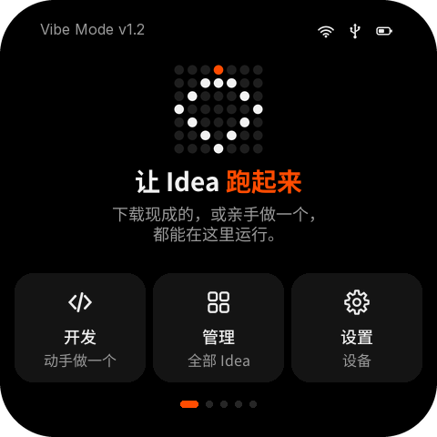
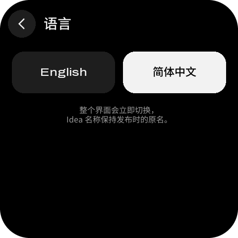

# Vibe Mode 0.3 界面设计与功能定义（阶段 A · 第 11 版）

| 项目 | 内容 |
| --- | --- |
| 状态 | v11 已实现；本目录只包含设计工具和生成物，**不修改固件** |
| 范围 | 480×480 Vibe Mode：首页、Idea 横向分页、Manage / Idea info / Download / Develop / Settings / Shared info |
| 语言 | English / 简体中文，在 Settings → Language 切换；命名统一为 **Idea** |
| 页面图 | `mockups/`（英文）和 `mockups/zh/`（中文）：各 70 个页面状态，由 `layout.json`（schema `vibe-mode-design/11`）渲染，带 60 px 屏幕圆角遮罩 |
| 原型 | `prototype/index.html`：单文件离线原型，横向翻页 + 子页栈 + 打开确认 + 左滑删除 / Undo + 长按删除 + 触感 + 息屏 + IMU 旋转 + Boot 键 + 中英文切换 + NVS 面板 |
| 验证 | `build_design.py --strict`：两种语言 0 layout issues、0 漏翻；Playwright smoke：175 passed, 0 failed |


中文版总览：[`mockups/zh/00-overview.png`](mockups/zh/00-overview.png)

## 0. 演示数据与 Idea 图标

示例 Idea 换成了 mosaico-ui 里的 Mosaico App（Pet Talk、Clock、Album、Agenda、Weather……，商店里有 Rolling Maze、Gold Miner），图标**直接使用** `design/mosaico-ui/src/assets/app-icons/<name>.png`（236 px 原图），`generate_assets.py` 只做等比缩小到 56 / 96 / 108 px，输出到 `assets/ideas/`，不重新绘制。来源与授权见 mosaico-ui 的 `ASSET-LICENSES.md`。只有没有图标的开发版（如 Agent 刚装的 hello_world）和末尾的 “+” 仍用本目录生成的占位图。ID、版本、大小和状态（当前、可更新、商店、空间不足）沿用原来的示例。

## 1. v11 修订：系统语言（English / 简体中文）

 

**入口与行为**
- Settings 第 5 行 **Language / 语言**，副标题显示当前语言。语言页两个大按钮，每种语言用它自己的文字写（English / 简体中文），不认识当前语言的人也能找到自己的。
- 点一下立即切换整个界面，提示 “已切换为简体中文” / “Language: English”，不重启。选择存到 `sysmeta/vibe_prefs/lang`；原型存在 localStorage `vibe-lang`，刷新后保持。
- 不翻译的内容：Idea 名称（按发布时的原名）、Wi‑Fi 名称、网址、共享信息的键和值。Idea 简介和分类由商店按设备语言下发，原型用 `i18n.py` 里的示例译文。

**实现**
- 英文是源文本。`tools/i18n.py` 是唯一的翻译表，共 283 条，其中 37 条是带 `{占位符}` 的句式；捕获到的值会再查一次表，例如 “Secured · Strong” → “已加密 · 信号强”。
- `build_design.py` 用同一份布局代码按语言各排一遍：中文状态写入 `layout.json` 的 `locales.zh`，原型模板写入 `prototype.locales.zh`，页面图输出到 `mockups/zh/`。原型切换语言时换用对应模板，运行时拼出的文案在显示前走同一张表（`L()`）。
- 字体：一行里有汉字，整行就用 Noto Sans CJK SC 排（`sans` → Regular，`medium` → Medium，`dot` → Bold），与拉丁字母的字重、基线一致。子集只含翻译表里出现的约 590 个字符，每个字重约 105 KB（OFL，见 `assets/fonts/OFL-NotoSansSC.txt`）。中文行高 1.15–1.2；折行按字切分，标点不放在行首，手写换行优先。
- 中文断行不照搬英文：英文靠手动换行凑出两行均衡，中文左对齐时这样会留下一截短行，像话说到一半。规则是放得下就写成一行（确认框的返回说明、帮助步骤、Idea 简介）；放不下时只在逗号或句号处断开，而且第一行要基本排满（≥ 75 %）。居中的短句（首页介绍、结果页说明）可以在逗号处断开，让两行长短均衡。最后一行不能只剩一两个字，“AI 键”这类按键名不能拆到两行。
- 检查：中文构建时 `--strict` 会把所有残留的英文单词列出来（名称和保留术语除外），并按上面的断行规则检查所有页面、Idea 简介和帮助步骤，目前都是 0。smoke 切到中文后走查 25 个页面，检查残留英文和被截断的中文，再验证刷新后保持、能切回英文。

**术语**

| 英文 | 中文 | 说明 |
| --- | --- | --- |
| Idea / Ideas | Idea | 产品概念，保留原文，不译“创意”“应用” |
| Vibe Mode、AI、Agent、Wi‑Fi、USB、NAND、Boot | 原文 | 品牌、按键丝印和通用技术词 |
| AI key / power key / Boot key | AI 键 / 电源键 / Boot 键 | 与机身按键对应 |
| Make Ideas Run | 让 Idea 跑起来 | 口语、有动感；品牌名保留 |
| Manage / Develop / Settings | 管理 / 开发 / 设置 | 首页三张卡片，副标题“全部 Idea / 动手做一个 / 设备” |
| Shared info | 共享信息 | 所有 Idea 都能读到的键值 |
| Hold AI · Press twice | 按住 AI 键 · 连按两下 | 打开确认框里指向按键的提示 |
| Go（ID 键盘） | 查找 | 这一步是去商店查询，不是“前往” |
| GO / space（全键盘） | 确定 / 空格 | |
| Screen off after 3 min | 3 分钟无操作后息屏 | 说清触发条件 |
| Lock（AI 键反馈） | 息屏 | 首页按 AI 键的实际效果 |
| Not deleted | 未删除 | 长按中途松手 |

**同时修改的英文文案**

| 位置 | 原来 | 现在 | 原因 |
| --- | --- | --- | --- |
| Help 主题底部按钮 | Show QR code | Full guide on your phone | 说清点了以后能得到什么，二维码只是手段 |
| About 底部按钮 | Mosaico Ideas | Browse Mosaico Ideas | 只有名字，看不出是一个动作 |
| Settings → Help 副标题 | Guides and QR codes | How-to guides and fixes | 写内容，不写形式 |
| Getting started 第 2 步 | Or type an Idea ID in Manage to download it. | Or download one: open Manage, tap +, type its ID. | 写出真实操作路径 |
| Getting started 第 3 步 | Tap an Idea to open it. Hold AI to come back. | … To come back, hold AI and press power twice. | 原文只写了一半，照做回不来 |
| Download 提示 | Type the 6-digit ID | Enter the 6-digit ID from Mosaico Ideas | 说明 ID 从哪来 |
| Display → Auto-rotate | Turns with the device (IMU) / Locked in this orientation | Follows how you hold it / Stays in this orientation | 去掉术语，写用户感受 |
| 当前网络页的安全性 | Open | None | “Open” 和页面上的打开操作容易混淆 |
| 忘记网络说明 | Ideas lose Wi-Fi until you reconnect. | After forgetting, Ideas stay offline until you reconnect. | 说清是“忘记之后” |
| 进度页 | Keep the device powered on. | Keep the device on until this finishes. | 说明要保持多久 |
| 保存结果 | It is on this device now. | Find it on your Ideas pages. | 告诉用户下一步去哪找 |

## 2. v10 修订：系统行为

### IMU 自动旋转

界面是正方形，旋转时不重新排版，只转方向：

- **屏幕方向**：QSPI 屏通过 MADCTL 的 MV/MX/MY 位（`esp_lcd_panel_swap_xy` / `mirror`）直接旋转扫描方向，触摸坐标做同样的变换，整帧重绘，并用 120 ms 淡入淡出遮住撕裂。
- **方向判断**：按 IMU 的重力方向分 0° / 90° / 180° / 270° 四档。偏离当前方向超过 60° 才切换，另有 15° 回差，并且要保持 300 ms；设备平放时（|z| > 0.8 g）不切换。
- **暂不旋转的时机**：手指按着屏幕、正在键盘页输入、正在长按 3 秒时；离开这些状态后再转。
- **开关**：Settings → Display → **Auto-rotate**，关闭后界面跟着设备一起转。

参数见 `tokens.orientation`。

### AI 键按下反馈（类似 iPhone 侧键）

- 按下瞬间：屏幕上沿、AI 键正下方长出一条 64×8 的橙色短条，同时触感一下。
- 松开后：短条下方弹出一个小标签，写明这次按键做了什么——`Back`（返回）/ `Home`（回首页）/ `Lock`（息屏）/ `Close`（关闭弹窗）/ `Wake`（唤醒）。停留 0.5 s 后淡出。
- 反馈固定在**设备边缘、按键下方**，不跟着界面转；界面旋转后，标签会反向旋转保持可读。

参数见 `tokens.key_feedback`。

### 息屏锁屏

- **进入方式**：在首页按 AI 键；或者无操作超过设定时间。时间在 Settings → Display 里选，可选 1 / 3 / 5 / 10 分钟或 Never，默认 3 分钟。
- **息屏时**：Wi‑Fi 断开，背光降到 10 %，屏幕只显示一帧静态画面：点阵图形 + **Make Ideas Run** + `Vibe Mode v1.2` + `Tap or pick up to wake`。
- **唤醒**：点屏幕、IMU 检测到移动、或按任意键。唤醒后回到原来的页面，Wi‑Fi 自动重连。
- **不会息屏的时候**：正在下载 / 安装 / 切换、后台更新进行中、Idea 正在运行。

参数见 `tokens.screen_off`。Settings 现在有 5 行（多了 Display），所以改为可滚动列表。

### Boot 键

- **按住底部左侧的 Boot 键（0.6 s）**：打开 *Update Vibe Mode* 说明页。页面写明只有安装新的 Vibe Mode 版本时才需要 Boot 键，用 `Hold Boot` + `Press power twice` 两个标签说明怎么进入更新模式，并附二维码（`mosaico.espressif.com/vibe/update`）去网页看详细步骤。点 `Got it` 或按 AI 关闭。
- **按住 Boot 再双击开关机键**：进入 *Update mode* 页（二维码 + 网址）。这个页面不在 Vibe Mode 的页面栈里，AI 键无效；按一次开关机键重启回到 Vibe Mode。

### 完成时的震动

下载完成、更新完成、存入 NAND 完成、切换 Idea 写入完成、Agent 安装完成时，都给一次“成功”震动：14 ms → 隔 70 ms → 22 ms。下载失败给两下 40 ms。参数见 `tokens.haptics.success` / `error`。

## 3. v9 修订

### 首页与翻页

| 项 | 做法 |
| --- | --- |
| 升级标识 | 首页状态栏不再显示 “↑ 2 updates”；更新只在 Idea 图标角标和 Manage 里出现 |
| 翻页 | 只有内容左右移动，**状态栏和底部圆点固定不动**；落到新页后状态栏中间显示 `Home` / `Ideas 2/4`，2 秒后消失 |
| 首次提示 | 首次使用时首页右边缘有一个朝左的橙色三角，循环做“左移 + 轻晃”；用户第一次翻页后永久消失（`vibe_prefs/pager_hint`）。三角放在右边缘、指向左，因为首页左边没有页面，下一页在右边、要向左滑 |
| 添加 Idea | Ideas 最后一格是石墨色圆 + 大号白色 `+`；点按进入 Manage 里的 Download Idea，返回回到 Manage |

### 打开 Idea 前确认

点 Idea 不再直接进入，先弹出确认框：

- 标题 `Open <Idea>?`，副标题说明 Vibe Mode 会关闭；如果正在运行的是还没存到 NAND 的开发版，改为橙色提醒 `Unsaved hello_world will be replaced.`
- “To come back to Vibe Mode” 区块：`Hold AI` + `Press power twice` 两个按键标签。
- `Cancel` / `Open`；AI 键也能关闭。
- 底部 `Don't show this again` 勾选框；勾选后点 Open，之后点 Idea 直接进入（`vibe_prefs/open_confirm`）。

### 删除

| 位置 | 做法 |
| --- | --- |
| Idea info | **长按 3 秒**删除。按下后 Open 缩成只剩图标，Delete 变宽，按钮里的红色进度条随时间填满，文字倒数 `Keep holding · 2 s`；上方内容变暗并弹出 `Delete <Idea>? Keep holding for 3 s. Let go to cancel.` 中途松手：恢复原样并提示 `Not deleted`。只点一下：提示 `Hold for 3 s to delete` |
| Manage / Shared 列表 | 行左滑露出 Delete，点按删除，4 秒内可 Undo（不变） |
| 忘记 Wi‑Fi | 同样长按 3 秒 |

删除相关统一用红色 `#E5484D`（Delete、进度、忘记网络），橙色只表示“需要注意”。

### Manage 与 Develop

- Manage 的更新按钮图标改为**向上箭头 + 底线**（upgrade），不再用刷新图标；Idea info 的 “Update to v…” 行同步使用。
- Develop 第三行从 “Share your Idea” 改为 **Save to NAND flash**：Agent 通过 USB 装的 Idea 只在运行区，存到 NAND 后才会出现在 Ideas 里，下次可以切回来。没有开发版时这一行置灰：`Install an Idea over USB first`。

### 状态栏

USB 未连接时和 Wi‑Fi 断开一样，显示**灰色带斜线**的 USB 图标。

### 图标配色

上一版每个功能一种颜色（蓝、青、紫、琥珀），在黑底上显得杂、像玩具。现在统一成一套单色：

| 用途 | 图块 | 图标 |
| --- | --- | --- |
| 普通（neutral） | 石墨 `#232323` | 米白 `#E9E2D6`（设备外壳的颜色） |
| 需要注意（accent） | 橙色 16 % | 橙 `#FF4C01`（如 Vibe-code、Update to …） |
| 不可用（muted） | `#1A1A1A` | 灰 `#9A9A9A` |

一个页面里最多一个橙色图块；功能靠图标形状区分，不靠颜色。

### 键盘

| 键盘 | 做法 |
| --- | --- |
| 全键盘 GO | 输入有效时才是橙色：密码 ≥8 位；Shared 的 key / value 非空。否则和功能键同色、文字变暗，按下给出说明 |
| ID 键盘 Go | 输满 6 位才变橙色；查询中变回灰色 |
| 按下放大 | ID 键盘按下时键位放大 14 %（设计图 `download-typing` 展示：键位四周各外扩 6 px 并提亮）；全键盘保留放大气泡 |
| 触感 | **按下（touch-down）即触发**，不等抬起：普通键一下 8 ms 的“嗒”；GO / Go 可用时 8 ms + 45 ms 间隔 + 8 ms 的双击感；不可用时一下 24 ms 的低沉震动；长按退格清空 14 ms |

触感参数在 `layout.json` 的 `tokens.haptics`。固件建议用 LRA 在谐振频率驱动并主动刹车，8 ms 的脉冲才会“清脆”而不是“嗡”。原型里：支持 Vibration API 的手机（Android Chrome）会真实震动，其他设备用很短的“嗒”声代替，可在右侧“模拟”里关闭。

### Toast 位置

有底部按钮的页面（Idea info、结果页、Shared 条目、Help 主题、About、进度、当前网络）和 ID 键盘页，toast 自动上移，不遮挡按钮（`tokens.toast.lift`）。

## 4. 480×480 设计系统

| 项目 | 值 |
| --- | --- |
| 屏幕 | 480×480，显示宽 38.8 mm，`SCREEN_R = 60` |
| 外边距 | 常规 16 px；底部操作按钮 24 px |
| 根页面 | 状态栏 y < 56（固定），内容区横向翻页，页码圆点 y = 440（固定） |
| 二级页页头 | 返回圆 (16, 20)，标题 x = 88，内容 y = 96；没有状态栏 |
| 列表行 | 80 px 卡片 + 8 px 间隔（88 px 行距），前导 56 px，常显滚动条 |
| 底部操作 | y = 380，高 84；Idea info 为 y = 360、高 96（长按目标） |
| 默认触控 | ≥84×84；密集（列表行、键盘、左滑 Delete、确认框勾选行）≥72 |
| 长按 | 3 s，高 96 px，距屏幕边 ≥24 px、距其他按钮 ≥24 px |
| 字号 | `sans` 16/18/24 · `medium` 16/18/22/28 · `dot` 18/22/28/40/88 |
| 颜色 | 背景 `#000` · 卡片 `#141414` · 强调橙 `#FF4C01` · 删除红 `#E5484D` · 米白 `#E9E2D6` · 主按钮 `#F2F2F2` / `#000` |
| 方向 | 0 / 90 / 180 / 270°，面板旋转，不重排 |
| 息屏 | 背光 10 %，Wi‑Fi 断开，1 / 3 / 5 / 10 分钟 / Never |

## 5. 页面与状态（每种语言 70 个）

| 区域 | 状态 |
| --- | --- |
| Home | 默认、首次使用（三角提示 + 页名）、离线、按下 AI（Lock 反馈） |
| 息屏 | 低亮度 Make Ideas Run · Vibe Mode |
| Ideas | 页 1–4（含页名）、空列表、打开确认框 |
| Manage | 有更新、更新中、左滑露出 Delete、删除后 Undo、已是最新 |
| Idea info | local / update / remote / nospace / current、长按删除中 |
| Download | 空、输入中（按住一个键）、满 6 位、查询中、报错、离线 |
| Progress / Result | download、install、switch、agent；saved / failed / nospace / battery |
| Develop | ready / waiting / unplugged |
| Settings / Display / Language / Help / About | 可滚动列表、按下 AI（Back 反馈）、Display（3 分钟 + 自动旋转 / 永不 + 锁定方向）、语言、帮助主题、关于 |
| Boot 键 | 更新说明（二维码）、更新模式 |
| Wi‑Fi | 已连、未连、待续任务、连接中、当前网络、密码三态 |
| Shared | 列表、左滑、空、说明页、条目、新 key、value、改 key |
| 二维码 | 开发指南、某个 Idea |
| 其它 | Launching、Running、Boot |

机器可读定义见 `layout.json`；命名对象见 `layout-tables.md`。

## 6. 交互表

| # | 场景 | 行为 |
| --- | --- | --- |
| 1 | 横向翻页 | 内容跟手，状态栏和圆点不动；≥56 px 或甩动提交；落页后显示页名 2 s |
| 2 | 打开 Idea | 点格子 → 确认框（可关闭以后不再问）→ 当前直接 Launching；其它先 Switching（1.5 s 内可 Cancel） |
| 3 | AI 键 | 息屏：唤醒；弹窗：关闭；子页：返回；Ideas 页：回 Home；Home：息屏。按下时按键下方屏幕边缘亮橙条，松开显示动作名 |
| 4 | 边缘返回 | 左缘 24 px 内右滑：≥96 px 或甩动提交 |
| 5 | 更新 | Manage 页头 ↑ 按钮：逐个后台更新，转圈 + 剩余数量；断网暂停 |
| 6 | 左滑删除 | 行左滑超过 52 px 停在露出 Delete；点别处先收起；当前 Idea 回弹 |
| 7 | Undo | 列表删除立即生效，toast 4 s；离开页面或 toast 消失后才真正删除文件 |
| 8 | 长按删除 | Idea info / 忘记 Wi‑Fi：按住 3 s；中途松手取消 |
| 9 | 键盘 | 输入有效前 GO 为灰；按下即触感；ID 键按下放大 |
| 10 | Download | 6 位 ID 逐格填入 → Go → 查询 → Idea info → Download |
| 11 | Shared | ? 说明；+ 先 key 后 value；条目页分别改 Key / Value |
| 12 | 开发 | Agent 装到运行区 → Develop → Save to NAND flash → 出现在 Ideas |
| 13 | 离线续接 | 查询 / 下载 / 更新离线进 Wi‑Fi；连上后续跑；离开则 Cancelled |
| 14 | 回到 Vibe Mode | 运行中按住 AI 并双击电源 |
| 15 | 息屏 / 唤醒 | 首页按 AI 或超时 → 息屏；点屏 / 晃动 / 按键 → 唤醒，回原页面并重连 Wi‑Fi |
| 16 | 旋转 | IMU 换方向 → 面板旋转；按住屏幕、在键盘页或长按删除时先不转 |
| 17 | Boot 键 | 按住：更新说明；按住 + 双击电源：更新模式；更新模式里按一次电源：重启 |

## 7. 本地数据与 sysmeta

```text
/nand/ideas/<idea_id>/…
sysmeta/wifi/*                   # Wi‑Fi（Settings → Wi‑Fi 管理）
sysmeta/shared/<key>             # 用户自定义；key ≤15（a–z 0–9 _），value 字符串 ≤256
sysmeta/vibe_prefs/pager_hint    # 首页翻页提示已看过
sysmeta/vibe_prefs/open_confirm  # 打开 Idea 前是否确认
sysmeta/vibe_prefs/display       # screen_off_s（60/180/300/600/0）、auto_rotate
sysmeta/vibe_prefs/lang          # en / zh
```

删除 Idea / 条目在 Undo 窗口结束后再提交到 NAND / NVS。改 key 是“写新 key、删旧 key”的一次事务。

## 8. 阶段 B handoff

- 保持 `layout.json` 对象名和 `tokens`（`row`、`tints`、`haptics`、`toast.lift`）、`prototype.interactions`（`undo_ms`、`swipe_*`、`page_label_ms`、`danger_hold_ms`）。
- 根层：状态栏和圆点放在横向 pager 容器之外；二级页用原生 Stack，不挂状态栏。
- 长按删除：按下时把 Open / Delete 动画到 `hold_expand` 指定的矩形，显示 `delete_popup`；计时 3 s，中途松手还原。
- 触感在 touch-down 中断里直接触发，不要排到 UI 刷新之后。
- 旋转用面板配置实现（不在软件里转帧缓冲）；触摸变换和面板同步切换。
- 息屏：关 Wi‑Fi、背光 10 %、停止刷新；IMU 运动中断 + 触摸唤醒 + 按键唤醒。
- AI 键反馈画在面板坐标（设备固定），不随界面方向。
- 真机复核：R60 裁切、84 px 触控、QR（6 px 模块）扫描距离、AI GPIO、LRA 手感、帧率。

## 9. 再生成与验证

```sh
cd esp-mosaico-recovery/docs/vibe-mode-0.3-design

.venv/bin/python tools/generate_assets.py          # 或 --skip-fonts；--skip-cjk 保留现有中文子集
.venv/bin/python tools/build_design.py --strict
.venv/bin/python tools/build_prototype.py
node tools/prototype_smoke.js [截图目录]
```

预期：

```text
70 states × 2 languages rendered; 0 layout issues
175 passed, 0 failed
```
