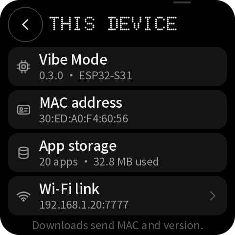

# 附录：逐页布局表

由 `tools/build_design.py` 生成，与 `layout.json` 和页面图一致；坐标单位为 480×480 逻辑像素。
只列出有名称（阶段 B 需要绑定或更新）或可点击的对象；装饰对象见 `layout.json`。

## guide-1 — Guide 1/4

| 名称 | 类型 | x, y, w, h | 样式 | 内容 / 动作 |
|---|---|---|---|---|
| `guide_step` | label | 20, 26, 140, 32 | dot 32px #9A9A9A | 01/04 |
| `button_skip` | button | 344, 12, 120, 72 | medium 28px #9A9A9A | Skip → `guide:done` |
| `button_guide_next` | button | 16, 388, 448, 80 | medium 28px #000000 | Next → `guide:2` |
| `ai_cue` | container | 354, 3, 36, 4 | #3A3A3A |  |

## guide-2 — Guide 2/4

| 名称 | 类型 | x, y, w, h | 样式 | 内容 / 动作 |
|---|---|---|---|---|
| `guide_step` | label | 20, 26, 140, 32 | dot 32px #9A9A9A | 02/04 |
| `button_skip` | button | 344, 12, 120, 72 | medium 28px #9A9A9A | Skip → `guide:done` |
| `guide_ring_ai` | container | 130, 149, 46, 27 |  |  |
| `guide_ring_power` | container | 130, 304, 46, 27 |  |  |
| `button_guide_back` | button | 16, 388, 140, 80 | medium 28px #F2F2F2 | Back → `guide:1` |
| `button_guide_next` | button | 164, 388, 300, 80 | medium 28px #000000 | Next → `guide:3` |
| `ai_cue` | container | 354, 3, 36, 4 | #3A3A3A |  |

## guide-3 — Guide 3/4

| 名称 | 类型 | x, y, w, h | 样式 | 内容 / 动作 |
|---|---|---|---|---|
| `guide_step` | label | 20, 26, 140, 32 | dot 32px #9A9A9A | 03/04 |
| `button_skip` | button | 344, 12, 120, 72 | medium 28px #9A9A9A | Skip → `guide:done` |
| `button_guide_back` | button | 16, 388, 140, 80 | medium 28px #F2F2F2 | Back → `guide:2` |
| `button_guide_next` | button | 164, 388, 300, 80 | medium 28px #000000 | Next → `guide:4` |
| `ai_cue` | container | 354, 3, 36, 4 | #3A3A3A |  |

## guide-4 — Guide 4/4

| 名称 | 类型 | x, y, w, h | 样式 | 内容 / 动作 |
|---|---|---|---|---|
| `guide_step` | label | 20, 26, 140, 32 | dot 32px #9A9A9A | 04/04 |
| `button_skip` | button | 344, 12, 120, 72 | medium 28px #9A9A9A | Skip → `guide:done` |
| `guide_key_0` | container | 16, 148, 128, 64 | #1E1E1E |  |
| `guide_key_1` | container | 16, 228, 128, 64 | #1E1E1E |  |
| `guide_key_2` | container | 16, 308, 128, 64 | #1E1E1E |  |
| `button_guide_back` | button | 16, 388, 140, 80 | medium 28px #F2F2F2 | Back → `guide:3` |
| `button_guide_next` | button | 164, 388, 300, 80 | medium 28px #000000 | Start → `guide:done` |
| `ai_cue` | container | 354, 3, 36, 4 | #3A3A3A |  |

## home — Home · all apps, agent connected

| 名称 | 类型 | x, y, w, h | 样式 | 内容 / 动作 |
|---|---|---|---|---|
| `status_wifi` | image | 330, 17, 28, 28 |  | wifi-28-white.png |
| `status_agent` | image | 368, 17, 28, 28 |  | robot-28-orange.png |
| `status_battery` | image | 406, 17, 28, 28 |  | battery_mid-28-white.png |
| `button_filter` | button | 16, 56, 288, 72 | #000000 | → `go:categories` |
| `home_title` | label | 40, 74, 218, 35 | medium 28px #F2F2F2 | All apps |
| `button_help_home` | button | 312, 56, 72, 72 | #000000 | → `help:topics` |
| `button_device` | button | 392, 56, 72, 72 | #000000 | → `go:device` |
| `apps` | list | 16, 140, 448, 240 | 行高 96 | 行模板 `apps_row` |
| `button_download` | button | 16, 388, 216, 80 | medium 28px #000000 | Download → `go:download` |
| `button_develop` | button | 248, 388, 216, 80 | medium 28px #F2F2F2 | Develop → `go:develop` |
| `ai_cue` | container | 354, 3, 36, 4 | #3A3A3A |  |

## categories — Show: all, favorites, categories

| 名称 | 类型 | x, y, w, h | 样式 | 内容 / 动作 |
|---|---|---|---|---|
| `button_back_categories` | button | 16, 14, 72, 72 | #000000 | → `back` |
| `button_help_categories` | button | 392, 14, 72, 72 | #000000 | → `help:start` |
| `categories_title` | label | 100, 30, 276, 40 | dot 40px #F2F2F2 | SHOW |
| `category_all` | button | 16, 96, 216, 84 | #141414 | → `filter:all` |
| `category_all_count` | label | 136, 108, 80, 32 | dot 32px #9A9A9A | 20 |
| `category_favorites` | button | 248, 96, 216, 84 | #141414 | → `filter:favorites` |
| `category_favorites_count` | label | 368, 108, 80, 32 | dot 32px #9A9A9A | 03 |
| `category_display` | button | 16, 188, 216, 84 | #141414 | → `filter:display` |
| `category_display_count` | label | 136, 200, 80, 32 | dot 32px #9A9A9A | 05 |
| `category_audio` | button | 248, 188, 216, 84 | #141414 | → `filter:audio` |
| `category_audio_count` | label | 368, 200, 80, 32 | dot 32px #9A9A9A | 03 |
| `category_smart-home` | button | 16, 280, 216, 84 | #141414 | → `filter:smart-home` |
| `category_smart-home_count` | label | 136, 292, 80, 32 | dot 32px #9A9A9A | 03 |
| `category_selected` | container | 16, 280, 216, 84 |  |  |
| `category_sensors` | button | 248, 280, 216, 84 | #141414 | → `filter:sensors` |
| `category_sensors_count` | label | 368, 292, 80, 32 | dot 32px #9A9A9A | 03 |
| `category_communication` | button | 16, 372, 216, 84 | #141414 | → `filter:communication` |
| `category_communication_count` | label | 136, 384, 80, 32 | dot 32px #9A9A9A | 03 |
| `category_motor` | button | 248, 372, 216, 84 | #141414 | → `filter:motor` |
| `category_motor_count` | label | 368, 384, 80, 32 | dot 32px #9A9A9A | 03 |
| `ai_cue` | container | 354, 3, 36, 4 | #3A3A3A |  |

## download — Download · empty

| 名称 | 类型 | x, y, w, h | 样式 | 内容 / 动作 |
|---|---|---|---|---|
| `button_back_download` | button | 16, 14, 72, 72 | #000000 | → `back` |
| `button_browse` | button | 392, 14, 72, 72 | #000000 | → `qr:ideas` |
| `download_title` | label | 100, 30, 276, 40 | dot 40px #F2F2F2 | DOWNLOAD |
| `id_digits` | label | 24, 106, 432, 44 | dot 44px #F2F2F2 |   |
| `id_digits_compact` | label | 24, 112, 432, 32 | dot 32px #F2F2F2 |   |
| `id_status` | label | 24, 112, 432, 33 | sans 26px #9A9A9A | Type the app ID |
| `key_1` | button | 16, 168, 144, 72 | dot 40px #F2F2F2 | 1 → `key:1` |
| `key_2` | button | 168, 168, 144, 72 | dot 40px #F2F2F2 | 2 → `key:2` |
| `key_3` | button | 320, 168, 144, 72 | dot 40px #F2F2F2 | 3 → `key:3` |
| `key_4` | button | 16, 244, 144, 72 | dot 40px #F2F2F2 | 4 → `key:4` |
| `key_5` | button | 168, 244, 144, 72 | dot 40px #F2F2F2 | 5 → `key:5` |
| `key_6` | button | 320, 244, 144, 72 | dot 40px #F2F2F2 | 6 → `key:6` |
| `key_7` | button | 16, 320, 144, 72 | dot 40px #F2F2F2 | 7 → `key:7` |
| `key_8` | button | 168, 320, 144, 72 | dot 40px #F2F2F2 | 8 → `key:8` |
| `key_9` | button | 320, 320, 144, 72 | dot 40px #F2F2F2 | 9 → `key:9` |
| `key_del` | button | 16, 396, 144, 72 | #000000 | → `key:del` |
| `key_0` | button | 168, 396, 144, 72 | dot 40px #F2F2F2 | 0 → `key:0` |
| `key_go` | button | 320, 396, 144, 72 | #FF4C01 | → `key:go` |
| `ai_cue` | container | 354, 3, 36, 4 | #3A3A3A |  |

## develop — Develop

| 名称 | 类型 | x, y, w, h | 样式 | 内容 / 动作 |
|---|---|---|---|---|
| `button_back_develop` | button | 16, 14, 72, 72 | #000000 | → `back` |
| `button_help_develop` | button | 392, 14, 72, 72 | #000000 | → `help:develop` |
| `develop_title` | label | 100, 30, 276, 40 | dot 40px #F2F2F2 | DEVELOP |
| `develop_status_on` | label | 16, 96, 448, 28 | sans 22px #FF4C01 | ● USB connected · AI agent ready |
| `button_step_1` | button | 16, 132, 448, 88 | #141414 | → `qr:develop` |
| `button_step_3` | button | 16, 324, 448, 88 | #141414 | → `qr:ideas` |
| `ai_cue` | container | 354, 3, 36, 4 | #3A3A3A |  |

## detail-current — Detail · current app (favorite)

| 名称 | 类型 | x, y, w, h | 样式 | 内容 / 动作 |
|---|---|---|---|---|
| `button_back_detail` | button | 16, 14, 72, 72 | #000000 | → `back` |
| `button_favorite_on` | button | 392, 14, 72, 72 | #000000 | → `app:favorite` |
| `detail_title` | label | 100, 30, 276, 40 | dot 40px #F2F2F2 | APP |
| `detail_tile` | container | 16, 96, 96, 96 | #262626 |  |
| `detail_initial` | label | 16, 115, 96, 64 | dot 64px #F2F2F2 | P |
| `detail_name` | label | 128, 100, 336, 43 | medium 34px #F2F2F2 | Pixel Pet |
| `detail_id` | label | 128, 148, 220, 32 | dot 32px #FF4C01 | 100001 |
| `detail_status_accent` | label | 16, 204, 448, 35 | medium 28px #FF4C01 | ● Current app |
| `detail_facts` | label | 16, 244, 448, 28 | sans 22px #9A9A9A | Display · Official · v1.2.0 · 1.8 MB |
| `button_primary` | button | 16, 288, 448, 80 | medium 28px #000000 | Open → `app:run` |
| `button_secondary` | button | 16, 376, 144, 88 | medium 22px #F2F2F2 | Update → `app:update` |
| `button_tertiary` | button | 168, 376, 144, 88 | medium 22px #FF4C01 | Delete → `app:delete_ask` |
| `button_about` | button | 320, 376, 144, 88 | medium 22px #F2F2F2 | About → `go:about` |
| `ai_cue` | container | 354, 3, 36, 4 | #3A3A3A |  |

## detail-local — Detail · saved app

| 名称 | 类型 | x, y, w, h | 样式 | 内容 / 动作 |
|---|---|---|---|---|
| `button_back_detail` | button | 16, 14, 72, 72 | #000000 | → `back` |
| `button_favorite_off` | button | 392, 14, 72, 72 | #000000 | → `app:favorite` |
| `detail_title` | label | 100, 30, 276, 40 | dot 40px #F2F2F2 | APP |
| `detail_tile` | container | 16, 96, 96, 96 | #262626 |  |
| `detail_initial` | label | 16, 115, 96, 64 | dot 64px #F2F2F2 | A |
| `detail_name` | label | 128, 100, 336, 43 | medium 34px #F2F2F2 | Air Monitor |
| `detail_id` | label | 128, 148, 220, 32 | dot 32px #FF4C01 | 100012 |
| `detail_status` | label | 16, 204, 448, 35 | medium 28px #F2F2F2 | Saved · not running |
| `detail_facts` | label | 16, 244, 448, 28 | sans 22px #9A9A9A | Sensors · Official · v1.2.2 · 1.3 MB |
| `button_primary` | button | 16, 288, 448, 80 | medium 28px #000000 | Run this app → `app:run` |
| `button_secondary` | button | 16, 376, 144, 88 | medium 22px #F2F2F2 | Update → `app:update` |
| `button_tertiary` | button | 168, 376, 144, 88 | medium 22px #FF4C01 | Delete → `app:delete_ask` |
| `button_about` | button | 320, 376, 144, 88 | medium 22px #F2F2F2 | About → `go:about` |
| `ai_cue` | container | 354, 3, 36, 4 | #3A3A3A |  |

## detail-delete — Detail · delete confirmation

| 名称 | 类型 | x, y, w, h | 样式 | 内容 / 动作 |
|---|---|---|---|---|
| `button_back_detail` | button | 16, 14, 72, 72 | #000000 | → `back` |
| `button_favorite_off` | button | 392, 14, 72, 72 | #000000 | → `app:favorite` |
| `detail_title` | label | 100, 30, 276, 40 | dot 40px #F2F2F2 | APP |
| `detail_tile` | container | 16, 96, 96, 96 | #262626 |  |
| `detail_initial` | label | 16, 115, 96, 64 | dot 64px #F2F2F2 | A |
| `detail_name` | label | 128, 100, 336, 43 | medium 34px #F2F2F2 | Air Monitor |
| `detail_id` | label | 128, 148, 220, 32 | dot 32px #FF4C01 | 100012 |
| `detail_status` | label | 16, 204, 448, 35 | medium 28px #F2F2F2 | Saved · not running |
| `detail_facts` | label | 16, 244, 448, 28 | sans 22px #9A9A9A | Sensors · Official · v1.2.2 · 1.3 MB |
| `button_primary` | button | 16, 288, 448, 80 | medium 28px #000000 | Run this app → `app:run` |
| `button_secondary` | button | 16, 376, 144, 88 | medium 22px #F2F2F2 | Update → `app:update` |
| `button_delete_confirm` | button | 168, 376, 144, 88 | medium 22px #FFFFFF | Tap again → `app:delete` |
| `button_about` | button | 320, 376, 144, 88 | medium 22px #F2F2F2 | About → `go:about` |
| `ai_cue` | container | 354, 3, 36, 4 | #3A3A3A |  |

## detail-remote — Detail · found on Mosaico Ideas

| 名称 | 类型 | x, y, w, h | 样式 | 内容 / 动作 |
|---|---|---|---|---|
| `button_back_detail` | button | 16, 14, 72, 72 | #000000 | → `back` |
| `detail_title` | label | 100, 30, 356, 40 | dot 40px #F2F2F2 | APP |
| `detail_tile` | container | 16, 96, 96, 96 | #262626 |  |
| `detail_initial` | label | 16, 115, 96, 64 | dot 64px #F2F2F2 | R |
| `detail_name` | label | 128, 100, 336, 43 | medium 34px #F2F2F2 | Retro Snake |
| `detail_id` | label | 128, 148, 220, 32 | dot 32px #FF4C01 | 238114 |
| `detail_status` | label | 16, 204, 448, 35 | medium 28px #F2F2F2 | Not on this device |
| `detail_facts` | label | 16, 244, 448, 28 | sans 22px #9A9A9A | Display · Community · v1.0.3 · 0.9 MB |
| `button_primary` | button | 16, 288, 448, 80 | medium 28px #000000 | Download & run → `store:run` |
| `button_secondary` | button | 16, 376, 144, 88 | medium 22px #F2F2F2 | Save only → `store:keep` |
| `button_about` | button | 168, 376, 144, 88 | medium 22px #F2F2F2 | About → `go:about` |
| `button_tertiary` | button | 320, 376, 144, 88 | medium 22px #F2F2F2 | Cancel → `back` |
| `ai_cue` | container | 354, 3, 36, 4 | #3A3A3A |  |

## detail-update — Detail · update available

| 名称 | 类型 | x, y, w, h | 样式 | 内容 / 动作 |
|---|---|---|---|---|
| `button_back_detail` | button | 16, 14, 72, 72 | #000000 | → `back` |
| `detail_title` | label | 100, 30, 356, 40 | dot 40px #F2F2F2 | APP |
| `detail_tile` | container | 16, 96, 96, 96 | #262626 |  |
| `detail_initial` | label | 16, 115, 96, 64 | dot 64px #F2F2F2 | V |
| `detail_name` | label | 128, 100, 336, 43 | medium 34px #F2F2F2 | Voice Notes |
| `detail_id` | label | 128, 148, 220, 32 | dot 32px #FF4C01 | 100006 |
| `detail_status_accent` | label | 16, 204, 448, 35 | medium 28px #FF4C01 | Update v1.0.0 → v1.1.0 |
| `detail_facts` | label | 16, 244, 448, 28 | sans 22px #9A9A9A | Audio · Official · v1.1.0 · 3.2 MB |
| `button_primary` | button | 16, 288, 448, 80 | medium 28px #000000 | Download & run → `store:run` |
| `button_secondary` | button | 16, 376, 144, 88 | medium 22px #F2F2F2 | Save only → `store:keep` |
| `button_about` | button | 168, 376, 144, 88 | medium 22px #F2F2F2 | About → `go:about` |
| `button_tertiary` | button | 320, 376, 144, 88 | medium 22px #F2F2F2 | Cancel → `back` |
| `ai_cue` | container | 354, 3, 36, 4 | #3A3A3A |  |

## about — About · summary and app QR

| 名称 | 类型 | x, y, w, h | 样式 | 内容 / 动作 |
|---|---|---|---|---|
| `button_back_about` | button | 16, 14, 72, 72 | #000000 | → `back` |
| `about_title` | label | 100, 30, 356, 40 | dot 40px #F2F2F2 | ABOUT |
| `about_name` | label | 16, 96, 448, 35 | medium 28px #F2F2F2 | Pixel Pet |
| `button_qr_app_code` | image | 16, 140, 198, 198 | QR，每模块 6 px | app-100001.png |
| `button_qr_app` | button | 16, 140, 198, 198 |  | → `qr:app` |
| `about_summary` | label | 226, 140, 238, 228 | sans 26px #9A9A9A 换行 | A tiny dot-matrix pet that lives on your screen. Feed it, play with it and watch it grow. |
| `about_facts` | label | 16, 404, 448, 28 | sans 22px #9A9A9A | Display · Official · v1.2.0 · 1.8 MB |
| `ai_cue` | container | 354, 3, 36, 4 | #3A3A3A |  |

## qr-full — Any QR code, enlarged

| 名称 | 类型 | x, y, w, h | 样式 | 内容 / 动作 |
|---|---|---|---|---|
| `qr_full_code` | image | 58, 10, 363, 363 | QR，每模块 11 px | app-100001.png |
| `qr_full_title` | label | 16, 382, 448, 35 | medium 28px #F2F2F2 | Pixel Pet on Mosaico Ideas |
| `qr_full_url` | label | 16, 422, 448, 28 | sans 22px #9A9A9A | mosaico-ideas.espressif.com/app/100001 |
| `button_qr_close` | button | 0, 0, 480, 480 |  | → `back` |
| `ai_cue` | container | 354, 3, 36, 4 | #3A3A3A |  |

## progress-agent — Progress · from the AI agent

| 名称 | 类型 | x, y, w, h | 样式 | 内容 / 动作 |
|---|---|---|---|---|
| `progress_caption` | label | 16, 22, 448, 28 | medium 22px #FF4C01 | FROM YOUR AI AGENT · USB |
| `progress_title` | label | 16, 56, 448, 43 | medium 34px #F2F2F2 | Installing your app |
| `progress_detail` | label | 16, 104, 448, 33 | sans 26px #9A9A9A | hello_world · v0.2.1 |
| `progress_percent` | label | 16, 148, 448, 120 | dot 120px #F2F2F2 | 42% |
| `progress` | progress | 16, 282, 448, 10 | #262626 |  |
| `progress_bytes` | label | 16, 304, 448, 28 | sans 22px #9A9A9A | 1.20 of 2.85 MB · 236 KB/s |
| `progress_step` | label | 16, 336, 448, 28 | sans 22px #5C5C5C | Step 1 of 2 · Receiving |
| `ai_cue` | container | 354, 3, 36, 4 | #3A3A3A |  |

## progress-download — Progress · download

| 名称 | 类型 | x, y, w, h | 样式 | 内容 / 动作 |
|---|---|---|---|---|
| `progress_caption` | label | 16, 22, 448, 28 | medium 22px #FF4C01 | FROM MOSAICO IDEAS |
| `progress_title` | label | 16, 56, 448, 43 | medium 34px #F2F2F2 | Downloading |
| `progress_detail` | label | 16, 104, 448, 33 | sans 26px #9A9A9A | Retro Snake · v1.0.3 |
| `progress_percent` | label | 16, 148, 448, 120 | dot 120px #F2F2F2 | 67% |
| `progress` | progress | 16, 282, 448, 10 | #262626 |  |
| `progress_bytes` | label | 16, 304, 448, 28 | sans 22px #9A9A9A | 0.61 of 0.92 MB · 512 KB/s |
| `progress_step` | label | 16, 336, 448, 28 | sans 22px #5C5C5C | File 2 of 3 |
| `button_cancel` | button | 16, 388, 448, 80 | medium 28px #F2F2F2 | Cancel download → `store:cancel` |
| `ai_cue` | container | 354, 3, 36, 4 | #3A3A3A |  |

## progress-install — Progress · switching apps

| 名称 | 类型 | x, y, w, h | 样式 | 内容 / 动作 |
|---|---|---|---|---|
| `progress_caption` | label | 16, 22, 448, 28 | medium 22px #FF4C01 | FROM YOUR LIBRARY |
| `progress_title` | label | 16, 56, 448, 43 | medium 34px #F2F2F2 | Switching apps |
| `progress_detail` | label | 16, 104, 448, 33 | sans 26px #9A9A9A | Weather Station · v2.0.1 |
| `progress_percent` | label | 16, 148, 448, 120 | dot 120px #F2F2F2 | 88% |
| `progress` | progress | 16, 282, 448, 10 | #262626 |  |
| `progress_bytes` | label | 16, 304, 448, 28 | sans 22px #9A9A9A | 2.11 of 2.40 MB · 1.6 MB/s |
| `progress_step` | label | 16, 336, 448, 28 | sans 22px #5C5C5C | Step 2 of 2 · Writing |
| `ai_cue` | container | 354, 3, 36, 4 | #3A3A3A |  |

## result-installed — Result · installed

| 名称 | 类型 | x, y, w, h | 样式 | 内容 / 动作 |
|---|---|---|---|---|
| `result_ring` | container | 180, 40, 120, 120 | #000000 |  |
| `result_icon` | image | 216, 76, 48, 48 |  | check-48-orange.png |
| `result_title` | label | 16, 180, 448, 43 | medium 34px #F2F2F2 | App installed |
| `result_caption` | label | 16, 228, 448, 33 | sans 26px #9A9A9A | Pixel Pet · v1.2.0 |
| `result_detail` | label | 40, 270, 400, 28 | sans 22px #9A9A9A | Restarting into your app… |
| `button_done` | button | 16, 388, 448, 80 | medium 28px #000000 | Done → `go:home` |
| `ai_cue` | container | 354, 3, 36, 4 | #3A3A3A |  |

## result-saved — Result · saved

| 名称 | 类型 | x, y, w, h | 样式 | 内容 / 动作 |
|---|---|---|---|---|
| `result_ring` | container | 180, 40, 120, 120 | #000000 |  |
| `result_icon` | image | 216, 76, 48, 48 |  | check-48-orange.png |
| `result_title` | label | 16, 180, 448, 43 | medium 34px #F2F2F2 | Saved to My Apps |
| `result_caption` | label | 16, 228, 448, 33 | sans 26px #9A9A9A | Retro Snake · v1.0.3 |
| `result_detail` | label | 40, 270, 400, 55 | sans 22px #9A9A9A | Open it any time ⏎ from the list. |
| `button_result_second` | button | 16, 388, 216, 80 | medium 28px #F2F2F2 | Open now → `result:second` |
| `button_done` | button | 248, 388, 216, 80 | medium 28px #000000 | Done → `go:home` |
| `ai_cue` | container | 354, 3, 36, 4 | #3A3A3A |  |

## result-failed — Result · failed

| 名称 | 类型 | x, y, w, h | 样式 | 内容 / 动作 |
|---|---|---|---|---|
| `result_ring` | container | 180, 40, 120, 120 | #000000 |  |
| `result_icon` | image | 216, 76, 48, 48 |  | close-48-grey.png |
| `result_title` | label | 16, 180, 448, 43 | medium 34px #F2F2F2 | Couldn't download |
| `result_caption` | label | 16, 228, 448, 33 | sans 26px #9A9A9A | Retro Snake · v1.0.3 |
| `result_detail` | label | 40, 270, 400, 55 | sans 22px #9A9A9A | The connection dropped. ⏎ Check Wi-Fi and try again. |
| `button_result_second` | button | 16, 388, 216, 80 | medium 28px #F2F2F2 | Try again → `result:second` |
| `button_done` | button | 248, 388, 216, 80 | medium 28px #000000 | Done → `go:home` |
| `button_help_result` | button | 392, 14, 72, 72 | #000000 | → `help:fix` |
| `ai_cue` | container | 354, 3, 36, 4 | #3A3A3A |  |

## help — Help topics

| 名称 | 类型 | x, y, w, h | 样式 | 内容 / 动作 |
|---|---|---|---|---|
| `button_back_help` | button | 16, 14, 72, 72 | #000000 | → `back` |
| `button_replay` | button | 392, 14, 72, 72 | #000000 | → `guide:1` |
| `help_title` | label | 100, 30, 276, 40 | dot 40px #F2F2F2 | HELP |
| `topic_start` | button | 16, 96, 448, 84 | #141414 | → `help:start` |
| `topic_develop` | button | 16, 188, 448, 84 | #141414 | → `help:develop` |
| `topic_ids` | button | 16, 280, 448, 84 | #141414 | → `help:ids` |
| `topic_fix` | button | 16, 372, 448, 84 | #141414 | → `help:fix` |
| `ai_cue` | container | 354, 3, 36, 4 | #3A3A3A |  |

## help-topic — Help topic with QR

| 名称 | 类型 | x, y, w, h | 样式 | 内容 / 动作 |
|---|---|---|---|---|
| `button_back_topic` | button | 16, 14, 72, 72 | #000000 | → `back` |
| `topic_title` | label | 100, 30, 356, 40 | dot 40px #F2F2F2 | HELP |
| `topic_icon` | image | 16, 99, 32, 32 |  | code-32-white.png |
| `topic_title` | label | 60, 96, 404, 35 | medium 28px #F2F2F2 | Develop apps |
| `button_qr_topic_code` | image | 108, 140, 264, 264 | QR，每模块 8 px | develop.png |
| `button_qr_topic` | button | 108, 140, 264, 264 |  | → `qr:develop` |
| `topic_url` | label | 16, 414, 448, 28 | sans 22px #9A9A9A | mosaico.espressif.com/guide/vibe-coding |
| `ai_cue` | container | 354, 3, 36, 4 | #3A3A3A |  |

## wifi — Wi-Fi

| 名称 | 类型 | x, y, w, h | 样式 | 内容 / 动作 |
|---|---|---|---|---|
| `button_back_wifi` | button | 16, 14, 72, 72 | #000000 | → `back` |
| `button_help_wifi` | button | 392, 14, 72, 72 | #000000 | → `help:fix` |
| `wifi_title` | label | 100, 30, 276, 40 | dot 40px #F2F2F2 | WI-FI |
| `wifi_connection` | label | 76, 104, 252, 35 | medium 28px #F2F2F2 | Studio-5G |
| `wifi_detail` | label | 76, 142, 252, 28 | sans 22px #9A9A9A | Connected |
| `button_forget` | button | 336, 104, 116, 72 | medium 22px #F2F2F2 | Forget → `wifi:forget` |
| `wifi_scan` | label | 16, 210, 360, 28 | medium 22px #9A9A9A | NETWORKS · 4 |
| `button_scan` | button | 392, 192, 72, 72 | #000000 | → `wifi:scan` |
| `networks` | list | 16, 272, 448, 192 | 行高 96 | 行模板 `networks_row` |
| `ai_cue` | container | 354, 3, 36, 4 | #3A3A3A |  |

## password — Wi-Fi password

| 名称 | 类型 | x, y, w, h | 样式 | 内容 / 动作 |
|---|---|---|---|---|
| `button_back_password` | button | 16, 14, 72, 72 | #000000 | → `back` |
| `password_title` | label | 100, 30, 356, 40 | dot 40px #F2F2F2 | PASSWORD |
| `password_display` | label | 32, 114, 336, 35 | medium 28px #F2F2F2 | •••••••••• |
| `button_toggle_password` | button | 376, 96, 88, 72 | #1E1E1E | → `password:toggle` |
| `password_note` | label | 16, 182, 448, 28 | sans 22px #9A9A9A | Or set it from your computer. |
| `password_keyboard` | keyboard | 0, 231, 480, 233 |  |  |
| `ai_cue` | container | 354, 3, 36, 4 | #3A3A3A |  |

## device — Device · shared settings

| 名称 | 类型 | x, y, w, h | 样式 | 内容 / 动作 |
|---|---|---|---|---|
| `button_back_device` | button | 16, 14, 72, 72 | #000000 | → `back` |
| `button_help_device` | button | 392, 14, 72, 72 | #000000 | → `help:fix` |
| `device_title` | label | 100, 30, 276, 40 | dot 40px #F2F2F2 | DEVICE |
| `button_device_wifi` | button | 16, 128, 448, 80 | #141414 | → `go:wifi` |
| `device_wifi` | label | 80, 172, 330, 28 | sans 22px #9A9A9A | Studio-5G |
| `button_device_city` | button | 16, 216, 448, 80 | #141414 | → `go:city` |
| `device_city` | label | 80, 260, 330, 28 | sans 22px #9A9A9A | Shanghai |
| `button_device_token` | button | 16, 304, 448, 80 | #141414 | → `go:token` |
| `device_token` | label | 80, 348, 330, 28 | sans 22px #9A9A9A | Set · ends in 4c8e |
| `button_device_info` | button | 16, 392, 448, 80 | #141414 | → `go:device_info` |
| `device_summary` | label | 80, 436, 330, 28 | sans 22px #9A9A9A | Vibe Mode 0.3.0 · 20 apps |
| `ai_cue` | container | 354, 3, 36, 4 | #3A3A3A |  |

## device-info — This device

| 名称 | 类型 | x, y, w, h | 样式 | 内容 / 动作 |
|---|---|---|---|---|
| `button_back_info` | button | 16, 14, 72, 72 | #000000 | → `back` |
| `info_title` | label | 100, 30, 356, 40 | dot 40px #F2F2F2 | THIS DEVICE |
| `device_version` | label | 80, 140, 330, 28 | sans 22px #9A9A9A | 0.3.0 · ESP32-S31 |
| `device_mac` | label | 80, 228, 330, 28 | sans 22px #9A9A9A | 30:ED:A0:F4:60:56 |
| `device_storage` | label | 80, 316, 330, 28 | sans 22px #9A9A9A | 20 apps · 32.8 MB used |
| `button_wifi_link` | button | 16, 360, 448, 80 | #141414 | → `go:wifi_link` |
| `device_endpoint` | label | 80, 404, 330, 28 | sans 22px #9A9A9A | 192.168.1.20:7777 |
| `ai_cue` | container | 354, 3, 36, 4 | #3A3A3A |  |

## wifi-link — Wi-Fi link

| 名称 | 类型 | x, y, w, h | 样式 | 内容 / 动作 |
|---|---|---|---|---|
| `button_back_wifilink` | button | 16, 14, 72, 72 | #000000 | → `back` |
| `button_help_wifilink` | button | 392, 14, 72, 72 | #000000 | → `help:develop` |
| `wifilink_title` | label | 100, 30, 276, 40 | dot 40px #F2F2F2 | WI-FI LINK |
| `wifilink_endpoint` | label | 32, 140, 416, 35 | medium 28px #F2F2F2 | 192.168.1.20:7777 |
| `wifilink_token` | label | 32, 230, 416, 110 | sans 22px #F2F2F2 | 3f9a1c07e2b84d6a ⏎ 95c1f0e7d2a4b8c6 ⏎ 0d5e9f2a7c3b1e8d ⏎ 4f6a0c9b2e7d5a13 |
| `ai_cue` | container | 354, 3, 36, 4 | #3A3A3A |  |

## city — City (set from the computer)

| 名称 | 类型 | x, y, w, h | 样式 | 内容 / 动作 |
|---|---|---|---|---|
| `button_back_city` | button | 16, 14, 72, 72 | #000000 | → `back` |
| `city_title` | label | 100, 30, 356, 40 | dot 40px #F2F2F2 | CITY |
| `city_value` | label | 32, 138, 416, 43 | medium 34px #F2F2F2 | Shanghai |
| `button_type_city` | button | 16, 388, 448, 80 | medium 28px #F2F2F2 | Type on device → `go:city_input` |
| `ai_cue` | container | 354, 3, 36, 4 | #3A3A3A |  |

## token — AI token (set from the computer)

| 名称 | 类型 | x, y, w, h | 样式 | 内容 / 动作 |
|---|---|---|---|---|
| `button_back_token` | button | 16, 14, 72, 72 | #000000 | → `back` |
| `token_title` | label | 100, 30, 356, 40 | dot 40px #F2F2F2 | AI TOKEN |
| `token_value` | label | 32, 138, 416, 35 | medium 28px #F2F2F2 | Set · ends in 4c8e |
| `button_type_token` | button | 16, 388, 216, 80 | medium 28px #F2F2F2 | Type it → `go:token_input` |
| `button_clear_token` | button | 248, 388, 216, 80 | medium 28px #FF4C01 | Clear → `token:clear` |
| `ai_cue` | container | 354, 3, 36, 4 | #3A3A3A |  |

