# 附录：逐页布局表

由 `tools/build_design.py` 生成，与 `layout.json` 和页面图一致；坐标单位为 480×480 逻辑像素。
只列出有名称（阶段 B 需要绑定或更新）或可点击的对象；装饰对象见 `layout.json`。

## home — Home

| 名称 | 类型 | x, y, w, h | 样式 | 内容 / 动作 |
|---|---|---|---|---|
| `nav_product` | label | 44, 22, 130, 20 | sans 16px #9A9A9A | Vibe Mode v1.2 |
| `nav_badge` | label | 176, 23, 164, 19 | medium 16px #9A9A9A |   |
| `nav_wifi` | image | 348, 24, 20, 20 |  | wifi-20-white.png |
| `nav_usb` | image | 380, 24, 20, 20 |  | usb-20-white.png |
| `nav_battery` | image | 412, 24, 20, 20 |  | battery_mid-20-white.png |
| `home_hero` | image | 180, 60, 120, 120 |  | home-00.png |
| `home_title_a` | label | 108, 184, 199, 33 | dot 28px #F2F2F2 | Make Ideas |
| `home_title_b` | label | 307, 184, 68, 33 | dot 28px #FF4C01 | Run |
| `home_intro` | label | 40, 224, 400, 44 | sans 18px #9A9A9A | Download or build Ideas, ⏎ then run them here. |
| `button_develop` | button | 16, 300, 144, 120 | #141414 | → `go:develop` |
| `button_develop_icon` | image | 72, 316, 32, 32 |  | code-32-white.png |
| `button_develop_label` | label | 24, 360, 128, 21 | medium 18px #F2F2F2 | Develop |
| `button_develop_sub` | label | 24, 386, 128, 20 | sans 16px #9A9A9A | Build one |
| `button_manage` | button | 168, 300, 144, 120 | #141414 | → `go:manage` |
| `button_manage_icon` | image | 224, 316, 32, 32 |  | grid-32-white.png |
| `button_manage_label` | label | 176, 360, 128, 21 | medium 18px #F2F2F2 | Manage |
| `button_manage_sub` | label | 176, 386, 128, 20 | sans 16px #9A9A9A | All Ideas |
| `button_settings` | button | 320, 300, 144, 120 | #141414 | → `go:settings` |
| `button_settings_icon` | image | 376, 316, 32, 32 |  | settings-32-white.png |
| `button_settings_label` | label | 328, 360, 128, 21 | medium 18px #F2F2F2 | Settings |
| `button_settings_sub` | label | 328, 386, 128, 20 | sans 16px #9A9A9A | Device |
| `pager_dot_0` | container | 198, 440, 20, 8 | #FF4C01 |  |
| `pager_dot_1` | container | 226, 440, 8, 8 | #262626 |  |
| `pager_dot_2` | container | 242, 440, 8, 8 | #262626 |  |
| `pager_dot_3` | container | 258, 440, 8, 8 | #262626 |  |
| `pager_dot_4` | container | 274, 440, 8, 8 | #262626 |  |

## sleep — Screen off (10 % backlight, Wi-Fi off)

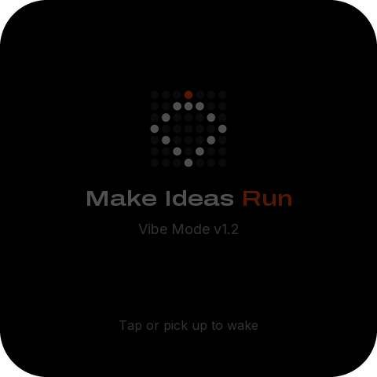

| 名称 | 类型 | x, y, w, h | 样式 | 内容 / 动作 |
|---|---|---|---|---|
| `sleep_logo` | image | 180, 104, 120, 120 |  | home-00.png |
| `sleep_title_a` | label | 108, 236, 199, 33 | dot 28px #F2F2F2 | Make Ideas |
| `sleep_title_b` | label | 307, 236, 68, 33 | dot 28px #FF4C01 | Run |
| `sleep_product` | label | 24, 280, 432, 22 | sans 18px #9A9A9A | Vibe Mode v1.2 |
| `sleep_hint` | label | 24, 404, 432, 20 | sans 16px #9A9A9A | Tap or pick up to wake |
| `button_wake` | button | 0, 0, 480, 480 |  | → `wake` |

## ideas-1 — Ideas · page 1/4

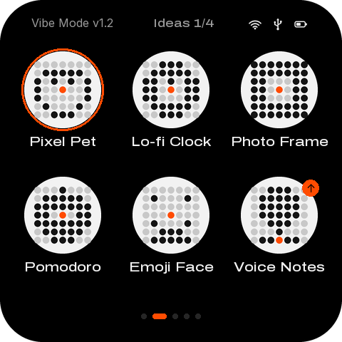

| 名称 | 类型 | x, y, w, h | 样式 | 内容 / 动作 |
|---|---|---|---|---|
| `nav_product` | label | 44, 22, 130, 20 | sans 16px #9A9A9A | Vibe Mode v1.2 |
| `nav_badge` | label | 176, 23, 164, 19 | medium 16px #9A9A9A | Ideas 1/4 |
| `nav_wifi` | image | 348, 24, 20, 20 |  | wifi-20-white.png |
| `nav_usb` | image | 380, 24, 20, 20 |  | usb-20-white.png |
| `nav_battery` | image | 412, 24, 20, 20 |  | battery_mid-20-white.png |
| `idea_ring_100001` | container | 30, 68, 116, 116 |  |  |
| `idea_icon_100001` | image | 34, 72, 108, 108 |  | idea_pet-108.png |
| `idea_name_100001` | label | 16, 188, 144, 42 | medium 18px #F2F2F2 换行 | Pixel Pet |
| `button_idea_100001` | button | 12, 66, 152, 170 |  | → `idea:100001` |
| `idea_icon_100002` | image | 186, 72, 108, 108 |  | idea_clock-108.png |
| `idea_name_100002` | label | 168, 188, 144, 42 | medium 18px #F2F2F2 换行 | Lo-fi Clock |
| `button_idea_100002` | button | 164, 66, 152, 170 |  | → `idea:100002` |
| `idea_icon_100003` | image | 338, 72, 108, 108 |  | idea_frame-108.png |
| `idea_name_100003` | label | 320, 188, 144, 42 | medium 18px #F2F2F2 换行 | Photo Frame |
| `button_idea_100003` | button | 316, 66, 152, 170 |  | → `idea:100003` |
| `idea_icon_100004` | image | 34, 248, 108, 108 |  | idea_timer-108.png |
| `idea_name_100004` | label | 16, 364, 144, 42 | medium 18px #F2F2F2 换行 | Pomodoro |
| `button_idea_100004` | button | 12, 242, 152, 170 |  | → `idea:100004` |
| `idea_icon_100005` | image | 186, 248, 108, 108 |  | idea_face-108.png |
| `idea_name_100005` | label | 168, 364, 144, 42 | medium 18px #F2F2F2 换行 | Emoji Face |
| `button_idea_100005` | button | 164, 242, 152, 170 |  | → `idea:100005` |
| `idea_icon_100006` | image | 338, 248, 108, 108 |  | idea_mic-108.png |
| `idea_badge_100006` | label | 424, 252, 24, 24 | sans 16px #000000 | ↑ |
| `idea_name_100006` | label | 320, 364, 144, 42 | medium 18px #F2F2F2 换行 | Voice Notes |
| `button_idea_100006` | button | 316, 242, 152, 170 |  | → `idea:100006` |
| `pager_dot_0` | container | 198, 440, 8, 8 | #262626 |  |
| `pager_dot_1` | container | 214, 440, 20, 8 | #FF4C01 |  |
| `pager_dot_2` | container | 242, 440, 8, 8 | #262626 |  |
| `pager_dot_3` | container | 258, 440, 8, 8 | #262626 |  |
| `pager_dot_4` | container | 274, 440, 8, 8 | #262626 |  |

## manage — Manage

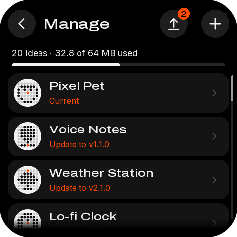

| 名称 | 类型 | x, y, w, h | 样式 | 内容 / 动作 |
|---|---|---|---|---|
| `button_back_manage_visual` | container | 16, 20, 56, 56 | #1E1E1E |  |
| `button_back_manage_icon` | image | 28, 32, 32, 32 |  | back-32-white.png |
| `button_back_manage` | button | 2, 6, 84, 84 |  | → `back` |
| `button_add_download_visual` | container | 408, 20, 56, 56 | #1E1E1E |  |
| `button_add_download_icon` | image | 420, 32, 32, 32 |  | plus-32-white.png |
| `button_add_download` | button | 394, 6, 84, 84 |  | → `go:download` |
| `button_update_all_visual` | container | 324, 20, 56, 56 | #1E1E1E |  |
| `button_update_all_icon` | image | 336, 32, 32, 32 |  | upgrade-32-white.png |
| `button_update_all_badge` | label | 360, 16, 24, 24 | medium 16px #000000 | 2 |
| `button_update_all` | button | 310, 6, 84, 84 |  | → `update:all` |
| `manage_title` | label | 88, 32, 224, 33 | medium 28px #F2F2F2 | Manage |
| `manage_summary` | label | 24, 96, 432, 22 | sans 18px #F2F2F2 | 20 Ideas · 32.8 of 64 MB used |
| `manage_bar` | progress | 24, 128, 432, 6 | #262626 |  |
| `manage` | list | 16, 148, 448, 316 | 行距 88 | 行模板 `manage_row` |
| `manage_fade` | image | 16, 440, 448, 24 |  | list-fade.png |
| `manage_scroll_track` | container | 468, 152, 4, 292 | #262626 |  |
| `manage_scroll_thumb` | container | 468, 152, 4, 53 | #9A9A9A |  |

## manage-updating — Manage · updating

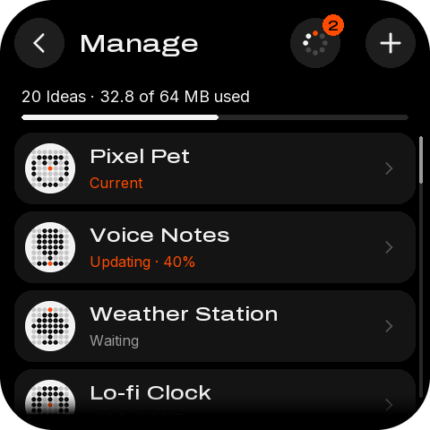

| 名称 | 类型 | x, y, w, h | 样式 | 内容 / 动作 |
|---|---|---|---|---|
| `button_back_manage_visual` | container | 16, 20, 56, 56 | #1E1E1E |  |
| `button_back_manage_icon` | image | 28, 32, 32, 32 |  | back-32-white.png |
| `button_back_manage` | button | 2, 6, 84, 84 |  | → `back` |
| `button_add_download_visual` | container | 408, 20, 56, 56 | #1E1E1E |  |
| `button_add_download_icon` | image | 420, 32, 32, 32 |  | plus-32-white.png |
| `button_add_download` | button | 394, 6, 84, 84 |  | → `go:download` |
| `button_update_all_visual` | container | 324, 20, 56, 56 | #1E1E1E |  |
| `button_update_all_spinner` | image | 336, 32, 32, 32 |  | spin32-00.png |
| `button_update_all_badge` | label | 360, 16, 24, 24 | medium 16px #000000 | 2 |
| `button_update_all` | button | 310, 6, 84, 84 |  | → `update:all` |
| `manage_title` | label | 88, 32, 224, 33 | medium 28px #F2F2F2 | Manage |
| `manage_summary` | label | 24, 96, 432, 22 | sans 18px #F2F2F2 | 20 Ideas · 32.8 of 64 MB used |
| `manage_bar` | progress | 24, 128, 432, 6 | #262626 |  |
| `manage` | list | 16, 148, 448, 316 | 行距 88 | 行模板 `manage_row` |
| `manage_fade` | image | 16, 440, 448, 24 |  | list-fade.png |
| `manage_scroll_track` | container | 468, 152, 4, 292 | #262626 |  |
| `manage_scroll_thumb` | container | 468, 152, 4, 53 | #9A9A9A |  |

## manage-swipe — Manage · swiped to delete

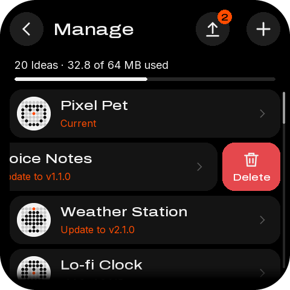

| 名称 | 类型 | x, y, w, h | 样式 | 内容 / 动作 |
|---|---|---|---|---|
| `button_back_manage_visual` | container | 16, 20, 56, 56 | #1E1E1E |  |
| `button_back_manage_icon` | image | 28, 32, 32, 32 |  | back-32-white.png |
| `button_back_manage` | button | 2, 6, 84, 84 |  | → `back` |
| `button_add_download_visual` | container | 408, 20, 56, 56 | #1E1E1E |  |
| `button_add_download_icon` | image | 420, 32, 32, 32 |  | plus-32-white.png |
| `button_add_download` | button | 394, 6, 84, 84 |  | → `go:download` |
| `button_update_all_visual` | container | 324, 20, 56, 56 | #1E1E1E |  |
| `button_update_all_icon` | image | 336, 32, 32, 32 |  | upgrade-32-white.png |
| `button_update_all_badge` | label | 360, 16, 24, 24 | medium 16px #000000 | 2 |
| `button_update_all` | button | 310, 6, 84, 84 |  | → `update:all` |
| `manage_title` | label | 88, 32, 224, 33 | medium 28px #F2F2F2 | Manage |
| `manage_summary` | label | 24, 96, 432, 22 | sans 18px #F2F2F2 | 20 Ideas · 32.8 of 64 MB used |
| `manage_bar` | progress | 24, 128, 432, 6 | #262626 |  |
| `manage` | list | 16, 148, 448, 316 | 行距 88 | 行模板 `manage_row` |
| `manage_fade` | image | 16, 440, 448, 24 |  | list-fade.png |
| `manage_scroll_track` | container | 468, 152, 4, 292 | #262626 |  |
| `manage_scroll_thumb` | container | 468, 152, 4, 53 | #9A9A9A |  |

## manage-undo — Manage · deleted, Undo

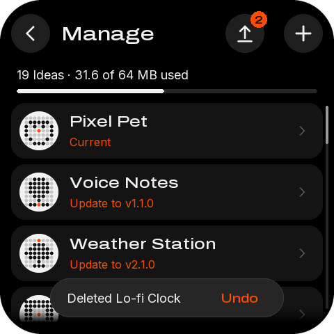

| 名称 | 类型 | x, y, w, h | 样式 | 内容 / 动作 |
|---|---|---|---|---|
| `button_back_manage_visual` | container | 16, 20, 56, 56 | #1E1E1E |  |
| `button_back_manage_icon` | image | 28, 32, 32, 32 |  | back-32-white.png |
| `button_back_manage` | button | 2, 6, 84, 84 |  | → `back` |
| `button_add_download_visual` | container | 408, 20, 56, 56 | #1E1E1E |  |
| `button_add_download_icon` | image | 420, 32, 32, 32 |  | plus-32-white.png |
| `button_add_download` | button | 394, 6, 84, 84 |  | → `go:download` |
| `button_update_all_visual` | container | 324, 20, 56, 56 | #1E1E1E |  |
| `button_update_all_icon` | image | 336, 32, 32, 32 |  | upgrade-32-white.png |
| `button_update_all_badge` | label | 360, 16, 24, 24 | medium 16px #000000 | 2 |
| `button_update_all` | button | 310, 6, 84, 84 |  | → `update:all` |
| `manage_title` | label | 88, 32, 224, 33 | medium 28px #F2F2F2 | Manage |
| `manage_summary` | label | 24, 96, 432, 22 | sans 18px #F2F2F2 | 19 Ideas · 31.6 of 64 MB used |
| `manage_bar` | progress | 24, 128, 432, 6 | #262626 |  |
| `manage` | list | 16, 148, 448, 316 | 行距 88 | 行模板 `manage_row` |
| `manage_fade` | image | 16, 440, 448, 24 |  | list-fade.png |
| `manage_scroll_track` | container | 468, 152, 4, 292 | #262626 |  |
| `manage_scroll_thumb` | container | 468, 152, 4, 55 | #9A9A9A |  |
| `toast` | container | 72, 400, 336, 56 | #262626 |  |
| `toast_text` | label | 96, 417, 200, 22 | sans 18px #F2F2F2 | Deleted Lo-fi Clock |
| `toast_undo` | label | 304, 418, 80, 21 | medium 18px #FF4C01 | Undo |
| `button_undo` | button | 300, 386, 96, 84 |  | → `toast:undo` |

## manage-uptodate — Manage · up to date

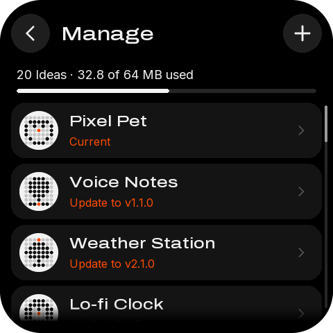

| 名称 | 类型 | x, y, w, h | 样式 | 内容 / 动作 |
|---|---|---|---|---|
| `button_back_manage_visual` | container | 16, 20, 56, 56 | #1E1E1E |  |
| `button_back_manage_icon` | image | 28, 32, 32, 32 |  | back-32-white.png |
| `button_back_manage` | button | 2, 6, 84, 84 |  | → `back` |
| `button_add_download_visual` | container | 408, 20, 56, 56 | #1E1E1E |  |
| `button_add_download_icon` | image | 420, 32, 32, 32 |  | plus-32-white.png |
| `button_add_download` | button | 394, 6, 84, 84 |  | → `go:download` |
| `manage_title` | label | 88, 32, 308, 33 | medium 28px #F2F2F2 | Manage |
| `manage_summary` | label | 24, 96, 432, 22 | sans 18px #F2F2F2 | 20 Ideas · 32.8 of 64 MB used |
| `manage_bar` | progress | 24, 128, 432, 6 | #262626 |  |
| `manage` | list | 16, 148, 448, 316 | 行距 88 | 行模板 `manage_row` |
| `manage_fade` | image | 16, 440, 448, 24 |  | list-fade.png |
| `manage_scroll_track` | container | 468, 152, 4, 292 | #262626 |  |
| `manage_scroll_thumb` | container | 468, 152, 4, 53 | #9A9A9A |  |

## idea-info-local — Idea info · on this device

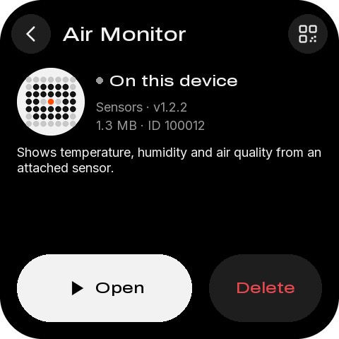

| 名称 | 类型 | x, y, w, h | 样式 | 内容 / 动作 |
|---|---|---|---|---|
| `button_back_info_visual` | container | 16, 20, 56, 56 | #1E1E1E |  |
| `button_back_info_icon` | image | 28, 32, 32, 32 |  | back-32-white.png |
| `button_back_info` | button | 2, 6, 84, 84 |  | → `back` |
| `button_qr_idea_visual` | container | 408, 20, 56, 56 | #1E1E1E |  |
| `button_qr_idea_icon` | image | 420, 32, 32, 32 |  | qr-32-white.png |
| `button_qr_idea` | button | 394, 6, 84, 84 |  | → `qr:idea` |
| `info_title` | label | 88, 32, 308, 33 | medium 28px #F2F2F2 | Air Monitor |
| `info_icon` | image | 24, 96, 96, 96 |  | idea_air-96.png |
| `info_status_dot` | container | 136, 109, 10, 10 | #9A9A9A |  |
| `info_status` | label | 154, 102, 302, 26 | medium 22px #F2F2F2 | On this device |
| `info_meta` | label | 136, 140, 320, 22 | sans 18px #9A9A9A | Sensors · v1.2.2 |
| `info_meta2` | label | 136, 166, 320, 22 | sans 18px #9A9A9A | 1.3 MB · ID 100012 |
| `info_summary` | label | 24, 204, 432, 65 | sans 18px #F2F2F2 换行 | Shows temperature, humidity and air quality from an ⏎ attached sensor. |
| `button_open` | button | 24, 360, 248, 96 | medium 22px #000000 | Open → `idea:open` |
| `button_delete_track` | container | 296, 360, 160, 96 | #1E1E1E |  |
| `button_delete_fill` | container | 296, 360, 0, 96 | #E5484D |  |
| `button_delete` | button | 296, 360, 160, 96 | medium 22px #E5484D 长按 3000 ms | Delete → `hold:delete` |

## idea-info-update — Idea info · update available

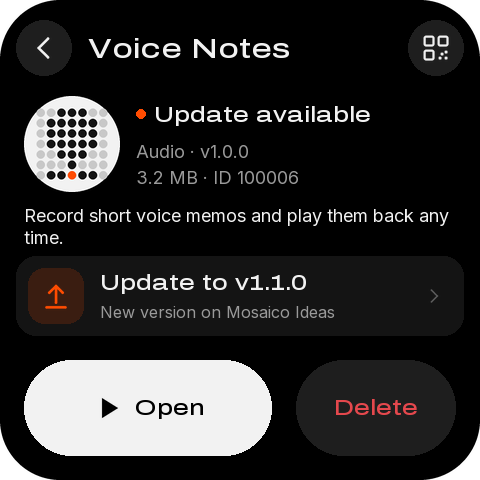

| 名称 | 类型 | x, y, w, h | 样式 | 内容 / 动作 |
|---|---|---|---|---|
| `button_back_info_visual` | container | 16, 20, 56, 56 | #1E1E1E |  |
| `button_back_info_icon` | image | 28, 32, 32, 32 |  | back-32-white.png |
| `button_back_info` | button | 2, 6, 84, 84 |  | → `back` |
| `button_qr_idea_visual` | container | 408, 20, 56, 56 | #1E1E1E |  |
| `button_qr_idea_icon` | image | 420, 32, 32, 32 |  | qr-32-white.png |
| `button_qr_idea` | button | 394, 6, 84, 84 |  | → `qr:idea` |
| `info_title` | label | 88, 32, 308, 33 | medium 28px #F2F2F2 | Voice Notes |
| `info_icon` | image | 24, 96, 96, 96 |  | idea_mic-96.png |
| `info_status_dot` | container | 136, 109, 10, 10 | #FF4C01 |  |
| `info_status` | label | 154, 102, 302, 26 | medium 22px #F2F2F2 | Update available |
| `info_meta` | label | 136, 140, 320, 22 | sans 18px #9A9A9A | Audio · v1.0.0 |
| `info_meta2` | label | 136, 166, 320, 22 | sans 18px #9A9A9A | 3.2 MB · ID 100006 |
| `info_summary` | label | 24, 204, 432, 44 | sans 18px #F2F2F2 换行 | Record short voice memos and play them back any ⏎ time. |
| `button_update` | button | 16, 256, 448, 80 | #141414 | → `idea:update` |
| `info_update_title` | label | 100, 270, 312, 26 | medium 22px #F2F2F2 | Update to v1.1.0 |
| `info_update_sub` | label | 100, 302, 312, 20 | sans 16px #9A9A9A | New version on Mosaico Ideas |
| `button_open` | button | 24, 360, 248, 96 | medium 22px #000000 | Open → `idea:open` |
| `button_delete_track` | container | 296, 360, 160, 96 | #1E1E1E |  |
| `button_delete_fill` | container | 296, 360, 0, 96 | #E5484D |  |
| `button_delete` | button | 296, 360, 160, 96 | medium 22px #E5484D 长按 3000 ms | Delete → `hold:delete` |

## idea-info-remote — Idea info · from the store

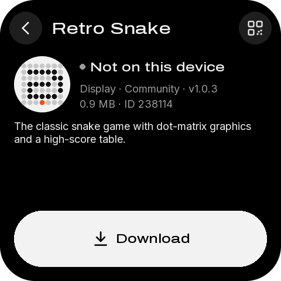

| 名称 | 类型 | x, y, w, h | 样式 | 内容 / 动作 |
|---|---|---|---|---|
| `button_back_info_visual` | container | 16, 20, 56, 56 | #1E1E1E |  |
| `button_back_info_icon` | image | 28, 32, 32, 32 |  | back-32-white.png |
| `button_back_info` | button | 2, 6, 84, 84 |  | → `back` |
| `button_qr_idea_visual` | container | 408, 20, 56, 56 | #1E1E1E |  |
| `button_qr_idea_icon` | image | 420, 32, 32, 32 |  | qr-32-white.png |
| `button_qr_idea` | button | 394, 6, 84, 84 |  | → `qr:idea` |
| `info_title` | label | 88, 32, 308, 33 | medium 28px #F2F2F2 | Retro Snake |
| `info_icon` | image | 24, 96, 96, 96 |  | idea_snake-96.png |
| `info_status_dot` | container | 136, 109, 10, 10 | #9A9A9A |  |
| `info_status` | label | 154, 102, 302, 26 | medium 22px #F2F2F2 | Not on this device |
| `info_meta` | label | 136, 140, 320, 22 | sans 18px #9A9A9A | Display · Community · v1.0.3 |
| `info_meta2` | label | 136, 166, 320, 22 | sans 18px #9A9A9A | 0.9 MB · ID 238114 |
| `info_summary` | label | 24, 204, 432, 65 | sans 18px #F2F2F2 换行 | The classic snake game with dot-matrix graphics ⏎ and a high-score table. |
| `button_download` | button | 24, 360, 432, 96 | medium 22px #000000 | Download → `idea:download` |

## idea-info-nospace — Idea info · not enough space

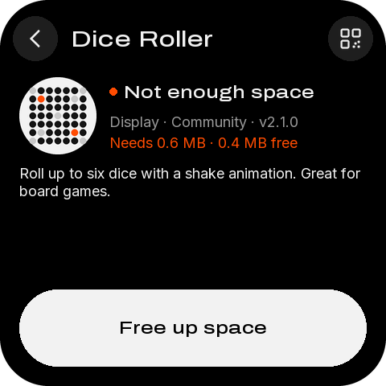

| 名称 | 类型 | x, y, w, h | 样式 | 内容 / 动作 |
|---|---|---|---|---|
| `button_back_info_visual` | container | 16, 20, 56, 56 | #1E1E1E |  |
| `button_back_info_icon` | image | 28, 32, 32, 32 |  | back-32-white.png |
| `button_back_info` | button | 2, 6, 84, 84 |  | → `back` |
| `button_qr_idea_visual` | container | 408, 20, 56, 56 | #1E1E1E |  |
| `button_qr_idea_icon` | image | 420, 32, 32, 32 |  | qr-32-white.png |
| `button_qr_idea` | button | 394, 6, 84, 84 |  | → `qr:idea` |
| `info_title` | label | 88, 32, 308, 33 | medium 28px #F2F2F2 | Dice Roller |
| `info_icon` | image | 24, 96, 96, 96 |  | idea_dice-96.png |
| `info_status_dot` | container | 136, 109, 10, 10 | #FF4C01 |  |
| `info_status` | label | 154, 102, 302, 26 | medium 22px #F2F2F2 | Not enough space |
| `info_meta` | label | 136, 140, 320, 22 | sans 18px #9A9A9A | Display · Community · v2.1.0 |
| `info_meta2` | label | 136, 166, 320, 22 | sans 18px #FF4C01 | Needs 0.6 MB · 0.4 MB free |
| `info_summary` | label | 24, 204, 432, 65 | sans 18px #F2F2F2 换行 | Roll up to six dice with a shake animation. Great for ⏎ board games. |
| `button_free_space` | button | 24, 360, 432, 96 | medium 22px #000000 | Free up space → `go:manage` |

## idea-info-current — Idea info · current Idea

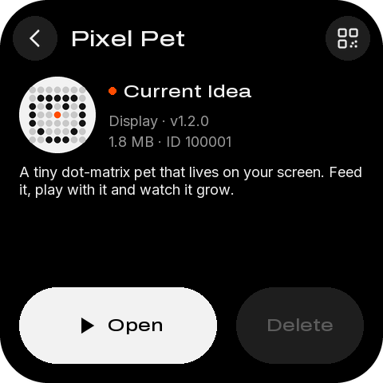

| 名称 | 类型 | x, y, w, h | 样式 | 内容 / 动作 |
|---|---|---|---|---|
| `button_back_info_visual` | container | 16, 20, 56, 56 | #1E1E1E |  |
| `button_back_info_icon` | image | 28, 32, 32, 32 |  | back-32-white.png |
| `button_back_info` | button | 2, 6, 84, 84 |  | → `back` |
| `button_qr_idea_visual` | container | 408, 20, 56, 56 | #1E1E1E |  |
| `button_qr_idea_icon` | image | 420, 32, 32, 32 |  | qr-32-white.png |
| `button_qr_idea` | button | 394, 6, 84, 84 |  | → `qr:idea` |
| `info_title` | label | 88, 32, 308, 33 | medium 28px #F2F2F2 | Pixel Pet |
| `info_icon` | image | 24, 96, 96, 96 |  | idea_pet-96.png |
| `info_status_dot` | container | 136, 109, 10, 10 | #FF4C01 |  |
| `info_status` | label | 154, 102, 302, 26 | medium 22px #F2F2F2 | Current Idea |
| `info_meta` | label | 136, 140, 320, 22 | sans 18px #9A9A9A | Display · v1.2.0 |
| `info_meta2` | label | 136, 166, 320, 22 | sans 18px #9A9A9A | 1.8 MB · ID 100001 |
| `info_summary` | label | 24, 204, 432, 65 | sans 18px #F2F2F2 换行 | A tiny dot-matrix pet that lives on your screen. Feed ⏎ it, play with it and watch it grow. |
| `button_open` | button | 24, 360, 248, 96 | medium 22px #000000 | Open → `idea:open` |
| `button_delete` | button | 296, 360, 160, 96 | medium 22px #5C5C5C | Delete → `idea:delete` |

## idea-info-deleting — Idea info · holding Delete (3 s)

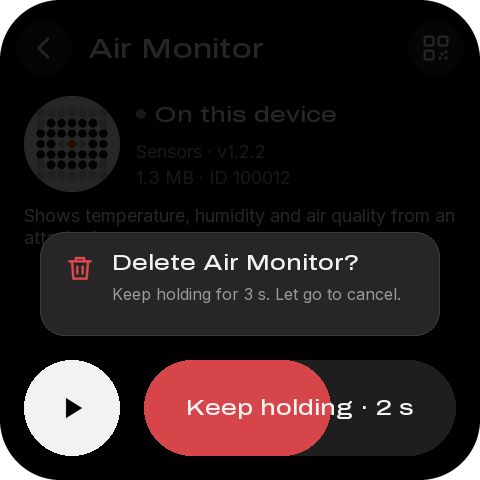

| 名称 | 类型 | x, y, w, h | 样式 | 内容 / 动作 |
|---|---|---|---|---|
| `button_back_info_visual` | container | 16, 20, 56, 56 | #1E1E1E |  |
| `button_back_info_icon` | image | 28, 32, 32, 32 |  | back-32-white.png |
| `button_back_info` | button | 2, 6, 84, 84 |  | → `back` |
| `button_qr_idea_visual` | container | 408, 20, 56, 56 | #1E1E1E |  |
| `button_qr_idea_icon` | image | 420, 32, 32, 32 |  | qr-32-white.png |
| `button_qr_idea` | button | 394, 6, 84, 84 |  | → `qr:idea` |
| `info_title` | label | 88, 32, 308, 33 | medium 28px #F2F2F2 | Air Monitor |
| `info_icon` | image | 24, 96, 96, 96 |  | idea_air-96.png |
| `info_status_dot` | container | 136, 109, 10, 10 | #9A9A9A |  |
| `info_status` | label | 154, 102, 302, 26 | medium 22px #F2F2F2 | On this device |
| `info_meta` | label | 136, 140, 320, 22 | sans 18px #9A9A9A | Sensors · v1.2.2 |
| `info_meta2` | label | 136, 166, 320, 22 | sans 18px #9A9A9A | 1.3 MB · ID 100012 |
| `info_summary` | label | 24, 204, 432, 65 | sans 18px #F2F2F2 换行 | Shows temperature, humidity and air quality from an ⏎ attached sensor. |
| `button_open` | button | 24, 360, 96, 96 | #F2F2F2 | → `idea:open` |
| `button_delete_track` | container | 144, 360, 312, 96 | #1E1E1E |  |
| `button_delete_fill` | container | 144, 360, 187, 96 | #E5484D |  |
| `button_delete` | button | 144, 360, 312, 96 | medium 22px #F2F2F2 长按 3000 ms | Keep holding · 2 s → `hold:delete` |
| `delete_dim` | container | 0, 0, 480, 344 | #000000 |  |
| `delete_popup` | container | 40, 232, 400, 104 | #262626 |  |
| `delete_popup_icon` | image | 64, 252, 32, 32 |  | trash-32-red.png |
| `delete_popup_title` | label | 112, 250, 312, 26 | medium 22px #F2F2F2 | Delete Air Monitor? |
| `delete_popup_body` | label | 112, 284, 312, 20 | sans 16px #9A9A9A | Keep holding for 3 s. Let go to cancel. |

## download — Download · empty

| 名称 | 类型 | x, y, w, h | 样式 | 内容 / 动作 |
|---|---|---|---|---|
| `button_back_download_visual` | container | 16, 20, 56, 56 | #1E1E1E |  |
| `button_back_download_icon` | image | 28, 32, 32, 32 |  | back-32-white.png |
| `button_back_download` | button | 2, 6, 84, 84 |  | → `back` |
| `button_qr_ideas_visual` | container | 408, 20, 56, 56 | #1E1E1E |  |
| `button_qr_ideas_icon` | image | 420, 32, 32, 32 |  | qr-32-white.png |
| `button_qr_ideas` | button | 394, 6, 84, 84 |  | → `qr:ideas` |
| `download_title` | label | 88, 32, 308, 33 | medium 28px #F2F2F2 | Download Idea |
| `id_slot_0_box` | container | 82, 92, 44, 56 | #141414 |  |
| `id_slot_0` | label | 82, 92, 44, 56 | dot 28px #F2F2F2 |   |
| `id_slot_1_box` | container | 134, 92, 44, 56 | #141414 |  |
| `id_slot_1` | label | 134, 92, 44, 56 | dot 28px #F2F2F2 |   |
| `id_slot_2_box` | container | 186, 92, 44, 56 | #141414 |  |
| `id_slot_2` | label | 186, 92, 44, 56 | dot 28px #F2F2F2 |   |
| `id_slot_3_box` | container | 250, 92, 44, 56 | #141414 |  |
| `id_slot_3` | label | 250, 92, 44, 56 | dot 28px #F2F2F2 |   |
| `id_slot_4_box` | container | 302, 92, 44, 56 | #141414 |  |
| `id_slot_4` | label | 302, 92, 44, 56 | dot 28px #F2F2F2 |   |
| `id_slot_5_box` | container | 354, 92, 44, 56 | #141414 |  |
| `id_slot_5` | label | 354, 92, 44, 56 | dot 28px #F2F2F2 |   |
| `id_status` | label | 24, 156, 432, 20 | sans 16px #9A9A9A | Type the 6-digit ID |
| `key_1_visual` | label | 92, 188, 88, 56 | dot 28px #F2F2F2 | 1 |
| `key_1` | button | 84, 180, 104, 72 |  | → `key:1` |
| `key_2_visual` | label | 196, 188, 88, 56 | dot 28px #F2F2F2 | 2 |
| `key_2` | button | 188, 180, 104, 72 |  | → `key:2` |
| `key_3_visual` | label | 300, 188, 88, 56 | dot 28px #F2F2F2 | 3 |
| `key_3` | button | 292, 180, 104, 72 |  | → `key:3` |
| `key_4_visual` | label | 92, 260, 88, 56 | dot 28px #F2F2F2 | 4 |
| `key_4` | button | 84, 252, 104, 72 |  | → `key:4` |
| `key_5_visual` | label | 196, 260, 88, 56 | dot 28px #F2F2F2 | 5 |
| `key_5` | button | 188, 252, 104, 72 |  | → `key:5` |
| `key_6_visual` | label | 300, 260, 88, 56 | dot 28px #F2F2F2 | 6 |
| `key_6` | button | 292, 252, 104, 72 |  | → `key:6` |
| `key_7_visual` | label | 92, 332, 88, 56 | dot 28px #F2F2F2 | 7 |
| `key_7` | button | 84, 324, 104, 72 |  | → `key:7` |
| `key_8_visual` | label | 196, 332, 88, 56 | dot 28px #F2F2F2 | 8 |
| `key_8` | button | 188, 324, 104, 72 |  | → `key:8` |
| `key_9_visual` | label | 300, 332, 88, 56 | dot 28px #F2F2F2 | 9 |
| `key_9` | button | 292, 324, 104, 72 |  | → `key:9` |
| `key_del_visual` | container | 92, 404, 88, 56 |  |  |
| `key_del_icon` | image | 120, 416, 32, 32 |  | backspace-32-white.png |
| `key_del` | button | 84, 396, 104, 72 |  | → `key:del` |
| `key_0_visual` | label | 196, 404, 88, 56 | dot 28px #F2F2F2 | 0 |
| `key_0` | button | 188, 396, 104, 72 |  | → `key:0` |
| `key_go_visual` | label | 300, 404, 88, 56 | medium 22px #5C5C5C | Go |
| `key_go` | button | 292, 396, 104, 72 |  | → `key:go` |

## download-typing — Download · typing, key 1 held down

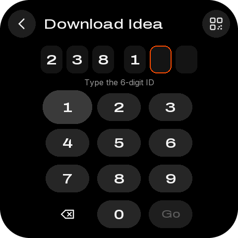

| 名称 | 类型 | x, y, w, h | 样式 | 内容 / 动作 |
|---|---|---|---|---|
| `button_back_download_visual` | container | 16, 20, 56, 56 | #1E1E1E |  |
| `button_back_download_icon` | image | 28, 32, 32, 32 |  | back-32-white.png |
| `button_back_download` | button | 2, 6, 84, 84 |  | → `back` |
| `button_qr_ideas_visual` | container | 408, 20, 56, 56 | #1E1E1E |  |
| `button_qr_ideas_icon` | image | 420, 32, 32, 32 |  | qr-32-white.png |
| `button_qr_ideas` | button | 394, 6, 84, 84 |  | → `qr:ideas` |
| `download_title` | label | 88, 32, 308, 33 | medium 28px #F2F2F2 | Download Idea |
| `id_slot_0_box` | container | 82, 92, 44, 56 | #141414 |  |
| `id_slot_0` | label | 82, 92, 44, 56 | dot 28px #F2F2F2 | 2 |
| `id_slot_1_box` | container | 134, 92, 44, 56 | #141414 |  |
| `id_slot_1` | label | 134, 92, 44, 56 | dot 28px #F2F2F2 | 3 |
| `id_slot_2_box` | container | 186, 92, 44, 56 | #141414 |  |
| `id_slot_2` | label | 186, 92, 44, 56 | dot 28px #F2F2F2 | 8 |
| `id_slot_3_box` | container | 250, 92, 44, 56 | #141414 |  |
| `id_slot_3` | label | 250, 92, 44, 56 | dot 28px #F2F2F2 | 1 |
| `id_slot_4_box` | container | 302, 92, 44, 56 | #141414 |  |
| `id_slot_4` | label | 302, 92, 44, 56 | dot 28px #F2F2F2 |   |
| `id_slot_5_box` | container | 354, 92, 44, 56 | #141414 |  |
| `id_slot_5` | label | 354, 92, 44, 56 | dot 28px #F2F2F2 |   |
| `id_status` | label | 24, 156, 432, 20 | sans 16px #9A9A9A | Type the 6-digit ID |
| `key_1_visual` | label | 86, 182, 100, 68 | dot 28px #F2F2F2 | 1 |
| `key_1` | button | 84, 180, 104, 72 |  | → `key:1` |
| `key_2_visual` | label | 196, 188, 88, 56 | dot 28px #F2F2F2 | 2 |
| `key_2` | button | 188, 180, 104, 72 |  | → `key:2` |
| `key_3_visual` | label | 300, 188, 88, 56 | dot 28px #F2F2F2 | 3 |
| `key_3` | button | 292, 180, 104, 72 |  | → `key:3` |
| `key_4_visual` | label | 92, 260, 88, 56 | dot 28px #F2F2F2 | 4 |
| `key_4` | button | 84, 252, 104, 72 |  | → `key:4` |
| `key_5_visual` | label | 196, 260, 88, 56 | dot 28px #F2F2F2 | 5 |
| `key_5` | button | 188, 252, 104, 72 |  | → `key:5` |
| `key_6_visual` | label | 300, 260, 88, 56 | dot 28px #F2F2F2 | 6 |
| `key_6` | button | 292, 252, 104, 72 |  | → `key:6` |
| `key_7_visual` | label | 92, 332, 88, 56 | dot 28px #F2F2F2 | 7 |
| `key_7` | button | 84, 324, 104, 72 |  | → `key:7` |
| `key_8_visual` | label | 196, 332, 88, 56 | dot 28px #F2F2F2 | 8 |
| `key_8` | button | 188, 324, 104, 72 |  | → `key:8` |
| `key_9_visual` | label | 300, 332, 88, 56 | dot 28px #F2F2F2 | 9 |
| `key_9` | button | 292, 324, 104, 72 |  | → `key:9` |
| `key_del_visual` | container | 92, 404, 88, 56 |  |  |
| `key_del_icon` | image | 120, 416, 32, 32 |  | backspace-32-white.png |
| `key_del` | button | 84, 396, 104, 72 |  | → `key:del` |
| `key_0_visual` | label | 196, 404, 88, 56 | dot 28px #F2F2F2 | 0 |
| `key_0` | button | 188, 396, 104, 72 |  | → `key:0` |
| `key_go_visual` | label | 300, 404, 88, 56 | medium 22px #5C5C5C | Go |
| `key_go` | button | 292, 396, 104, 72 |  | → `key:go` |

## download-ready — Download · six digits, Go ready

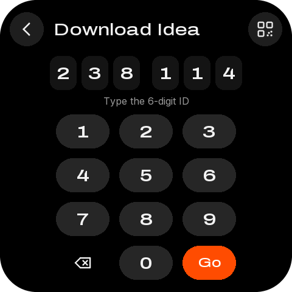

| 名称 | 类型 | x, y, w, h | 样式 | 内容 / 动作 |
|---|---|---|---|---|
| `button_back_download_visual` | container | 16, 20, 56, 56 | #1E1E1E |  |
| `button_back_download_icon` | image | 28, 32, 32, 32 |  | back-32-white.png |
| `button_back_download` | button | 2, 6, 84, 84 |  | → `back` |
| `button_qr_ideas_visual` | container | 408, 20, 56, 56 | #1E1E1E |  |
| `button_qr_ideas_icon` | image | 420, 32, 32, 32 |  | qr-32-white.png |
| `button_qr_ideas` | button | 394, 6, 84, 84 |  | → `qr:ideas` |
| `download_title` | label | 88, 32, 308, 33 | medium 28px #F2F2F2 | Download Idea |
| `id_slot_0_box` | container | 82, 92, 44, 56 | #141414 |  |
| `id_slot_0` | label | 82, 92, 44, 56 | dot 28px #F2F2F2 | 2 |
| `id_slot_1_box` | container | 134, 92, 44, 56 | #141414 |  |
| `id_slot_1` | label | 134, 92, 44, 56 | dot 28px #F2F2F2 | 3 |
| `id_slot_2_box` | container | 186, 92, 44, 56 | #141414 |  |
| `id_slot_2` | label | 186, 92, 44, 56 | dot 28px #F2F2F2 | 8 |
| `id_slot_3_box` | container | 250, 92, 44, 56 | #141414 |  |
| `id_slot_3` | label | 250, 92, 44, 56 | dot 28px #F2F2F2 | 1 |
| `id_slot_4_box` | container | 302, 92, 44, 56 | #141414 |  |
| `id_slot_4` | label | 302, 92, 44, 56 | dot 28px #F2F2F2 | 1 |
| `id_slot_5_box` | container | 354, 92, 44, 56 | #141414 |  |
| `id_slot_5` | label | 354, 92, 44, 56 | dot 28px #F2F2F2 | 4 |
| `id_status` | label | 24, 156, 432, 20 | sans 16px #9A9A9A | Type the 6-digit ID |
| `key_1_visual` | label | 92, 188, 88, 56 | dot 28px #F2F2F2 | 1 |
| `key_1` | button | 84, 180, 104, 72 |  | → `key:1` |
| `key_2_visual` | label | 196, 188, 88, 56 | dot 28px #F2F2F2 | 2 |
| `key_2` | button | 188, 180, 104, 72 |  | → `key:2` |
| `key_3_visual` | label | 300, 188, 88, 56 | dot 28px #F2F2F2 | 3 |
| `key_3` | button | 292, 180, 104, 72 |  | → `key:3` |
| `key_4_visual` | label | 92, 260, 88, 56 | dot 28px #F2F2F2 | 4 |
| `key_4` | button | 84, 252, 104, 72 |  | → `key:4` |
| `key_5_visual` | label | 196, 260, 88, 56 | dot 28px #F2F2F2 | 5 |
| `key_5` | button | 188, 252, 104, 72 |  | → `key:5` |
| `key_6_visual` | label | 300, 260, 88, 56 | dot 28px #F2F2F2 | 6 |
| `key_6` | button | 292, 252, 104, 72 |  | → `key:6` |
| `key_7_visual` | label | 92, 332, 88, 56 | dot 28px #F2F2F2 | 7 |
| `key_7` | button | 84, 324, 104, 72 |  | → `key:7` |
| `key_8_visual` | label | 196, 332, 88, 56 | dot 28px #F2F2F2 | 8 |
| `key_8` | button | 188, 324, 104, 72 |  | → `key:8` |
| `key_9_visual` | label | 300, 332, 88, 56 | dot 28px #F2F2F2 | 9 |
| `key_9` | button | 292, 324, 104, 72 |  | → `key:9` |
| `key_del_visual` | container | 92, 404, 88, 56 |  |  |
| `key_del_icon` | image | 120, 416, 32, 32 |  | backspace-32-white.png |
| `key_del` | button | 84, 396, 104, 72 |  | → `key:del` |
| `key_0_visual` | label | 196, 404, 88, 56 | dot 28px #F2F2F2 | 0 |
| `key_0` | button | 188, 396, 104, 72 |  | → `key:0` |
| `key_go_visual` | label | 300, 404, 88, 56 | medium 22px #FFFFFF | Go |
| `key_go` | button | 292, 396, 104, 72 |  | → `key:go` |

## download-lookup — Download · looking up

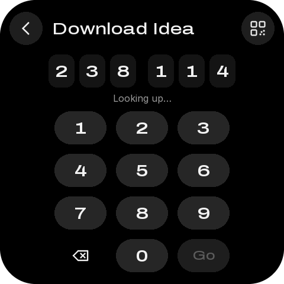

| 名称 | 类型 | x, y, w, h | 样式 | 内容 / 动作 |
|---|---|---|---|---|
| `button_back_download_visual` | container | 16, 20, 56, 56 | #1E1E1E |  |
| `button_back_download_icon` | image | 28, 32, 32, 32 |  | back-32-white.png |
| `button_back_download` | button | 2, 6, 84, 84 |  | → `back` |
| `button_qr_ideas_visual` | container | 408, 20, 56, 56 | #1E1E1E |  |
| `button_qr_ideas_icon` | image | 420, 32, 32, 32 |  | qr-32-white.png |
| `button_qr_ideas` | button | 394, 6, 84, 84 |  | → `qr:ideas` |
| `download_title` | label | 88, 32, 308, 33 | medium 28px #F2F2F2 | Download Idea |
| `id_slot_0_box` | container | 82, 92, 44, 56 | #141414 |  |
| `id_slot_0` | label | 82, 92, 44, 56 | dot 28px #F2F2F2 | 2 |
| `id_slot_1_box` | container | 134, 92, 44, 56 | #141414 |  |
| `id_slot_1` | label | 134, 92, 44, 56 | dot 28px #F2F2F2 | 3 |
| `id_slot_2_box` | container | 186, 92, 44, 56 | #141414 |  |
| `id_slot_2` | label | 186, 92, 44, 56 | dot 28px #F2F2F2 | 8 |
| `id_slot_3_box` | container | 250, 92, 44, 56 | #141414 |  |
| `id_slot_3` | label | 250, 92, 44, 56 | dot 28px #F2F2F2 | 1 |
| `id_slot_4_box` | container | 302, 92, 44, 56 | #141414 |  |
| `id_slot_4` | label | 302, 92, 44, 56 | dot 28px #F2F2F2 | 1 |
| `id_slot_5_box` | container | 354, 92, 44, 56 | #141414 |  |
| `id_slot_5` | label | 354, 92, 44, 56 | dot 28px #F2F2F2 | 4 |
| `id_status` | label | 24, 156, 432, 20 | sans 16px #9A9A9A | Looking up… |
| `key_1_visual` | label | 92, 188, 88, 56 | dot 28px #F2F2F2 | 1 |
| `key_1` | button | 84, 180, 104, 72 |  | → `key:1` |
| `key_2_visual` | label | 196, 188, 88, 56 | dot 28px #F2F2F2 | 2 |
| `key_2` | button | 188, 180, 104, 72 |  | → `key:2` |
| `key_3_visual` | label | 300, 188, 88, 56 | dot 28px #F2F2F2 | 3 |
| `key_3` | button | 292, 180, 104, 72 |  | → `key:3` |
| `key_4_visual` | label | 92, 260, 88, 56 | dot 28px #F2F2F2 | 4 |
| `key_4` | button | 84, 252, 104, 72 |  | → `key:4` |
| `key_5_visual` | label | 196, 260, 88, 56 | dot 28px #F2F2F2 | 5 |
| `key_5` | button | 188, 252, 104, 72 |  | → `key:5` |
| `key_6_visual` | label | 300, 260, 88, 56 | dot 28px #F2F2F2 | 6 |
| `key_6` | button | 292, 252, 104, 72 |  | → `key:6` |
| `key_7_visual` | label | 92, 332, 88, 56 | dot 28px #F2F2F2 | 7 |
| `key_7` | button | 84, 324, 104, 72 |  | → `key:7` |
| `key_8_visual` | label | 196, 332, 88, 56 | dot 28px #F2F2F2 | 8 |
| `key_8` | button | 188, 324, 104, 72 |  | → `key:8` |
| `key_9_visual` | label | 300, 332, 88, 56 | dot 28px #F2F2F2 | 9 |
| `key_9` | button | 292, 324, 104, 72 |  | → `key:9` |
| `key_del_visual` | container | 92, 404, 88, 56 |  |  |
| `key_del_icon` | image | 120, 416, 32, 32 |  | backspace-32-white.png |
| `key_del` | button | 84, 396, 104, 72 |  | → `key:del` |
| `key_0_visual` | label | 196, 404, 88, 56 | dot 28px #F2F2F2 | 0 |
| `key_0` | button | 188, 396, 104, 72 |  | → `key:0` |
| `key_go_visual` | label | 300, 404, 88, 56 | medium 22px #5C5C5C | Go |
| `key_go` | button | 292, 396, 104, 72 |  | → `key:go` |

## download-error — Download · not found

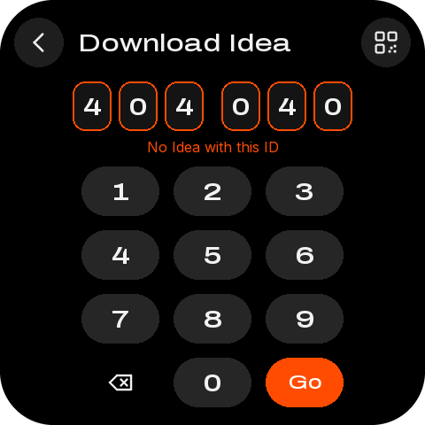

| 名称 | 类型 | x, y, w, h | 样式 | 内容 / 动作 |
|---|---|---|---|---|
| `button_back_download_visual` | container | 16, 20, 56, 56 | #1E1E1E |  |
| `button_back_download_icon` | image | 28, 32, 32, 32 |  | back-32-white.png |
| `button_back_download` | button | 2, 6, 84, 84 |  | → `back` |
| `button_qr_ideas_visual` | container | 408, 20, 56, 56 | #1E1E1E |  |
| `button_qr_ideas_icon` | image | 420, 32, 32, 32 |  | qr-32-white.png |
| `button_qr_ideas` | button | 394, 6, 84, 84 |  | → `qr:ideas` |
| `download_title` | label | 88, 32, 308, 33 | medium 28px #F2F2F2 | Download Idea |
| `id_slot_0_box` | container | 82, 92, 44, 56 | #141414 |  |
| `id_slot_0` | label | 82, 92, 44, 56 | dot 28px #F2F2F2 | 4 |
| `id_slot_1_box` | container | 134, 92, 44, 56 | #141414 |  |
| `id_slot_1` | label | 134, 92, 44, 56 | dot 28px #F2F2F2 | 0 |
| `id_slot_2_box` | container | 186, 92, 44, 56 | #141414 |  |
| `id_slot_2` | label | 186, 92, 44, 56 | dot 28px #F2F2F2 | 4 |
| `id_slot_3_box` | container | 250, 92, 44, 56 | #141414 |  |
| `id_slot_3` | label | 250, 92, 44, 56 | dot 28px #F2F2F2 | 0 |
| `id_slot_4_box` | container | 302, 92, 44, 56 | #141414 |  |
| `id_slot_4` | label | 302, 92, 44, 56 | dot 28px #F2F2F2 | 4 |
| `id_slot_5_box` | container | 354, 92, 44, 56 | #141414 |  |
| `id_slot_5` | label | 354, 92, 44, 56 | dot 28px #F2F2F2 | 0 |
| `id_status` | label | 24, 156, 432, 20 | sans 16px #FF4C01 | No Idea with this ID |
| `key_1_visual` | label | 92, 188, 88, 56 | dot 28px #F2F2F2 | 1 |
| `key_1` | button | 84, 180, 104, 72 |  | → `key:1` |
| `key_2_visual` | label | 196, 188, 88, 56 | dot 28px #F2F2F2 | 2 |
| `key_2` | button | 188, 180, 104, 72 |  | → `key:2` |
| `key_3_visual` | label | 300, 188, 88, 56 | dot 28px #F2F2F2 | 3 |
| `key_3` | button | 292, 180, 104, 72 |  | → `key:3` |
| `key_4_visual` | label | 92, 260, 88, 56 | dot 28px #F2F2F2 | 4 |
| `key_4` | button | 84, 252, 104, 72 |  | → `key:4` |
| `key_5_visual` | label | 196, 260, 88, 56 | dot 28px #F2F2F2 | 5 |
| `key_5` | button | 188, 252, 104, 72 |  | → `key:5` |
| `key_6_visual` | label | 300, 260, 88, 56 | dot 28px #F2F2F2 | 6 |
| `key_6` | button | 292, 252, 104, 72 |  | → `key:6` |
| `key_7_visual` | label | 92, 332, 88, 56 | dot 28px #F2F2F2 | 7 |
| `key_7` | button | 84, 324, 104, 72 |  | → `key:7` |
| `key_8_visual` | label | 196, 332, 88, 56 | dot 28px #F2F2F2 | 8 |
| `key_8` | button | 188, 324, 104, 72 |  | → `key:8` |
| `key_9_visual` | label | 300, 332, 88, 56 | dot 28px #F2F2F2 | 9 |
| `key_9` | button | 292, 324, 104, 72 |  | → `key:9` |
| `key_del_visual` | container | 92, 404, 88, 56 |  |  |
| `key_del_icon` | image | 120, 416, 32, 32 |  | backspace-32-white.png |
| `key_del` | button | 84, 396, 104, 72 |  | → `key:del` |
| `key_0_visual` | label | 196, 404, 88, 56 | dot 28px #F2F2F2 | 0 |
| `key_0` | button | 188, 396, 104, 72 |  | → `key:0` |
| `key_go_visual` | label | 300, 404, 88, 56 | medium 22px #FFFFFF | Go |
| `key_go` | button | 292, 396, 104, 72 |  | → `key:go` |

## download-offline — Download · offline

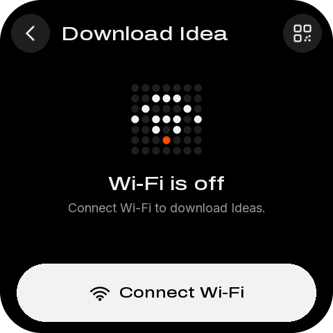

| 名称 | 类型 | x, y, w, h | 样式 | 内容 / 动作 |
|---|---|---|---|---|
| `button_back_download_visual` | container | 16, 20, 56, 56 | #1E1E1E |  |
| `button_back_download_icon` | image | 28, 32, 32, 32 |  | back-32-white.png |
| `button_back_download` | button | 2, 6, 84, 84 |  | → `back` |
| `button_qr_ideas_visual` | container | 408, 20, 56, 56 | #1E1E1E |  |
| `button_qr_ideas_icon` | image | 420, 32, 32, 32 |  | qr-32-white.png |
| `button_qr_ideas` | button | 394, 6, 84, 84 |  | → `qr:ideas` |
| `download_title` | label | 88, 32, 308, 33 | medium 28px #F2F2F2 | Download Idea |
| `download_hero` | image | 180, 112, 120, 120 |  | hero_wifi-120.png |
| `download_offline_title` | label | 24, 248, 432, 33 | medium 28px #F2F2F2 | Wi-Fi is off |
| `download_offline_note` | label | 24, 288, 432, 22 | sans 18px #9A9A9A | Connect Wi-Fi to download Ideas. |
| `button_connect_wifi` | button | 24, 380, 432, 84 | medium 22px #000000 | Connect Wi-Fi → `go:wifi` |

## progress-download — Progress · download and install

| 名称 | 类型 | x, y, w, h | 样式 | 内容 / 动作 |
|---|---|---|---|---|
| `progress_icon` | image | 32, 48, 96, 96 |  | idea_snake-96.png |
| `progress_title` | label | 144, 56, 312, 26 | medium 22px #F2F2F2 | Downloading |
| `progress_detail` | label | 144, 90, 312, 22 | sans 18px #9A9A9A | Retro Snake · v1.0.3 |
| `progress_phase` | label | 144, 118, 312, 20 | sans 16px #9A9A9A | Step 1 of 2 · Download |
| `progress_percent` | label | 24, 168, 432, 102 | dot 88px #F2F2F2 | 62% |
| `progress` | progress | 40, 280, 400, 12 | #262626 |  |
| `progress_bytes` | label | 24, 300, 432, 20 | sans 16px #9A9A9A | 0.56 of 0.90 MB · 512 KB/s |
| `button_cancel` | button | 24, 380, 432, 84 | medium 22px #F2F2F2 | Cancel → `progress:cancel` |

## progress-install — Progress · installing

| 名称 | 类型 | x, y, w, h | 样式 | 内容 / 动作 |
|---|---|---|---|---|
| `progress_icon` | image | 32, 48, 96, 96 |  | idea_snake-96.png |
| `progress_title` | label | 144, 56, 312, 26 | medium 22px #F2F2F2 | Installing |
| `progress_detail` | label | 144, 90, 312, 22 | sans 18px #9A9A9A | Retro Snake · v1.0.3 |
| `progress_phase` | label | 144, 118, 312, 20 | sans 16px #9A9A9A | Step 2 of 2 · Install |
| `progress_percent` | label | 24, 168, 432, 102 | dot 88px #F2F2F2 | 81% |
| `progress` | progress | 40, 280, 400, 12 | #262626 |  |
| `progress_bytes` | label | 24, 300, 432, 20 | sans 16px #9A9A9A | 0.90 of 0.90 MB · Writing |

## progress-switch — Progress · switching Ideas

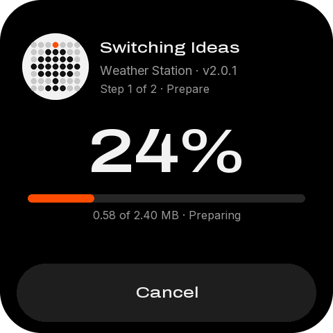

| 名称 | 类型 | x, y, w, h | 样式 | 内容 / 动作 |
|---|---|---|---|---|
| `progress_icon` | image | 32, 48, 96, 96 |  | idea_weather-96.png |
| `progress_title` | label | 144, 56, 312, 26 | medium 22px #F2F2F2 | Switching Ideas |
| `progress_detail` | label | 144, 90, 312, 22 | sans 18px #9A9A9A | Weather Station · v2.0.1 |
| `progress_phase` | label | 144, 118, 312, 20 | sans 16px #9A9A9A | Step 1 of 2 · Prepare |
| `progress_percent` | label | 24, 168, 432, 102 | dot 88px #F2F2F2 | 24% |
| `progress` | progress | 40, 280, 400, 12 | #262626 |  |
| `progress_bytes` | label | 24, 300, 432, 20 | sans 16px #9A9A9A | 0.58 of 2.40 MB · Preparing |
| `button_cancel` | button | 24, 380, 432, 84 | medium 22px #F2F2F2 | Cancel → `progress:cancel` |

## progress-agent — Progress · AI agent install

| 名称 | 类型 | x, y, w, h | 样式 | 内容 / 动作 |
|---|---|---|---|---|
| `progress_icon` | image | 32, 48, 96, 96 |  | idea_plus-96.png |
| `progress_title` | label | 144, 56, 312, 26 | medium 22px #F2F2F2 | From your agent |
| `progress_detail` | label | 144, 90, 312, 22 | sans 18px #9A9A9A | hello_world · v0.2.1 |
| `progress_phase` | label | 144, 118, 312, 20 | sans 16px #9A9A9A | Step 1 of 2 · Receiving |
| `progress_percent` | label | 24, 168, 432, 102 | dot 88px #F2F2F2 | 46% |
| `progress` | progress | 40, 280, 400, 12 | #262626 |  |
| `progress_bytes` | label | 24, 300, 432, 20 | sans 16px #9A9A9A | 1.31 of 2.85 MB · 236 KB/s |

## result-saved — Result · saved

| 名称 | 类型 | x, y, w, h | 样式 | 内容 / 动作 |
|---|---|---|---|---|
| `result_hero` | image | 180, 48, 120, 120 |  | hero_saved-120.png |
| `result_title` | label | 24, 184, 432, 33 | medium 28px #F2F2F2 | Idea saved |
| `result_caption` | label | 24, 226, 432, 22 | sans 18px #9A9A9A | Retro Snake · v1.0.3 |
| `result_detail` | label | 24, 254, 432, 44 | sans 18px #9A9A9A | It is on this device now. |
| `button_result_left` | button | 24, 380, 208, 84 | medium 22px #F2F2F2 | Done → `result:done` |
| `button_result_right` | button | 248, 380, 208, 84 | medium 22px #000000 | Open → `result:open` |

## result-failed — Result · failed

| 名称 | 类型 | x, y, w, h | 样式 | 内容 / 动作 |
|---|---|---|---|---|
| `result_hero` | image | 180, 48, 120, 120 |  | hero_cross-120.png |
| `result_title` | label | 24, 184, 432, 33 | medium 28px #F2F2F2 | Couldn't download |
| `result_caption` | label | 24, 226, 432, 22 | sans 18px #9A9A9A | Retro Snake · v1.0.3 |
| `result_detail` | label | 24, 254, 432, 44 | sans 18px #9A9A9A | The connection dropped. ⏎ Check Wi-Fi and try again. |
| `button_result_left` | button | 24, 380, 208, 84 | medium 22px #F2F2F2 | Done → `result:done` |
| `button_result_right` | button | 248, 380, 208, 84 | medium 22px #000000 | Try again → `result:retry` |

## result-nospace — Result · no space

| 名称 | 类型 | x, y, w, h | 样式 | 内容 / 动作 |
|---|---|---|---|---|
| `result_hero` | image | 180, 48, 120, 120 |  | hero_full-120.png |
| `result_title` | label | 24, 184, 432, 33 | medium 28px #F2F2F2 | Not enough storage |
| `result_caption` | label | 24, 226, 432, 22 | sans 18px #9A9A9A | Retro Snake needs 0.9 MB |
| `result_detail` | label | 24, 254, 432, 44 | sans 18px #9A9A9A | Delete an Idea you don't use ⏎ to make room. |
| `button_result_left` | button | 24, 380, 208, 84 | medium 22px #F2F2F2 | Cancel → `result:done` |
| `button_result_right` | button | 248, 380, 208, 84 | medium 22px #000000 | Manage → `go:manage` |

## result-battery — Result · low battery

| 名称 | 类型 | x, y, w, h | 样式 | 内容 / 动作 |
|---|---|---|---|---|
| `result_hero` | image | 180, 48, 120, 120 |  | hero_battery-120.png |
| `result_title` | label | 24, 184, 432, 33 | medium 28px #F2F2F2 | Battery low |
| `result_caption` | label | 24, 226, 432, 22 | sans 18px #9A9A9A | Charge to 20% to switch Ideas |
| `result_detail` | label | 24, 254, 432, 44 | sans 18px #9A9A9A | Switching writes to flash and ⏎ must not be interrupted. |
| `button_result_right` | button | 24, 380, 432, 84 | medium 22px #000000 | OK → `result:done` |

## launching — Opening an Idea

| 名称 | 类型 | x, y, w, h | 样式 | 内容 / 动作 |
|---|---|---|---|---|
| `launch_icon` | image | 186, 80, 108, 108 |  | idea_weather-108.png |
| `launch_title` | label | 24, 212, 432, 33 | medium 28px #F2F2F2 | Opening Weather Station |
| `launch_spinner` | image | 208, 316, 64, 64 |  | spin64-00.png |

## running — Your Idea is running

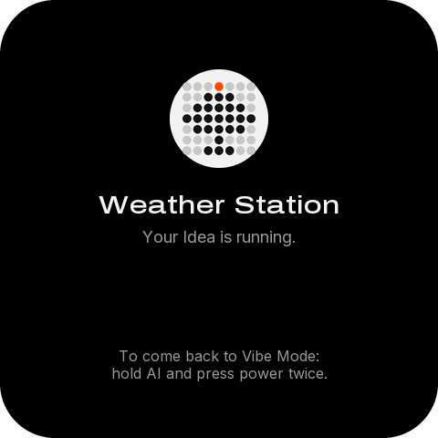

| 名称 | 类型 | x, y, w, h | 样式 | 内容 / 动作 |
|---|---|---|---|---|
| `running_icon` | image | 186, 76, 108, 108 |  | idea_weather-108.png |
| `running_title` | label | 24, 208, 432, 33 | medium 28px #F2F2F2 | Weather Station |

## boot — Boot

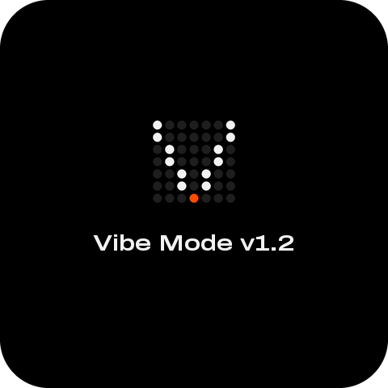

| 名称 | 类型 | x, y, w, h | 样式 | 内容 / 动作 |
|---|---|---|---|---|
| `boot_logo` | image | 180, 140, 120, 120 |  | hero_vibe-120.png |
| `boot_title` | label | 24, 284, 432, 33 | dot 28px #F2F2F2 | Vibe Mode v1.2 |

## boot-tip — Boot key held · update tip

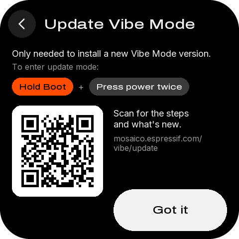

| 名称 | 类型 | x, y, w, h | 样式 | 内容 / 动作 |
|---|---|---|---|---|
| `button_back_boot_tip_visual` | container | 16, 20, 56, 56 | #1E1E1E |  |
| `button_back_boot_tip_icon` | image | 28, 32, 32, 32 |  | back-32-white.png |
| `button_back_boot_tip` | button | 2, 6, 84, 84 |  | → `back` |
| `boot_tip_title` | label | 88, 32, 368, 33 | medium 28px #F2F2F2 | Update Vibe Mode |
| `boot_tip_body` | label | 24, 96, 432, 22 | sans 18px #F2F2F2 | Only needed to install a new Vibe Mode version. |
| `boot_tip_how` | label | 24, 124, 432, 20 | sans 16px #9A9A9A | To enter update mode: |
| `boot_tip_chip_boot` | label | 24, 156, 123, 36 | medium 16px #000000 | Hold Boot |
| `boot_tip_chip_power` | label | 179, 156, 201, 36 | medium 16px #F2F2F2 | Press power twice |
| `boot_tip_qr_card` | container | 24, 212, 183, 183 | #FFFFFF |  |
| `boot_tip_qr` | image | 33, 221, 165, 165 | QR，每模块 5 px | vibe-update.png |
| `boot_tip_qr_text` | label | 228, 216, 228, 44 | sans 18px #F2F2F2 | Scan for the steps ⏎ and what's new. |
| `boot_tip_url` | label | 228, 268, 228, 39 | sans 16px #9A9A9A | mosaico.espressif.com/ ⏎ vibe/update |
| `button_boot_tip_ok` | button | 228, 380, 228, 84 | medium 22px #000000 | Got it → `back` |

## update-mode — Vibe Mode update mode

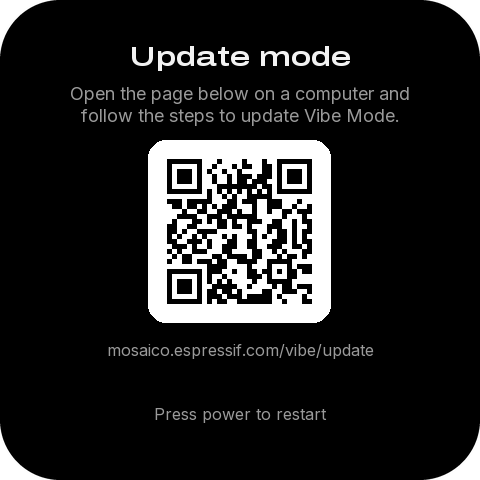

| 名称 | 类型 | x, y, w, h | 样式 | 内容 / 动作 |
|---|---|---|---|---|
| `update_title` | label | 24, 40, 432, 33 | dot 28px #F2F2F2 | Update mode |
| `update_body` | label | 40, 82, 400, 44 | sans 18px #9A9A9A | Open the page below on a computer and ⏎ follow the steps to update Vibe Mode. |
| `update_qr_card` | container | 148, 140, 183, 183 | #FFFFFF |  |
| `update_qr` | image | 157, 149, 165, 165 | QR，每模块 5 px | vibe-update.png |
| `update_url` | label | 24, 340, 432, 20 | sans 16px #9A9A9A | mosaico.espressif.com/vibe/update |
| `update_hint` | label | 24, 404, 432, 20 | sans 16px #9A9A9A | Press power to restart |

## develop — Develop · USB and agent ready

| 名称 | 类型 | x, y, w, h | 样式 | 内容 / 动作 |
|---|---|---|---|---|
| `button_back_develop_visual` | container | 16, 20, 56, 56 | #1E1E1E |  |
| `button_back_develop_icon` | image | 28, 32, 32, 32 |  | back-32-white.png |
| `button_back_develop` | button | 2, 6, 84, 84 |  | → `back` |
| `develop_title` | label | 88, 32, 368, 33 | medium 28px #F2F2F2 | Develop |
| `button_vibe_guide` | button | 16, 96, 448, 80 | #141414 | → `qr:develop` |
| `develop_usb_card` | container | 16, 192, 448, 112 | #141414 |  |
| `develop_usb_tile` | container | 28, 204, 56, 56 | #232323 |  |
| `develop_usb_icon` | image | 40, 216, 32, 32 |  | usb-32-cream.png |
| `develop_status_dot` | container | 100, 243, 10, 10 | #FF4C01 |  |
| `develop_status` | label | 118, 238, 326, 20 | sans 16px #FF4C01 | USB connected · Agent ready |
| `button_save_nand` | button | 16, 320, 448, 80 | #141414 | → `dev:save` |
| `develop_save_tile` | container | 28, 332, 56, 56 | #232323 |  |
| `develop_save_icon` | image | 40, 344, 32, 32 |  | storage-32-cream.png |
| `develop_save_title` | label | 100, 334, 312, 26 | medium 22px #F2F2F2 | Save to NAND flash |
| `develop_save_sub` | label | 100, 366, 312, 20 | sans 16px #9A9A9A | hello_world · keep it for later |
| `develop_save_trail` | image | 424, 350, 20, 20 |  | chevron-20-dim.png |

## settings — Settings

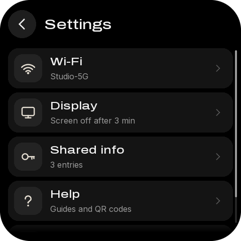

| 名称 | 类型 | x, y, w, h | 样式 | 内容 / 动作 |
|---|---|---|---|---|
| `button_back_settings_visual` | container | 16, 20, 56, 56 | #1E1E1E |  |
| `button_back_settings_icon` | image | 28, 32, 32, 32 |  | back-32-white.png |
| `button_back_settings` | button | 2, 6, 84, 84 |  | → `back` |
| `settings_title` | label | 88, 32, 368, 33 | medium 28px #F2F2F2 | Settings |
| `settings` | list | 16, 96, 448, 368 | 行距 88 | 行模板 `settings_row` |
| `settings_fade` | image | 16, 440, 448, 24 |  | list-fade.png |
| `settings_scroll_track` | container | 468, 100, 4, 344 | #262626 |  |
| `settings_scroll_thumb` | container | 468, 100, 4, 293 | #9A9A9A |  |

## display — Display · screen off and auto-rotate

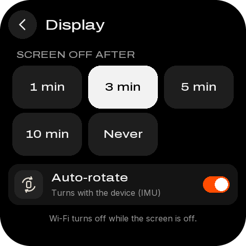

| 名称 | 类型 | x, y, w, h | 样式 | 内容 / 动作 |
|---|---|---|---|---|
| `button_back_display_visual` | container | 16, 20, 56, 56 | #1E1E1E |  |
| `button_back_display_icon` | image | 28, 32, 32, 32 |  | back-32-white.png |
| `button_back_display` | button | 2, 6, 84, 84 |  | → `back` |
| `display_title` | label | 88, 32, 368, 33 | medium 28px #F2F2F2 | Display |
| `display_section` | label | 32, 96, 416, 21 | medium 18px #9A9A9A | SCREEN OFF AFTER |
| `button_timeout_60` | button | 24, 128, 136, 84 | medium 22px #F2F2F2 | 1 min → `display:timeout:60` |
| `button_timeout_180` | button | 172, 128, 136, 84 | medium 22px #000000 | 3 min → `display:timeout:180` |
| `button_timeout_300` | button | 320, 128, 136, 84 | medium 22px #F2F2F2 | 5 min → `display:timeout:300` |
| `button_timeout_600` | button | 24, 220, 136, 84 | medium 22px #F2F2F2 | 10 min → `display:timeout:600` |
| `button_timeout_0` | button | 172, 220, 136, 84 | medium 22px #F2F2F2 | Never → `display:timeout:0` |
| `button_rotate` | button | 16, 320, 448, 80 | #141414 | → `display:rotate` |
| `display_rotate_sub` | label | 100, 366, 312, 20 | sans 16px #9A9A9A | Turns with the device (IMU) |
| `rotate_switch_track` | container | 396, 344, 52, 32 | #FF4C01 |  |
| `rotate_switch_knob` | container | 419, 347, 26, 26 | #FFFFFF |  |
| `display_note` | label | 24, 416, 432, 20 | sans 16px #9A9A9A | Wi-Fi turns off while the screen is off. |

## wifi — Wi-Fi · connected

| 名称 | 类型 | x, y, w, h | 样式 | 内容 / 动作 |
|---|---|---|---|---|
| `button_back_wifi_visual` | container | 16, 20, 56, 56 | #1E1E1E |  |
| `button_back_wifi_icon` | image | 28, 32, 32, 32 |  | back-32-white.png |
| `button_back_wifi` | button | 2, 6, 84, 84 |  | → `back` |
| `button_scan_visual` | container | 408, 20, 56, 56 | #1E1E1E |  |
| `button_scan_icon` | image | 420, 32, 32, 32 |  | refresh-32-white.png |
| `button_scan` | button | 394, 6, 84, 84 |  | → `wifi:scan` |
| `wifi_title` | label | 88, 32, 308, 33 | medium 28px #F2F2F2 | Wi-Fi |
| `button_wifi_current` | button | 16, 96, 448, 80 | #141414 | → `go:wifi_network` |
| `wifi_connection` | label | 100, 110, 312, 26 | medium 22px #F2F2F2 | Studio-5G |
| `wifi_detail` | label | 100, 142, 312, 20 | sans 16px #9A9A9A | Connected · 192.168.1.20 |
| `wifi_section` | label | 32, 196, 416, 21 | medium 18px #9A9A9A | OTHER NETWORKS · 4 |
| `networks` | list | 16, 228, 448, 236 | 行距 88 | 行模板 `network_row` |
| `networks_fade` | image | 16, 440, 448, 24 |  | list-fade.png |
| `networks_scroll_track` | container | 468, 232, 4, 212 | #262626 |  |
| `networks_scroll_thumb` | container | 468, 232, 4, 145 | #9A9A9A |  |

## wifi-off — Wi-Fi · not connected

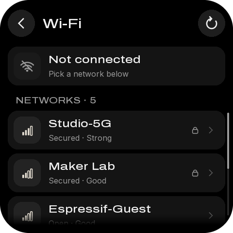

| 名称 | 类型 | x, y, w, h | 样式 | 内容 / 动作 |
|---|---|---|---|---|
| `button_back_wifi_visual` | container | 16, 20, 56, 56 | #1E1E1E |  |
| `button_back_wifi_icon` | image | 28, 32, 32, 32 |  | back-32-white.png |
| `button_back_wifi` | button | 2, 6, 84, 84 |  | → `back` |
| `button_scan_visual` | container | 408, 20, 56, 56 | #1E1E1E |  |
| `button_scan_icon` | image | 420, 32, 32, 32 |  | refresh-32-white.png |
| `button_scan` | button | 394, 6, 84, 84 |  | → `wifi:scan` |
| `wifi_title` | label | 88, 32, 308, 33 | medium 28px #F2F2F2 | Wi-Fi |
| `wifi_card` | container | 16, 96, 448, 80 | #141414 |  |
| `wifi_tile` | container | 28, 108, 56, 56 | #1A1A1A |  |
| `wifi_icon` | image | 40, 120, 32, 32 |  | wifi_off-32-grey.png |
| `wifi_connection` | label | 100, 110, 340, 26 | medium 22px #F2F2F2 | Not connected |
| `wifi_detail` | label | 100, 142, 340, 20 | sans 16px #9A9A9A | Pick a network below |
| `wifi_section` | label | 32, 196, 416, 21 | medium 18px #9A9A9A | NETWORKS · 5 |
| `networks` | list | 16, 228, 448, 236 | 行距 88 | 行模板 `network_row` |
| `networks_fade` | image | 16, 440, 448, 24 |  | list-fade.png |
| `networks_scroll_track` | container | 468, 232, 4, 212 | #262626 |  |
| `networks_scroll_thumb` | container | 468, 232, 4, 116 | #9A9A9A |  |

## wifi-pending — Wi-Fi · resumes a task

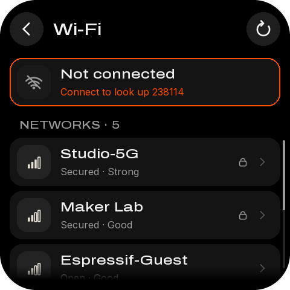

| 名称 | 类型 | x, y, w, h | 样式 | 内容 / 动作 |
|---|---|---|---|---|
| `button_back_wifi_visual` | container | 16, 20, 56, 56 | #1E1E1E |  |
| `button_back_wifi_icon` | image | 28, 32, 32, 32 |  | back-32-white.png |
| `button_back_wifi` | button | 2, 6, 84, 84 |  | → `back` |
| `button_scan_visual` | container | 408, 20, 56, 56 | #1E1E1E |  |
| `button_scan_icon` | image | 420, 32, 32, 32 |  | refresh-32-white.png |
| `button_scan` | button | 394, 6, 84, 84 |  | → `wifi:scan` |
| `wifi_title` | label | 88, 32, 308, 33 | medium 28px #F2F2F2 | Wi-Fi |
| `wifi_card` | container | 16, 96, 448, 80 | #141414 |  |
| `wifi_tile` | container | 28, 108, 56, 56 | #1A1A1A |  |
| `wifi_icon` | image | 40, 120, 32, 32 |  | wifi_off-32-grey.png |
| `wifi_connection` | label | 100, 110, 340, 26 | medium 22px #F2F2F2 | Not connected |
| `wifi_detail` | label | 100, 142, 340, 20 | sans 16px #FF4C01 | Connect to look up 238114 |
| `wifi_section` | label | 32, 196, 416, 21 | medium 18px #9A9A9A | NETWORKS · 5 |
| `networks` | list | 16, 228, 448, 236 | 行距 88 | 行模板 `network_row` |
| `networks_fade` | image | 16, 440, 448, 24 |  | list-fade.png |
| `networks_scroll_track` | container | 468, 232, 4, 212 | #262626 |  |
| `networks_scroll_thumb` | container | 468, 232, 4, 116 | #9A9A9A |  |

## wifi-connecting — Wi-Fi · connecting

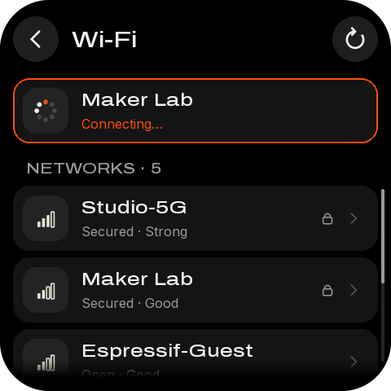

| 名称 | 类型 | x, y, w, h | 样式 | 内容 / 动作 |
|---|---|---|---|---|
| `button_back_wifi_visual` | container | 16, 20, 56, 56 | #1E1E1E |  |
| `button_back_wifi_icon` | image | 28, 32, 32, 32 |  | back-32-white.png |
| `button_back_wifi` | button | 2, 6, 84, 84 |  | → `back` |
| `button_scan_visual` | container | 408, 20, 56, 56 | #1E1E1E |  |
| `button_scan_icon` | image | 420, 32, 32, 32 |  | refresh-32-white.png |
| `button_scan` | button | 394, 6, 84, 84 |  | → `wifi:scan` |
| `wifi_title` | label | 88, 32, 308, 33 | medium 28px #F2F2F2 | Wi-Fi |
| `wifi_card` | container | 16, 96, 448, 80 | #141414 |  |
| `wifi_spinner` | image | 40, 120, 32, 32 |  | spin32-00.png |
| `wifi_connection` | label | 100, 110, 340, 26 | medium 22px #F2F2F2 | Maker Lab |
| `wifi_detail` | label | 100, 142, 340, 20 | sans 16px #FF4C01 | Connecting… |
| `wifi_section` | label | 32, 196, 416, 21 | medium 18px #9A9A9A | NETWORKS · 5 |
| `networks` | list | 16, 228, 448, 236 | 行距 88 | 行模板 `network_row` |
| `networks_fade` | image | 16, 440, 448, 24 |  | list-fade.png |
| `networks_scroll_track` | container | 468, 232, 4, 212 | #262626 |  |
| `networks_scroll_thumb` | container | 468, 232, 4, 116 | #9A9A9A |  |

## wifi-network — Wi-Fi · this network

| 名称 | 类型 | x, y, w, h | 样式 | 内容 / 动作 |
|---|---|---|---|---|
| `button_back_wifi_network_visual` | container | 16, 20, 56, 56 | #1E1E1E |  |
| `button_back_wifi_network_icon` | image | 28, 32, 32, 32 |  | back-32-white.png |
| `button_back_wifi_network` | button | 2, 6, 84, 84 |  | → `back` |
| `wifi_network_title` | label | 88, 32, 368, 33 | medium 28px #F2F2F2 | Studio-5G |
| `network_card` | container | 16, 96, 448, 192 | #141414 |  |
| `network_signal` | label | 196, 117, 248, 22 | sans 18px #F2F2F2 | Strong |
| `network_security` | label | 196, 181, 248, 22 | sans 18px #F2F2F2 | WPA2 |
| `network_ip` | label | 196, 245, 248, 22 | sans 18px #F2F2F2 | 192.168.1.20 |
| `button_forget_track` | container | 24, 344, 432, 96 | #141414 |  |
| `button_forget_fill` | container | 24, 344, 0, 96 | #E5484D |  |
| `button_forget` | button | 24, 344, 432, 96 | medium 22px #E5484D 长按 3000 ms | Hold to forget → `hold:forget` |

## password — Password

| 名称 | 类型 | x, y, w, h | 样式 | 内容 / 动作 |
|---|---|---|---|---|
| `button_back_password_visual` | container | 16, 20, 56, 56 | #1E1E1E |  |
| `button_back_password_icon` | image | 28, 32, 32, 32 |  | back-32-white.png |
| `button_back_password` | button | 2, 6, 84, 84 |  | → `back` |
| `password_title` | label | 88, 32, 368, 33 | medium 28px #F2F2F2 | Password |
| `password_card` | container | 16, 96, 448, 64 | #141414 |  |
| `password_display` | label | 36, 115, 332, 26 | medium 22px #9A9A9A | Type the password |
| `password_eye` | image | 412, 112, 32, 32 |  | eye-32-white.png |
| `button_toggle_password` | button | 380, 86, 84, 84 |  | → `password:toggle` |
| `password_note` | label | 32, 178, 416, 20 | sans 16px #9A9A9A | For Maker Lab · 8 or more characters |
| `password_keyboard` | keyboard | 0, 224, 480, 233 |  |  |

## shared — Shared info

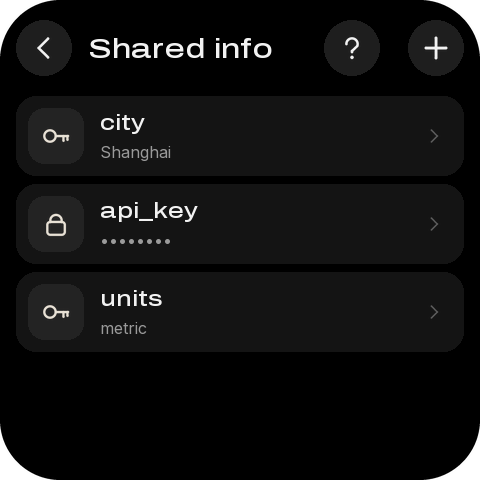

| 名称 | 类型 | x, y, w, h | 样式 | 内容 / 动作 |
|---|---|---|---|---|
| `button_back_shared_visual` | container | 16, 20, 56, 56 | #1E1E1E |  |
| `button_back_shared_icon` | image | 28, 32, 32, 32 |  | back-32-white.png |
| `button_back_shared` | button | 2, 6, 84, 84 |  | → `back` |
| `button_add_entry_visual` | container | 408, 20, 56, 56 | #1E1E1E |  |
| `button_add_entry_icon` | image | 420, 32, 32, 32 |  | plus-32-white.png |
| `button_add_entry` | button | 394, 6, 84, 84 |  | → `go:shared_add` |
| `button_shared_help_visual` | container | 324, 20, 56, 56 | #1E1E1E |  |
| `button_shared_help_icon` | image | 336, 32, 32, 32 |  | help-32-white.png |
| `button_shared_help` | button | 310, 6, 84, 84 |  | → `go:shared_help` |
| `shared_title` | label | 88, 32, 224, 33 | medium 28px #F2F2F2 | Shared info |
| `shared` | list | 16, 96, 448, 368 | 行距 88 | 行模板 `shared_row` |

## shared-swipe — Shared info · swiped to delete

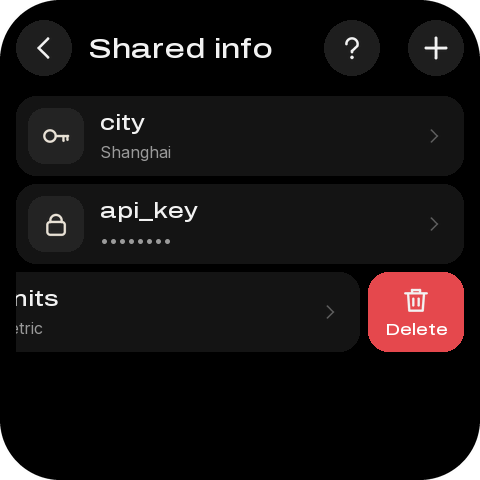

| 名称 | 类型 | x, y, w, h | 样式 | 内容 / 动作 |
|---|---|---|---|---|
| `button_back_shared_visual` | container | 16, 20, 56, 56 | #1E1E1E |  |
| `button_back_shared_icon` | image | 28, 32, 32, 32 |  | back-32-white.png |
| `button_back_shared` | button | 2, 6, 84, 84 |  | → `back` |
| `button_add_entry_visual` | container | 408, 20, 56, 56 | #1E1E1E |  |
| `button_add_entry_icon` | image | 420, 32, 32, 32 |  | plus-32-white.png |
| `button_add_entry` | button | 394, 6, 84, 84 |  | → `go:shared_add` |
| `button_shared_help_visual` | container | 324, 20, 56, 56 | #1E1E1E |  |
| `button_shared_help_icon` | image | 336, 32, 32, 32 |  | help-32-white.png |
| `button_shared_help` | button | 310, 6, 84, 84 |  | → `go:shared_help` |
| `shared_title` | label | 88, 32, 224, 33 | medium 28px #F2F2F2 | Shared info |
| `shared` | list | 16, 96, 448, 368 | 行距 88 | 行模板 `shared_row` |

## shared-empty — Shared info · empty

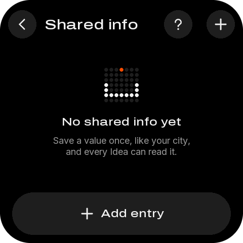

| 名称 | 类型 | x, y, w, h | 样式 | 内容 / 动作 |
|---|---|---|---|---|
| `button_back_shared_visual` | container | 16, 20, 56, 56 | #1E1E1E |  |
| `button_back_shared_icon` | image | 28, 32, 32, 32 |  | back-32-white.png |
| `button_back_shared` | button | 2, 6, 84, 84 |  | → `back` |
| `button_add_entry_visual` | container | 408, 20, 56, 56 | #1E1E1E |  |
| `button_add_entry_icon` | image | 420, 32, 32, 32 |  | plus-32-white.png |
| `button_add_entry` | button | 394, 6, 84, 84 |  | → `go:shared_add` |
| `button_shared_help_visual` | container | 324, 20, 56, 56 | #1E1E1E |  |
| `button_shared_help_icon` | image | 336, 32, 32, 32 |  | help-32-white.png |
| `button_shared_help` | button | 310, 6, 84, 84 |  | → `go:shared_help` |
| `shared_title` | label | 88, 32, 224, 33 | medium 28px #F2F2F2 | Shared info |
| `shared_empty_icon` | image | 200, 128, 80, 80 |  | hero_empty-80.png |
| `shared_empty_title` | label | 24, 228, 432, 26 | medium 22px #F2F2F2 | No shared info yet |
| `shared_empty_body` | label | 40, 266, 400, 44 | sans 18px #9A9A9A | Save a value once, like your city, ⏎ and every Idea can read it. |
| `button_add_first` | button | 24, 380, 432, 84 | medium 22px #F2F2F2 | Add entry → `go:shared_add` |

## shared-help — Shared info · what it is

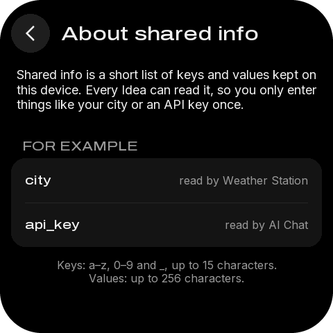

| 名称 | 类型 | x, y, w, h | 样式 | 内容 / 动作 |
|---|---|---|---|---|
| `button_back_shared_help_visual` | container | 16, 20, 56, 56 | #1E1E1E |  |
| `button_back_shared_help_icon` | image | 28, 32, 32, 32 |  | back-32-white.png |
| `button_back_shared_help` | button | 2, 6, 84, 84 |  | → `back` |
| `shared_help_title` | label | 88, 32, 368, 33 | medium 28px #F2F2F2 | About shared info |
| `shared_help_body` | label | 24, 96, 432, 87 | sans 18px #F2F2F2 换行 | Shared info is a short list of keys and values kept on ⏎ this device. Every Idea can read it, so you only enter ⏎ things like your city or an API key once. |
| `shared_help_card` | container | 16, 228, 448, 128 | #141414 |  |
| `shared_help_rules` | label | 24, 372, 432, 39 | sans 16px #9A9A9A | Keys: a–z, 0–9 and _, up to 15 characters. ⏎ Values: up to 256 characters. |

## shared-entry — Shared info · entry

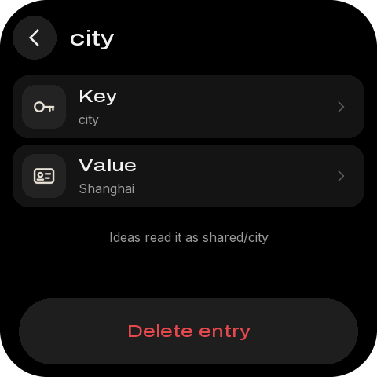

| 名称 | 类型 | x, y, w, h | 样式 | 内容 / 动作 |
|---|---|---|---|---|
| `button_back_shared_entry_visual` | container | 16, 20, 56, 56 | #1E1E1E |  |
| `button_back_shared_entry_icon` | image | 28, 32, 32, 32 |  | back-32-white.png |
| `button_back_shared_entry` | button | 2, 6, 84, 84 |  | → `back` |
| `shared_entry_title` | label | 88, 32, 368, 33 | medium 28px #F2F2F2 | city |
| `button_edit_key` | button | 16, 96, 448, 80 | #141414 | → `go:shared_key` |
| `entry_key` | label | 100, 142, 312, 20 | sans 16px #9A9A9A | city |
| `button_edit_value` | button | 16, 184, 448, 80 | #141414 | → `go:shared_value` |
| `entry_value` | label | 100, 230, 312, 20 | sans 16px #9A9A9A | Shanghai |
| `entry_hint` | label | 24, 292, 432, 20 | sans 16px #9A9A9A | Ideas read it as shared/city |
| `button_delete_entry` | button | 24, 380, 432, 84 | medium 22px #E5484D | Delete entry → `entry:delete` |

## shared-add-key — Shared info · new key

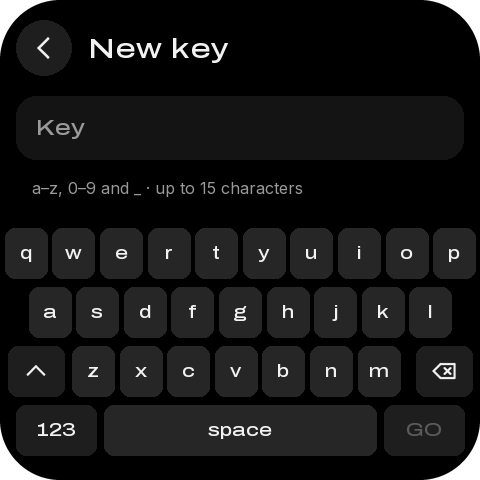

| 名称 | 类型 | x, y, w, h | 样式 | 内容 / 动作 |
|---|---|---|---|---|
| `button_back_shared_add_key_visual` | container | 16, 20, 56, 56 | #1E1E1E |  |
| `button_back_shared_add_key_icon` | image | 28, 32, 32, 32 |  | back-32-white.png |
| `button_back_shared_add_key` | button | 2, 6, 84, 84 |  | → `back` |
| `shared_add_key_title` | label | 88, 32, 368, 33 | medium 28px #F2F2F2 | New key |
| `shared_add_key_card` | container | 16, 96, 448, 64 | #141414 |  |
| `shared_add_key_display` | label | 36, 115, 408, 26 | medium 22px #9A9A9A | Key |
| `shared_add_key_note` | label | 32, 178, 416, 20 | sans 16px #9A9A9A | a–z, 0–9 and _ · up to 15 characters |
| `shared_add_key_keyboard` | keyboard | 0, 224, 480, 233 |  |  |

## shared-add-value — Shared info · new value

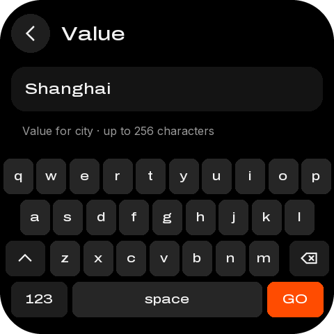

| 名称 | 类型 | x, y, w, h | 样式 | 内容 / 动作 |
|---|---|---|---|---|
| `button_back_shared_add_value_visual` | container | 16, 20, 56, 56 | #1E1E1E |  |
| `button_back_shared_add_value_icon` | image | 28, 32, 32, 32 |  | back-32-white.png |
| `button_back_shared_add_value` | button | 2, 6, 84, 84 |  | → `back` |
| `shared_add_value_title` | label | 88, 32, 368, 33 | medium 28px #F2F2F2 | Value |
| `shared_add_value_card` | container | 16, 96, 448, 64 | #141414 |  |
| `shared_add_value_display` | label | 36, 115, 408, 26 | medium 22px #F2F2F2 | Shanghai |
| `shared_add_value_note` | label | 32, 178, 416, 20 | sans 16px #9A9A9A | Value for city · up to 256 characters |
| `shared_add_value_keyboard` | keyboard | 0, 224, 480, 233 |  |  |

## shared-edit-key — Shared info · rename key

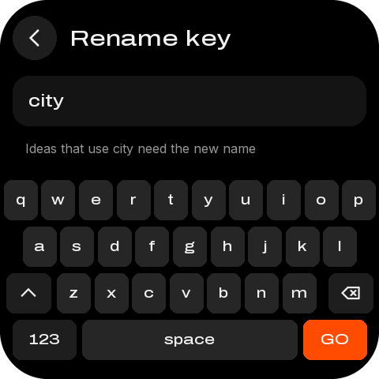

| 名称 | 类型 | x, y, w, h | 样式 | 内容 / 动作 |
|---|---|---|---|---|
| `button_back_shared_add_key_visual` | container | 16, 20, 56, 56 | #1E1E1E |  |
| `button_back_shared_add_key_icon` | image | 28, 32, 32, 32 |  | back-32-white.png |
| `button_back_shared_add_key` | button | 2, 6, 84, 84 |  | → `back` |
| `shared_add_key_title` | label | 88, 32, 368, 33 | medium 28px #F2F2F2 | Rename key |
| `shared_add_key_card` | container | 16, 96, 448, 64 | #141414 |  |
| `shared_add_key_display` | label | 36, 115, 408, 26 | medium 22px #F2F2F2 | city |
| `shared_add_key_note` | label | 32, 178, 416, 20 | sans 16px #9A9A9A | Ideas that use city need the new name |
| `shared_add_key_keyboard` | keyboard | 0, 224, 480, 233 |  |  |

## help — Help · topics

| 名称 | 类型 | x, y, w, h | 样式 | 内容 / 动作 |
|---|---|---|---|---|
| `button_back_help_visual` | container | 16, 20, 56, 56 | #1E1E1E |  |
| `button_back_help_icon` | image | 28, 32, 32, 32 |  | back-32-white.png |
| `button_back_help` | button | 2, 6, 84, 84 |  | → `back` |
| `help_title` | label | 88, 32, 368, 33 | medium 28px #F2F2F2 | Help |
| `button_help_start` | button | 16, 96, 448, 80 | #141414 | → `help:start` |
| `button_help_develop` | button | 16, 184, 448, 80 | #141414 | → `help:develop` |
| `button_help_ids` | button | 16, 272, 448, 80 | #141414 | → `help:ids` |
| `button_help_fix` | button | 16, 360, 448, 80 | #141414 | → `help:fix` |

## help-topic — Help · topic

| 名称 | 类型 | x, y, w, h | 样式 | 内容 / 动作 |
|---|---|---|---|---|
| `button_back_help_topic_visual` | container | 16, 20, 56, 56 | #1E1E1E |  |
| `button_back_help_topic_icon` | image | 28, 32, 32, 32 |  | back-32-white.png |
| `button_back_help_topic` | button | 2, 6, 84, 84 |  | → `back` |
| `help_topic_title` | label | 88, 32, 368, 33 | medium 28px #F2F2F2 | Getting started |
| `help_step_1` | label | 64, 108, 392, 44 | sans 18px #F2F2F2 换行 | Plug in USB and ask your agent to build an ⏎ Idea. |
| `help_step_2` | label | 64, 180, 392, 44 | sans 18px #F2F2F2 换行 | Or type an Idea ID in Manage to download it. |
| `help_step_3` | label | 64, 252, 392, 44 | sans 18px #F2F2F2 换行 | Tap an Idea to open it. Hold AI to come back. |
| `button_help_qr` | button | 24, 380, 432, 84 | medium 22px #F2F2F2 | Show QR code → `qr:help-start` |

## about — About

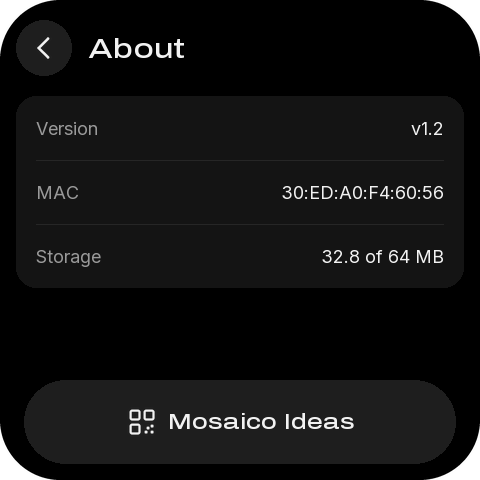

| 名称 | 类型 | x, y, w, h | 样式 | 内容 / 动作 |
|---|---|---|---|---|
| `button_back_about_visual` | container | 16, 20, 56, 56 | #1E1E1E |  |
| `button_back_about_icon` | image | 28, 32, 32, 32 |  | back-32-white.png |
| `button_back_about` | button | 2, 6, 84, 84 |  | → `back` |
| `about_title` | label | 88, 32, 368, 33 | medium 28px #F2F2F2 | About |
| `about_card` | container | 16, 96, 448, 192 | #141414 |  |
| `about_version` | label | 196, 117, 248, 22 | sans 18px #F2F2F2 | v1.2 |
| `about_mac` | label | 196, 181, 248, 22 | sans 18px #F2F2F2 | 30:ED:A0:F4:60:56 |
| `about_storage` | label | 196, 245, 248, 22 | sans 18px #F2F2F2 | 32.8 of 64 MB |
| `button_about_qr` | button | 24, 380, 432, 84 | medium 22px #F2F2F2 | Mosaico Ideas → `qr:ideas` |

## qr-develop — QR code · vibe-coding guide

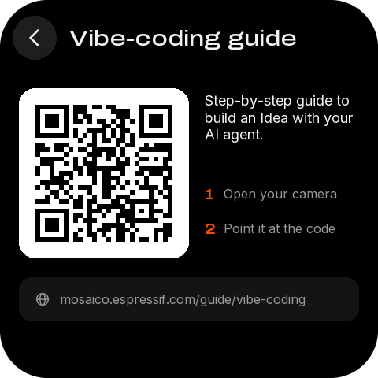

| 名称 | 类型 | x, y, w, h | 样式 | 内容 / 动作 |
|---|---|---|---|---|
| `button_back_qr_visual` | container | 16, 20, 56, 56 | #1E1E1E |  |
| `button_back_qr_icon` | image | 28, 32, 32, 32 |  | back-32-white.png |
| `button_back_qr` | button | 2, 6, 84, 84 |  | → `back` |
| `qr_title` | label | 88, 32, 368, 33 | medium 28px #F2F2F2 | Vibe-coding guide |
| `qr_card` | container | 24, 112, 216, 216 | #FFFFFF |  |
| `qr_code` | image | 33, 121, 198, 198 | QR，每模块 6 px | develop.png |
| `qr_desc` | label | 260, 116, 196, 87 | sans 18px #F2F2F2 换行 | Step-by-step guide to ⏎ build an Idea with your ⏎ AI agent. |
| `qr_url_card` | container | 24, 352, 432, 56 | #141414 |  |
| `qr_url` | label | 76, 370, 364, 20 | sans 16px #9A9A9A | mosaico.espressif.com/guide/vibe-coding |

## qr-idea — QR code · an Idea

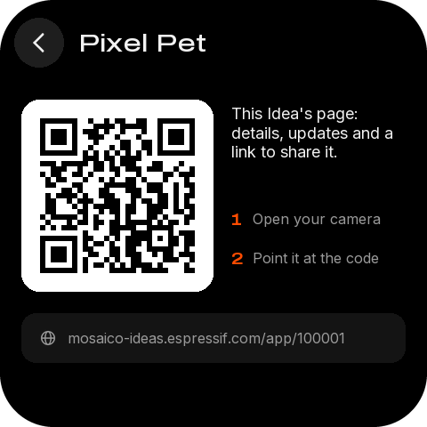

| 名称 | 类型 | x, y, w, h | 样式 | 内容 / 动作 |
|---|---|---|---|---|
| `button_back_qr_visual` | container | 16, 20, 56, 56 | #1E1E1E |  |
| `button_back_qr_icon` | image | 28, 32, 32, 32 |  | back-32-white.png |
| `button_back_qr` | button | 2, 6, 84, 84 |  | → `back` |
| `qr_title` | label | 88, 32, 368, 33 | medium 28px #F2F2F2 | Pixel Pet |
| `qr_card` | container | 24, 112, 216, 216 | #FFFFFF |  |
| `qr_code` | image | 33, 121, 198, 198 | QR，每模块 6 px | idea-100001.png |
| `qr_desc` | label | 260, 116, 196, 87 | sans 18px #F2F2F2 换行 | This Idea's page: ⏎ details, updates and a ⏎ link to share it. |
| `qr_url_card` | container | 24, 352, 432, 56 | #141414 |  |
| `qr_url` | label | 76, 370, 364, 20 | sans 16px #9A9A9A | mosaico-ideas.espressif.com/app/100001 |

