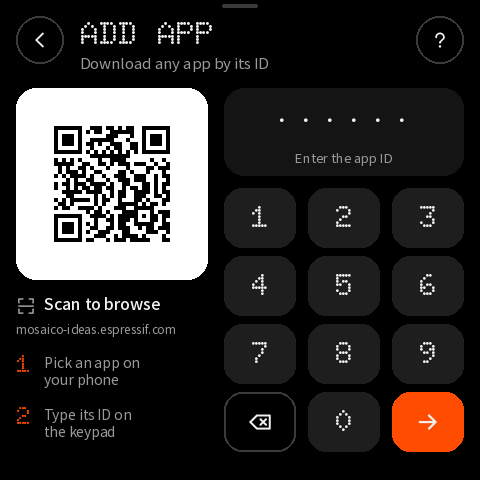

# 附录：逐页布局表

由 `tools/build_design.py` 生成，与 `layout.json` 和页面图一致；坐标单位为 480×480 逻辑像素。
只列出有名称（阶段 B 需要绑定或更新）或可点击的对象；装饰对象见 `layout.json`。

## guide-1 — Guide 1/4

| 名称 | 类型 | x, y, w, h | 样式 | 内容 / 动作 |
|---|---|---|---|---|
| `guide_step` | label | 16, 26, 120, 22 | dot 22px #9A9A9A | 01/04 |
| `button_skip` | button | 372, 16, 92, 44 | medium 15px #9A9A9A | Skip → `guide:done` |
| `button_guide_next` | button | 16, 404, 448, 56 | medium 18px #000000 | Next → `guide:2` |
| `ai_cue` | container | 222, 4, 36, 4 | #3A3A3A |  |

## guide-2 — Guide 2/4

| 名称 | 类型 | x, y, w, h | 样式 | 内容 / 动作 |
|---|---|---|---|---|
| `guide_step` | label | 16, 26, 120, 22 | dot 22px #9A9A9A | 02/04 |
| `button_skip` | button | 372, 16, 92, 44 | medium 15px #9A9A9A | Skip → `guide:done` |
| `button_guide_back` | button | 16, 404, 140, 56 | medium 17px #F2F2F2 | Back → `guide:1` |
| `button_guide_next` | button | 164, 404, 300, 56 | medium 18px #000000 | Next → `guide:3` |
| `ai_cue` | container | 222, 4, 36, 4 | #3A3A3A |  |

## guide-3 — Guide 3/4

| 名称 | 类型 | x, y, w, h | 样式 | 内容 / 动作 |
|---|---|---|---|---|
| `guide_step` | label | 16, 26, 120, 22 | dot 22px #9A9A9A | 03/04 |
| `button_skip` | button | 372, 16, 92, 44 | medium 15px #9A9A9A | Skip → `guide:done` |
| `button_guide_back` | button | 16, 404, 140, 56 | medium 17px #F2F2F2 | Back → `guide:2` |
| `button_guide_next` | button | 164, 404, 300, 56 | medium 18px #000000 | Next → `guide:4` |
| `ai_cue` | container | 222, 4, 36, 4 | #3A3A3A |  |

## guide-4 — Guide 4/4

| 名称 | 类型 | x, y, w, h | 样式 | 内容 / 动作 |
|---|---|---|---|---|
| `guide_step` | label | 16, 26, 120, 22 | dot 22px #9A9A9A | 04/04 |
| `button_skip` | button | 372, 16, 92, 44 | medium 15px #9A9A9A | Skip → `guide:done` |
| `guide_key_0` | button | 16, 124, 112, 44 | medium 15px #F2F2F2 | AI |
| `guide_key_1` | button | 16, 184, 112, 44 | medium 15px #F2F2F2 | AI ×2 |
| `guide_key_2` | button | 16, 244, 112, 44 | medium 15px #F2F2F2 | Hold AI |
| `guide_help_sample` | button | 16, 334, 44, 44 | #000000 | → `help:topics` |
| `button_guide_back` | button | 16, 404, 140, 56 | medium 17px #F2F2F2 | Back → `guide:3` |
| `button_guide_next` | button | 164, 404, 300, 56 | medium 18px #000000 | Start → `guide:done` |
| `ai_cue` | container | 222, 4, 36, 4 | #3A3A3A |  |

## home — Home · agent connected

| 名称 | 类型 | x, y, w, h | 样式 | 内容 / 动作 |
|---|---|---|---|---|
| `button_wifi` | button | 316, 16, 44, 44 | #000000 | → `go:wifi` |
| `button_help_home` | button | 368, 16, 44, 44 | #000000 | → `help:topics` |
| `button_device` | button | 420, 16, 44, 44 | #000000 | → `go:device` |
| `app_count` | label | 344, 76, 120, 40 | dot 40px #FF4C01 | 05 |
| `status_dot_live` | container | 16, 129, 8, 8 | #FF4C01 |  |
| `home_status` | label | 30, 122, 420, 19 | sans 15px #9A9A9A | Agent connected · USB |
| `apps` | list | 16, 152, 448, 240 | 行高 74 | 行模板 `apps_row` |
| `button_add` | button | 16, 404, 448, 56 | medium 18px #000000 | Add app → `go:add` |
| `ai_cue` | container | 222, 4, 36, 4 | #3A3A3A |  |

## add — Add app · empty

| 名称 | 类型 | x, y, w, h | 样式 | 内容 / 动作 |
|---|---|---|---|---|
| `button_back_add` | button | 16, 16, 48, 48 | #000000 | → `back` |
| `add_title` | label | 80, 18, 300, 32 | dot 32px #F2F2F2 | ADD APP |
| `add_subtitle` | label | 80, 54, 320, 19 | sans 15px #9A9A9A | Download any app by its ID |
| `button_help_add` | button | 416, 16, 48, 48 | #000000 | → `help:ids` |
| `ideas_qr` | image | 38, 110, 148, 148 |  | ideas-148.png |
| `id_digits` | label | 232, 102, 224, 40 | dot 40px #F2F2F2 | ······ |
| `id_digits_compact` | label | 232, 111, 224, 22 | dot 22px #F2F2F2 |   |
| `id_status` | label | 232, 150, 224, 17 | sans 13px #9A9A9A | Enter the app ID |
| `id_error` | label | 232, 150, 224, 17 | sans 13px #FF4C01 |   |
| `key_1` | button | 224, 188, 72, 60 | dot 30px #F2F2F2 | 1 → `key:1` |
| `key_2` | button | 308, 188, 72, 60 | dot 30px #F2F2F2 | 2 → `key:2` |
| `key_3` | button | 392, 188, 72, 60 | dot 30px #F2F2F2 | 3 → `key:3` |
| `key_4` | button | 224, 256, 72, 60 | dot 30px #F2F2F2 | 4 → `key:4` |
| `key_5` | button | 308, 256, 72, 60 | dot 30px #F2F2F2 | 5 → `key:5` |
| `key_6` | button | 392, 256, 72, 60 | dot 30px #F2F2F2 | 6 → `key:6` |
| `key_7` | button | 224, 324, 72, 60 | dot 30px #F2F2F2 | 7 → `key:7` |
| `key_8` | button | 308, 324, 72, 60 | dot 30px #F2F2F2 | 8 → `key:8` |
| `key_9` | button | 392, 324, 72, 60 | dot 30px #F2F2F2 | 9 → `key:9` |
| `key_del` | button | 224, 392, 72, 60 | #000000 | → `key:del` |
| `key_0` | button | 308, 392, 72, 60 | dot 30px #F2F2F2 | 0 → `key:0` |
| `key_go` | button | 392, 392, 72, 60 | #FF4C01 | → `key:go` |
| `ai_cue` | container | 222, 4, 36, 4 | #3A3A3A |  |

## detail-current — Detail · current app

| 名称 | 类型 | x, y, w, h | 样式 | 内容 / 动作 |
|---|---|---|---|---|
| `button_back_detail` | button | 16, 16, 48, 48 | #000000 | → `back` |
| `detail_title` | label | 80, 18, 300, 32 | dot 32px #F2F2F2 | APP |
| `detail_subtitle` | label | 80, 54, 320, 19 | sans 15px #9A9A9A | Saved on this device |
| `button_help_detail` | button | 416, 16, 48, 48 | #000000 | → `help:ids` |
| `detail_tile` | container | 16, 88, 96, 96 | #262626 |  |
| `detail_initial` | label | 16, 111, 96, 56 | dot 56px #F2F2F2 | P |
| `detail_name` | label | 128, 92, 336, 30 | medium 24px #F2F2F2 | Pixel Pet |
| `detail_id` | label | 128, 128, 336, 28 | dot 28px #FF4C01 | 100001 |
| `detail_meta` | label | 128, 164, 336, 19 | sans 15px #9A9A9A | v1.2.0 · 1.8 MB |
| `detail_source` | label | 200, 218, 248, 19 | medium 15px #F2F2F2 | Official |
| `detail_status` | label | 200, 274, 248, 19 | medium 15px #F2F2F2 |   |
| `detail_status_accent` | label | 200, 274, 248, 19 | medium 15px #FF4C01 | Current app |
| `button_primary` | button | 16, 328, 448, 56 | medium 18px #000000 | Open → `app:run` |
| `button_secondary` | button | 16, 396, 216, 56 | medium 17px #F2F2F2 | Update → `app:update` |
| `button_tertiary` | button | 248, 396, 216, 56 | medium 17px #FF4C01 | Delete → `app:delete_ask` |
| `ai_cue` | container | 222, 4, 36, 4 | #3A3A3A |  |

## detail-local — Detail · saved app

| 名称 | 类型 | x, y, w, h | 样式 | 内容 / 动作 |
|---|---|---|---|---|
| `button_back_detail` | button | 16, 16, 48, 48 | #000000 | → `back` |
| `detail_title` | label | 80, 18, 300, 32 | dot 32px #F2F2F2 | APP |
| `detail_subtitle` | label | 80, 54, 320, 19 | sans 15px #9A9A9A | Saved on this device |
| `button_help_detail` | button | 416, 16, 48, 48 | #000000 | → `help:ids` |
| `detail_tile` | container | 16, 88, 96, 96 | #262626 |  |
| `detail_initial` | label | 16, 111, 96, 56 | dot 56px #F2F2F2 | W |
| `detail_name` | label | 128, 92, 336, 30 | medium 24px #F2F2F2 | Weather Station |
| `detail_id` | label | 128, 128, 336, 28 | dot 28px #FF4C01 | 100002 |
| `detail_meta` | label | 128, 164, 336, 19 | sans 15px #9A9A9A | v2.0.1 · 2.4 MB |
| `detail_source` | label | 200, 218, 248, 19 | medium 15px #F2F2F2 | Official |
| `detail_status` | label | 200, 274, 248, 19 | medium 15px #F2F2F2 | Saved · not running |
| `detail_status_accent` | label | 200, 274, 248, 19 | medium 15px #FF4C01 |   |
| `button_primary` | button | 16, 328, 448, 56 | medium 18px #000000 | Switch to this app → `app:run` |
| `button_secondary` | button | 16, 396, 216, 56 | medium 17px #F2F2F2 | Update → `app:update` |
| `button_tertiary` | button | 248, 396, 216, 56 | medium 17px #FF4C01 | Delete → `app:delete_ask` |
| `ai_cue` | container | 222, 4, 36, 4 | #3A3A3A |  |

## detail-delete — Detail · delete confirmation

| 名称 | 类型 | x, y, w, h | 样式 | 内容 / 动作 |
|---|---|---|---|---|
| `button_back_detail` | button | 16, 16, 48, 48 | #000000 | → `back` |
| `detail_title` | label | 80, 18, 300, 32 | dot 32px #F2F2F2 | APP |
| `detail_subtitle` | label | 80, 54, 320, 19 | sans 15px #9A9A9A | Saved on this device |
| `button_help_detail` | button | 416, 16, 48, 48 | #000000 | → `help:ids` |
| `detail_tile` | container | 16, 88, 96, 96 | #262626 |  |
| `detail_initial` | label | 16, 111, 96, 56 | dot 56px #F2F2F2 | W |
| `detail_name` | label | 128, 92, 336, 30 | medium 24px #F2F2F2 | Weather Station |
| `detail_id` | label | 128, 128, 336, 28 | dot 28px #FF4C01 | 100002 |
| `detail_meta` | label | 128, 164, 336, 19 | sans 15px #9A9A9A | v2.0.1 · 2.4 MB |
| `detail_source` | label | 200, 218, 248, 19 | medium 15px #F2F2F2 | Official |
| `detail_status` | label | 200, 274, 248, 19 | medium 15px #F2F2F2 | Saved · not running |
| `detail_status_accent` | label | 200, 274, 248, 19 | medium 15px #FF4C01 |   |
| `button_primary` | button | 16, 328, 448, 56 | medium 18px #000000 | Switch to this app → `app:run` |
| `button_secondary` | button | 16, 396, 216, 56 | medium 17px #F2F2F2 | Update → `app:update` |
| `button_delete_confirm` | button | 248, 396, 216, 56 | medium 15px #FFFFFF | Tap again to delete → `app:delete` |
| `ai_cue` | container | 222, 4, 36, 4 | #3A3A3A |  |

## detail-remote — Detail · found in the store

| 名称 | 类型 | x, y, w, h | 样式 | 内容 / 动作 |
|---|---|---|---|---|
| `button_back_detail` | button | 16, 16, 48, 48 | #000000 | → `back` |
| `detail_title` | label | 80, 18, 300, 32 | dot 32px #F2F2F2 | APP |
| `detail_subtitle` | label | 80, 54, 320, 19 | sans 15px #9A9A9A | From the app store |
| `button_help_detail` | button | 416, 16, 48, 48 | #000000 | → `help:ids` |
| `detail_tile` | container | 16, 88, 96, 96 | #262626 |  |
| `detail_initial` | label | 16, 111, 96, 56 | dot 56px #F2F2F2 | R |
| `detail_name` | label | 128, 92, 336, 30 | medium 24px #F2F2F2 | Retro Snake |
| `detail_id` | label | 128, 128, 336, 28 | dot 28px #FF4C01 | 238114 |
| `detail_meta` | label | 128, 164, 336, 19 | sans 15px #9A9A9A | v1.0.3 · 0.9 MB |
| `detail_source` | label | 200, 218, 248, 19 | medium 15px #F2F2F2 | Community |
| `detail_status` | label | 200, 274, 248, 19 | medium 15px #F2F2F2 | Not on this device |
| `detail_status_accent` | label | 200, 274, 248, 19 | medium 15px #FF4C01 |   |
| `button_primary` | button | 16, 328, 448, 56 | medium 18px #000000 | Download & run → `store:run` |
| `button_secondary` | button | 16, 396, 216, 56 | medium 17px #F2F2F2 | Download only → `store:keep` |
| `button_tertiary` | button | 248, 396, 216, 56 | medium 17px #F2F2F2 | Cancel → `back` |
| `ai_cue` | container | 222, 4, 36, 4 | #3A3A3A |  |

## detail-update — Detail · update available

| 名称 | 类型 | x, y, w, h | 样式 | 内容 / 动作 |
|---|---|---|---|---|
| `button_back_detail` | button | 16, 16, 48, 48 | #000000 | → `back` |
| `detail_title` | label | 80, 18, 300, 32 | dot 32px #F2F2F2 | APP |
| `detail_subtitle` | label | 80, 54, 320, 19 | sans 15px #9A9A9A | From the app store |
| `button_help_detail` | button | 416, 16, 48, 48 | #000000 | → `help:ids` |
| `detail_tile` | container | 16, 88, 96, 96 | #262626 |  |
| `detail_initial` | label | 16, 111, 96, 56 | dot 56px #F2F2F2 | V |
| `detail_name` | label | 128, 92, 336, 30 | medium 24px #F2F2F2 | Voice Notes |
| `detail_id` | label | 128, 128, 336, 28 | dot 28px #FF4C01 | 100005 |
| `detail_meta` | label | 128, 164, 336, 19 | sans 15px #9A9A9A | v1.0.0 · 3.1 MB |
| `detail_source` | label | 200, 218, 248, 19 | medium 15px #F2F2F2 | Official |
| `detail_status` | label | 200, 274, 248, 19 | medium 15px #F2F2F2 |   |
| `detail_status_accent` | label | 200, 274, 248, 19 | medium 15px #FF4C01 | Update · v0.9.0 → v1.0.0 |
| `button_primary` | button | 16, 328, 448, 56 | medium 18px #000000 | Download & run → `store:run` |
| `button_secondary` | button | 16, 396, 216, 56 | medium 17px #F2F2F2 | Download only → `store:keep` |
| `button_tertiary` | button | 248, 396, 216, 56 | medium 17px #F2F2F2 | Cancel → `back` |
| `ai_cue` | container | 222, 4, 36, 4 | #3A3A3A |  |

## progress-agent — Progress · from the AI agent

| 名称 | 类型 | x, y, w, h | 样式 | 内容 / 动作 |
|---|---|---|---|---|
| `progress_caption` | label | 16, 30, 448, 17 | medium 13px #FF4C01 | FROM YOUR AI AGENT · USB |
| `progress_title` | label | 16, 52, 448, 35 | medium 28px #F2F2F2 | Installing your app |
| `progress_detail` | label | 16, 92, 448, 19 | sans 15px #9A9A9A | hello_world · v0.2.1 |
| `progress_percent` | label | 16, 126, 448, 112 | dot 112px #F2F2F2 | 42% |
| `progress` | progress | 16, 252, 448, 8 | #262626 |  |
| `progress_bytes` | label | 16, 274, 280, 19 | sans 15px #9A9A9A | 1.20 MB of 2.85 MB |
| `progress_rate` | label | 296, 274, 168, 19 | medium 15px #F2F2F2 | 236 KB/s |
| `progress_step` | label | 16, 302, 448, 18 | sans 14px #5C5C5C | Step 1 of 2 · Receiving |
| `ai_cue` | container | 222, 4, 36, 4 | #3A3A3A |  |

## progress-download — Progress · store download

| 名称 | 类型 | x, y, w, h | 样式 | 内容 / 动作 |
|---|---|---|---|---|
| `progress_caption` | label | 16, 30, 448, 17 | medium 13px #FF4C01 | FROM THE APP STORE |
| `progress_title` | label | 16, 52, 448, 35 | medium 28px #F2F2F2 | Downloading |
| `progress_detail` | label | 16, 92, 448, 19 | sans 15px #9A9A9A | Retro Snake · v1.0.3 |
| `progress_percent` | label | 16, 126, 448, 112 | dot 112px #F2F2F2 | 67% |
| `progress` | progress | 16, 252, 448, 8 | #262626 |  |
| `progress_bytes` | label | 16, 274, 280, 19 | sans 15px #9A9A9A | 0.61 MB of 0.92 MB |
| `progress_rate` | label | 296, 274, 168, 19 | medium 15px #F2F2F2 | 512 KB/s |
| `progress_step` | label | 16, 302, 448, 18 | sans 14px #5C5C5C | File 2 of 3 |
| `button_cancel` | button | 16, 404, 448, 56 | medium 17px #F2F2F2 | Cancel download → `store:cancel` |
| `ai_cue` | container | 222, 4, 36, 4 | #3A3A3A |  |

## progress-install — Progress · switching apps

| 名称 | 类型 | x, y, w, h | 样式 | 内容 / 动作 |
|---|---|---|---|---|
| `progress_caption` | label | 16, 30, 448, 17 | medium 13px #FF4C01 | FROM YOUR LIBRARY |
| `progress_title` | label | 16, 52, 448, 35 | medium 28px #F2F2F2 | Switching apps |
| `progress_detail` | label | 16, 92, 448, 19 | sans 15px #9A9A9A | Weather Station · v2.0.1 |
| `progress_percent` | label | 16, 126, 448, 112 | dot 112px #F2F2F2 | 88% |
| `progress` | progress | 16, 252, 448, 8 | #262626 |  |
| `progress_bytes` | label | 16, 274, 280, 19 | sans 15px #9A9A9A | 2.11 MB of 2.40 MB |
| `progress_rate` | label | 296, 274, 168, 19 | medium 15px #F2F2F2 | 1.6 MB/s |
| `progress_step` | label | 16, 302, 448, 18 | sans 14px #5C5C5C | Step 2 of 2 · Writing |
| `ai_cue` | container | 222, 4, 36, 4 | #3A3A3A |  |

## result-installed — Result · installed

| 名称 | 类型 | x, y, w, h | 样式 | 内容 / 动作 |
|---|---|---|---|---|
| `result_ring` | container | 192, 72, 96, 96 | #000000 |  |
| `result_icon` | image | 220, 100, 40, 40 |  | check-40-orange.png |
| `result_title` | label | 16, 190, 448, 35 | medium 28px #F2F2F2 | App installed |
| `result_caption` | label | 16, 232, 448, 19 | sans 15px #9A9A9A | Pixel Pet · v1.2.0 |
| `result_detail` | label | 40, 270, 400, 19 | sans 15px #9A9A9A | Restarting into your app… |
| `button_done` | button | 16, 396, 448, 56 | medium 18px #000000 | Done → `go:home` |
| `ai_cue` | container | 222, 4, 36, 4 | #3A3A3A |  |

## result-saved — Result · saved

| 名称 | 类型 | x, y, w, h | 样式 | 内容 / 动作 |
|---|---|---|---|---|
| `result_ring` | container | 192, 72, 96, 96 | #000000 |  |
| `result_icon` | image | 220, 100, 40, 40 |  | check-40-orange.png |
| `result_title` | label | 16, 190, 448, 35 | medium 28px #F2F2F2 | Saved to My Apps |
| `result_caption` | label | 16, 232, 448, 19 | sans 15px #9A9A9A | Retro Snake · v1.0.3 |
| `result_detail` | label | 40, 270, 400, 19 | sans 15px #9A9A9A | Open it any time from My Apps. |
| `button_result_second` | button | 16, 396, 216, 56 | medium 17px #F2F2F2 | Open now → `result:second` |
| `button_done` | button | 248, 396, 216, 56 | medium 18px #000000 | Done → `go:home` |
| `ai_cue` | container | 222, 4, 36, 4 | #3A3A3A |  |

## result-failed — Result · failed

| 名称 | 类型 | x, y, w, h | 样式 | 内容 / 动作 |
|---|---|---|---|---|
| `result_ring` | container | 192, 72, 96, 96 | #000000 |  |
| `result_icon` | image | 220, 100, 40, 40 |  | close-40-grey.png |
| `result_title` | label | 16, 190, 448, 35 | medium 28px #F2F2F2 | Couldn't download |
| `result_caption` | label | 16, 232, 448, 19 | sans 15px #9A9A9A | Retro Snake · v1.0.3 |
| `result_detail` | label | 40, 270, 400, 38 | sans 15px #9A9A9A | The connection dropped. Check Wi-Fi ⏎ and try again. |
| `button_result_second` | button | 16, 396, 216, 56 | medium 17px #F2F2F2 | Try again → `result:second` |
| `button_done` | button | 248, 396, 216, 56 | medium 18px #000000 | Done → `go:home` |
| `button_help_result` | button | 416, 16, 48, 48 | #000000 | → `help:fix` |
| `ai_cue` | container | 222, 4, 36, 4 | #3A3A3A |  |

## help — Help topics

| 名称 | 类型 | x, y, w, h | 样式 | 内容 / 动作 |
|---|---|---|---|---|
| `button_back_help` | button | 16, 16, 48, 48 | #000000 | → `back` |
| `help_title` | label | 80, 18, 300, 32 | dot 32px #F2F2F2 | HELP |
| `help_subtitle` | label | 80, 54, 320, 19 | sans 15px #9A9A9A | Scan a code to read the guide |
| `topic_start` | button | 16, 88, 448, 68 | #141414 | → `help:start` |
| `topic_agent` | button | 16, 164, 448, 68 | #141414 | → `help:agent` |
| `topic_ids` | button | 16, 240, 448, 68 | #141414 | → `help:ids` |
| `topic_fix` | button | 16, 316, 448, 68 | #141414 | → `help:fix` |
| `button_replay` | button | 16, 404, 448, 56 | medium 17px #F2F2F2 | Replay guide → `guide:1` |
| `ai_cue` | container | 222, 4, 36, 4 | #3A3A3A |  |

## help-topic — Help topic with QR

| 名称 | 类型 | x, y, w, h | 样式 | 内容 / 动作 |
|---|---|---|---|---|
| `button_back_topic` | button | 16, 16, 48, 48 | #000000 | → `back` |
| `topic_title` | label | 80, 18, 300, 32 | dot 32px #F2F2F2 | HELP |
| `topic_subtitle` | label | 80, 54, 320, 19 | sans 15px #9A9A9A | Scan for the full guide |
| `topic_qr` | image | 38, 110, 148, 148 |  | help-start-148.png |
| `topic_url` | label | 16, 292, 192, 30 | sans 12px #9A9A9A | mosaico.espressif.com ⏎ /vibe/start |
| `topic_icon` | image | 224, 92, 24, 24 |  | flag-24-white.png |
| `topic_title` | label | 224, 124, 240, 23 | medium 18px #F2F2F2 | Getting started |
| `topic_point_0` | label | 238, 161, 226, 35 | sans 14px #9A9A9A | Hold AI, then double-press ⏎ power to come back here. |
| `topic_point_1` | label | 238, 208, 226, 35 | sans 14px #9A9A9A | Press AI to go back. ⏎ Double-press AI to switch. |
| `topic_point_2` | label | 238, 255, 226, 35 | sans 14px #9A9A9A | Tap an app, then Open ⏎ or Switch to run it. |
| `button_topics` | button | 16, 404, 448, 56 | medium 17px #F2F2F2 | All help topics → `help:topics` |
| `ai_cue` | container | 222, 4, 36, 4 | #3A3A3A |  |

## wifi — Wi-Fi

| 名称 | 类型 | x, y, w, h | 样式 | 内容 / 动作 |
|---|---|---|---|---|
| `button_back_wifi` | button | 16, 16, 48, 48 | #000000 | → `back` |
| `wifi_title` | label | 80, 18, 300, 32 | dot 32px #F2F2F2 | WI-FI |
| `wifi_subtitle` | label | 80, 54, 320, 19 | sans 15px #9A9A9A | Connect to download apps |
| `button_help_wifi` | button | 416, 16, 48, 48 | #000000 | → `help:fix` |
| `wifi_connection` | label | 68, 98, 280, 24 | medium 19px #F2F2F2 | Studio-5G |
| `wifi_detail` | label | 68, 125, 280, 18 | sans 14px #9A9A9A | Connected · 192.168.1.20 |
| `button_forget` | button | 360, 102, 92, 44 | medium 15px #F2F2F2 | Forget → `wifi:forget` |
| `wifi_scan` | label | 16, 186, 300, 17 | medium 13px #9A9A9A | NETWORKS · 4 |
| `button_scan` | button | 368, 172, 96, 44 | medium 14px #F2F2F2 | Scan → `wifi:scan` |
| `networks` | list | 16, 228, 448, 244 | 行高 68 | 行模板 `networks_row` |
| `ai_cue` | container | 222, 4, 36, 4 | #3A3A3A |  |

## password — Wi-Fi password

| 名称 | 类型 | x, y, w, h | 样式 | 内容 / 动作 |
|---|---|---|---|---|
| `button_back_password` | button | 16, 16, 48, 48 | #000000 | → `back` |
| `password_title` | label | 80, 18, 300, 32 | dot 32px #F2F2F2 | PASSWORD |
| `password_subtitle` | label | 80, 54, 320, 19 | sans 15px #9A9A9A | Studio-5G |
| `password_display` | label | 34, 108, 340, 25 | medium 20px #F2F2F2 | •••••••••• |
| `button_toggle_password` | button | 392, 96, 56, 48 | #1E1E1E | → `password:toggle` |
| `password_error` | label | 16, 166, 448, 18 | sans 14px #FF4C01 |   |
| `password_keyboard` | keyboard | 0, 231, 480, 233 |  |  |
| `ai_cue` | container | 222, 4, 36, 4 | #3A3A3A |  |

## device — Device

| 名称 | 类型 | x, y, w, h | 样式 | 内容 / 动作 |
|---|---|---|---|---|
| `button_back_device` | button | 16, 16, 48, 48 | #000000 | → `back` |
| `device_title` | label | 80, 18, 300, 32 | dot 32px #F2F2F2 | DEVICE |
| `device_subtitle` | label | 80, 54, 320, 19 | sans 15px #9A9A9A | Vibe Mode 0.3.0 · ESP32-S31 |
| `button_help_device` | button | 416, 16, 48, 48 | #000000 | → `help:fix` |
| `button_device_wifi` | button | 16, 88, 448, 56 | #141414 | → `go:wifi` |
| `device_wifi` | label | 206, 106, 214, 19 | sans 15px #9A9A9A | Studio-5G |
| `device_version` | label | 206, 162, 242, 19 | sans 15px #9A9A9A | 0.3.0 |
| `device_mac` | label | 206, 218, 242, 19 | sans 15px #9A9A9A | 30:ED:A0:F4:60:56 |
| `device_storage` | label | 206, 274, 242, 19 | sans 15px #9A9A9A | 5 apps · 9.4 MB used |
| `device_endpoint` | label | 32, 368, 416, 18 | sans 14px #F2F2F2 | Wi-Fi link  192.168.1.20:7777 |
| `device_token` | label | 32, 390, 416, 30 | sans 12px #5C5C5C | Token  3f9a1c07e2b84d6a95c1f0e7d2a4b8c6 ⏎              0d5e9f2a7c3b1e8d4f6a0c9b2e7d5a13 |
| `ai_cue` | container | 222, 4, 36, 4 | #3A3A3A |  |

