# 附录：逐页布局表

由 `tools/build_design.py` 生成，与 `layout.json` 和页面图一致；坐标单位为 480×480 逻辑像素。
只列出有名称（阶段 B 需要绑定或更新）或可点击的对象；装饰对象见 `layout.json`。

## guide-1 — Guide 1/5

| 名称 | 类型 | x, y, w, h | 样式 | 内容 / 动作 |
|---|---|---|---|---|
| `guide_dot_1` | container | 198, 32, 20, 8 | #FF4C01 |  |
| `guide_dot_2` | container | 226, 32, 8, 8 | #262626 |  |
| `guide_dot_3` | container | 242, 32, 8, 8 | #262626 |  |
| `guide_dot_4` | container | 258, 32, 8, 8 | #262626 |  |
| `guide_dot_5` | container | 274, 32, 8, 8 | #262626 |  |
| `button_guide_skip` | button | 372, 6, 96, 84 |  | → `guide:done` |
| `guide_hero` | image | 180, 76, 120, 120 |  | hero_vibe-120.png |
| `button_guide_next` | button | 16, 388, 448, 84 | medium 22px #000000 | Get started → `guide:2` |

## guide-2 — Guide 2/5

| 名称 | 类型 | x, y, w, h | 样式 | 内容 / 动作 |
|---|---|---|---|---|
| `guide_dot_1` | container | 198, 32, 8, 8 | #262626 |  |
| `guide_dot_2` | container | 214, 32, 20, 8 | #FF4C01 |  |
| `guide_dot_3` | container | 242, 32, 8, 8 | #262626 |  |
| `guide_dot_4` | container | 258, 32, 8, 8 | #262626 |  |
| `guide_dot_5` | container | 274, 32, 8, 8 | #262626 |  |
| `button_guide_skip` | button | 372, 6, 96, 84 |  | → `guide:done` |
| `guide_ring_ai` | container | 126, 133, 46, 27 |  |  |
| `guide_ring_power` | container | 126, 288, 46, 27 |  |  |
| `button_guide_back` | button | 16, 388, 216, 84 | medium 22px #F2F2F2 | Back → `guide:1` |
| `button_guide_next` | button | 248, 388, 216, 84 | medium 22px #000000 | Next → `guide:3` |

## guide-3 — Guide 3/5

| 名称 | 类型 | x, y, w, h | 样式 | 内容 / 动作 |
|---|---|---|---|---|
| `guide_dot_1` | container | 198, 32, 8, 8 | #262626 |  |
| `guide_dot_2` | container | 214, 32, 8, 8 | #262626 |  |
| `guide_dot_3` | container | 230, 32, 20, 8 | #FF4C01 |  |
| `guide_dot_4` | container | 258, 32, 8, 8 | #262626 |  |
| `guide_dot_5` | container | 274, 32, 8, 8 | #262626 |  |
| `button_guide_skip` | button | 372, 6, 96, 84 |  | → `guide:done` |
| `button_guide_back` | button | 16, 388, 216, 84 | medium 22px #F2F2F2 | Back → `guide:2` |
| `button_guide_next` | button | 248, 388, 216, 84 | medium 22px #000000 | Next → `guide:4` |

## guide-4 — Guide 4/5

| 名称 | 类型 | x, y, w, h | 样式 | 内容 / 动作 |
|---|---|---|---|---|
| `guide_dot_1` | container | 198, 32, 8, 8 | #262626 |  |
| `guide_dot_2` | container | 214, 32, 8, 8 | #262626 |  |
| `guide_dot_3` | container | 230, 32, 8, 8 | #262626 |  |
| `guide_dot_4` | container | 246, 32, 20, 8 | #FF4C01 |  |
| `guide_dot_5` | container | 274, 32, 8, 8 | #262626 |  |
| `button_guide_skip` | button | 372, 6, 96, 84 |  | → `guide:done` |
| `button_guide_back` | button | 16, 388, 216, 84 | medium 22px #F2F2F2 | Back → `guide:3` |
| `button_guide_next` | button | 248, 388, 216, 84 | medium 22px #000000 | Next → `guide:5` |

## guide-5 — Guide 5/5

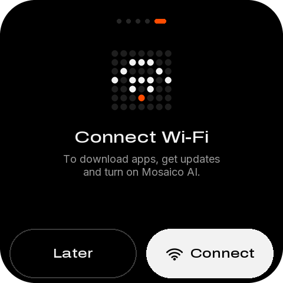

| 名称 | 类型 | x, y, w, h | 样式 | 内容 / 动作 |
|---|---|---|---|---|
| `guide_dot_1` | container | 198, 32, 8, 8 | #262626 |  |
| `guide_dot_2` | container | 214, 32, 8, 8 | #262626 |  |
| `guide_dot_3` | container | 230, 32, 8, 8 | #262626 |  |
| `guide_dot_4` | container | 246, 32, 8, 8 | #262626 |  |
| `guide_dot_5` | container | 262, 32, 20, 8 | #FF4C01 |  |
| `guide_hero` | image | 180, 76, 120, 120 |  | hero_wifi-120.png |
| `button_guide_later` | button | 16, 388, 216, 84 | medium 22px #F2F2F2 | Later → `guide:done` |
| `button_guide_wifi` | button | 248, 388, 216, 84 | medium 22px #000000 | Connect → `guide:wifi` |

## home — Home · recent first

| 名称 | 类型 | x, y, w, h | 样式 | 内容 / 动作 |
|---|---|---|---|---|
| `status_badge` | label | 212, 15, 100, 21 | medium 18px #FF4C01 | ↑ 2 |
| `status_wifi` | image | 324, 12, 28, 28 |  | wifi-28-white.png |
| `status_agent` | image | 360, 12, 28, 28 |  | robot-28-orange.png |
| `status_battery` | image | 396, 12, 28, 28 |  | battery_mid-28-white.png |
| `button_filter_visual` | container | 16, 46, 280, 72 | #000000 |  |
| `home_title` | label | 40, 69, 212, 26 | medium 22px #F2F2F2 | My apps |
| `button_filter` | button | 16, 40, 280, 84 |  | → `drawer:open` |
| `button_help_visual` | container | 314, 50, 64, 64 | #000000 |  |
| `button_help_icon` | image | 330, 66, 32, 32 |  | help-32-white.png |
| `button_help` | button | 304, 40, 84, 84 |  | → `go:help` |
| `button_device_visual` | container | 398, 50, 64, 64 | #000000 |  |
| `button_device_icon` | image | 414, 66, 32, 32 |  | chip-32-white.png |
| `button_device` | button | 388, 40, 84, 84 |  | → `go:device` |
| `apps` | list | 16, 128, 448, 256 | 行距 80 | 行模板 `apps_row` |
| `apps_fade` | image | 16, 360, 448, 24 |  | list-fade.png |
| `button_download` | button | 16, 388, 216, 84 | medium 22px #000000 | Download → `go:download` |
| `button_develop` | button | 248, 388, 216, 84 | medium 22px #F2F2F2 | Develop → `go:develop` |

## quick-switch — Quick switch

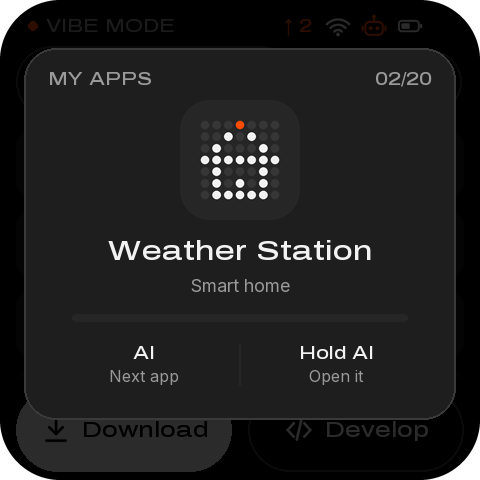

| 名称 | 类型 | x, y, w, h | 样式 | 内容 / 动作 |
|---|---|---|---|---|
| `status_badge` | label | 212, 15, 100, 21 | medium 18px #FF4C01 | ↑ 2 |
| `status_wifi` | image | 324, 12, 28, 28 |  | wifi-28-white.png |
| `status_agent` | image | 360, 12, 28, 28 |  | robot-28-orange.png |
| `status_battery` | image | 396, 12, 28, 28 |  | battery_mid-28-white.png |
| `button_filter_visual` | container | 16, 46, 280, 72 | #000000 |  |
| `home_title` | label | 40, 69, 212, 26 | medium 22px #F2F2F2 | My apps |
| `button_filter` | button | 16, 40, 280, 84 |  | → `drawer:open` |
| `button_help_visual` | container | 314, 50, 64, 64 | #000000 |  |
| `button_help_icon` | image | 330, 66, 32, 32 |  | help-32-white.png |
| `button_help` | button | 304, 40, 84, 84 |  | → `go:help` |
| `button_device_visual` | container | 398, 50, 64, 64 | #000000 |  |
| `button_device_icon` | image | 414, 66, 32, 32 |  | chip-32-white.png |
| `button_device` | button | 388, 40, 84, 84 |  | → `go:device` |
| `apps` | list | 16, 128, 448, 256 | 行距 80 | 行模板 `apps_row` |
| `apps_fade` | image | 16, 360, 448, 24 |  | list-fade.png |
| `button_download` | button | 16, 388, 216, 84 | medium 22px #000000 | Download → `go:download` |
| `button_develop` | button | 248, 388, 216, 84 | medium 22px #F2F2F2 | Develop → `go:develop` |
| `switch_card` | container | 24, 48, 432, 372 | #1E1E1E |  |
| `switch_filter` | label | 48, 68, 240, 21 | medium 18px #9A9A9A | MY APPS |
| `switch_position` | label | 328, 68, 104, 21 | medium 18px #9A9A9A | 02/20 |
| `switch_tile` | image | 180, 100, 120, 120 |  | tile_smart-home-120.png |
| `switch_name` | label | 48, 234, 384, 33 | medium 28px #F2F2F2 | Weather Station |
| `switch_detail` | label | 48, 274, 384, 22 | sans 18px #9A9A9A | Smart home |
| `switch_hold` | progress | 72, 314, 336, 8 | #262626 |  |
| `button_switch_open` | button | 24, 48, 432, 372 |  | → `qs:open` |

## download — Download · empty

| 名称 | 类型 | x, y, w, h | 样式 | 内容 / 动作 |
|---|---|---|---|---|
| `button_back_download_visual` | container | 16, 16, 64, 64 | #000000 |  |
| `button_back_download_icon` | image | 32, 32, 32, 32 |  | back-32-white.png |
| `button_back_download` | button | 6, 6, 84, 84 |  | → `back` |
| `download_title_icon` | image | 104, 32, 32, 32 |  | page_download-32-orange.png |
| `button_qr_ideas_visual` | container | 400, 16, 64, 64 | #000000 |  |
| `button_qr_ideas_icon` | image | 416, 32, 32, 32 |  | qr-32-white.png |
| `button_qr_ideas` | button | 390, 6, 84, 84 |  | → `qr:ideas` |
| `download_title` | label | 146, 32, 238, 33 | dot 28px #F2F2F2 | DOWNLOAD |
| `id_card` | container | 16, 88, 448, 68 | #141414 |  |
| `id_status` | label | 32, 111, 416, 22 | sans 18px #9A9A9A | Type the app ID |
| `key_1` | button | 16, 164, 144, 72 | dot 28px #F2F2F2 | 1 → `key:1` |
| `key_2` | button | 168, 164, 144, 72 | dot 28px #F2F2F2 | 2 → `key:2` |
| `key_3` | button | 320, 164, 144, 72 | dot 28px #F2F2F2 | 3 → `key:3` |
| `key_4` | button | 16, 242, 144, 72 | dot 28px #F2F2F2 | 4 → `key:4` |
| `key_5` | button | 168, 242, 144, 72 | dot 28px #F2F2F2 | 5 → `key:5` |
| `key_6` | button | 320, 242, 144, 72 | dot 28px #F2F2F2 | 6 → `key:6` |
| `key_7` | button | 16, 320, 144, 72 | dot 28px #F2F2F2 | 7 → `key:7` |
| `key_8` | button | 168, 320, 144, 72 | dot 28px #F2F2F2 | 8 → `key:8` |
| `key_9` | button | 320, 320, 144, 72 | dot 28px #F2F2F2 | 9 → `key:9` |
| `key_del` | button | 16, 398, 144, 72 | #1E1E1E | → `key:del` |
| `key_0` | button | 168, 398, 144, 72 | dot 28px #F2F2F2 | 0 → `key:0` |
| `key_go` | button | 320, 398, 144, 72 | medium 22px #FFFFFF | Go → `key:go` |

## develop — Develop · USB and agent ready

| 名称 | 类型 | x, y, w, h | 样式 | 内容 / 动作 |
|---|---|---|---|---|
| `button_back_develop_visual` | container | 16, 16, 64, 64 | #000000 |  |
| `button_back_develop_icon` | image | 32, 32, 32, 32 |  | back-32-white.png |
| `button_back_develop` | button | 6, 6, 84, 84 |  | → `back` |
| `develop_title_icon` | image | 104, 32, 32, 32 |  | page_develop-32-orange.png |
| `develop_title` | label | 146, 32, 310, 33 | dot 28px #F2F2F2 | DEVELOP |
| `button_vibe_guide` | button | 16, 100, 448, 80 | #141414 | → `qr:develop` |
| `develop_usb_card` | container | 16, 192, 448, 104 | #141414 |  |
| `develop_status_dot` | container | 84, 241, 10, 10 | #FF4C01 |  |
| `develop_status` | label | 102, 236, 342, 20 | sans 16px #FF4C01 | USB connected · Agent ready |
| `button_share` | button | 16, 308, 448, 80 | #141414 | → `qr:ideas` |

## detail-current — Detail · current app

| 名称 | 类型 | x, y, w, h | 样式 | 内容 / 动作 |
|---|---|---|---|---|
| `button_back_detail_visual` | container | 16, 16, 64, 64 | #000000 |  |
| `button_back_detail_icon` | image | 32, 32, 32, 32 |  | back-32-white.png |
| `button_back_detail` | button | 6, 6, 84, 84 |  | → `back` |
| `button_favorite_visual` | container | 400, 16, 64, 64 | #000000 |  |
| `button_favorite_icon` | image | 416, 32, 32, 32 |  | star_fill-32-orange.png |
| `button_favorite` | button | 390, 6, 84, 84 |  | → `app:favorite` |
| `detail_title` | label | 104, 35, 280, 26 | dot 22px #F2F2F2 | Pixel Pet |
| `detail_tile` | image | 24, 100, 96, 96 |  | tile_display-96.png |
| `detail_status_dot` | container | 136, 114, 10, 10 | #FF4C01 |  |
| `detail_status` | label | 154, 106, 302, 26 | medium 22px #FF4C01 | Current app |
| `detail_meta` | label | 136, 140, 320, 22 | sans 18px #9A9A9A | Display · v1.2.0 |
| `detail_meta2` | label | 136, 166, 320, 22 | sans 18px #9A9A9A | 1.8 MB · ID 100001 |
| `button_primary` | button | 16, 212, 448, 84 | medium 22px #000000 | Open app → `app:run` |
| `button_secondary` | button | 16, 308, 216, 84 | medium 22px #F2F2F2 | Update → `app:update` |
| `button_qr_app` | button | 248, 308, 216, 84 | medium 22px #F2F2F2 | QR code → `qr:app` |
| `button_more` | button | 160, 396, 160, 84 |  | → `detail:2` |

## detail-local — Detail · on this device

| 名称 | 类型 | x, y, w, h | 样式 | 内容 / 动作 |
|---|---|---|---|---|
| `button_back_detail_visual` | container | 16, 16, 64, 64 | #000000 |  |
| `button_back_detail_icon` | image | 32, 32, 32, 32 |  | back-32-white.png |
| `button_back_detail` | button | 6, 6, 84, 84 |  | → `back` |
| `button_favorite_visual` | container | 400, 16, 64, 64 | #000000 |  |
| `button_favorite_icon` | image | 416, 32, 32, 32 |  | star-32-white.png |
| `button_favorite` | button | 390, 6, 84, 84 |  | → `app:favorite` |
| `detail_title` | label | 104, 35, 280, 26 | dot 22px #F2F2F2 | Air Monitor |
| `detail_tile` | image | 24, 100, 96, 96 |  | tile_sensors-96.png |
| `detail_status_dot` | container | 136, 114, 10, 10 | #9A9A9A |  |
| `detail_status` | label | 154, 106, 302, 26 | medium 22px #F2F2F2 | On this device |
| `detail_meta` | label | 136, 140, 320, 22 | sans 18px #9A9A9A | Sensors · v1.2.2 |
| `detail_meta2` | label | 136, 166, 320, 22 | sans 18px #9A9A9A | 1.3 MB · ID 100012 |
| `button_primary` | button | 16, 212, 448, 84 | medium 22px #000000 | Open app → `app:run` |
| `button_secondary` | button | 16, 308, 216, 84 | medium 22px #F2F2F2 | Update → `app:update` |
| `button_qr_app` | button | 248, 308, 216, 84 | medium 22px #F2F2F2 | QR code → `qr:app` |
| `button_more` | button | 160, 396, 160, 84 |  | → `detail:2` |

## detail-remote — Detail · from the store

| 名称 | 类型 | x, y, w, h | 样式 | 内容 / 动作 |
|---|---|---|---|---|
| `button_back_detail_visual` | container | 16, 16, 64, 64 | #000000 |  |
| `button_back_detail_icon` | image | 32, 32, 32, 32 |  | back-32-white.png |
| `button_back_detail` | button | 6, 6, 84, 84 |  | → `back` |
| `button_favorite_visual` | container | 400, 16, 64, 64 | #000000 |  |
| `button_favorite_icon` | image | 416, 32, 32, 32 |  | star-32-white.png |
| `button_favorite` | button | 390, 6, 84, 84 |  | → `app:favorite` |
| `detail_title` | label | 104, 35, 280, 26 | dot 22px #F2F2F2 | Retro Snake |
| `detail_tile` | image | 24, 100, 96, 96 |  | tile_display-96.png |
| `detail_status_dot` | container | 136, 114, 10, 10 | #5C5C5C |  |
| `detail_status` | label | 154, 106, 302, 26 | medium 22px #F2F2F2 | Not on this device |
| `detail_meta` | label | 136, 140, 320, 22 | sans 18px #9A9A9A | Display · Community · v1.0.3 |
| `detail_meta2` | label | 136, 166, 320, 22 | sans 18px #9A9A9A | 0.9 MB · ID 238114 |
| `button_primary` | button | 16, 212, 448, 84 | medium 22px #000000 | Download & open → `store:run` |
| `button_secondary` | button | 16, 308, 216, 84 | medium 22px #F2F2F2 | Save → `store:keep` |
| `button_qr_app` | button | 248, 308, 216, 84 | medium 22px #F2F2F2 | QR code → `qr:app` |
| `button_more` | button | 160, 396, 160, 84 |  | → `detail:2` |

## detail-update — Detail · update available

| 名称 | 类型 | x, y, w, h | 样式 | 内容 / 动作 |
|---|---|---|---|---|
| `button_back_detail_visual` | container | 16, 16, 64, 64 | #000000 |  |
| `button_back_detail_icon` | image | 32, 32, 32, 32 |  | back-32-white.png |
| `button_back_detail` | button | 6, 6, 84, 84 |  | → `back` |
| `button_favorite_visual` | container | 400, 16, 64, 64 | #000000 |  |
| `button_favorite_icon` | image | 416, 32, 32, 32 |  | star-32-white.png |
| `button_favorite` | button | 390, 6, 84, 84 |  | → `app:favorite` |
| `detail_title` | label | 104, 35, 280, 26 | dot 22px #F2F2F2 | Voice Notes |
| `detail_tile` | image | 24, 100, 96, 96 |  | tile_audio-96.png |
| `detail_status_dot` | container | 136, 114, 10, 10 | #FF4C01 |  |
| `detail_status` | label | 154, 106, 302, 26 | medium 22px #FF4C01 | Update available |
| `detail_meta` | label | 136, 140, 320, 22 | sans 18px #9A9A9A | Audio · v1.0.0 |
| `detail_meta2` | label | 136, 166, 320, 22 | sans 18px #9A9A9A | New v1.1.0 · 3.2 MB |
| `button_primary` | button | 16, 212, 448, 84 | medium 22px #000000 | Update & open → `store:run` |
| `button_secondary` | button | 16, 308, 216, 84 | medium 22px #F2F2F2 | Save → `store:keep` |
| `button_qr_app` | button | 248, 308, 216, 84 | medium 22px #F2F2F2 | QR code → `qr:app` |
| `button_more` | button | 160, 396, 160, 84 |  | → `detail:2` |

## detail-nospace — Detail · not enough space

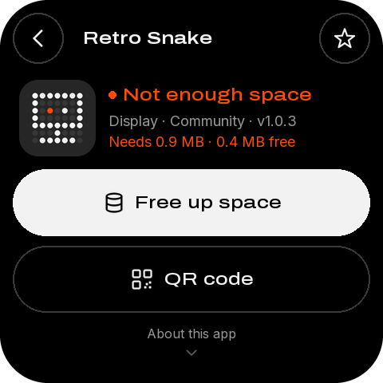

| 名称 | 类型 | x, y, w, h | 样式 | 内容 / 动作 |
|---|---|---|---|---|
| `button_back_detail_visual` | container | 16, 16, 64, 64 | #000000 |  |
| `button_back_detail_icon` | image | 32, 32, 32, 32 |  | back-32-white.png |
| `button_back_detail` | button | 6, 6, 84, 84 |  | → `back` |
| `button_favorite_visual` | container | 400, 16, 64, 64 | #000000 |  |
| `button_favorite_icon` | image | 416, 32, 32, 32 |  | star-32-white.png |
| `button_favorite` | button | 390, 6, 84, 84 |  | → `app:favorite` |
| `detail_title` | label | 104, 35, 280, 26 | dot 22px #F2F2F2 | Retro Snake |
| `detail_tile` | image | 24, 100, 96, 96 |  | tile_display-96.png |
| `detail_status_dot` | container | 136, 114, 10, 10 | #FF4C01 |  |
| `detail_status` | label | 154, 106, 302, 26 | medium 22px #FF4C01 | Not enough space |
| `detail_meta` | label | 136, 140, 320, 22 | sans 18px #9A9A9A | Display · Community · v1.0.3 |
| `detail_meta2` | label | 136, 166, 320, 22 | sans 18px #FF4C01 | Needs 0.9 MB · 0.4 MB free |
| `button_primary` | button | 16, 212, 448, 84 | medium 22px #000000 | Free up space → `go:storage` |
| `button_qr_app` | button | 16, 308, 448, 84 | medium 22px #F2F2F2 | QR code → `qr:app` |
| `button_more` | button | 160, 396, 160, 84 |  | → `detail:2` |

## detail-about — Detail page 2 · About

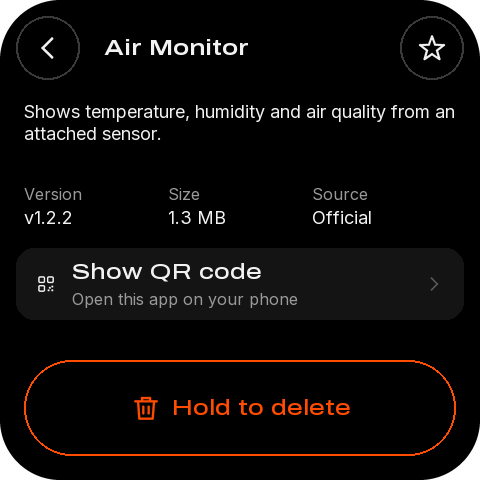

| 名称 | 类型 | x, y, w, h | 样式 | 内容 / 动作 |
|---|---|---|---|---|
| `button_back_detail_visual` | container | 16, 16, 64, 64 | #000000 |  |
| `button_back_detail_icon` | image | 32, 32, 32, 32 |  | back-32-white.png |
| `button_back_detail` | button | 6, 6, 84, 84 |  | → `back` |
| `button_favorite_visual` | container | 400, 16, 64, 64 | #000000 |  |
| `button_favorite_icon` | image | 416, 32, 32, 32 |  | star-32-white.png |
| `button_favorite` | button | 390, 6, 84, 84 |  | → `app:favorite` |
| `detail_title` | label | 104, 35, 280, 26 | dot 22px #F2F2F2 | Air Monitor |
| `detail_summary` | label | 24, 100, 432, 65 | sans 18px #F2F2F2 换行 | Shows temperature, humidity and air quality from an ⏎ attached sensor. |
| `detail_version` | label | 24, 206, 136, 22 | sans 18px #F2F2F2 | v1.2.2 |
| `detail_size` | label | 168, 206, 136, 22 | sans 18px #F2F2F2 | 1.3 MB |
| `detail_source` | label | 312, 206, 136, 22 | sans 18px #F2F2F2 | Official |
| `button_qr_row` | button | 16, 248, 448, 72 | #141414 | → `qr:app` |
| `button_delete` | button | 24, 360, 432, 96 | medium 22px #FF4C01 长按 600 ms | Hold to delete → `hold:delete` |

## detail-about-remote — Detail page 2 · store app

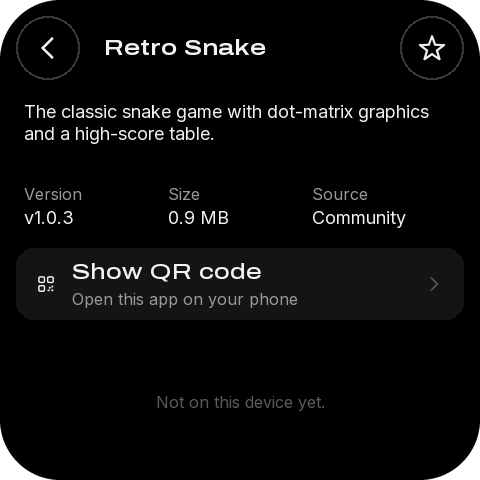

| 名称 | 类型 | x, y, w, h | 样式 | 内容 / 动作 |
|---|---|---|---|---|
| `button_back_detail_visual` | container | 16, 16, 64, 64 | #000000 |  |
| `button_back_detail_icon` | image | 32, 32, 32, 32 |  | back-32-white.png |
| `button_back_detail` | button | 6, 6, 84, 84 |  | → `back` |
| `button_favorite_visual` | container | 400, 16, 64, 64 | #000000 |  |
| `button_favorite_icon` | image | 416, 32, 32, 32 |  | star-32-white.png |
| `button_favorite` | button | 390, 6, 84, 84 |  | → `app:favorite` |
| `detail_title` | label | 104, 35, 280, 26 | dot 22px #F2F2F2 | Retro Snake |
| `detail_summary` | label | 24, 100, 432, 65 | sans 18px #F2F2F2 换行 | The classic snake game with dot-matrix graphics ⏎ and a high-score table. |
| `detail_version` | label | 24, 206, 136, 22 | sans 18px #F2F2F2 | v1.0.3 |
| `detail_size` | label | 168, 206, 136, 22 | sans 18px #F2F2F2 | 0.9 MB |
| `detail_source` | label | 312, 206, 136, 22 | sans 18px #F2F2F2 | Community |
| `button_qr_row` | button | 16, 248, 448, 72 | #141414 | → `qr:app` |

## detail-delete-hold — Detail page 2 · holding delete

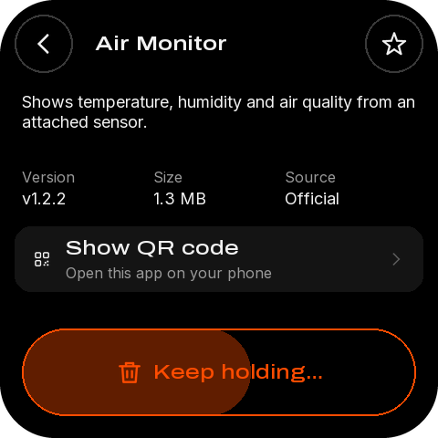

| 名称 | 类型 | x, y, w, h | 样式 | 内容 / 动作 |
|---|---|---|---|---|
| `button_back_detail_visual` | container | 16, 16, 64, 64 | #000000 |  |
| `button_back_detail_icon` | image | 32, 32, 32, 32 |  | back-32-white.png |
| `button_back_detail` | button | 6, 6, 84, 84 |  | → `back` |
| `button_favorite_visual` | container | 400, 16, 64, 64 | #000000 |  |
| `button_favorite_icon` | image | 416, 32, 32, 32 |  | star-32-white.png |
| `button_favorite` | button | 390, 6, 84, 84 |  | → `app:favorite` |
| `detail_title` | label | 104, 35, 280, 26 | dot 22px #F2F2F2 | Air Monitor |
| `detail_summary` | label | 24, 100, 432, 65 | sans 18px #F2F2F2 换行 | Shows temperature, humidity and air quality from an ⏎ attached sensor. |
| `detail_version` | label | 24, 206, 136, 22 | sans 18px #F2F2F2 | v1.2.2 |
| `detail_size` | label | 168, 206, 136, 22 | sans 18px #F2F2F2 | 1.3 MB |
| `detail_source` | label | 312, 206, 136, 22 | sans 18px #F2F2F2 | Official |
| `button_qr_row` | button | 16, 248, 448, 72 | #141414 | → `qr:app` |
| `button_delete_fill` | container | 24, 360, 251, 96 | #FF4C01 |  |
| `button_delete` | button | 24, 360, 432, 96 | medium 22px #FF4C01 长按 600 ms | Keep holding… → `hold:delete` |

## qr-full — QR code · full screen

| 名称 | 类型 | x, y, w, h | 样式 | 内容 / 动作 |
|---|---|---|---|---|
| `qr_full_code` | image | 58, 14, 363, 363 | QR，每模块 11 px | app-100001.png |
| `qr_full_title` | label | 24, 386, 432, 26 | medium 22px #F2F2F2 | Pixel Pet |
| `qr_full_url` | label | 24, 416, 432, 20 | sans 16px #9A9A9A | mosaico-ideas.espressif.com/app/100001 |
| `button_qr_close` | button | 0, 0, 480, 480 |  | → `back` |

## progress-agent — Progress · AI agent install

| 名称 | 类型 | x, y, w, h | 样式 | 内容 / 动作 |
|---|---|---|---|---|
| `progress_caption` | label | 24, 36, 432, 21 | medium 18px #9A9A9A | FROM YOUR AI AGENT · USB |
| `progress_title` | label | 24, 62, 432, 33 | medium 28px #F2F2F2 | Installing your app |
| `progress_detail` | label | 24, 100, 432, 22 | sans 18px #9A9A9A | hello_world · v0.2.1 |
| `progress_spinner` | image | 224, 148, 32, 32 |  | spin32-00.png |
| `progress_percent` | label | 24, 188, 432, 102 | dot 88px #F2F2F2 | 46% |
| `progress` | progress | 40, 304, 400, 12 | #262626 |  |
| `progress_bytes` | label | 24, 326, 432, 20 | sans 16px #9A9A9A | 1.31 of 2.85 MB · 236 KB/s |
| `progress_step` | label | 24, 350, 432, 20 | sans 16px #9A9A9A | Step 1 of 2 · Receiving |

## progress-download — Progress · download

| 名称 | 类型 | x, y, w, h | 样式 | 内容 / 动作 |
|---|---|---|---|---|
| `progress_caption` | label | 24, 36, 432, 21 | medium 18px #9A9A9A | FROM MOSAICO IDEAS |
| `progress_title` | label | 24, 62, 432, 33 | medium 28px #F2F2F2 | Downloading |
| `progress_detail` | label | 24, 100, 432, 22 | sans 18px #9A9A9A | Retro Snake · v1.0.3 |
| `progress_spinner` | image | 224, 148, 32, 32 |  | spin32-00.png |
| `progress_percent` | label | 24, 188, 432, 102 | dot 88px #F2F2F2 | 62% |
| `progress` | progress | 40, 304, 400, 12 | #262626 |  |
| `progress_bytes` | label | 24, 326, 432, 20 | sans 16px #9A9A9A | 0.56 of 0.90 MB · 512 KB/s |
| `progress_step` | label | 24, 350, 432, 20 | sans 16px #9A9A9A | File 2 of 3 |
| `button_cancel` | button | 16, 388, 448, 84 | medium 22px #F2F2F2 | Cancel → `store:cancel` |

## progress-install — Progress · switch app

| 名称 | 类型 | x, y, w, h | 样式 | 内容 / 动作 |
|---|---|---|---|---|
| `progress_caption` | label | 24, 36, 432, 21 | medium 18px #9A9A9A | FROM YOUR LIBRARY |
| `progress_title` | label | 24, 62, 432, 33 | medium 28px #F2F2F2 | Switching apps |
| `progress_detail` | label | 24, 100, 432, 22 | sans 18px #9A9A9A | Weather Station · v2.0.1 |
| `progress_spinner` | image | 224, 148, 32, 32 |  | spin32-00.png |
| `progress_percent` | label | 24, 188, 432, 102 | dot 88px #F2F2F2 | 81% |
| `progress` | progress | 40, 304, 400, 12 | #262626 |  |
| `progress_bytes` | label | 24, 326, 432, 20 | sans 16px #9A9A9A | 1.94 of 2.40 MB · 1.6 MB/s |
| `progress_step` | label | 24, 350, 432, 20 | sans 16px #9A9A9A | Step 2 of 2 · Checking |

## progress-update — Progress · resumed update

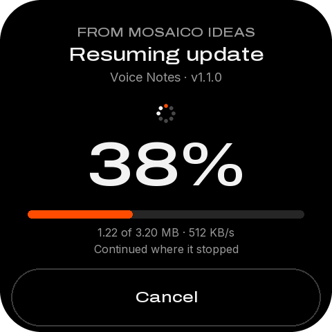

| 名称 | 类型 | x, y, w, h | 样式 | 内容 / 动作 |
|---|---|---|---|---|
| `progress_caption` | label | 24, 36, 432, 21 | medium 18px #9A9A9A | FROM MOSAICO IDEAS |
| `progress_title` | label | 24, 62, 432, 33 | medium 28px #F2F2F2 | Resuming update |
| `progress_detail` | label | 24, 100, 432, 22 | sans 18px #9A9A9A | Voice Notes · v1.1.0 |
| `progress_spinner` | image | 224, 148, 32, 32 |  | spin32-00.png |
| `progress_percent` | label | 24, 188, 432, 102 | dot 88px #F2F2F2 | 38% |
| `progress` | progress | 40, 304, 400, 12 | #262626 |  |
| `progress_bytes` | label | 24, 326, 432, 20 | sans 16px #9A9A9A | 1.22 of 3.20 MB · 512 KB/s |
| `progress_step` | label | 24, 350, 432, 20 | sans 16px #9A9A9A | Continued where it stopped |
| `button_cancel` | button | 16, 388, 448, 84 | medium 22px #F2F2F2 | Cancel → `store:cancel` |

## result-installed — Result · installed

| 名称 | 类型 | x, y, w, h | 样式 | 内容 / 动作 |
|---|---|---|---|---|
| `result_hero` | image | 180, 56, 120, 120 |  | hero_check-120.png |
| `result_title` | label | 24, 196, 432, 33 | medium 28px #F2F2F2 | App installed |
| `result_caption` | label | 24, 236, 432, 22 | sans 18px #9A9A9A | Weather Station · v2.0.1 |
| `result_detail` | label | 24, 264, 432, 44 | sans 18px #F2F2F2 | Opening in 3 s |
| `result_dot_1` | container | 210, 300, 12, 12 | #FF4C01 |  |
| `result_dot_2` | container | 234, 300, 12, 12 | #262626 |  |
| `result_dot_3` | container | 258, 300, 12, 12 | #262626 |  |
| `button_result_left` | button | 16, 388, 216, 84 | medium 22px #F2F2F2 | Stay here → `result:stay` |
| `button_result_right` | button | 248, 388, 216, 84 | medium 22px #000000 | Open now → `result:open` |

## result-saved — Result · saved

| 名称 | 类型 | x, y, w, h | 样式 | 内容 / 动作 |
|---|---|---|---|---|
| `result_hero` | image | 180, 56, 120, 120 |  | hero_saved-120.png |
| `result_title` | label | 24, 196, 432, 33 | medium 28px #F2F2F2 | Saved to My apps |
| `result_caption` | label | 24, 236, 432, 22 | sans 18px #9A9A9A | Retro Snake · v1.0.3 |
| `result_detail` | label | 24, 264, 432, 44 | sans 18px #9A9A9A | Open it any time from the list. |
| `button_result_left` | button | 16, 388, 216, 84 | medium 22px #F2F2F2 | Open now → `result:open` |
| `button_result_right` | button | 248, 388, 216, 84 | medium 22px #000000 | Done → `result:done` |

## result-updated — Result · updated

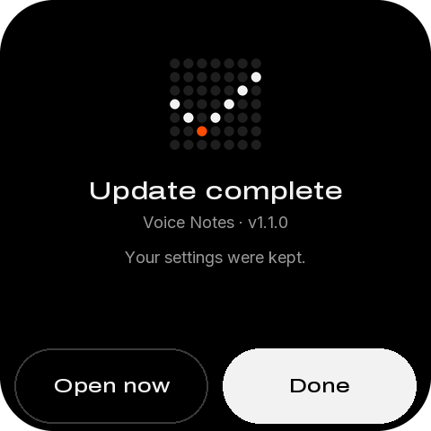

| 名称 | 类型 | x, y, w, h | 样式 | 内容 / 动作 |
|---|---|---|---|---|
| `result_hero` | image | 180, 56, 120, 120 |  | hero_check-120.png |
| `result_title` | label | 24, 196, 432, 33 | medium 28px #F2F2F2 | Update complete |
| `result_caption` | label | 24, 236, 432, 22 | sans 18px #9A9A9A | Voice Notes · v1.1.0 |
| `result_detail` | label | 24, 264, 432, 44 | sans 18px #9A9A9A | Your settings were kept. |
| `button_result_left` | button | 16, 388, 216, 84 | medium 22px #F2F2F2 | Open now → `result:open` |
| `button_result_right` | button | 248, 388, 216, 84 | medium 22px #000000 | Done → `result:done` |

## result-failed — Result · failed

| 名称 | 类型 | x, y, w, h | 样式 | 内容 / 动作 |
|---|---|---|---|---|
| `result_hero` | image | 180, 56, 120, 120 |  | hero_cross-120.png |
| `result_title` | label | 24, 196, 432, 33 | medium 28px #F2F2F2 | Couldn't download |
| `result_caption` | label | 24, 236, 432, 22 | sans 18px #9A9A9A | Retro Snake · v1.0.3 |
| `result_detail` | label | 24, 264, 432, 44 | sans 18px #9A9A9A | The connection dropped. ⏎ Check Wi-Fi and try again. |
| `button_result_left` | button | 16, 388, 216, 84 | medium 22px #F2F2F2 | Done → `result:done` |
| `button_result_right` | button | 248, 388, 216, 84 | medium 22px #000000 | Try again → `result:retry` |

## result-nospace — Result · no space

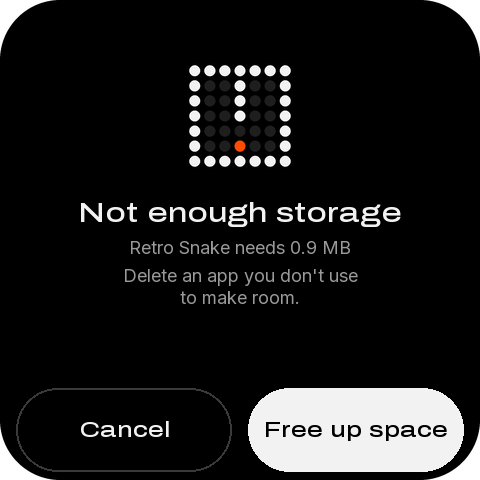

| 名称 | 类型 | x, y, w, h | 样式 | 内容 / 动作 |
|---|---|---|---|---|
| `result_hero` | image | 180, 56, 120, 120 |  | hero_full-120.png |
| `result_title` | label | 24, 196, 432, 33 | medium 28px #F2F2F2 | Not enough storage |
| `result_caption` | label | 24, 236, 432, 22 | sans 18px #9A9A9A | Retro Snake needs 0.9 MB |
| `result_detail` | label | 24, 264, 432, 44 | sans 18px #9A9A9A | Delete an app you don't use ⏎ to make room. |
| `button_result_left` | button | 16, 388, 216, 84 | medium 22px #F2F2F2 | Cancel → `result:done` |
| `button_result_right` | button | 248, 388, 216, 84 | medium 22px #000000 | Free up space → `go:storage` |

## result-battery — Result · low battery

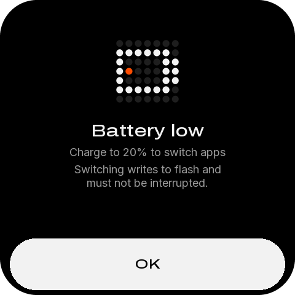

| 名称 | 类型 | x, y, w, h | 样式 | 内容 / 动作 |
|---|---|---|---|---|
| `result_hero` | image | 180, 56, 120, 120 |  | hero_battery-120.png |
| `result_title` | label | 24, 196, 432, 33 | medium 28px #F2F2F2 | Battery low |
| `result_caption` | label | 24, 236, 432, 22 | sans 18px #9A9A9A | Charge to 20% to switch apps |
| `result_detail` | label | 24, 264, 432, 44 | sans 18px #9A9A9A | Switching writes to flash and ⏎ must not be interrupted. |
| `button_result_right` | button | 16, 388, 448, 84 | medium 22px #000000 | OK → `result:done` |

## help — Help · topics

| 名称 | 类型 | x, y, w, h | 样式 | 内容 / 动作 |
|---|---|---|---|---|
| `button_back_help_visual` | container | 16, 16, 64, 64 | #000000 |  |
| `button_back_help_icon` | image | 32, 32, 32, 32 |  | back-32-white.png |
| `button_back_help` | button | 6, 6, 84, 84 |  | → `back` |
| `help_title_icon` | image | 104, 32, 32, 32 |  | page_help-32-orange.png |
| `help_title` | label | 146, 32, 310, 33 | dot 28px #F2F2F2 | HELP |
| `help` | list | 16, 92, 448, 388 | 行距 80 | 行模板 `固定行` |
| `button_help_start` | button | 16, 100, 448, 72 | #141414 | → `help:start` |
| `button_help_develop` | button | 16, 180, 448, 72 | #141414 | → `help:develop` |
| `button_help_ids` | button | 16, 260, 448, 72 | #141414 | → `help:ids` |
| `button_help_fix` | button | 16, 340, 448, 72 | #141414 | → `help:fix` |
| `button_help_replay` | button | 16, 420, 448, 72 | #141414 | → `guide:1` |

## wifi — Wi-Fi · connected

| 名称 | 类型 | x, y, w, h | 样式 | 内容 / 动作 |
|---|---|---|---|---|
| `button_back_wifi_visual` | container | 16, 16, 64, 64 | #000000 |  |
| `button_back_wifi_icon` | image | 32, 32, 32, 32 |  | back-32-white.png |
| `button_back_wifi` | button | 6, 6, 84, 84 |  | → `back` |
| `button_scan_visual` | container | 400, 16, 64, 64 | #000000 |  |
| `button_scan_icon` | image | 416, 32, 32, 32 |  | refresh-32-white.png |
| `button_scan` | button | 390, 6, 84, 84 |  | → `wifi:scan` |
| `wifi_title` | label | 104, 32, 280, 33 | dot 28px #F2F2F2 | WI-FI |
| `button_wifi_current` | button | 16, 96, 448, 80 | #141414 | → `go:wifi_network` |
| `wifi_icon` | image | 36, 120, 32, 32 |  | wifi-32-orange.png |
| `wifi_connection` | label | 84, 109, 324, 26 | medium 22px #F2F2F2 | Studio-5G |
| `wifi_detail` | label | 84, 139, 324, 20 | sans 16px #9A9A9A | Connected · 192.168.1.20 |
| `wifi_section` | label | 32, 192, 416, 21 | medium 18px #9A9A9A | OTHER NETWORKS · 4 |
| `networks` | list | 16, 222, 448, 242 | 行距 80 | 行模板 `networks_row` |

## wifi-network — Wi-Fi · this network

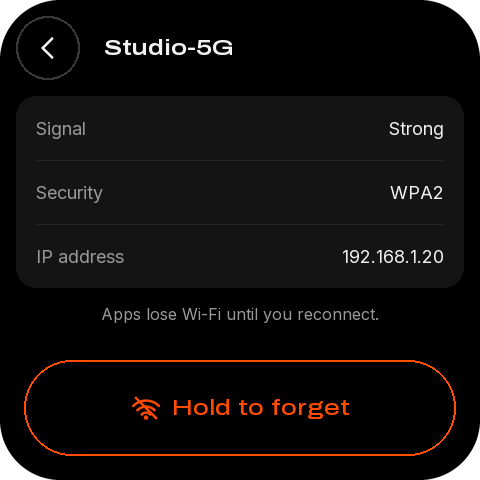

| 名称 | 类型 | x, y, w, h | 样式 | 内容 / 动作 |
|---|---|---|---|---|
| `button_back_wifi_network_visual` | container | 16, 16, 64, 64 | #000000 |  |
| `button_back_wifi_network_icon` | image | 32, 32, 32, 32 |  | back-32-white.png |
| `button_back_wifi_network` | button | 6, 6, 84, 84 |  | → `back` |
| `wifi_network_title` | label | 104, 35, 352, 26 | dot 22px #F2F2F2 | Studio-5G |
| `network_card` | container | 16, 96, 448, 192 | #141414 |  |
| `network_signal` | label | 196, 117, 248, 22 | sans 18px #F2F2F2 | Strong |
| `network_security` | label | 196, 181, 248, 22 | sans 18px #F2F2F2 | WPA2 |
| `network_ip` | label | 196, 245, 248, 22 | sans 18px #F2F2F2 | 192.168.1.20 |
| `button_forget` | button | 24, 360, 432, 96 | medium 22px #FF4C01 长按 600 ms | Hold to forget → `hold:forget` |

## password — Password

| 名称 | 类型 | x, y, w, h | 样式 | 内容 / 动作 |
|---|---|---|---|---|
| `button_back_password_visual` | container | 16, 16, 64, 64 | #000000 |  |
| `button_back_password_icon` | image | 32, 32, 32, 32 |  | back-32-white.png |
| `button_back_password` | button | 6, 6, 84, 84 |  | → `back` |
| `password_title` | label | 104, 32, 352, 33 | dot 28px #F2F2F2 | PASSWORD |
| `password_card` | container | 16, 92, 448, 72 | #141414 |  |
| `password_display` | label | 36, 115, 332, 26 | medium 22px #5C5C5C | Type the password |
| `password_eye` | image | 408, 112, 32, 32 |  | eye-32-white.png |
| `button_toggle_password` | button | 380, 86, 84, 84 |  | → `password:toggle` |
| `password_note` | label | 32, 182, 416, 20 | sans 16px #9A9A9A | For Maker Lab · 8 or more characters |
| `password_keyboard` | keyboard | 0, 222, 480, 233 |  |  |

## device — Device

| 名称 | 类型 | x, y, w, h | 样式 | 内容 / 动作 |
|---|---|---|---|---|
| `button_back_device_visual` | container | 16, 16, 64, 64 | #000000 |  |
| `button_back_device_icon` | image | 32, 32, 32, 32 |  | back-32-white.png |
| `button_back_device` | button | 6, 6, 84, 84 |  | → `back` |
| `device_title_icon` | image | 104, 32, 32, 32 |  | page_device-32-orange.png |
| `device_title` | label | 146, 32, 310, 33 | dot 28px #F2F2F2 | DEVICE |
| `device` | list | 16, 92, 448, 388 | 行距 80 | 行模板 `固定行` |
| `button_device_wifi` | button | 16, 128, 448, 72 | #141414 | → `go:wifi` |
| `device_wifi` | label | 72, 169, 336, 20 | sans 16px #9A9A9A | Studio-5G |
| `button_device_city` | button | 16, 208, 448, 72 | #141414 | → `go:city` |
| `device_city` | label | 72, 249, 336, 20 | sans 16px #9A9A9A | Shanghai |
| `button_device_ai` | button | 16, 288, 448, 72 | #141414 | → `go:token` |
| `device_ai` | label | 72, 329, 336, 20 | sans 16px #9A9A9A | On · included |
| `button_device_updates` | button | 16, 404, 448, 72 | #141414 | → `go:updates` |
| `device_updates` | label | 72, 445, 336, 20 | sans 16px #FF4C01 | 2 available |
| `button_device_storage` | button | 16, 484, 448, 72 | #141414 | → `go:storage` |
| `device_storage` | label | 72, 525, 336, 20 | sans 16px #9A9A9A | 32.8 of 64 MB used |
| `button_device_link` | button | 16, 564, 448, 72 | #141414 | → `go:wifi_link` |
| `device_link` | label | 72, 605, 336, 20 | sans 16px #9A9A9A | Ready · 192.168.1.20 |
| `device_about` | label | 72, 685, 336, 20 | sans 16px #9A9A9A | MAC 30:ED:A0:F4:60:56 |

## wifi-link — Wi-Fi link

| 名称 | 类型 | x, y, w, h | 样式 | 内容 / 动作 |
|---|---|---|---|---|
| `button_back_wifi_link_visual` | container | 16, 16, 64, 64 | #000000 |  |
| `button_back_wifi_link_icon` | image | 32, 32, 32, 32 |  | back-32-white.png |
| `button_back_wifi_link` | button | 6, 6, 84, 84 |  | → `back` |
| `wifi_link_title` | label | 104, 32, 352, 33 | dot 28px #F2F2F2 | WI-FI LINK |
| `wifilink_endpoint` | label | 36, 194, 408, 26 | medium 22px #F2F2F2 | 192.168.1.20:7777 |
| `wifilink_token` | label | 36, 274, 332, 26 | medium 22px #F2F2F2 | •••• •••• •••• 5a13 |
| `wifilink_eye` | image | 408, 262, 32, 32 |  | eye-32-white.png |
| `button_toggle_pairing` | button | 380, 236, 84, 84 |  | → `wifi_link:toggle` |

## updates — Updates · available

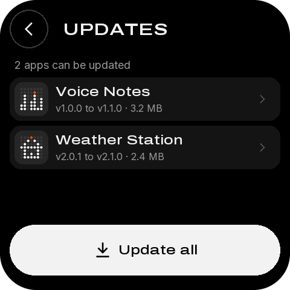

| 名称 | 类型 | x, y, w, h | 样式 | 内容 / 动作 |
|---|---|---|---|---|
| `button_back_updates_visual` | container | 16, 16, 64, 64 | #000000 |  |
| `button_back_updates_icon` | image | 32, 32, 32, 32 |  | back-32-white.png |
| `button_back_updates` | button | 6, 6, 84, 84 |  | → `back` |
| `updates_title` | label | 104, 32, 352, 33 | dot 28px #F2F2F2 | UPDATES |
| `updates_summary` | label | 24, 96, 432, 22 | sans 18px #9A9A9A | 2 apps can be updated |
| `updates` | list | 16, 128, 448, 232 | 行距 80 | 行模板 `updates_row` |
| `button_update_all` | button | 16, 372, 448, 84 | medium 22px #000000 | Update all → `updates:all` |

## storage — Storage

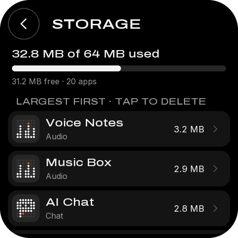

| 名称 | 类型 | x, y, w, h | 样式 | 内容 / 动作 |
|---|---|---|---|---|
| `button_back_storage_visual` | container | 16, 16, 64, 64 | #000000 |  |
| `button_back_storage_icon` | image | 32, 32, 32, 32 |  | back-32-white.png |
| `button_back_storage` | button | 6, 6, 84, 84 |  | → `back` |
| `storage_title` | label | 104, 32, 352, 33 | dot 28px #F2F2F2 | STORAGE |
| `storage_summary` | label | 24, 96, 432, 26 | medium 22px #F2F2F2 | 32.8 MB of 64 MB used |
| `storage_bar` | progress | 24, 132, 432, 12 | #262626 |  |
| `storage_legend` | label | 24, 154, 432, 20 | sans 16px #9A9A9A | 31.2 MB free · 20 apps |
| `storage` | list | 16, 224, 448, 248 | 行距 80 | 行模板 `storage_row` |

## city — City

| 名称 | 类型 | x, y, w, h | 样式 | 内容 / 动作 |
|---|---|---|---|---|
| `button_back_city_visual` | container | 16, 16, 64, 64 | #000000 |  |
| `button_back_city_icon` | image | 32, 32, 32, 32 |  | back-32-white.png |
| `button_back_city` | button | 6, 6, 84, 84 |  | → `back` |
| `city_title` | label | 104, 32, 352, 33 | dot 28px #F2F2F2 | CITY |
| `city_value` | label | 36, 140, 408, 33 | medium 28px #F2F2F2 | Shanghai |
| `city_link` | label | 62, 221, 394, 20 | sans 16px #FF4C01 | USB connected · Agent ready |
| `button_city_type` | button | 16, 372, 448, 84 | medium 22px #F2F2F2 | Type on device → `go:city_input` |

## city-input — City · keyboard

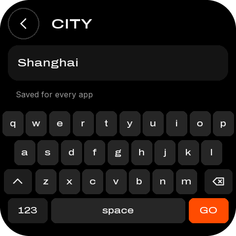

| 名称 | 类型 | x, y, w, h | 样式 | 内容 / 动作 |
|---|---|---|---|---|
| `button_back_city_input_visual` | container | 16, 16, 64, 64 | #000000 |  |
| `button_back_city_input_icon` | image | 32, 32, 32, 32 |  | back-32-white.png |
| `button_back_city_input` | button | 6, 6, 84, 84 |  | → `back` |
| `city_input_title` | label | 104, 32, 352, 33 | dot 28px #F2F2F2 | CITY |
| `city_input_card` | container | 16, 92, 448, 72 | #141414 |  |
| `city_input_display` | label | 36, 115, 408, 26 | medium 22px #F2F2F2 | Shanghai |
| `city_input_note` | label | 32, 182, 416, 20 | sans 16px #9A9A9A | Saved for every app |
| `city_input_keyboard` | keyboard | 0, 222, 480, 233 |  |  |

## token-mosaico — Mosaico AI · on

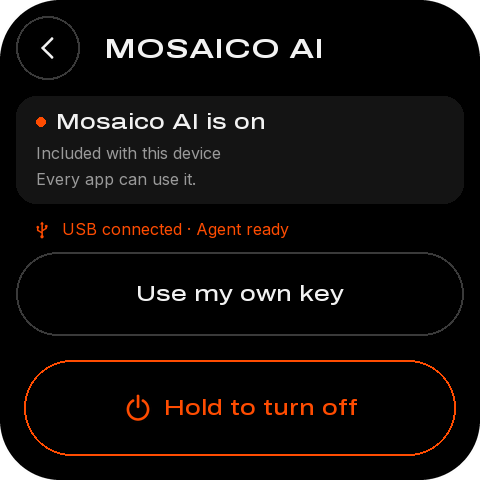

| 名称 | 类型 | x, y, w, h | 样式 | 内容 / 动作 |
|---|---|---|---|---|
| `button_back_token_visual` | container | 16, 16, 64, 64 | #000000 |  |
| `button_back_token_icon` | image | 32, 32, 32, 32 |  | back-32-white.png |
| `button_back_token` | button | 6, 6, 84, 84 |  | → `back` |
| `token_title` | label | 104, 32, 352, 33 | dot 28px #F2F2F2 | MOSAICO AI |
| `token_card` | container | 16, 96, 448, 108 | #141414 |  |
| `token_dot` | container | 36, 117, 10, 10 | #FF4C01 |  |
| `token_title` | label | 56, 109, 388, 26 | medium 22px #F2F2F2 | Mosaico AI is on |
| `token_sub` | label | 36, 143, 408, 20 | sans 16px #9A9A9A | Included with this device |
| `token_note` | label | 36, 169, 408, 20 | sans 16px #9A9A9A | Every app can use it. |
| `token_link` | label | 62, 219, 394, 20 | sans 16px #FF4C01 | USB connected · Agent ready |
| `button_own_key` | button | 16, 252, 448, 84 | medium 22px #F2F2F2 | Use my own key → `go:own_key` |
| `button_turn_off` | button | 24, 360, 432, 96 | medium 22px #FF4C01 长按 600 ms | Hold to turn off → `hold:turnoff` |

## own-key — Own key · keyboard

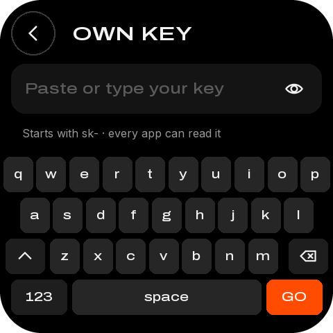

| 名称 | 类型 | x, y, w, h | 样式 | 内容 / 动作 |
|---|---|---|---|---|
| `button_back_own_key_visual` | container | 16, 16, 64, 64 | #000000 |  |
| `button_back_own_key_icon` | image | 32, 32, 32, 32 |  | back-32-white.png |
| `button_back_own_key` | button | 6, 6, 84, 84 |  | → `back` |
| `own_key_title` | label | 104, 32, 352, 33 | dot 28px #F2F2F2 | OWN KEY |
| `own_key_card` | container | 16, 92, 448, 72 | #141414 |  |
| `own_key_display` | label | 36, 115, 332, 26 | medium 22px #5C5C5C | Paste or type your key |
| `own_key_eye` | image | 408, 112, 32, 32 |  | eye-32-white.png |
| `button_toggle_own_key` | button | 380, 86, 84, 84 |  | → `own_key:toggle` |
| `own_key_note` | label | 32, 182, 416, 20 | sans 16px #9A9A9A | Starts with sk- · every app can read it |
| `own_key_keyboard` | keyboard | 0, 222, 480, 233 |  |  |

## launching — Opening an app

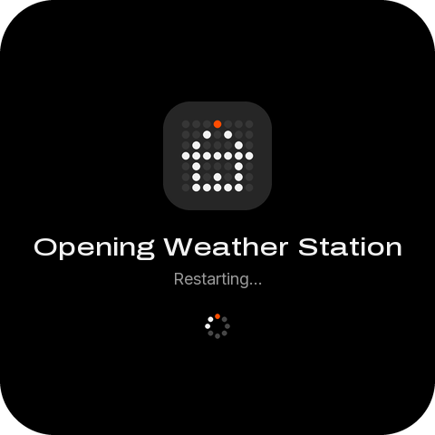

| 名称 | 类型 | x, y, w, h | 样式 | 内容 / 动作 |
|---|---|---|---|---|
| `launch_tile` | image | 180, 112, 120, 120 |  | tile_smart-home-120.png |
| `launch_title` | label | 24, 256, 432, 33 | medium 28px #F2F2F2 | Opening Weather Station |
| `launch_spinner` | image | 224, 344, 32, 32 |  | spin32-00.png |

## app-running — Your app is running

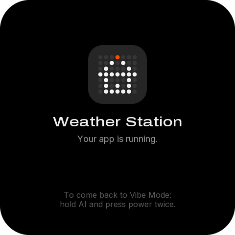

| 名称 | 类型 | x, y, w, h | 样式 | 内容 / 动作 |
|---|---|---|---|---|
| `running_tile` | image | 180, 92, 120, 120 |  | tile_smart-home-120.png |
| `running_title` | label | 24, 232, 432, 33 | medium 28px #F2F2F2 | Weather Station |

