# 附录：逐页布局表

由 `tools/build_design.py` 生成，与 `layout.json` 和页面图一致；坐标单位为 480×480 逻辑像素。
只列出有名称（阶段 B 需要绑定或更新）或可点击的对象；装饰对象见 `layout.json`。

## guide-1 — Guide 1/4

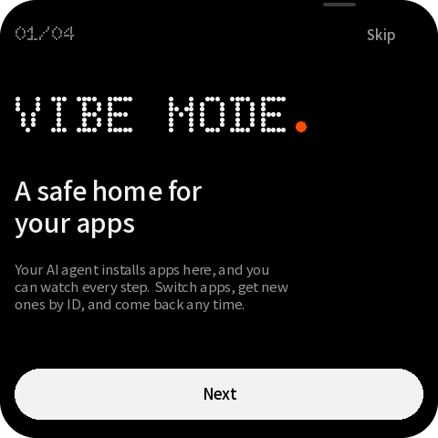

| 名称 | 类型 | x, y, w, h | 样式 | 内容 / 动作 |
|---|---|---|---|---|
| `guide_step` | label | 16, 26, 120, 22 | dot 22px #9A9A9A | 01/04 |
| `button_skip` | button | 372, 16, 92, 44 | medium 15px #9A9A9A | Skip → `guide:done` |
| `button_guide_next` | button | 16, 404, 448, 56 | medium 17px #000000 | Next → `guide:2` |
| `ai_cue` | container | 354, 3, 36, 4 | #3A3A3A |  |

## guide-2 — Guide 2/4

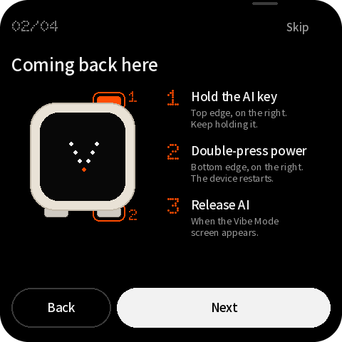

| 名称 | 类型 | x, y, w, h | 样式 | 内容 / 动作 |
|---|---|---|---|---|
| `guide_step` | label | 16, 26, 120, 22 | dot 22px #9A9A9A | 02/04 |
| `button_skip` | button | 372, 16, 92, 44 | medium 15px #9A9A9A | Skip → `guide:done` |
| `guide_ring_ai` | container | 130, 129, 46, 27 |  |  |
| `guide_ring_power` | container | 130, 284, 46, 27 |  |  |
| `button_guide_back` | button | 16, 404, 140, 56 | medium 17px #F2F2F2 | Back → `guide:1` |
| `button_guide_next` | button | 164, 404, 300, 56 | medium 17px #000000 | Next → `guide:3` |
| `ai_cue` | container | 354, 3, 36, 4 | #3A3A3A |  |

## guide-3 — Guide 3/4

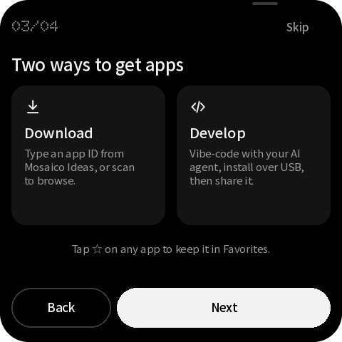

| 名称 | 类型 | x, y, w, h | 样式 | 内容 / 动作 |
|---|---|---|---|---|
| `guide_step` | label | 16, 26, 120, 22 | dot 22px #9A9A9A | 03/04 |
| `button_skip` | button | 372, 16, 92, 44 | medium 15px #9A9A9A | Skip → `guide:done` |
| `button_guide_back` | button | 16, 404, 140, 56 | medium 17px #F2F2F2 | Back → `guide:2` |
| `button_guide_next` | button | 164, 404, 300, 56 | medium 17px #000000 | Next → `guide:4` |
| `ai_cue` | container | 354, 3, 36, 4 | #3A3A3A |  |

## guide-4 — Guide 4/4

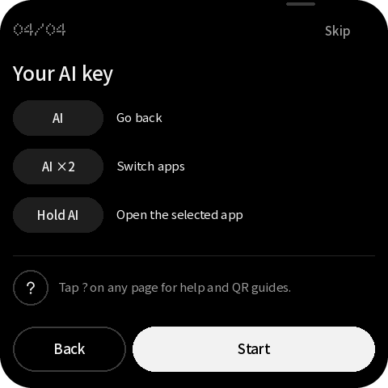

| 名称 | 类型 | x, y, w, h | 样式 | 内容 / 动作 |
|---|---|---|---|---|
| `guide_step` | label | 16, 26, 120, 22 | dot 22px #9A9A9A | 04/04 |
| `button_skip` | button | 372, 16, 92, 44 | medium 15px #9A9A9A | Skip → `guide:done` |
| `guide_key_0` | button | 16, 124, 112, 44 | medium 15px #F2F2F2 | AI |
| `guide_key_1` | button | 16, 184, 112, 44 | medium 15px #F2F2F2 | AI ×2 |
| `guide_key_2` | button | 16, 244, 112, 44 | medium 15px #F2F2F2 | Hold AI |
| `guide_help_sample` | button | 16, 334, 44, 44 | #000000 | → `help:topics` |
| `button_guide_back` | button | 16, 404, 140, 56 | medium 17px #F2F2F2 | Back → `guide:3` |
| `button_guide_next` | button | 164, 404, 300, 56 | medium 17px #000000 | Start → `guide:done` |
| `ai_cue` | container | 354, 3, 36, 4 | #3A3A3A |  |

## home — Home · all apps, agent connected

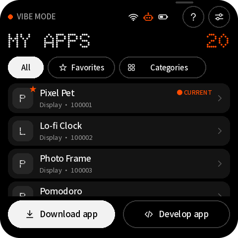

| 名称 | 类型 | x, y, w, h | 样式 | 内容 / 动作 |
|---|---|---|---|---|
| `status_wifi` | image | 258, 23, 22, 22 |  | wifi-22-white.png |
| `status_agent` | image | 288, 23, 22, 22 |  | robot-22-orange.png |
| `status_battery` | image | 318, 23, 22, 22 |  | battery_mid-22-white.png |
| `button_help_home` | button | 368, 12, 44, 44 | #000000 | → `help:topics` |
| `button_device` | button | 420, 12, 44, 44 | #000000 | → `go:device` |
| `home_title` | label | 16, 64, 330, 40 | dot 40px #F2F2F2 | MY APPS |
| `app_count` | label | 348, 64, 116, 40 | dot 40px #FF4C01 | 20 |
| `chip_all_on` | button | 16, 114, 72, 44 | medium 15px #000000 | All → `filter:all` |
| `chip_favorites_off` | button | 96, 114, 136, 44 | medium 15px #F2F2F2 | Favorites → `filter:favorites` |
| `chip_category_off` | button | 240, 114, 176, 44 | medium 15px #F2F2F2 | Categories → `go:categories` |
| `apps` | list | 16, 168, 448, 228 | 行高 66 | 行模板 `apps_row` |
| `button_download` | button | 16, 404, 216, 56 | medium 17px #000000 | Download app → `go:download` |
| `button_develop` | button | 248, 404, 216, 56 | medium 17px #F2F2F2 | Develop app → `go:develop` |
| `ai_cue` | container | 354, 3, 36, 4 | #3A3A3A |  |

## categories — Categories

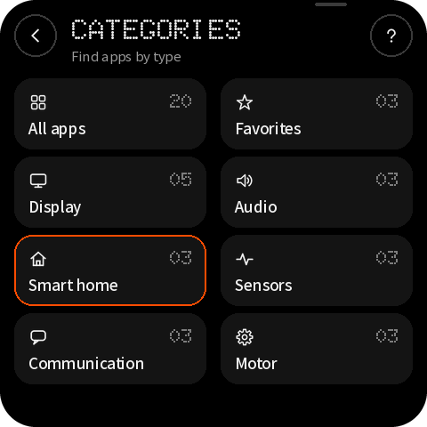

| 名称 | 类型 | x, y, w, h | 样式 | 内容 / 动作 |
|---|---|---|---|---|
| `button_back_categories` | button | 16, 16, 48, 48 | #000000 | → `back` |
| `button_help_categories` | button | 416, 16, 48, 48 | #000000 | → `help:start` |
| `categories_title` | label | 80, 18, 320, 32 | dot 32px #F2F2F2 | CATEGORIES |
| `categories_subtitle` | label | 80, 54, 320, 19 | sans 15px #9A9A9A | Find apps by type |
| `category_all` | button | 16, 88, 216, 80 | #141414 | → `filter:all` |
| `category_all_count` | label | 128, 103, 88, 22 | dot 22px #9A9A9A | 20 |
| `category_favorites` | button | 248, 88, 216, 80 | #141414 | → `filter:favorites` |
| `category_favorites_count` | label | 360, 103, 88, 22 | dot 22px #9A9A9A | 03 |
| `category_display` | button | 16, 176, 216, 80 | #141414 | → `filter:display` |
| `category_display_count` | label | 128, 191, 88, 22 | dot 22px #9A9A9A | 05 |
| `category_audio` | button | 248, 176, 216, 80 | #141414 | → `filter:audio` |
| `category_audio_count` | label | 360, 191, 88, 22 | dot 22px #9A9A9A | 03 |
| `category_smart-home` | button | 16, 264, 216, 80 | #141414 | → `filter:smart-home` |
| `category_smart-home_count` | label | 128, 279, 88, 22 | dot 22px #9A9A9A | 03 |
| `category_selected` | container | 16, 264, 216, 80 |  |  |
| `category_sensors` | button | 248, 264, 216, 80 | #141414 | → `filter:sensors` |
| `category_sensors_count` | label | 360, 279, 88, 22 | dot 22px #9A9A9A | 03 |
| `category_communication` | button | 16, 352, 216, 80 | #141414 | → `filter:communication` |
| `category_communication_count` | label | 128, 367, 88, 22 | dot 22px #9A9A9A | 03 |
| `category_motor` | button | 248, 352, 216, 80 | #141414 | → `filter:motor` |
| `category_motor_count` | label | 360, 367, 88, 22 | dot 22px #9A9A9A | 03 |
| `ai_cue` | container | 354, 3, 36, 4 | #3A3A3A |  |

## download — Download · empty

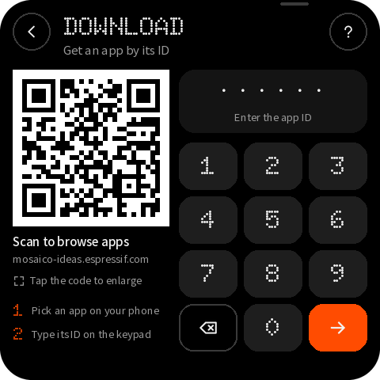

| 名称 | 类型 | x, y, w, h | 样式 | 内容 / 动作 |
|---|---|---|---|---|
| `button_back_download` | button | 16, 16, 48, 48 | #000000 | → `back` |
| `button_help_download` | button | 416, 16, 48, 48 | #000000 | → `help:ids` |
| `download_title` | label | 80, 18, 320, 32 | dot 32px #F2F2F2 | DOWNLOAD |
| `download_subtitle` | label | 80, 54, 320, 19 | sans 15px #9A9A9A | Get an app by its ID |
| `button_qr_ideas_code` | image | 16, 88, 198, 198 | QR，每模块 6 px | ideas.png |
| `button_qr_ideas` | button | 16, 88, 198, 198 |  | → `qr:ideas` |
| `id_digits` | label | 234, 96, 222, 40 | dot 40px #F2F2F2 | ······ |
| `id_digits_compact` | label | 234, 105, 222, 22 | dot 22px #F2F2F2 |   |
| `id_status` | label | 234, 140, 222, 17 | sans 13px #9A9A9A | Enter the app ID |
| `id_error` | label | 234, 140, 222, 17 | sans 13px #FF4C01 |   |
| `key_1` | button | 226, 180, 74, 60 | dot 32px #F2F2F2 | 1 → `key:1` |
| `key_2` | button | 308, 180, 74, 60 | dot 32px #F2F2F2 | 2 → `key:2` |
| `key_3` | button | 390, 180, 74, 60 | dot 32px #F2F2F2 | 3 → `key:3` |
| `key_4` | button | 226, 248, 74, 60 | dot 32px #F2F2F2 | 4 → `key:4` |
| `key_5` | button | 308, 248, 74, 60 | dot 32px #F2F2F2 | 5 → `key:5` |
| `key_6` | button | 390, 248, 74, 60 | dot 32px #F2F2F2 | 6 → `key:6` |
| `key_7` | button | 226, 316, 74, 60 | dot 32px #F2F2F2 | 7 → `key:7` |
| `key_8` | button | 308, 316, 74, 60 | dot 32px #F2F2F2 | 8 → `key:8` |
| `key_9` | button | 390, 316, 74, 60 | dot 32px #F2F2F2 | 9 → `key:9` |
| `key_del` | button | 226, 384, 74, 60 | #000000 | → `key:del` |
| `key_0` | button | 308, 384, 74, 60 | dot 32px #F2F2F2 | 0 → `key:0` |
| `key_go` | button | 390, 384, 74, 60 | #FF4C01 | → `key:go` |
| `ai_cue` | container | 354, 3, 36, 4 | #3A3A3A |  |

## develop — Develop app

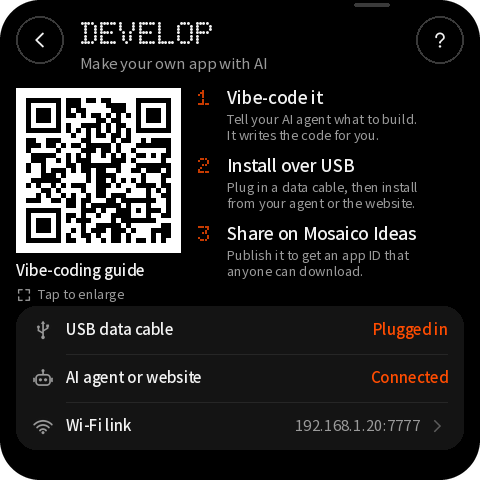

| 名称 | 类型 | x, y, w, h | 样式 | 内容 / 动作 |
|---|---|---|---|---|
| `button_back_develop` | button | 16, 16, 48, 48 | #000000 | → `back` |
| `button_help_develop` | button | 416, 16, 48, 48 | #000000 | → `help:topics` |
| `develop_title` | label | 80, 18, 320, 32 | dot 32px #F2F2F2 | DEVELOP |
| `develop_subtitle` | label | 80, 54, 320, 19 | sans 15px #9A9A9A | Make your own app with AI |
| `button_qr_develop_code` | image | 16, 88, 165, 165 | QR，每模块 5 px | develop.png |
| `button_qr_develop` | button | 16, 88, 165, 165 |  | → `qr:develop` |
| `develop_usb_on` | label | 244, 320, 204, 19 | medium 15px #FF4C01 | Plugged in |
| `develop_link_on` | label | 244, 368, 204, 19 | medium 15px #FF4C01 | Connected |
| `button_wifi_link` | button | 16, 402, 448, 48 |  | → `go:wifi_link` |
| `develop_endpoint` | label | 196, 416, 224, 19 | sans 15px #9A9A9A | 192.168.1.20:7777 |
| `ai_cue` | container | 354, 3, 36, 4 | #3A3A3A |  |

## wifi-link — Develop · Wi-Fi link

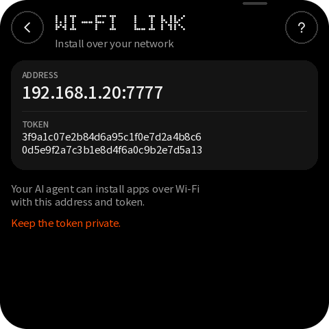

| 名称 | 类型 | x, y, w, h | 样式 | 内容 / 动作 |
|---|---|---|---|---|
| `button_back_wifilink` | button | 16, 16, 48, 48 | #000000 | → `back` |
| `button_help_wifilink` | button | 416, 16, 48, 48 | #000000 | → `help:topics` |
| `wifilink_title` | label | 80, 18, 320, 32 | dot 32px #F2F2F2 | WI-FI LINK |
| `wifilink_subtitle` | label | 80, 54, 320, 19 | sans 15px #9A9A9A | Install over your network |
| `wifilink_endpoint` | label | 32, 120, 416, 30 | medium 24px #F2F2F2 | 192.168.1.20:7777 |
| `wifilink_token` | label | 32, 190, 416, 38 | sans 15px #F2F2F2 | 3f9a1c07e2b84d6a95c1f0e7d2a4b8c6 ⏎ 0d5e9f2a7c3b1e8d4f6a0c9b2e7d5a13 |
| `ai_cue` | container | 354, 3, 36, 4 | #3A3A3A |  |

## detail-current — Detail · current app (favorite)

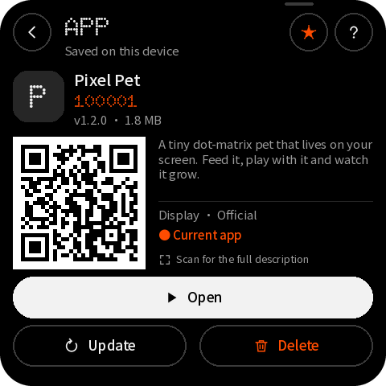

| 名称 | 类型 | x, y, w, h | 样式 | 内容 / 动作 |
|---|---|---|---|---|
| `button_back_detail` | button | 16, 16, 48, 48 | #000000 | → `back` |
| `button_help_detail` | button | 416, 16, 48, 48 | #000000 | → `help:ids` |
| `button_favorite_on` | button | 360, 16, 48, 48 | #000000 | → `app:favorite` |
| `detail_title` | label | 80, 18, 264, 32 | dot 32px #F2F2F2 | APP |
| `detail_subtitle` | label | 80, 54, 264, 19 | sans 15px #9A9A9A | Saved on this device |
| `detail_tile` | container | 16, 88, 64, 64 | #262626 |  |
| `detail_initial` | label | 16, 102, 64, 40 | dot 40px #F2F2F2 | P |
| `detail_name` | label | 92, 87, 372, 25 | medium 20px #F2F2F2 | Pixel Pet |
| `detail_id` | label | 92, 115, 200, 22 | dot 22px #FF4C01 | 100001 |
| `detail_meta` | label | 92, 140, 372, 19 | sans 15px #9A9A9A | v1.2.0 · 1.8 MB |
| `button_qr_app_code` | image | 16, 170, 165, 165 | QR，每模块 5 px | app-100001.png |
| `button_qr_app` | button | 16, 170, 165, 165 |  | → `qr:app` |
| `detail_summary` | label | 197, 170, 267, 75 | sans 15px #9A9A9A 换行 | A tiny dot-matrix pet that lives on your screen. Feed it, play with it and watch it grow. |
| `detail_facts` | label | 197, 258, 267, 19 | sans 15px #9A9A9A | Display · Official |
| `detail_status_accent` | label | 197, 283, 267, 19 | medium 15px #FF4C01 | ● Current app |
| `button_primary` | button | 16, 344, 448, 52 | medium 17px #000000 | Open → `app:run` |
| `button_secondary` | button | 16, 404, 216, 52 | medium 17px #F2F2F2 | Update → `app:update` |
| `button_tertiary` | button | 248, 404, 216, 52 | medium 17px #FF4C01 | Delete → `app:delete_ask` |
| `ai_cue` | container | 354, 3, 36, 4 | #3A3A3A |  |

## detail-local — Detail · saved app

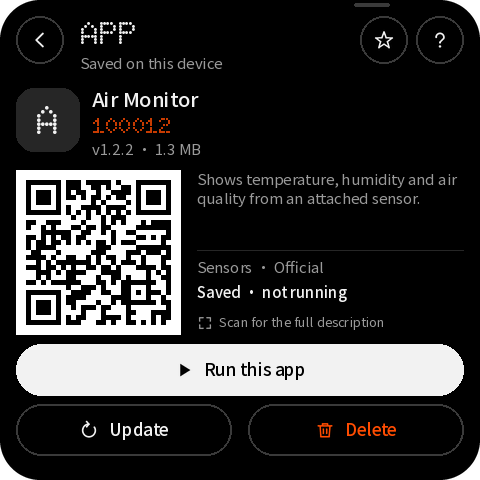

| 名称 | 类型 | x, y, w, h | 样式 | 内容 / 动作 |
|---|---|---|---|---|
| `button_back_detail` | button | 16, 16, 48, 48 | #000000 | → `back` |
| `button_help_detail` | button | 416, 16, 48, 48 | #000000 | → `help:ids` |
| `button_favorite_off` | button | 360, 16, 48, 48 | #000000 | → `app:favorite` |
| `detail_title` | label | 80, 18, 264, 32 | dot 32px #F2F2F2 | APP |
| `detail_subtitle` | label | 80, 54, 264, 19 | sans 15px #9A9A9A | Saved on this device |
| `detail_tile` | container | 16, 88, 64, 64 | #262626 |  |
| `detail_initial` | label | 16, 102, 64, 40 | dot 40px #F2F2F2 | A |
| `detail_name` | label | 92, 87, 372, 25 | medium 20px #F2F2F2 | Air Monitor |
| `detail_id` | label | 92, 115, 200, 22 | dot 22px #FF4C01 | 100012 |
| `detail_meta` | label | 92, 140, 372, 19 | sans 15px #9A9A9A | v1.2.2 · 1.3 MB |
| `button_qr_app_code` | image | 16, 170, 165, 165 | QR，每模块 5 px | app-100012.png |
| `button_qr_app` | button | 16, 170, 165, 165 |  | → `qr:app` |
| `detail_summary` | label | 197, 170, 267, 75 | sans 15px #9A9A9A 换行 | Shows temperature, humidity and air quality from an attached sensor. |
| `detail_facts` | label | 197, 258, 267, 19 | sans 15px #9A9A9A | Sensors · Official |
| `detail_status` | label | 197, 283, 267, 19 | medium 15px #F2F2F2 | Saved · not running |
| `button_primary` | button | 16, 344, 448, 52 | medium 17px #000000 | Run this app → `app:run` |
| `button_secondary` | button | 16, 404, 216, 52 | medium 17px #F2F2F2 | Update → `app:update` |
| `button_tertiary` | button | 248, 404, 216, 52 | medium 17px #FF4C01 | Delete → `app:delete_ask` |
| `ai_cue` | container | 354, 3, 36, 4 | #3A3A3A |  |

## detail-delete — Detail · delete confirmation

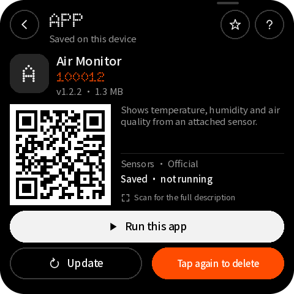

| 名称 | 类型 | x, y, w, h | 样式 | 内容 / 动作 |
|---|---|---|---|---|
| `button_back_detail` | button | 16, 16, 48, 48 | #000000 | → `back` |
| `button_help_detail` | button | 416, 16, 48, 48 | #000000 | → `help:ids` |
| `button_favorite_off` | button | 360, 16, 48, 48 | #000000 | → `app:favorite` |
| `detail_title` | label | 80, 18, 264, 32 | dot 32px #F2F2F2 | APP |
| `detail_subtitle` | label | 80, 54, 264, 19 | sans 15px #9A9A9A | Saved on this device |
| `detail_tile` | container | 16, 88, 64, 64 | #262626 |  |
| `detail_initial` | label | 16, 102, 64, 40 | dot 40px #F2F2F2 | A |
| `detail_name` | label | 92, 87, 372, 25 | medium 20px #F2F2F2 | Air Monitor |
| `detail_id` | label | 92, 115, 200, 22 | dot 22px #FF4C01 | 100012 |
| `detail_meta` | label | 92, 140, 372, 19 | sans 15px #9A9A9A | v1.2.2 · 1.3 MB |
| `button_qr_app_code` | image | 16, 170, 165, 165 | QR，每模块 5 px | app-100012.png |
| `button_qr_app` | button | 16, 170, 165, 165 |  | → `qr:app` |
| `detail_summary` | label | 197, 170, 267, 75 | sans 15px #9A9A9A 换行 | Shows temperature, humidity and air quality from an attached sensor. |
| `detail_facts` | label | 197, 258, 267, 19 | sans 15px #9A9A9A | Sensors · Official |
| `detail_status` | label | 197, 283, 267, 19 | medium 15px #F2F2F2 | Saved · not running |
| `button_primary` | button | 16, 344, 448, 52 | medium 17px #000000 | Run this app → `app:run` |
| `button_secondary` | button | 16, 404, 216, 52 | medium 17px #F2F2F2 | Update → `app:update` |
| `button_delete_confirm` | button | 248, 404, 216, 52 | medium 15px #FFFFFF | Tap again to delete → `app:delete` |
| `ai_cue` | container | 354, 3, 36, 4 | #3A3A3A |  |

## detail-remote — Detail · found on Mosaico Ideas

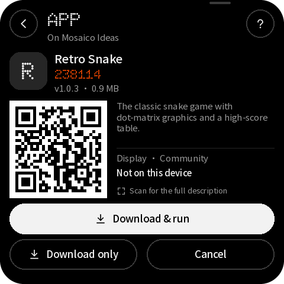

| 名称 | 类型 | x, y, w, h | 样式 | 内容 / 动作 |
|---|---|---|---|---|
| `button_back_detail` | button | 16, 16, 48, 48 | #000000 | → `back` |
| `button_help_detail` | button | 416, 16, 48, 48 | #000000 | → `help:ids` |
| `detail_title` | label | 80, 18, 320, 32 | dot 32px #F2F2F2 | APP |
| `detail_subtitle` | label | 80, 54, 320, 19 | sans 15px #9A9A9A | On Mosaico Ideas |
| `detail_tile` | container | 16, 88, 64, 64 | #262626 |  |
| `detail_initial` | label | 16, 102, 64, 40 | dot 40px #F2F2F2 | R |
| `detail_name` | label | 92, 87, 372, 25 | medium 20px #F2F2F2 | Retro Snake |
| `detail_id` | label | 92, 115, 200, 22 | dot 22px #FF4C01 | 238114 |
| `detail_meta` | label | 92, 140, 372, 19 | sans 15px #9A9A9A | v1.0.3 · 0.9 MB |
| `button_qr_app_code` | image | 16, 170, 165, 165 | QR，每模块 5 px | app-238114.png |
| `button_qr_app` | button | 16, 170, 165, 165 |  | → `qr:app` |
| `detail_summary` | label | 197, 170, 267, 75 | sans 15px #9A9A9A 换行 | The classic snake game with dot-matrix graphics and a high-score table. |
| `detail_facts` | label | 197, 258, 267, 19 | sans 15px #9A9A9A | Display · Community |
| `detail_status` | label | 197, 283, 267, 19 | medium 15px #F2F2F2 | Not on this device |
| `button_primary` | button | 16, 344, 448, 52 | medium 17px #000000 | Download & run → `store:run` |
| `button_secondary` | button | 16, 404, 216, 52 | medium 17px #F2F2F2 | Download only → `store:keep` |
| `button_tertiary` | button | 248, 404, 216, 52 | medium 17px #F2F2F2 | Cancel → `back` |
| `ai_cue` | container | 354, 3, 36, 4 | #3A3A3A |  |

## detail-update — Detail · update available

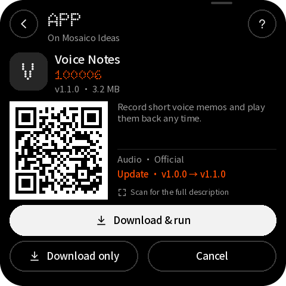

| 名称 | 类型 | x, y, w, h | 样式 | 内容 / 动作 |
|---|---|---|---|---|
| `button_back_detail` | button | 16, 16, 48, 48 | #000000 | → `back` |
| `button_help_detail` | button | 416, 16, 48, 48 | #000000 | → `help:ids` |
| `detail_title` | label | 80, 18, 320, 32 | dot 32px #F2F2F2 | APP |
| `detail_subtitle` | label | 80, 54, 320, 19 | sans 15px #9A9A9A | On Mosaico Ideas |
| `detail_tile` | container | 16, 88, 64, 64 | #262626 |  |
| `detail_initial` | label | 16, 102, 64, 40 | dot 40px #F2F2F2 | V |
| `detail_name` | label | 92, 87, 372, 25 | medium 20px #F2F2F2 | Voice Notes |
| `detail_id` | label | 92, 115, 200, 22 | dot 22px #FF4C01 | 100006 |
| `detail_meta` | label | 92, 140, 372, 19 | sans 15px #9A9A9A | v1.1.0 · 3.2 MB |
| `button_qr_app_code` | image | 16, 170, 165, 165 | QR，每模块 5 px | app-100006.png |
| `button_qr_app` | button | 16, 170, 165, 165 |  | → `qr:app` |
| `detail_summary` | label | 197, 170, 267, 75 | sans 15px #9A9A9A 换行 | Record short voice memos and play them back any time. |
| `detail_facts` | label | 197, 258, 267, 19 | sans 15px #9A9A9A | Audio · Official |
| `detail_status_accent` | label | 197, 283, 267, 19 | medium 15px #FF4C01 | Update · v1.0.0 → v1.1.0 |
| `button_primary` | button | 16, 344, 448, 52 | medium 17px #000000 | Download & run → `store:run` |
| `button_secondary` | button | 16, 404, 216, 52 | medium 17px #F2F2F2 | Download only → `store:keep` |
| `button_tertiary` | button | 248, 404, 216, 52 | medium 17px #F2F2F2 | Cancel → `back` |
| `ai_cue` | container | 354, 3, 36, 4 | #3A3A3A |  |

## qr-full — Any QR code, enlarged

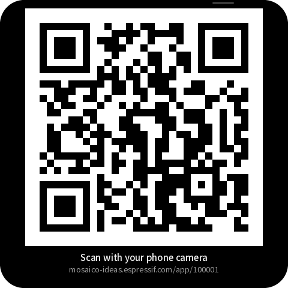

| 名称 | 类型 | x, y, w, h | 样式 | 内容 / 动作 |
|---|---|---|---|---|
| `qr_full_code` | image | 42, 14, 396, 396 | QR，每模块 12 px | app-100001.png |
| `qr_full_title` | label | 16, 420, 448, 19 | medium 15px #F2F2F2 | Scan with your phone camera |
| `qr_full_url` | label | 16, 441, 448, 17 | sans 13px #9A9A9A | mosaico-ideas.espressif.com/app/100001 |
| `button_qr_close` | button | 0, 0, 480, 480 |  | → `back` |
| `ai_cue` | container | 354, 3, 36, 4 | #3A3A3A |  |

## progress-agent — Progress · from the AI agent

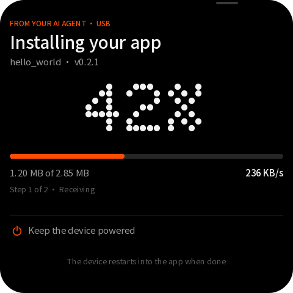

| 名称 | 类型 | x, y, w, h | 样式 | 内容 / 动作 |
|---|---|---|---|---|
| `progress_caption` | label | 16, 31, 448, 15 | medium 12px #FF4C01 | FROM YOUR AI AGENT · USB |
| `progress_title` | label | 16, 52, 448, 35 | medium 28px #F2F2F2 | Installing your app |
| `progress_detail` | label | 16, 92, 448, 19 | sans 15px #9A9A9A | hello_world · v0.2.1 |
| `progress_percent` | label | 16, 126, 448, 112 | dot 112px #F2F2F2 | 42% |
| `progress` | progress | 16, 252, 448, 8 | #262626 |  |
| `progress_bytes` | label | 16, 274, 280, 19 | sans 15px #9A9A9A | 1.20 MB of 2.85 MB |
| `progress_rate` | label | 296, 274, 168, 19 | medium 15px #F2F2F2 | 236 KB/s |
| `progress_step` | label | 16, 302, 448, 17 | sans 13px #5C5C5C | Step 1 of 2 · Receiving |
| `ai_cue` | container | 354, 3, 36, 4 | #3A3A3A |  |

## progress-download — Progress · download

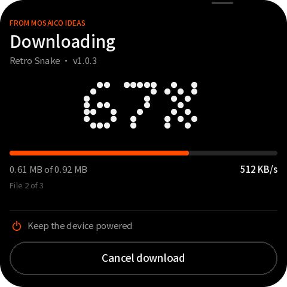

| 名称 | 类型 | x, y, w, h | 样式 | 内容 / 动作 |
|---|---|---|---|---|
| `progress_caption` | label | 16, 31, 448, 15 | medium 12px #FF4C01 | FROM MOSAICO IDEAS |
| `progress_title` | label | 16, 52, 448, 35 | medium 28px #F2F2F2 | Downloading |
| `progress_detail` | label | 16, 92, 448, 19 | sans 15px #9A9A9A | Retro Snake · v1.0.3 |
| `progress_percent` | label | 16, 126, 448, 112 | dot 112px #F2F2F2 | 67% |
| `progress` | progress | 16, 252, 448, 8 | #262626 |  |
| `progress_bytes` | label | 16, 274, 280, 19 | sans 15px #9A9A9A | 0.61 MB of 0.92 MB |
| `progress_rate` | label | 296, 274, 168, 19 | medium 15px #F2F2F2 | 512 KB/s |
| `progress_step` | label | 16, 302, 448, 17 | sans 13px #5C5C5C | File 2 of 3 |
| `button_cancel` | button | 16, 404, 448, 56 | medium 17px #F2F2F2 | Cancel download → `store:cancel` |
| `ai_cue` | container | 354, 3, 36, 4 | #3A3A3A |  |

## progress-install — Progress · switching apps

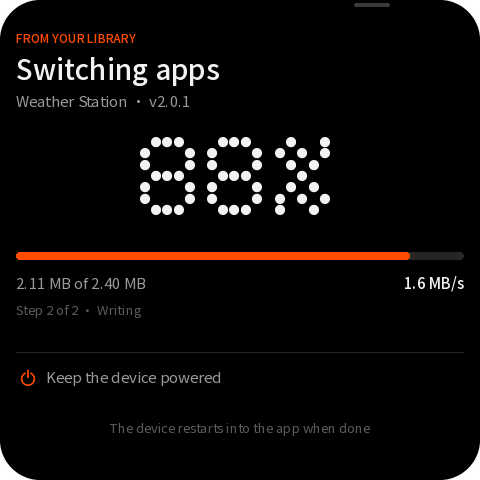

| 名称 | 类型 | x, y, w, h | 样式 | 内容 / 动作 |
|---|---|---|---|---|
| `progress_caption` | label | 16, 31, 448, 15 | medium 12px #FF4C01 | FROM YOUR LIBRARY |
| `progress_title` | label | 16, 52, 448, 35 | medium 28px #F2F2F2 | Switching apps |
| `progress_detail` | label | 16, 92, 448, 19 | sans 15px #9A9A9A | Weather Station · v2.0.1 |
| `progress_percent` | label | 16, 126, 448, 112 | dot 112px #F2F2F2 | 88% |
| `progress` | progress | 16, 252, 448, 8 | #262626 |  |
| `progress_bytes` | label | 16, 274, 280, 19 | sans 15px #9A9A9A | 2.11 MB of 2.40 MB |
| `progress_rate` | label | 296, 274, 168, 19 | medium 15px #F2F2F2 | 1.6 MB/s |
| `progress_step` | label | 16, 302, 448, 17 | sans 13px #5C5C5C | Step 2 of 2 · Writing |
| `ai_cue` | container | 354, 3, 36, 4 | #3A3A3A |  |

## result-installed — Result · installed

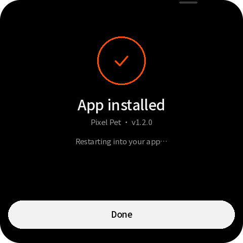

| 名称 | 类型 | x, y, w, h | 样式 | 内容 / 动作 |
|---|---|---|---|---|
| `result_ring` | container | 192, 72, 96, 96 | #000000 |  |
| `result_icon` | image | 220, 100, 40, 40 |  | check-40-orange.png |
| `result_title` | label | 16, 190, 448, 35 | medium 28px #F2F2F2 | App installed |
| `result_caption` | label | 16, 232, 448, 19 | sans 15px #9A9A9A | Pixel Pet · v1.2.0 |
| `result_detail` | label | 40, 270, 400, 19 | sans 15px #9A9A9A | Restarting into your app… |
| `button_done` | button | 16, 396, 448, 56 | medium 17px #000000 | Done → `go:home` |
| `ai_cue` | container | 354, 3, 36, 4 | #3A3A3A |  |

## result-saved — Result · saved

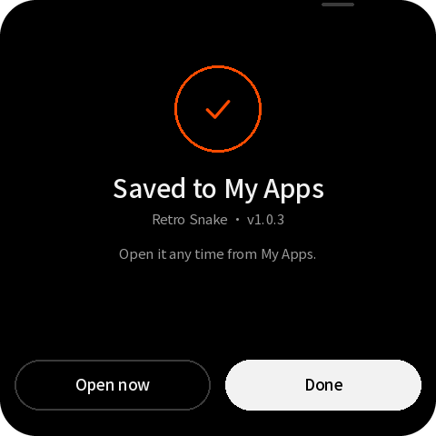

| 名称 | 类型 | x, y, w, h | 样式 | 内容 / 动作 |
|---|---|---|---|---|
| `result_ring` | container | 192, 72, 96, 96 | #000000 |  |
| `result_icon` | image | 220, 100, 40, 40 |  | check-40-orange.png |
| `result_title` | label | 16, 190, 448, 35 | medium 28px #F2F2F2 | Saved to My Apps |
| `result_caption` | label | 16, 232, 448, 19 | sans 15px #9A9A9A | Retro Snake · v1.0.3 |
| `result_detail` | label | 40, 270, 400, 19 | sans 15px #9A9A9A | Open it any time from My Apps. |
| `button_result_second` | button | 16, 396, 216, 56 | medium 17px #F2F2F2 | Open now → `result:second` |
| `button_done` | button | 248, 396, 216, 56 | medium 17px #000000 | Done → `go:home` |
| `ai_cue` | container | 354, 3, 36, 4 | #3A3A3A |  |

## result-failed — Result · failed

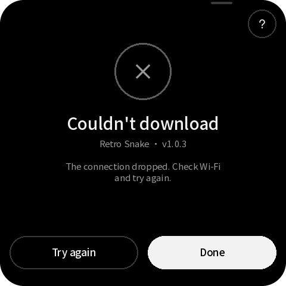

| 名称 | 类型 | x, y, w, h | 样式 | 内容 / 动作 |
|---|---|---|---|---|
| `result_ring` | container | 192, 72, 96, 96 | #000000 |  |
| `result_icon` | image | 220, 100, 40, 40 |  | close-40-grey.png |
| `result_title` | label | 16, 190, 448, 35 | medium 28px #F2F2F2 | Couldn't download |
| `result_caption` | label | 16, 232, 448, 19 | sans 15px #9A9A9A | Retro Snake · v1.0.3 |
| `result_detail` | label | 40, 270, 400, 38 | sans 15px #9A9A9A | The connection dropped. Check Wi-Fi ⏎ and try again. |
| `button_result_second` | button | 16, 396, 216, 56 | medium 17px #F2F2F2 | Try again → `result:second` |
| `button_done` | button | 248, 396, 216, 56 | medium 17px #000000 | Done → `go:home` |
| `button_help_result` | button | 416, 16, 48, 48 | #000000 | → `help:fix` |
| `ai_cue` | container | 354, 3, 36, 4 | #3A3A3A |  |

## help — Help topics

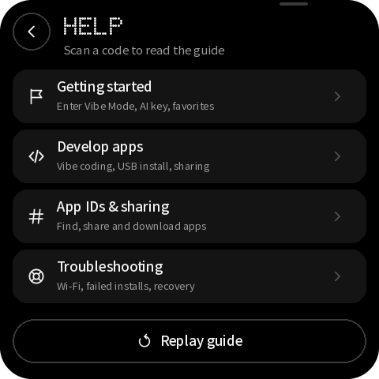

| 名称 | 类型 | x, y, w, h | 样式 | 内容 / 动作 |
|---|---|---|---|---|
| `button_back_help` | button | 16, 16, 48, 48 | #000000 | → `back` |
| `help_title` | label | 80, 18, 384, 32 | dot 32px #F2F2F2 | HELP |
| `help_subtitle` | label | 80, 54, 384, 19 | sans 15px #9A9A9A | Scan a code to read the guide |
| `topic_start` | button | 16, 88, 448, 68 | #141414 | → `help:start` |
| `topic_develop` | button | 16, 164, 448, 68 | #141414 | → `help:develop` |
| `topic_ids` | button | 16, 240, 448, 68 | #141414 | → `help:ids` |
| `topic_fix` | button | 16, 316, 448, 68 | #141414 | → `help:fix` |
| `button_replay` | button | 16, 404, 448, 56 | medium 17px #F2F2F2 | Replay guide → `guide:1` |
| `ai_cue` | container | 354, 3, 36, 4 | #3A3A3A |  |

## help-topic — Help topic with QR

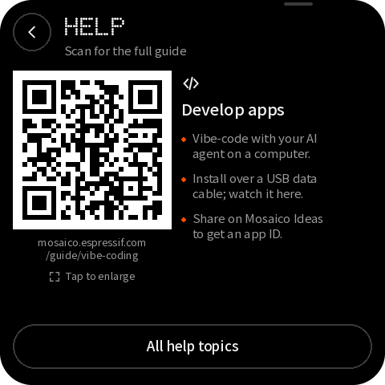

| 名称 | 类型 | x, y, w, h | 样式 | 内容 / 动作 |
|---|---|---|---|---|
| `button_back_topic` | button | 16, 16, 48, 48 | #000000 | → `back` |
| `topic_title` | label | 80, 18, 384, 32 | dot 32px #F2F2F2 | HELP |
| `topic_subtitle` | label | 80, 54, 384, 19 | sans 15px #9A9A9A | Scan for the full guide |
| `button_qr_topic_code` | image | 16, 88, 198, 198 | QR，每模块 6 px | develop.png |
| `button_qr_topic` | button | 16, 88, 198, 198 |  | → `qr:develop` |
| `topic_url` | label | 16, 294, 198, 33 | sans 13px #9A9A9A | mosaico.espressif.com ⏎ /guide/vibe-coding |
| `topic_icon` | image | 226, 92, 24, 24 |  | code-24-white.png |
| `topic_title` | label | 226, 124, 238, 25 | medium 20px #F2F2F2 | Develop apps |
| `topic_point_0` | label | 240, 163, 224, 38 | sans 15px #9A9A9A | Vibe-code with your AI ⏎ agent on a computer. |
| `topic_point_1` | label | 240, 213, 224, 38 | sans 15px #9A9A9A | Install over a USB data ⏎ cable; watch it here. |
| `topic_point_2` | label | 240, 263, 224, 38 | sans 15px #9A9A9A | Share on Mosaico Ideas ⏎ to get an app ID. |
| `button_topics` | button | 16, 404, 448, 56 | medium 17px #F2F2F2 | All help topics → `help:topics` |
| `ai_cue` | container | 354, 3, 36, 4 | #3A3A3A |  |

## wifi — Wi-Fi

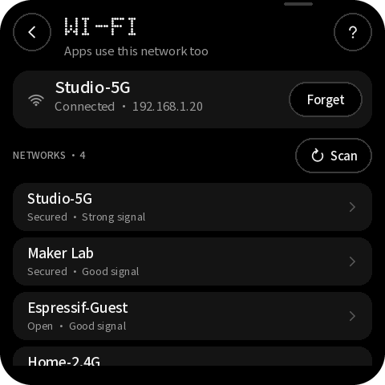

| 名称 | 类型 | x, y, w, h | 样式 | 内容 / 动作 |
|---|---|---|---|---|
| `button_back_wifi` | button | 16, 16, 48, 48 | #000000 | → `back` |
| `button_help_wifi` | button | 416, 16, 48, 48 | #000000 | → `help:fix` |
| `wifi_title` | label | 80, 18, 320, 32 | dot 32px #F2F2F2 | WI-FI |
| `wifi_subtitle` | label | 80, 54, 320, 19 | sans 15px #9A9A9A | Apps use this network too |
| `wifi_connection` | label | 68, 96, 280, 25 | medium 20px #F2F2F2 | Studio-5G |
| `wifi_detail` | label | 68, 123, 280, 19 | sans 15px #9A9A9A | Connected · 192.168.1.20 |
| `button_forget` | button | 360, 102, 92, 44 | medium 15px #F2F2F2 | Forget → `wifi:forget` |
| `wifi_scan` | label | 16, 186, 300, 15 | medium 12px #9A9A9A | NETWORKS · 4 |
| `button_scan` | button | 368, 172, 96, 44 | medium 15px #F2F2F2 | Scan → `wifi:scan` |
| `networks` | list | 16, 228, 448, 228 | 行高 68 | 行模板 `networks_row` |
| `ai_cue` | container | 354, 3, 36, 4 | #3A3A3A |  |

## password — Wi-Fi password

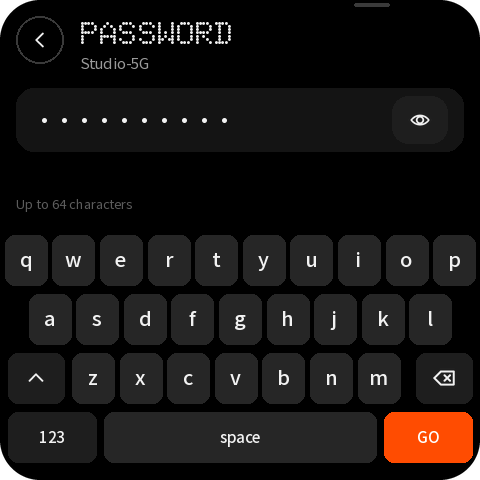

| 名称 | 类型 | x, y, w, h | 样式 | 内容 / 动作 |
|---|---|---|---|---|
| `button_back_password` | button | 16, 16, 48, 48 | #000000 | → `back` |
| `password_title` | label | 80, 18, 384, 32 | dot 32px #F2F2F2 | PASSWORD |
| `password_subtitle` | label | 80, 54, 384, 19 | sans 15px #9A9A9A | Studio-5G |
| `password_display` | label | 34, 108, 340, 25 | medium 20px #F2F2F2 | •••••••••• |
| `button_toggle_password` | button | 392, 96, 56, 48 | #1E1E1E | → `password:toggle` |
| `password_note` | label | 16, 165, 448, 19 | sans 15px #FF4C01 |   |
| `password_keyboard` | keyboard | 0, 231, 480, 233 |  |  |
| `ai_cue` | container | 354, 3, 36, 4 | #3A3A3A |  |

## device — Device · shared settings

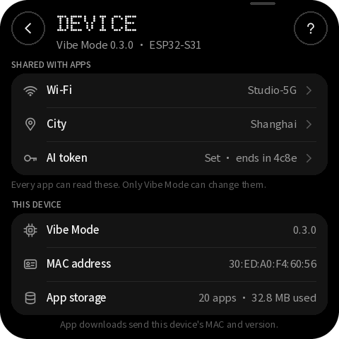

| 名称 | 类型 | x, y, w, h | 样式 | 内容 / 动作 |
|---|---|---|---|---|
| `button_back_device` | button | 16, 16, 48, 48 | #000000 | → `back` |
| `button_help_device` | button | 416, 16, 48, 48 | #000000 | → `help:fix` |
| `device_title` | label | 80, 18, 320, 32 | dot 32px #F2F2F2 | DEVICE |
| `device_subtitle` | label | 80, 54, 320, 19 | sans 15px #9A9A9A | Vibe Mode 0.3.0 · ESP32-S31 |
| `button_device_wifi` | button | 16, 104, 448, 48 |  | → `go:wifi` |
| `device_wifi` | label | 196, 118, 224, 19 | sans 15px #9A9A9A | Studio-5G |
| `button_device_city` | button | 16, 152, 448, 48 |  | → `go:city` |
| `device_city` | label | 196, 166, 224, 19 | sans 15px #9A9A9A | Shanghai |
| `button_device_token` | button | 16, 200, 448, 48 |  | → `go:token` |
| `device_token` | label | 196, 214, 224, 19 | sans 15px #9A9A9A | Set · ends in 4c8e |
| `device_version` | label | 206, 316, 242, 19 | sans 15px #9A9A9A | 0.3.0 |
| `device_mac` | label | 206, 364, 242, 19 | sans 15px #9A9A9A | 30:ED:A0:F4:60:56 |
| `device_storage` | label | 206, 412, 242, 19 | sans 15px #9A9A9A | 20 apps · 32.8 MB used |
| `ai_cue` | container | 354, 3, 36, 4 | #3A3A3A |  |

## city — City (shared)

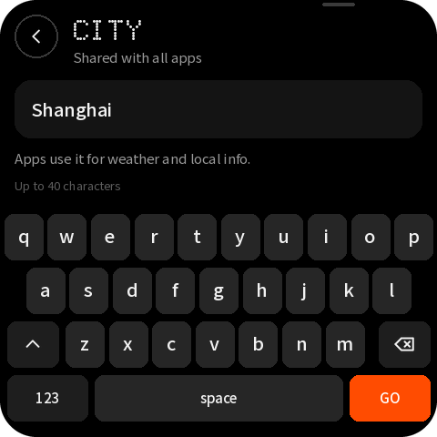

| 名称 | 类型 | x, y, w, h | 样式 | 内容 / 动作 |
|---|---|---|---|---|
| `button_back_city` | button | 16, 16, 48, 48 | #000000 | → `back` |
| `city_title` | label | 80, 18, 384, 32 | dot 32px #F2F2F2 | CITY |
| `city_subtitle` | label | 80, 54, 384, 19 | sans 15px #9A9A9A | Shared with all apps |
| `city_display` | label | 34, 108, 340, 25 | medium 20px #F2F2F2 | Shanghai |
| `city_note` | label | 16, 165, 448, 19 | sans 15px #9A9A9A | Apps use it for weather and local info. |
| `city_keyboard` | keyboard | 0, 231, 480, 233 |  |  |
| `ai_cue` | container | 354, 3, 36, 4 | #3A3A3A |  |

## token — AI token (shared)

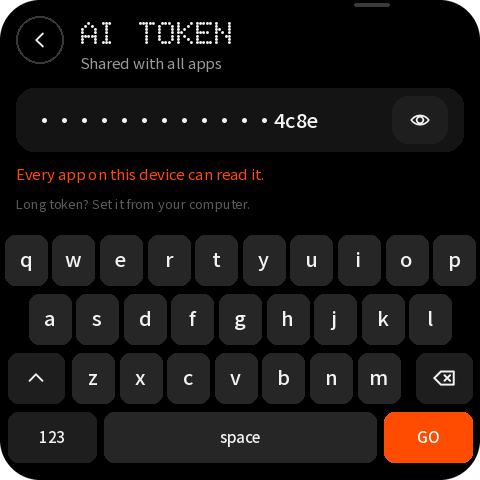

| 名称 | 类型 | x, y, w, h | 样式 | 内容 / 动作 |
|---|---|---|---|---|
| `button_back_token` | button | 16, 16, 48, 48 | #000000 | → `back` |
| `token_title` | label | 80, 18, 384, 32 | dot 32px #F2F2F2 | AI TOKEN |
| `token_subtitle` | label | 80, 54, 384, 19 | sans 15px #9A9A9A | Shared with all apps |
| `token_display` | label | 34, 108, 340, 25 | medium 20px #F2F2F2 | ••••••••••••4c8e |
| `button_toggle_token` | button | 392, 96, 56, 48 | #1E1E1E | → `token:toggle` |
| `token_note` | label | 16, 165, 448, 19 | sans 15px #FF4C01 | Every app on this device can read it. |
| `token_keyboard` | keyboard | 0, 231, 480, 233 |  |  |
| `ai_cue` | container | 354, 3, 36, 4 | #3A3A3A |  |

